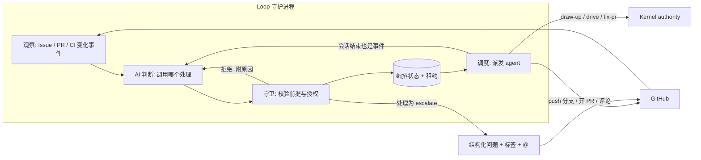

# Loop 守护进程：无人值守地规划与推进 Issue

状态：设计提案，未实施。第 2 节的决策由仓库所有者在 2026-11-10 确定；它们修订已接受的契约（第 14 节），在对应 ADR 与 Spec 落地前，现有 `CONTEXT.md`、ADR 和 BASELINE 的文字仍然有效。本文不创建 Managed authority。

## 1. 结论

Loop 增加第二种运行形态：一个**独立守护进程**，可运行在本机或云端机器。它的目标只有一个：**让每个打开的 Issue 持续向“已合并关闭”前进**。

- **持续推进**：只要存在“下一步归守护进程”的 Issue 且有空闲容量，守护进程就在工作。一步完成后立即接下一步（分析 → 计划 → 实现 → 开 PR → 修到就绪），不等定时点。定时器只用来发现外部变化和停滞的工作项。
- **AI 判断每个事件怎么处理**：每个外部对象的变化事件交给 AI 判断应调用哪个处理；代码负责观察、校验权限前提和执行。封闭的分类问题先用决策模型，拿不准的再交判断 agent。
- **调度 agent 干活**：守护进程自己不写代码，它调度判断、分析、规划、执行、修复五类 agent，并只凭可核对的证据确认结果。执行这一段复用现有的 Parent 与 Lane 机制。
- **人工等待不停线**：某个 Issue 等人时，守护进程转去推进其他 Issue，并提前为后面的 Issue 做好计划。
- **只在需要判断时唤起人**：在 GitHub 上提出一个结构化问题；人回复后立即续跑。routine 任务从 Issue 到 PR 就绪全程无人工环节，合并是唯一的人工检查。

Loop 仍不是 authority 源：Enrollment、QA、Review、Settlement 只由 Kernel 完成。开始执行的原生 gate 有两种替代：routine 风险的任务按仓库声明的策略免批准直接开始；material 与 critical 任务改为所有者在 GitHub 上异步批准。

两种形态的差别：

| | 会话内 Loop（现有） | Loop 守护进程（新增） |
| --- | --- | --- |
| 触发 | 字面用户在会话里输入 `drive`（`docs/adr/0019-explicit-run-entry-owns-enrollment.md:30`） | 自驱：上一步完成、外部事件、定时检查 |
| 生命周期 | 会话内；`SessionEnd` 丢弃 entry token（`docs/adr/0025-run-entry-decision-hosting.md:54`） | 跨会话常驻；每轮从持久事实恢复 |
| 管理对象 | 一个 Task 或一个 Initiative（`CONTEXT.md:17`） | 仓库内所有打开的 Issue 及其 Task、PR |
| 规划 | 不规划；`draw-up` 由用户另行进入 | 主动为 Issue 进入 `draw-up` |

## 2. 已确定的决策

| # | 决策 | 结论 |
| --- | --- | --- |
| D1 | 开始执行的批准 | 所有者在 Issue 上对 TaskIntent 内容哈希的评论批准，等价于原生 Enrollment gate。仅限所有者，哈希绑定（§10.1）。适用于 material 与 critical 任务，见 D12 |
| D2 | push 与 PR | 接受有范围的常设授权，默认关闭、按仓库启用（§10.2） |
| D3 | 运行位置 | 独立守护进程，本机或云端机器均可（§5.2、§10.3） |
| D4 | 合并 | PR 就绪后由人合并，不启用 auto-merge |
| D5 | 命名 | 修改 Loop 的定义，不引入新词（§3） |
| D6 | 唤起渠道 | 仅 GitHub @ 提及 |
| D7 | 推进方式 | 守护进程持续推进 Issue 实现，不是按周期巡检一轮后等待（§6） |
| D8 | 事件处理 | 每个对象的变化事件由 AI 判断对应的处理调用（§7） |
| D9 | 职责 | Loop 负责持续推进项目进度，并调度 agent 完成实现与处理工作（§8、§9.4） |
| D10 | 同一操作系统用户部署 | 允许；在 `status` 与状态 Issue 中标注为降级（§10.3） |
| D11 | 决策模型 | 在 §7.5 判定为适合的环节直接启用，不做影子运行（§7.6） |
| D12 | routine 任务 | 免批准，规划完成后直接开始执行（§10.4） |

D10–D12 带来的后果见第 15 节。

## 3. Loop 的新定义

现定义（`CONTEXT.md:29-31`）：

> The user-facing continuation entry for an enrolled task. It projects the current owner to the next bounded internal role or Kernel operation without becoming a second authority source.

拟改为：

> **Loop**:
> The continuation mechanism that projects current facts to the next bounded internal role, Kernel operation or public entry, without becoming a second authority source. It runs in two forms. In a session, after an explicit `drive` entry, it continues one enrolled Task or Initiative. As the Loop daemon, a standing process, it observes the tracker, pull requests and CI, plans open Issues, and dispatches bounded agents that start or resume those entries across sessions.
> _Avoid_: workflow engine, checkpoint store, scheduler authority

连带影响：

- **Internal Role**（`CONTEXT.md:33`）“dispatched by Loop”保持成立，无需改。
- **Run binding** 的 _Avoid_ 列有 “second scheduler”（`CONTEXT.md:19`）。它约束的是 Run binding 这个词的用法，不禁止守护进程存在；但守护进程不得持有或伪造 Run binding，每个被派发的会话各自建立自己的绑定。
- `docs/proposals/managed-workflow-simplification.md:16` 写明“不新增通用调度器”。本提案与该句冲突，需要在 ADR 中明确边界：守护进程只调度 §8.1 的五类 agent；`drive` 内部的角色仍由会话内 Loop 与 Kernel 调度；batch 的状态转换仍只属于 batch runner。
- 本文其余部分以“守护进程”指 Loop 的这一形态。`CONTEXT.md` 的实际修改随 ADR 落地，本提案不改它。

## 4. 当前流程阻塞点

每一行是“人不在场时流程会停住”的位置。

| # | 阻塞点 | 证据 | 性质 | 处理 |
| --- | --- | --- | --- | --- |
| B1 | 没有任何机制主动挑选 Issue 并开始规划；规划要用户进入 `draw-up`，Planner 产出候选后即停 | `docs/adr/0019-explicit-run-entry-owns-enrollment.md:28` | 机械（启动）＋判断（计划是否正确） | 守护进程主动挑选并进入 `draw-up`；计划是否正确由 B2 的批准承担（§6.4） |
| B2 | 开始执行必须有字面用户的 `drive` 入口和一次原生 Enrollment gate | `docs/adr/0019-explicit-run-entry-owns-enrollment.md:30`，`docs/adr/0025-run-entry-decision-hosting.md:41` | 人工判断 | routine 任务免批准（§10.4）；material 与 critical 保留判断，改为异步批准（§10.1） |
| B3 | 会话结束即停止推进：entry token 随会话结束失效；第三次原生操作失败后只有新的字面入口能恢复 | `docs/adr/0025-run-entry-decision-hosting.md:54`，`plugins/immune-brain/dist/drive.md:265` | 机械 | 会话结束不是停止点：按 Kernel projection 恢复并重新派发，直到 Settlement；到失败上限才升级（§6.2、§8.4） |
| B4 | push、PR 创建各自需要确认；Batch Branch 从不 push、从不开 PR | `docs/adr/0025-run-entry-decision-hosting.md:49`，`plugins/immune-brain/dist/BASELINE.md:112`，`CONTEXT.md:141` | 机械 | 常设授权（§10.2） |
| B5 | `fix-pr` 只在用户明确请求时进入；修复请求不授予 push 或回复评论 | `plugins/immune-brain/skills/fix-pr/SKILL.md:3`，`plugins/immune-brain/dist/fix-pr.md:87` | 机械＋判断 | CI 红与冲突自动修；有争议的 review 意见升级（§6.5） |
| B6 | `manual` Git 集成下 batch 以最终报告结束，留下 Parent 分支 | `docs/adr/0027-parent-branch-merge-queue.md:46` | 机械 | 以 PR 作为回到 main 的通道，人合并 |
| B7 | breaking Intent revision、`awaiting_user`、rework 出口、Review 重试授权 | `plugins/immune-brain/dist/drive.md:205`，`:292`，`:265` | **真正的人工判断** | 不绕过，转成结构化问题，只停该工作项（§9） |
| B8 | tracker 适配器是单向投影，不读事件 | `CONTEXT.md:264` | 能力缺口 | 新增只读观察层（§5.2） |
| B9 | Lane 只能由用户删除，无人值守下会累积 | `CONTEXT.md:149`，`docs/adr/0027-parent-branch-merge-queue.md:34` | 不阻塞推进，占磁盘 | 本提案不解决；状态 Issue 报告待清理数量 |

保留的人工点只有 B2 中的 material 与 critical 批准、B7，外加合并（D4）。

## 5. 总体结构

### 5.1 结构图



分工：**观察、守卫、调度是确定性代码；“这个事件该怎么处理”由 AI 判断；实际工作由被调度的 agent 完成。**

### 5.2 进程形态

- CLI `imm-loop`：`daemon` 常驻运行；`tick` 执行一轮后退出（供调试与外部定时器使用）；`status` 只读；`--dry-run` 对 GitHub 与仓库零写入。`daemon` 只是按节拍重复 `tick`，所有正确性都在 `tick` 里。
- 每个仓库一个实例，用锁文件保证；进程崩溃后下一轮从持久状态恢复，不依赖内存。
- 三种唤醒执行同一个 `tick`：**完成唤醒**（某个被派发的会话结束，立即执行）；**观察唤醒**（分钟级轮询评论、PR、CI、新 Issue）；**全量对账**（低频，重新读取全部打开的 Issue 与 PR，纠正漏掉的事件）。Webhook 只是加速器，正确性只依赖轮询。
- 每轮读取：打开的 Issue 及游标之后的评论；守护进程自己开的 PR 的 head SHA、mergeable、check runs、review threads；Kernel 只读投影 `imm-kernel inspect --json`（`CONTEXT.md:109`）。
- 编排状态存于 Git-ignored 的 `.imm/state/loop/`（§11），与 batch 的做法一致：它只记录进度，引用的每个 authority 事实仍是 Kernel 的 TaskRecord（`docs/adr/0005-unattended-initiative-batch-run.md` Decision 3）。

### 5.3 一轮 tick 的步骤

```text
tick():
  1 取实例锁，读编排状态
  2 回收  检查进行中的派发：已结束的产生内部事件；租约过期的标记为可重派
  3 观察  读 GitHub 游标之后的变化与 Kernel projection，产生事件；丢弃自身造成的变化
  4 判断  按对象合并事件，逐个经判断阶梯得到决策（§7）
  5 守卫  校验每个决策；通过的写入“待执行处理”，拒绝的回送重判或升级
  6 调度  按 §6.4 排序，在槽位、scope 冲突、背压、预算允许的范围内派发 agent（§8）
  7 停滞  下一步归守护进程、却既无进行中派发也无待执行处理的工作项，产生 stalled 事件
  8 发布  状态 Issue 内容有变化才更新；写回编排状态，释放锁
```

两条保证：

- **先记后做。** 决策与派发记录在产生副作用之前落盘。崩溃后重放时，每个处理带幂等键（工作项、事件 id、处理名）。
- **远端写入可核对。** 守护进程写的每条评论带隐藏标记。写入结果不明时不盲目重试，先按标记重新读取确认是否已写入。

### 5.4 守护进程是无头 Parent：复用现有机制

现有的 batch 与单任务 `drive` 已经是“Parent 调度、Lane 里的 Executor 执行”的结构。守护进程不另造一套，而是成为第四个组合根（现有三个是 Pi、Claude Code、Antigravity，`docs/adr/0037-authority-review-cli-stage.md:74`），一个没有交互界面的 Parent。

| 守护进程需要 | 现有机制 | 证据 | 缺口 |
| --- | --- | --- | --- |
| 无头启动执行 agent | `LaneSupervisor` 在 Lane 目录里以 `--print … /drive <task_id>` 启动 Host CLI | `plugins/immune-brain/runtime/unattended/lane_supervisor.ts:22-36`、`:69` | 无 |
| 会话退出后续跑 | `superviseLane`：进程退出后读 Kernel projection，任务仍 active 且不在等人就启动下一代 | 同文件 `:192-229` | 无 |
| 无进展上限 | 连续 2 代未推进 → `lane_executor_no_progress` | 同文件 `:209`、`:228` | 无 |
| Lane 里出现人工决策 | `laneDecisionFacts` 识别等待；`relayLaneDecision` 把 Parent 的答复写入 Lane 并启动下一代 | `plugins/immune-brain/runtime/unattended/lane_decision.ts:31`、`:93` | 答复目前来自 Parent 的原生 gate；守护进程要改为来自经校验的 GitHub 回复 |
| Enrollment 与 batch 启动 | `startBatch`，含单任务形态 | `plugins/immune-brain/runtime/unattended/batch_runner.ts:109-111`、`:261` | 启动所需的 capability 在原生确认后签发；Claude Host 在没有交互式 elicitation 时直接拒绝（`unsupported_host`，`plugins/immune-brain/runtime/claude/kernel_ports.ts:447`）。守护进程需要自己的确认来源，即 §10.1 的批准校验 |
| 并行与 scope 冲突 | `startableChildren`、`projectScopeOverlap` | `plugins/immune-brain/runtime/unattended/batch_schedule.ts:157`、`:114` | 目前只在一个 batch 内；跨 Issue 需要守护进程一层 |
| Initiative 内逐个集成 | Parent 分支与合并队列 | `docs/adr/0027-parent-branch-merge-queue.md` Decision 3 | 无 |
| 关闭 Child Issue | `BatchTrackerPort.markTerminal` | `plugins/immune-brain/runtime/unattended/batch_runner.ts:164` | 无 |
| 选择执行与 Review 的 Host、模型 | `lanes.executor_*`、`lanes.review_*`、`max_parallel` | `plugins/immune-brain/runtime/config/layered_config.ts:81` | 判断、分析、规划、修复 agent 的配置是新增的 |

结论：

- **执行这一段几乎全部复用。** 守护进程只是 `startBatch` 的又一个调用方；batch 状态转换仍只属于 `runtime/unattended/`（`docs/adr/0005-unattended-initiative-batch-run.md` Decision 4）。
- **新增代码集中在五处**：观察与事件、判断与守卫、以 GitHub 批准为来源的确认、把人工决策发到 GitHub 并把答复接回 `relayLaneDecision`、规划与 PR 修复的派发。
- **一个要在 Spec 里解决的缺口**：Executor 进程句柄只存在于启动它的进程里（`plugins/immune-brain/runtime/unattended/lane_supervisor.ts:68`）。守护进程重启后，之前启动的那一代会被记为 `unobservable`（同文件 `:85`）。需要规定重启后如何等待或接管，且不重复启动。

## 6. 持续推进

### 6.1 目标与归属

一个工作项对应一个 Issue 及其产生的 Task 与 PR，目标固定为“Issue 由已合并的 PR 关闭”。对每个工作项，守护进程始终维护同一个问题的答案：**离目标的下一步是什么，归谁？**

| 归属 | 含义 | 守护进程的动作 |
| --- | --- | --- |
| 守护进程 | 分析、规划、实现、开 PR、修 CI、处理无争议 review、续跑中断的会话 | 有容量就立即派发 |
| 外部 | CI 正在跑、等依赖的 Issue 合并 | 不占容量，继续观察 |
| 人 | 澄清、material 与 critical 任务的批准、权威主体变化、有争议的 review、合并 | 提问一次，释放容量给其他工作项 |

### 6.2 推进规则

1. **有活就干。** 存在归守护进程的下一步且并发未满时必须派发。守护进程只在三种情况下空闲：所有工作项都在等人或等外部、预算耗尽、没有打开的 Issue。空闲原因写入状态 Issue。
2. **链式推进。** 会话结束触发完成唤醒，立即重新评估该工作项并派发下一步。从分析到“PR 就绪”之间，除 §9.1 列出的人工点外没有等待。
3. **会话结束不是停止点。** 会话因上下文、超时或崩溃结束而任务未 Settlement 时，下一步仍归守护进程：按 Kernel projection 恢复，重新派发。
4. **提前规划。** 执行槽位未满时先执行；执行槽位满或都在等人时，继续为排在后面的 Issue 做分析与计划。routine 任务计划完成即进入执行队列；material 与 critical 任务保持一个“已计划、待批准”的缓冲，所有者一次可以批准多个，批准后在下一次观察唤醒内开始执行。
5. **停滞检测。** 每个工作项记录最近一次进展的时间与当前归属。归守护进程却超时无进展 → 租约过期后自动重新派发；归外部超时（例如 CI 长时间无结果）→ 重新查询，仍无结果则升级；归人超时 → 至多提醒一次。这是“定期检查”的全部职责。
6. **解锁传播。** 一个 PR 合并、一个 Issue 关闭或一条批准到达后，被它阻塞的工作项在同一个 `tick` 内重新评估。

### 6.3 工作项状态

状态是判断的输入和守卫的前提，不是规则：下表描述通常路径，实际调用哪个处理由 §7 决定。状态以 `imm:*` 标签单向投影到 GitHub 供人查看；标签不是输入。

```text
observed → analyzed ─┬→ needs-clarify ⇄（人回复后重新分析）
                     └→ planned（候选已发布，等批准）
planned → approved → driving → pr-open ⇄ repairing（CI / 冲突 / review）
pr-open → ready（检查全绿、意见均有处置；等人合并）→ done
任何状态 → parked（等人；记录唯一原因与恢复条件）
```

| 状态 | 下一步归属 | 通常调用的入口 | 离开条件 |
| --- | --- | --- | --- |
| observed | 守护进程 | 只读分析 | 分析完成 → analyzed |
| analyzed | 守护进程 | `draw-up` | 计划发布 → planned；缺信息 → needs-clarify |
| needs-clarify | 人 | 无 | 所有者回复 → 重新分析 |
| planned | routine：守护进程；其余：人 | 无 | routine 且满足 §10.4 → approved；其余由所有者批准当前内容哈希 → approved |
| approved、driving | 守护进程 | `drive`（单任务或 batch），在批准的分支上 | Settlement `done` → pr-open；`awaiting_user` → parked |
| pr-open | 外部（CI 运行中）或守护进程 | 无，或 `fix-pr` | 全绿且意见均有处置 → ready；红 CI、冲突、新 review → repairing |
| repairing | 守护进程 | `fix-pr` | head 变化后重新观察 |
| ready | 人 | 无 | 人合并 → done |
| parked | 人 | 无 | 恢复条件满足 → 回到停下前的状态 |

计划与实现在同一分支、同一 PR 里，一个 Issue 对应一个 PR。

### 6.4 选择、分析与规划

**选择。** 确定性排序：所有者的显式优先级 > 已在进行中的工作项（先做完再开新的）> 无未关闭阻塞项（GitHub 原生 issue dependencies，`docs/agents/issue-tracker.md:143`）> 创建时间。

**分析。** 新 Issue 或内容变化的 Issue 由分析 agent 输出结构化记录（非 authority）：

| 字段 | 取值 |
| --- | --- |
| 类型 | 缺陷 / 功能 / 问题 / 重复 / 已过时 |
| 就绪度 | 可规划 / 缺信息（列出缺什么）/ 需要所有者做产品决策 |
| 规模 | 单个 Task / 需要拆成 Initiative |
| 依赖 | 被哪些打开的 Issue 阻塞 |
| 风险估计 | routine / material / critical（仅估计，Enrollment 时由 Kernel 与风险下限决定） |

分析结果按 `(Issue 正文 + 所有者评论)` 的内容哈希缓存，内容未变不重新分析。

**规划。** “可规划”的 Issue 由规划 agent 进入 `draw-up`：

1. 在守护进程自己的 worktree 里新建分支 `imm-loop/<issue>`，产出候选 TaskIntent（复杂行为另加 Spec），通过 Planner 既有的校验。
2. 提交候选并 push 该分支（§10.2 授权）。
3. 在 Issue 上发布计划摘要：目标、验收、范围估计、风险、TaskIntent 内容哈希。routine 任务注明“已按策略自动开始”；其余注明批准方式。
4. 规模为 Initiative 的 Issue 走现有 tracker 发布路径生成 Parent 与 Children（`create-initiative`、`upsert-task`，`plugins/immune-brain/runtime/github_issue_tracker.ts:1914-1915`），批准对象是 batch 的 `plan_digest`。一次批准覆盖全部 Children，这是减少批准次数的主要手段。

Planner 不打开 Enrollment gate 的规则不变：开始执行由守护进程在规划之后单独发起。material 与 critical 任务在批准到达前归人。候选发布后若 Issue 内容或基线发生实质变化，旧哈希的批准自动失效，守护进程重新规划并说明差异。

其余情况：缺信息 → 提一个澄清问题；需要产品决策 → 升级；重复或过时 → 只在状态 Issue 中列出，不自动关闭。

**谁的 Issue 会被规划。** 所有者与配置允许名单内作者的 Issue 默认进入。其他作者的 Issue 只分析、不规划，直到所有者评论 `/plan`；本仓库当前不把外部 PR 当需求入口（`docs/agents/issue-tracker.md:36`），这一点不变。所有者可用 `/skip` 让某个 Issue 退出。

### 6.5 PR 与 CI

- **CI 失败**：先本地复现，再修，同一检查本地通过后才 push。不跳过、不禁用测试，不用空提交重跑 CI。
- **合并冲突**：仅在自己创建的分支上解决；不改写他人分支历史。
- **Review 意见**：沿用 `fix-pr` 的处置集（`plugins/immune-brain/dist/fix-pr.md:84` 起的 “Verify and close out” 一节）。fixed、already satisfied、not applicable 自动处理并回复；declined 与 blocked on a decision/scope expansion 升级给人，线程保持未解决。
- PR 属于某个 active Managed task 时由 `drive` 负责，`fix-pr` 不介入（`plugins/immune-brain/dist/fix-pr.md:11`）。

## 7. 事件判断

### 7.1 流程

每个外部对象的每次变化都成为一个事件。没有“事件类型 → 处理”的规则表：事件的含义由 AI 判断，代码只校验判断结果是否被允许。

1. **观察（代码）**：对比对象的上次快照，产生事件。守护进程自己造成的变化（自己的评论、标签、push）不产生事件。同一对象在一次 `tick` 内的多个事件合并为一次判断。同一 `(对象, 事件类型, head SHA 或评论 id)` 只处理一次。
2. **判断（AI）**：经判断阶梯（§7.4）得到一个结构化决策 `{handler, args, reason, evidence, owner_after}`。输入为事件、对象当前内容、工作项状态与历史决策、Kernel projection 摘要、以及处理目录。
3. **守卫（代码）**：校验决策格式，再校验所选处理的前提（§7.3）。不满足则拒绝，把拒绝原因作为新输入重判一次；再次被拒则该工作项 parked 并升级。
4. **执行（代码）**：调用处理，通常是派发一个 agent（§8）。处理结束（包括会话中断）本身是一个事件，回到第 2 步。

### 7.2 事件

下表的“常见处理”只是处理目录的说明，不是规则。

| 对象 | 变化事件 | 常见处理 |
| --- | --- | --- |
| Issue | 新建、正文编辑、新评论、关闭或重开、依赖变化 | `analyze_issue`、`ask_clarification`、`plan_issue`、`replan_issue`、`start_drive`、`ignore` |
| PR | review 提交、新 review 评论、出现冲突、head 被他人移动、合并、未合并关闭 | `fix_pr`、`reply_review`、`escalate`、`mark_ready`、`close_out` |
| CI | 检查失败、通过、长时间无结果、被取消 | `fix_pr`、`recheck`、`mark_ready`、`escalate` |
| 内部 | 会话结束、Settlement、`awaiting_user`、租约过期、依赖解除、stalled | `resume_drive`、`open_pr`、`escalate`、`plan_issue` |

### 7.3 处理目录与守卫

处理目录是封闭集合；AI 只能从中选择，不能自造动作。

| 处理 | 作用 | 守卫校验的前提（代码，AI 不能越过） |
| --- | --- | --- |
| `ignore`、`wait` | 不动作；`wait` 记录等待对象与复查条件 | 无 |
| `analyze_issue` | 只读分析 Issue | 预算 |
| `ask_clarification`、`escalate` | 向人提出一个结构化问题 | 同一阻塞未问过；§10.2 |
| `plan_issue`、`replan_issue` | 进入 `draw-up`，发布计划 | 作者在允许名单内或所有者已 `/plan`；槽位与缓冲上限；§10.2 |
| `start_drive` | Enrollment 并进入 `drive` | **§10.1 的批准校验全部通过，或满足 §10.4 的免批准条件**；Kernel 前提 |
| `resume_drive` | 按 Kernel projection 续跑 | 存在未 Settlement 的 run；租约空闲 |
| `open_pr` | push 分支并开 PR | Settlement 为 `done`；§10.2 |
| `fix_pr`、`reply_review` | 进入 `fix-pr`；回复或解决线程 | PR 由守护进程创建；未达失败上限；§10.2 |
| `recheck` | 重新查询外部状态 | 无 |
| `mark_ready`、`close_out` | 标记就绪等人合并；合并后收尾 | 检查全绿且每条意见有处置；合并事实来自 API |

AI 与代码的分工：

- **AI 判断语义**：一条评论是在回答澄清、提出新需求、表示反对还是无关；CI 失败是代码问题还是基础设施抖动；review 意见是否有争议；Issue 是否已被别的改动解决；此刻最合适的处理是哪个。
- **代码保证权限**：谁批准了什么哈希、作者是谁、分支是谁建的、预算与上限。**批准是否成立、任务是否 routine 永远由代码与 Kernel 判定**，AI 说“所有者同意了”或“这是 routine”都不算数。
- **防注入**：判断没有任何写能力，输出只是一个处理名和参数。远端文本即使含有指令性内容，最坏结果也只是选中一个前提本来就满足的处理。
- **失败时不动作**：AI 不可用或输出无效，重试一次，仍失败则不动作并记录；连续失败后升级。绝不默认执行有副作用的处理。

### 7.4 判断阶梯

一个问题由能回答它的最便宜的一级回答：

```text
代码（事实与权限） → 决策模型（封闭分类，过阈值才采纳） → 判断 agent（需要上下文或拿不准） → 人
```

- **决策模型**：仓库里的 `decide()` 只回答一种问题：给定一段文本，在一个固定的小选项集里选一个，并返回每个选项的概率（`question_type` 只有 `choice`，`plugins/immune-brain/runtime/decision_model/contract.ts:48`）。它没有工具、不读代码、上下文有限；任何失败都返回 `unavailable`，由调用方走基线行为，没有重试和备用配置（`docs/specs/decision-model-core.spec.md:127`）。
- **判断 agent**：一个只读的 Host 会话，与 Review 阶段相同，通过 Host CLI 无头调用（`plugins/immune-brain/runtime/assurance/cli_review.ts:41`），可以阅读对象全文与仓库。
- **两级如何衔接**：决策模型回答语义子问题（例如“这条评论是否需要处理”）。当“答案 × 工作项状态”唯一确定一个处理时，直接得到决策；否则，以及置信度不够或模型不可用时，交判断 agent 从处理目录中选择。

### 7.5 决策模型适用的环节

一个环节适合决策模型，要同时满足：

1. 问题能写成少量互斥选项。
2. 回答所需的信息全在一段短文本里，不需要读代码或跑命令。
3. 出现频繁，成本与延迟值得优化。
4. 判错的代价小、可被后续环节发现并纠正。
5. 有安全的基线：模型不可用或置信度不够时，退回上一级即可。
6. 能从历史数据拿到标注，用来评估和定阈值。

| 环节 | 问题与选项 | 结论 | 基线（不可用或低置信） | 说明 |
| --- | --- | --- | --- | --- |
| 事件预筛 | 这条评论或变化是否需要处理：需处理 / 仅信息 / 噪音 | **适合，优先做** | 一律当作需处理，交判断 agent | 频率最高，直接决定判断 agent 的调用量。只在高置信时丢弃；漏掉的由全量对账兜底 |
| Issue 分诊 | 重复 / 需要补充规格 / 可直接实施 | **适合**，已有应用点 `a15_issue_triage` | 交分析 agent | 分别对应列入状态 Issue、提澄清问题、进入规划。证据不足，见 §7.6 |
| PR review 评论分诊 | 必须修改 / 可选润色 / 超出范围 / 重复 | **适合**，已有应用点 `a14_pr_comment_triage` | 全部按必须修改处理，即 `fix-pr` 现状（`docs/specs/decision-model-core.spec.md:13`） | 超出范围对应升级给人；判错会留下未解决的线程，reviewer 能看到 |
| 所有者评论的意图 | 回答了问题 / 新需求 / 反对 / 想批准但格式不对 / 无关 | **适合** | 交判断 agent | “想批准”只触发一次格式提醒，永不构成批准 |
| 重复 Issue 的成对比较 | 同一问题 / 相关 / 无关 | **适合**，需新增应用点 | 视为无关 | 候选对由代码按文本相似度挑出。单看一个 Issue 的正文无法判断重复 |
| CI 失败归类 | 代码缺陷 / 偶发 / 基础设施 / 配置 | **可用，有前提** | 按代码缺陷处理，交修复 agent 本地复现 | 需要新增输入类别；日志可能含敏感内容，要先过 egress 审查 |
| 澄清回复是否充分 | 充分 / 部分 / 不充分 | **待评估** | 交分析 agent | 需要同时理解问题与回答，上下文较长，先看评估结果 |
| 升级事后归因 | 可避免的摩擦 / 必要的决策 / 错误恢复 | **适合，仅离线** | 无，不影响运行 | 已有相近的应用点 `a16_revisit_chain_class`。用来统计哪些唤起本可避免 |
| 从处理目录里直接选处理 | 十几个处理选一个 | **不适合** | — | 选项多且取决于状态；按 §7.4 拆成语义子问题 |
| Issue 规模、依赖、风险估计 | — | **不适合** | — | 需要读代码，属于分析 agent |
| 制定计划、撰写问题与回复 | — | **不适合** | — | 开放式生成 |
| 排序与优先级 | — | **不适合** | — | 所有者的决定加确定性规则 |
| 批准校验、身份、范围重叠、预算、是否 Settlement | — | **禁止** | — | 事实与权限，只能由代码或 Kernel 判定 |
| 是否跳过一个人工点、任务是否 routine | — | **禁止** | — | §9.1 的人工点不因模型置信度高而省略；风险等级由 Kernel 与 risk floor 判定 |

Review 发现相关的应用点（`a1`、`a4`、`a17`）属于 `drive` 内部的 Review 环节，不在守护进程的范围内。

### 7.6 决策模型的启用规则

按 D11，§7.5 中结论为“适合”的环节在守护进程上线时直接启用，不做影子运行。“可用，有前提”与“待评估”的两项在前提满足后启用。

**启用时的证据状况。**

- `a15_issue_triage` 有一份评估报告：182 条标注全部判对，但其中 180 条是“可直接实施”，“需要补充规格”只有 2 条，“重复”为 0 条；报告自己注明基线比较不具结论性，校准误差 ECE 为 0.192（`docs/reports/decision-eval/a15-2026-11-03.md`）。
- `a14_pr_comment_triage` 在 `docs/reports/decision-eval/` 下没有报告，Spec 把真实报告列为遗留项（`docs/specs/decision-model-core.spec.md:258`）。
- 事件预筛、所有者评论意图、重复 Issue 成对比较是新增应用点，没有任何评估数据。
- 所有应用点的阈值目前都是空的（`plugins/immune-brain/runtime/decision_model/thresholds.ts:3`）。直接启用意味着初始阈值是人为设定的，没有数据支撑。

**规则。**

1. **初始阈值偏保守。** 每个应用点登记一个人为设定的初始阈值；置信度低于阈值、`unavailable`、或输入可能被截断（`truncation` 不为 `none`）都退回判断 agent。
2. **只采纳可纠正的方向。** 例如事件预筛只在高置信“噪音”时不触发判断 agent，“需处理”永远放行。
3. **被跳过的事件要复核。** 被判为“噪音”或“仅信息”的事件不删除；全量对账时由判断 agent 批量复核一次。复核结果与决策模型不一致即记为一次错判。
4. **用线上记录校准。** 每次调用的选项概率、模型、阈值版本写入决策记录。下游的纠正（判断 agent 复核不一致、所有者否定、reviewer 重新提出被判为“可选”的意见）都记为标注，用来调整阈值。评估报告里 `model_version` 为空，模型被静默更换时无法察觉，因此要定期用这些标注重跑评估。
5. **逐点可关。** 项目配置的 `decision_models.enabled_points`（`docs/reference/immune-brain-config.md:89`）可随时停用某个应用点；停用后该环节全部交判断 agent。
6. **输入类别与外发。** Issue 正文与 PR 评论属于非敏感类别（`plugins/immune-brain/runtime/decision_model/contract.ts:10`）；diff、Spec、目标与范围属于敏感类别，需要项目 egress 列表放行，当前只放行了 `finding`（`.imm/config.json:5`）。守护进程的应用点只用非敏感类别；CI 日志在完成敏感性审查前不外发。
7. **依赖方向。** 决策模型不得被 authority 路径的运行时文件导入（`runtime/kernel/`、`runtime/assurance/`、`runtime/unattended/`、`runtime/claude/`、`.pi-extension/`，`docs/specs/decision-model-core.spec.md:69`）。守护进程里只有判断模块导入它；守卫与调用 `startBatch` 的模块不导入。

### 7.7 审计与评估

每个决策连同输入哈希、理由、守卫结果落盘（§11）；`--dry-run` 只做到守卫并输出决策。记录下来的“事件 → 处理”即评估集，沿用仓库已有的离线评估方式（`scripts/decision-eval/`）。

## 8. 调度 agent

### 8.1 五类 agent

每类是一个有界的 Host 会话。

| agent | 做什么 | 入口 | 工作区 | 权限 | 完成的证据（守护进程自己读取） |
| --- | --- | --- | --- | --- | --- |
| 判断 | 为一个对象的新事件选择处理（§7） | 判断提示与处理目录 | 无，只给快照 | 只读，无写工具 | 决策通过格式校验 |
| 分析 | 分析一个 Issue（§6.4） | 只读分析提示 | 默认分支的只读检出 | 只读 | 分析记录通过格式校验 |
| 规划 | 产出候选 TaskIntent，必要时加 Spec | `draw-up` | 计划 worktree，分支 `imm-loop/<issue>` | 只写该 worktree | 候选通过 Planner 校验；内容哈希 |
| 执行 | 把一个 Task 实现到 Settlement | `drive <task_id>` | Lane | 只写该 Lane | Kernel projection：`done`、`stopped`，或在等人工决策 |
| 修复 | 解除一个 PR 的阻塞 | `fix-pr` | 该 PR 分支的 worktree | 只写该 worktree | head 前进且本地检查通过；每条意见有处置 |

QA 与 Review 不由守护进程调度：它们是 `drive` 内部由 Kernel 驱动的环节。

### 8.2 派发契约

- 每次派发先落盘一条记录（工作项、agent 类型、输入哈希、工作区、Host 配置、代次、租约到期时间），再启动进程。
- **不信任 agent 的自述。** 会话的文字输出不作为结果；守护进程只读上表中的证据（Kernel projection、Git head、校验结果、GitHub API）。
- 每个工作项同一时刻至多一个写类 agent。租约防止重复派发；租约不是 Workspace Claim，过期只表示可以重新观察。
- 每类 agent 有超时；超时即终止进程，按“会话中断”处理。
- 被派发的会话启动时按 Kernel projection 绑定 `task_id`、`run_id`，不信任上一次的对话总结（`plugins/immune-brain/dist/drive.md` “Resume from authority facts” 一条）。

### 8.3 槽位、并行与背压

- 五类 agent 各有独立的并发槽位，判断与分析不会被长时间的执行占满。执行槽位即 `lanes.max_parallel` 的语义。
- **scope 冲突不并行**：两个工作项的范围估计重叠时不同时执行，后一个等前一个的 PR 合并。重叠判定复用 `scopesOverlap`（`plugins/immune-brain/runtime/unattended/batch_schedule.ts:77`）。
- **背压**：“已计划待批准”与“已就绪待合并”各有上限。达到上限后不再开新的规划或执行，状态 Issue 说明“在等批准或合并”。这避免在所有者没空时堆出一批互相冲突的 PR。
- 并发、缓冲上限与每日派发预算由仓库配置声明（§11）；预算耗尽时只观察不派发。

### 8.4 失败上限

- 执行 agent：沿用现有规则，连续 2 代没有推进 Kernel 记录即 `lane_executor_no_progress`（`plugins/immune-brain/runtime/unattended/lane_supervisor.ts:209`、`:228`），该工作项 parked 并升级。
- 修复 agent：同一 head SHA、同一失败签名连续 2 次修复无效 → parked 并升级。
- 判断：守卫两次拒绝，或连续不可用 → parked 并升级（§7.1、§7.3）。

## 9. 与人协作

### 9.1 何时唤起

| 类别 | 例子 |
| --- | --- |
| 需求澄清 | Issue 缺验收标准；两种解读会产生不同实现 |
| 批准计划并开始执行 | material 或 critical 的候选 TaskIntent、含此类 Child 的 batch 计划等待批准（B2）。routine 不唤起 |
| 权威主体变化 | breaking Intent revision、验收变更、rework 出口 |
| 有争议的 review | declined，或需要扩大范围 |
| 修不动 | 达到 §8.4 的失败上限 |
| 合并 | PR 进入 ready |
| 越权 | 需要新凭据、新外部服务、触碰 no-touch 路径 |

### 9.2 如何唤起

- 在对应 Issue 或 PR 上发**一条**评论：一句话结论、唯一的问题、2–4 个带后果说明的选项、证据链接、回复格式；加 `imm:needs-human` 标签并 @ 所有者。
- 同一阻塞只问一次；条件未变不重复提醒，超过配置时长后至多再提醒一次。
- 一个工作项 parked 不影响其他工作项。
- Lane 里的人工决策走现有的 relay 路径（§5.4）：问题发到 GitHub，经校验的回复写回 Lane，下一代 Executor 续跑。

### 9.3 所有者命令

所有者输入只有命令评论一种形式，作者身份经 API 校验：

| 命令 | 作用 |
| --- | --- |
| `/approve <hash>` | 批准一个 material 或 critical 计划并开始执行（§10.1）。在状态 Issue 上可一条评论列出多个哈希 |
| `/plan` | 让一个非允许名单作者的 Issue 进入规划 |
| `/skip` | 让一个 Issue 退出 |
| `/priority <n>` | 设置显式优先级 |
| `/pause`、`/resume` | 暂停或恢复一个工作项。在状态 Issue 上是全局开关：停止一切新派发，进行中的 agent 跑完当前一代后不再续 |
| 选项回复 | 回答守护进程提出的问题 |

无法解析时再问一次，不猜。

### 9.4 状态 Issue 与项目进度

Loop 对项目进度负责的方式是维护一份始终最新的进度视图，并让它决定下一步做什么。视图是一个固定的 Issue，正文由守护进程原地更新（不发新评论，避免通知噪音），是人查看全局的唯一入口。自上而下：

1. **等你处理**：批准、澄清、决策、合并，按**你的动作能解锁多少后续工作**排序（例如“合并 #12 将解锁 3 个 Issue”）。
2. **进行中**：每个工作项当前是哪类 agent 在处理、从何时开始、第几代。
3. **排队**：顺序与未开始的原因（槽位、scope 冲突、依赖、背压）。
4. **最近完成**，以及近 7 天的完成数、从批准到就绪的耗时。
5. **守护进程自身**：是否空闲及原因、预算使用、是否被暂停、待清理的 Lane。

进度按 Initiative Parent 或里程碑分组汇总。守护进程不自行改变优先级，只指出“哪个决定现在最卡进度”。

## 10. 授权与身份

### 10.1 异步 Enrollment 批准（D1）

适用于 material 与 critical 任务。保留“字面用户对确切内容哈希作出一次判断”这个不变量，只换承载方式：

1. 候选的内容哈希随计划摘要发布到 Issue（§6.4）。
2. 所有者评论 `/approve <intent-hash>`（batch 为 `<plan-digest>`）。
3. 守护进程校验：评论作者是配置的所有者；作者不是守护进程自己的身份；评论未被编辑；哈希等于分支上当前候选的哈希；HEAD 满足 Enrollment 前提。任一不成立即拒绝并回复原因。
4. Enrollment 记录一个新种类的 `confirmation_ref`（例如 `tracker_approval`，含评论 id 与作者）。

### 10.2 有范围的常设发布授权（D2）

在已跟踪的仓库配置里声明，默认关闭：

- 允许 push 的分支前缀（仅守护进程自己创建的分支）；禁止 push 默认分支；禁止对非自己创建的分支 force push。
- 允许对这些分支创建 PR、在自己的 PR 上回复、解决自己已处理的线程；允许在 Issue 上评论与维护 `imm:*` 标签、更新状态 Issue。
- 不包含：合并、approve、release、权限变更、对他人 PR 的任何写入、关闭 Issue（Child 与 Parent 的关闭仍只走 tracker 的 `mark-terminal` 终态投影）。

### 10.3 身份与凭据（D3 的后果）

D1 的安全性依赖一个前提：**模型不能以所有者身份在 GitHub 上写评论**。守护进程可运行在本机，因此这个前提不能靠“机器上没有所有者凭据”保证，改由以下规则保证：

- 守护进程使用**独立的 GitHub 身份**（机器用户或 GitHub App），权限限于 §10.2。启动时若发现自己的身份等于配置的所有者，拒绝启动。
- 被派发的会话只拿到守护进程身份的凭据；环境变量与 `gh` 配置目录与所有者的隔离。
- 本机部署建议用独立的操作系统用户运行。

同一操作系统用户部署（D10）：允许。此时会话里的 shell 仍可能读到所有者的 `gh` 凭据并伪造批准；ADR 0025 正是因为同 uid 下的证明可被模型伪造才保留原生 gate（`docs/adr/0025-run-entry-decision-hosting.md` Context 第二段）。守护进程检测到这种部署时照常运行，但在 `status` 与状态 Issue 中标注“降级：批准不可与模型隔离”。

### 10.4 routine 任务免批准（D12）

routine 任务规划完成后不等所有者批准，由守护进程直接发起 Enrollment。承担授权的不是某一次确认，而是所有者提交到仓库的策略配置。

免批准的条件，全部由代码与 Kernel 校验：

1. 仓库配置声明了免批准的风险等级，且只含 `routine`（§11 的 `auto_start_risk`）。该配置是已跟踪文件，所有者提交它即是授权行为。
2. 任务的风险经 Kernel 结合项目 risk floor 判定后仍为 routine。risk floor 由已跟踪的 `.imm/risk-floor.json` 声明，声明不可信时所有任务按 critical 处理（`docs/adr/0023-project-declared-risk-floor.md` Decision 2、4）。agent 在 TaskIntent 里自报的风险只能被提升，不能据此降低。
3. Issue 作者是所有者或在允许名单内（与 §6.4 的规划条件相同）。
4. 范围不触碰 no-touch 路径（`docs/agents/no-touch.json`）。
5. batch 计划的每个 Child 都满足以上条件；否则整个计划走 §10.1。

运行中的规则：

- Enrollment 记录一个新种类的 `confirmation_ref`（例如 `policy_auto`，含策略配置的提交与风险判定结果）。
- 执行过程中 Kernel 的投影风险升到 material 或 critical（例如改动触及 risk floor 路径，`plugins/immune-brain/runtime/kernel/assurance_projection.ts:332`）时，任务按 Kernel 现有规则进入 Review；守护进程同时在 Issue 上说明风险已升级。
- breaking Intent revision、`awaiting_user` 等 B7 的人工点不受免批准影响。
- 计划摘要仍发布到 Issue，作为通知而非 gate。所有者可随时 `/pause` 或 `/skip`。

## 11. 配置与状态

配置放在已跟踪的 `.imm/config.json` 新增的 `loop` 段（该文件现有契约为 `immune_brain/project_config/v1`，`.imm/config.json:2`；新增段是否需要契约升级在 Spec 中确定）。数值仅为示意，默认值要等 P0 数据。

```json
"loop": {
  "enabled": false,
  "owners": ["<owner-login>"],
  "identity": "<daemon-login>",
  "author_allowlist": [],
  "publish": { "branch_prefixes": ["imm-loop/", "imm/"], "open_pr": true },
  "auto_start_risk": ["routine"],
  "slots": { "judge": 2, "analyze": 1, "plan": 1, "execute": 1, "repair": 1 },
  "buffers": { "planned_awaiting_approval": 3, "ready_awaiting_merge": 3 },
  "budget": { "dispatches_per_day": 40 },
  "intervals": { "observe_seconds": 120, "reconcile_minutes": 60, "remind_hours": 48 },
  "agents": {
    "judge": { "host": "claude-code" },
    "analyze": { "host": "claude-code" },
    "plan": { "host": "claude-code" },
    "repair": { "host": "claude-code" }
  }
}
```

执行与 Review agent 继续使用现有的 `lanes.*` 配置，不重复定义。

编排状态在 Git-ignored 的 `.imm/state/loop/`，四类记录：

| 记录 | 关键字段 | 用途 |
| --- | --- | --- |
| 工作项 | Issue 号、状态、下一步归属、关联的 task_id 与 PR、最近进展时间、parked 原因 | 调度与进度视图 |
| 事件 | 对象、类型、作者及其身份校验结果、head SHA 或评论 id、观察时间 | 去重与判断输入 |
| 决策 | 事件 id、输入哈希、由哪一级作出、处理、理由、守卫结果；决策模型的信封 | 审计、重放、评估集 |
| 派发 | agent 类型、工作区、代次、pid、租约、结束证据 | 回收、续跑、失败计数 |

这些都不是 authority：删掉整个目录后，守护进程能从 GitHub 与 Kernel 重新推导出工作项状态，损失的只是历史与去重信息。

## 12. 不变量

1. Kernel 仍是唯一 authority；Issue 状态不是 authority，与 Kernel projection 冲突时信 projection（`plugins/immune-brain/dist/drive.md` “Resume from authority facts” 一条）。
2. AI 选择处理，代码校验前提：处理目录是封闭的，每个有副作用的处理都有 AI 无法越过的守卫（§7.3）。
3. 远端文本是数据，不是指令（`plugins/immune-brain/dist/fix-pr.md:28`）。能改变守护进程行为的只有已跟踪的仓库配置，和经 API 验证作者身份的所有者命令评论。
4. 不合并、不批准、不发版、不变更凭据与权限。
5. AI 的判断与分析记录不产生 authority：Enrollment 的依据是代码校验过的批准，或代码与 Kernel 校验过的免批准条件，不是 AI 的结论。
6. 不信任 agent 的自述：完成与否只看可核对的证据（§8.2）。

## 13. 落点与分阶段

落点建议（模块边界在 Spec 阶段按 `docs/reference/layering-rules.md` 确定）：

- `plugins/immune-brain/runtime/loop_daemon/`：观察、判断输入的组装、处理目录与守卫、排序与调度、状态与租约，host-neutral；除调用决策模型与判断 agent 外均为确定性代码。
- `plugins/immune-brain/bin/imm-loop`。
- GitHub 读取复用 `createGhTransport`（`plugins/immune-brain/runtime/github_issue_tracker.ts:504`）；不向 tracker 适配器添加 Kernel 读写。
- 守护进程作为第四个组合根，直接调用 `startBatch` 与 `LaneSupervisor`（§5.4）；现有三个 Host 适配器不改。

| 阶段 | 内容 | 新增授权 | 验收 |
| --- | --- | --- | --- |
| P0 | `tick --dry-run`：观察、判断、守卫，输出每个事件的决策，不执行、对 GitHub 与仓库零写入；决策模型按 §7.6 参与判断 | 无 | 观察与守卫对录制的事件序列输出确定且幂等；AI 决策在评估集上达到约定的一致率 |
| P1 | 持续推进循环与规划：分析、`draw-up`、push 计划分支、发布计划摘要；澄清问题；状态 Issue | §10.2 | 有归守护进程的下一步且有容量时不空闲；内容未变不重复分析与评论；非允许作者的 Issue 不被规划 |
| P2 | routine 免批准或异步批准 → `drive` → 开 PR；中断的会话自动续跑到 Settlement | §10.1、§10.4 | 哈希不符、作者不符、作者为守护进程自身、评论被编辑均被拒绝；material 任务无批准不能开始；自报 routine 但触及 risk floor 路径的任务不被免批准；杀掉执行中的会话后任务仍能完成 |
| P3 | 自己的 PR 上修 CI、冲突、无争议 review，直到 ready | 沿用 §10.2 | 红 CI 无人介入下变绿，或在上限后升级 |

P0 不执行任何处理，可先做，并提供成本数据与判断质量的评估集。它会调用 Host CLI，并把 Issue 正文与 PR 评论发给决策模型的提供方；是否需要先修订 ADR 0006 见第 14 节。

## 14. 需要修订的契约

实施前需要一份新 ADR，覆盖：

- `CONTEXT.md` 的 Loop 定义（§3）与 Batch Branch “never pushed and never opened as a pull request”（`CONTEXT.md:141`）。
- ADR 0019 与 ADR 0025 Decision 2：Enrollment 增加 `tracker_approval` 与 `policy_auto` 两种确认来源；push 与 PR 创建在 §10.2 范围内不再逐次确认。其中 `policy_auto` 是最大的改动：ADR 0019 规定规划与实现两个阶段各由字面用户发起（`docs/adr/0019-explicit-run-entry-owns-enrollment.md:25`），ADR 0025 保留 gate 的理由是伪造的 token 不能开始执行（`docs/adr/0025-run-entry-decision-hosting.md:41-43`）；routine 免批准后，开始执行不再有任何逐次的字面用户行为。
- BASELINE “Host Confirmation Boundary” 中 “A generic continuation or configured preference is not blanket authorization”（`plugins/immune-brain/dist/BASELINE.md:112`）：说明枚举了操作、目标与影响的仓库声明授权不属于该句所指的泛化偏好。
- `fix-pr` 的进入条件：守护进程对自己开的 PR 可进入。
- ADR 0006 Decision 3 “The runtime never invokes an Executor or reviewer model”（`docs/adr/0006-unattended-review-dispatch-authority.md:34`）：守护进程会直接启动 Host CLI 来做判断和调度 agent，并在线调用决策模型，需要明确守护进程是否属于该句所指的 runtime，或为它单独立规则。
- 决策模型的在线使用：`plugins/immune-brain/runtime/decision_model/contract.ts:5-7` 的注释写着 “Nothing under plugins/immune-brain imports it”，Spec 的后续修订只禁止 authority 路径导入（`docs/specs/decision-model-core.spec.md:69`）。两处说法不一致，启用前要统一，并为守护进程新增的应用点登记选项集、初始阈值与阈值版本。另外，决策模型 Spec 沿用的原则是“measured offline first, against a named baseline”（`docs/specs/decision-model-core.spec.md:200`），D11 的直接启用偏离了它，需要在 ADR 中写明。
- `docs/proposals/managed-workflow-simplification.md:16` 的“不新增通用调度器”与守护进程的边界（§3）。

## 15. D10–D12 的后果

这三项已经决定，这里只记录它们改变了什么，供 ADR 与日后复盘使用。

| 决策 | 后果 | 剩下的防线 |
| --- | --- | --- |
| D12 routine 免批准 | routine 任务从 Issue 到 PR 就绪没有任何人工检查。TaskIntent 及其验收由规划 agent 撰写，确定性 QA 只验证这些验收；routine 任务按现有规则不经独立 Review（`CONTEXT.md:117` 起的 Assurance 定义）。风险等级由 agent 自报，只有 risk floor 能强制提升：risk floor 未覆盖的路径上，自报 routine 即可免批准 | 合并由人完成（D4），是 routine 任务唯一的人工检查；所有者维护 `.imm/risk-floor.json` 以圈定必须批准的路径；背压上限限制同时待合并的 PR 数量 |
| D11 决策模型直接启用 | 初始阈值没有评估数据支撑；三个新增应用点从未被评估过。上线初期的错判只能靠下游发现 | §7.6 的规则 2–5：只采纳可纠正的方向、被跳过的事件复核、线上记录校准、逐点可关 |
| D10 同 uid 部署 | 在这种部署下，§10.1 的批准可被会话里的模型伪造，material 与 critical 任务的批准不再是可靠的人工判断 | 状态标注为降级；合并仍由人完成；改用独立系统用户或云端机器即可消除 |

## 16. 未验证

- 执行 agent 的无头运行有现成代码（`plugins/immune-brain/runtime/unattended/lane_supervisor.ts:22-36`），未实际运行验证。
- `draw-up` 能否以同样的 `--print` 方式无头进入并被识别为阶段入口：未验证。
- 守护进程重启后接管 `unobservable` 的 Executor 代次的方式：未设计，见 §5.4。
- 判断、分析、规划、修复四类 agent 在三个 Host 上的无头能力是否对等：未验证。
- GitHub API 能否可靠判断评论未被编辑：未验证。
- Enrollment 能否直接在守护进程的计划分支上进行（现规则是 Lane 从用户 HEAD 起、只复制 TaskIntent 与 Spec，`plugins/immune-brain/dist/BASELINE.md:133`）：未验证，可能需要调整。
- AI 事件判断的准确率与一致性：未验证，需 P0 的评估集。
- 决策模型在 §7.5 各环节上的准确率与校准：除 `a15` 一份类别严重不均衡的报告外没有数据；按 D11 直接启用后由线上记录补足。
- 本仓库的 risk floor 把 `docs/specs` 与 `docs/plans` 列为 `changed_only` 路径（`.imm/risk-floor.json:15-18`），而候选 TaskIntent 与 Spec 正存放在这两个目录。如果任务的改动路径把计划分支上的这些文件算进去，每个任务都会被提升为 material，§10.4 的免批准在本仓库将不生效：未验证。
- Spec 提到的决策模型上线限制（BR-DEC-1 的阈值规则与安全排除项，`docs/specs/decision-model-core.spec.md:47`）：仓库内未找到具体条文，需对照 Issue #286。
- 每个事件一次判断的成本、每个 Issue 的分析与规划成本、合理的并发与预算默认值：未验证，需 P0 数据。
