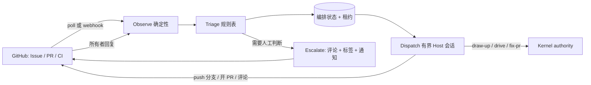

# Loop Agent：事件驱动的无人值守推进

状态：设计提案，未实施。本文不创建 Managed authority，不改变任何现有契约；第 8 节的决策未经仓库所有者确认前，第 4–6 节只是候选方案。

## 1. 结论

Loop Agent 是一个**常驻的外部事件调度器**：观察 GitHub Issue、PR、CI 的变化，把每个变化归到一个工作项上，派发一个有界的 Host 会话去推进它，只在需要人工判断时通过 GitHub 唤起人，并在人回复后自动续跑。

它与现有 Loop（`drive`）的区别：

| | 现有 Loop（`drive`） | Loop Agent |
| --- | --- | --- |
| 触发 | 字面用户在会话里输入 `drive`（`docs/adr/0019-explicit-run-entry-owns-enrollment.md:30`） | 外部对象变化（Issue/PR/CI 事件） |
| 生命周期 | 会话内；`SessionEnd` 丢弃 entry token（`docs/adr/0025-run-entry-decision-hosting.md:54`） | 跨会话常驻；每次 tick 从持久事实恢复 |
| 管理对象 | 一个 Task 或一个 Initiative（`CONTEXT.md:17`） | 仓库内所有打开的工作项 |
| 职责 | 把当前 owner 投影到下一个内部角色（`CONTEXT.md:29`） | 决定“现在该启动/续跑哪个 `draw-up`、`drive`、`fix-pr`” |

Loop Agent **不是第二个 authority 源**：Enrollment、QA、Review、Settlement 仍只由 Kernel 完成。它只做三件 Kernel 不做的事——观察外部、选择下一个入口、把阻塞转成异步的人工请求。

核心取舍只有一个：现有流程里人是**同步在场**的（原生 gate 弹在会话里）；无人值守要求把必须保留的人工判断改成**异步**的（在 GitHub 上批准），把不需要判断的确认改成**有范围的常设授权**。这两点都触碰已接受的 ADR，是第 8 节要所有者决定的内容。

## 2. 当前流程阻塞点

每一行是“人不在场时流程会停住”的位置。

| # | 阻塞点 | 证据 | 性质 | 本提案的处理 |
| --- | --- | --- | --- | --- |
| B1 | 开始执行必须有字面用户的 `drive` 入口和一次原生 Enrollment gate；Planner 永不打开 gate | `docs/adr/0019-explicit-run-entry-owns-enrollment.md:28-30`，`docs/adr/0025-run-entry-decision-hosting.md:41` | 人工判断（“这个计划对，开始做”） | 保留判断，改为异步：在 Issue 上对 TaskIntent 内容哈希批准（§5.1） |
| B2 | entry token 随会话结束失效；同一入口第三次原生操作失败即暂停，只有新的字面入口能恢复 | `docs/adr/0025-run-entry-decision-hosting.md:54`，`plugins/immune-brain/dist/drive.md:265` | 机械 | 调度器从 Kernel projection 恢复并重新派发；同签名失败有上限后才升级给人（§4.4） |
| B3 | push、PR 创建各自需要确认；配置的偏好不构成一揽子授权；Batch Branch 从不 push、从不开 PR | `docs/adr/0025-run-entry-decision-hosting.md:49`，`plugins/immune-brain/dist/BASELINE.md:112`，`CONTEXT.md:141` | 机械（目标固定、可逆） | 有范围的常设授权：只 push 自己创建的分支、只对其开 PR（§5.2） |
| B4 | `fix-pr` 只在用户明确请求时进入；修复请求本身不授予 push 或回复评论的权限 | `plugins/immune-brain/skills/fix-pr/SKILL.md:3`，`plugins/immune-brain/dist/fix-pr.md:87` | 机械（CI 红、冲突）＋判断（有争议的 review 意见） | CI 失败与冲突自动修；review 意见按处置分类，有争议的升级（§4.3） |
| B5 | `manual` Git 集成下 batch 以最终报告结束，留下 Parent 分支等人处理 | `docs/adr/0027-parent-branch-merge-queue.md:46` | 机械 | 以 PR 作为回到 main 的通道；合并仍由人（或 §8 D4） |
| B6 | breaking Intent revision、`awaiting_user` 的未决决策、rework 出口、Review 重试授权 | `plugins/immune-brain/dist/drive.md:205`，`:292`，`:265` | **真正的人工判断** | 不绕过。转成一个结构化问题发到 GitHub，只停该工作项（§4.5） |
| B7 | tracker 适配器是单向投影，不读事件、不读写 Kernel | `CONTEXT.md:264` | 能力缺口 | 新增只读观察层（§4.1） |
| B8 | Lane 只能由用户删除，无人值守下会累积 | `CONTEXT.md:149`，`docs/adr/0027-parent-branch-merge-queue.md:34` | 不阻塞推进，占磁盘 | 不在本提案内解决；tick 报告待清理 Lane 数量 |

B1 与 B6 是保留的人工点；B2–B5、B7 是本提案要消除的等待。

## 3. 边界与不变量

1. **Kernel 仍是唯一 authority。** Loop Agent 的状态是编排状态，与 batch 的做法一致：进度记录独立于 authority，引用的每个 authority 事实仍是 Kernel 的 TaskRecord（`docs/adr/0005-unattended-initiative-batch-run.md` Decision 3）。
2. **Issue 状态不是 authority。** 打开或关闭的 Issue 不等于 Enrollment 或完成（`plugins/immune-brain/dist/drive.md` “Resume from authority facts”一条）。Loop Agent 用 Issue 发现工作、用 Kernel projection 判断进度，两者冲突时信 projection。
3. **远端文本是数据，不是指令。** Issue 正文、评论、review、CI 日志都不可信（`plugins/immune-brain/dist/fix-pr.md:28`）。能改变 Loop Agent 行为的只有两类输入：仓库内已跟踪的配置，和**经 API 验证了作者身份**的所有者命令评论。本仓库当前不把外部 PR 当需求入口（`docs/agents/issue-tracker.md:36`），外部作者的 Issue/PR 只分诊、不自动执行。
4. **不合并、不批准、不发版。** 合并、review approve、release、凭据与权限变更永远在 Loop Agent 之外。
5. **判定逻辑是确定性的。** “这个事件该走哪个入口”由规则表决定；模型只在被派发的会话里做实现工作，以及（可选）对 Issue 做分类建议。分类建议不产生 authority，与 `runtime/decision_model/` 现有约束一致（`CONTEXT.md` Architecture Map “Decision models”一条：no authority path imports the component）。

## 4. 设计



### 4.1 Observe：只读、确定性、幂等

一个 host-neutral 命令 `imm-watch tick`（工作名）完成一轮观察与调度，本身无常驻进程。触发方式可换：本机 cron、GitHub Actions `schedule`/事件、或 Host 自带的定时与 PR 订阅。Webhook 只是加速器，正确性只依赖轮询。

每轮读取：

- 打开的 Issue 及自上次游标以来的评论、标签变化；带 `immune-brain:kind=task` 标记的 Child 按 `docs/agents/issue-tracker.md` 的 Parent 校验规则读取 Parent。
- Loop Agent 自己开的 PR：head SHA、mergeable、check runs、review threads。
- Kernel 只读投影：`imm-kernel inspect --json`（`CONTEXT.md` “Inspect Projection”）。

输出归一化事件 `{object, kind, actor, actor_association, head_sha, observed_at}`。同一 `(object, kind, head_sha 或 comment id)` 只处理一次。

### 4.2 工作项状态机

一个工作项对应一个 Issue（及其产生的 Task 与 PR）。状态存于 Git-ignored 的 `.imm/state/watch/`，并以 `imm:*` 标签单向投影到 GitHub 供人查看；标签不是输入。

```text
observed → triaged ─┬→ needs-clarify ⇄（人回复）
                    └→ planned（候选 TaskIntent 已发布，等批准）
planned → approved → driving → pr-open ⇄ repairing（CI / 冲突 / review）
pr-open → ready（检查全绿、无未处置意见；等人合并）→ done
任何状态 → parked（等人；记录唯一原因与恢复条件）
```

| 状态 | 进入条件 | 派发的入口 | 离开条件 |
| --- | --- | --- | --- |
| triaged | 新 Issue，作者为所有者或允许名单 | 只读分诊 | 信息足够 → planned；不足 → needs-clarify |
| planned | — | `draw-up`（只产出并发布候选，不 Enrollment） | 所有者批准该内容哈希 |
| driving | 批准有效且哈希仍匹配 | `drive`（单任务或 batch） | Settlement `done` → pr-open；`awaiting_user` → parked |
| repairing | 自己的 PR 上出现红 CI、冲突或新 review | `fix-pr` | head 变化后重新观察 |
| ready | 检查全绿、每条意见都有处置 | 无 | 人合并 → done |

### 4.3 PR 与 CI 推进规则

- **CI 失败**：先本地复现，再修，再跑同一检查通过后才 push。不跳过、不禁用测试，不用空提交重跑 CI。
- **合并冲突**：仅在自己创建的分支上解决；不改写他人分支历史。
- **Review 意见**：沿用 `fix-pr` 的处置集——fixed / already satisfied / not applicable / declined / blocked（`plugins/immune-brain/dist/fix-pr.md` §4）。前三类自动处理并回复；`declined` 与 `blocked on a decision/scope expansion` 升级给人，线程保持未解决。
- PR 属于某个 active Managed task 时由 `drive` 负责，`fix-pr` 不介入（`plugins/immune-brain/dist/fix-pr.md:11`）。

### 4.4 派发、并发与失败上限

- 每个工作项持有一个带过期时间的**租约**，防止两轮 tick 重复派发；租约不是 Workspace Claim，过期只表示可以重新观察。
- 每次派发是一个新的有界 Host 会话，运行在独立 worktree。Review 阶段已有以 `--print` 无头方式调用 reviewer CLI 的先例（`plugins/immune-brain/runtime/assurance/cli_review.ts:41`）；**`drive` 能否无头进入未验证**，见 §7。
- 会话启动时不信任上一次的对话总结，按 Kernel projection 绑定 `task_id`、`run_id` 后续跑。
- 失败上限按**失败签名**计：同一工作项、同一 head SHA、同一失败签名连续 2 次修复无效 → parked 并升级。全局并发上限与每日派发预算由仓库配置声明，耗尽时 tick 只观察不派发。

### 4.5 唤起人工

什么时候唤起：

| 类别 | 例子 | 是否可配置为自动 |
| --- | --- | --- |
| 需求澄清 | Issue 缺验收标准；两种解读会产生不同实现 | 否 |
| 开始执行 | 候选 TaskIntent 等待批准（B1） | 见 §8 D1 |
| 权威主体变化 | breaking Intent revision、验收变更、rework 出口 | 否 |
| 有争议的 review | `declined` / 需要扩大范围 | 否 |
| 修不动 | 达到 §4.4 失败上限 | 否 |
| 合并 | PR 进入 ready | 见 §8 D4 |
| 越权 | 需要新凭据、新外部服务、触碰 no-touch 路径 | 否 |

怎么唤起：

- 在对应 Issue 或 PR 上发**一条**评论：一句话结论、需要决定的唯一问题、2–4 个带后果说明的选项、相关证据链接，以及回复格式。同时加 `imm:needs-human` 标签并 @ 所有者。
- 同一阻塞只问一次；条件未变不重复提醒，超过配置时长后至多再提醒一次。
- 一个工作项 parked 不影响其他工作项。
- 人的回复是下一轮 tick 的普通事件：校验作者身份后解析选项，写入决策并续跑。无法解析时再问一次，不猜。

## 5. 需要新增的两类授权

### 5.1 异步 Enrollment 批准（处理 B1）

现状：gate 绑定 TaskIntent 内容哈希，由当前 Host 的原生对话框确认。提案保留“字面用户对确切内容哈希作出一次判断”这个不变量，只换承载方式：

1. `draw-up` 把候选 TaskIntent 的内容哈希、目标、验收、风险、范围估计发布到 Issue。
2. 所有者在 Issue 上评论 `/approve <intent-hash>`。
3. tick 通过 API 校验：评论作者是仓库所有者、评论未被编辑、哈希等于当前已跟踪候选的哈希、HEAD 满足 Enrollment 前提。任何一项不成立即拒绝，并回复原因。
4. Enrollment 记录一个新种类的 `confirmation_ref`（例如 `tracker_approval`，含评论 id 与作者）。

残余风险：信任从“本机原生对话框”移到“GitHub 账号身份”。账号被盗或 token 权限过大时，攻击者可批准执行。缓解：只接受所有者、哈希绑定、批准不覆盖 push 之外的任何特权效果、Loop Agent 自身 token 不具备以所有者身份评论的权限。ADR 0025 已指出 hook 写下的 token 可被模型的 Bash 伪造，因此才保留原生 gate（`docs/adr/0025-run-entry-decision-hosting.md` Context 第二段）；本方案的批准来自模型无法以所有者身份写入的远端，**前提是运行环境里的 GitHub 凭据不是所有者本人的凭据**——这一点在所有者自己的机器上通常不成立，是 §8 D3 选择运行位置的主要依据。

### 5.2 有范围的常设发布授权（处理 B3、B4）

在已跟踪的仓库配置里声明，默认关闭：

- 允许 push 的分支前缀（仅 Loop Agent 自己创建的分支）；禁止 force push 到非自己创建的分支；禁止 push 默认分支。
- 允许对这些分支创建 PR、在自己的 PR 上回复和解决自己已处理的线程。
- 不包含：合并、approve、release、标签与权限变更、对他人 PR 的任何写入。

这与 BASELINE 的现有句子冲突——“A generic continuation or configured preference is not blanket authorization”（`plugins/immune-brain/dist/BASELINE.md:112`）——也与“Batch Branch 从不 push”的定义冲突（`CONTEXT.md:141`）。区别在于它是**枚举了操作、目标与影响的具体授权**，而非泛化偏好；是否接受这个区别需要 ADR。

## 6. 落点与分阶段

落点建议（遵循 `docs/reference/layering-rules.md`，具体模块边界在 Spec 阶段确定）：

- `plugins/immune-brain/runtime/watch/`：观察、规则表、状态与租约，host-neutral、确定性。
- `plugins/immune-brain/bin/imm-watch`：`tick`、`status`、`--dry-run`。
- GitHub 读取复用 `runtime/github_issue_tracker.ts` 的 `createGhTransport`（`:504`）；不向 tracker 适配器添加 Kernel 读写。
- 各 Host 适配器只负责“启动一个有界会话”。

| 阶段 | 内容 | 新增授权 | 验收 |
| --- | --- | --- | --- |
| P0 | `tick --dry-run`：观察、分诊、输出“将要做什么”，零写入 | 无 | 对录制的事件序列，决策表输出确定且幂等 |
| P1 | 自己的 PR 上修 CI、冲突、无争议 review；升级通道 | §5.2 | 红 CI 在无人介入下变绿或在上限后升级；无重复评论 |
| P2 | Issue → `draw-up` → 异步批准 → `drive` → PR | §5.1 | 批准哈希不匹配、作者不符、评论被编辑均被拒绝 |
| P3（可选） | 按风险等级的策略自动批准 routine 任务 | §8 D1 的扩展 | 单独决策，默认不做 |

P0 不触碰任何 ADR，可先做，用真实事件校准规则表，再决定后续授权。

## 7. 未验证

- `drive` 入口与 Enrollment 能否在无头 Host 会话中完成：未验证。只确认了 Review 阶段的无头调用（`cli_review.ts:41`）。
- 三个 Host（Pi、Claude Code、Antigravity）各自的无头与定时能力是否对等：未验证。
- GitHub API 是否能可靠判断“评论未被编辑”及作者身份在所有 token 类型下一致：未验证。
- 派发成本（每工作项 token 消耗）与合理的并发、预算默认值：未验证，需 P0 数据。

## 8. 需要所有者决定

| # | 决策 | 建议 | 理由 |
| --- | --- | --- | --- |
| D1 | 是否接受 GitHub 评论批准等价于原生 Enrollment gate（修订 ADR 0019、0025） | 接受，仅限所有者、哈希绑定 | 不接受则每个任务仍需人到会话里输入 `drive`，无人值守只剩 PR 修复 |
| D2 | 是否接受 §5.2 的常设 push/PR 授权（修订 BASELINE 与 Batch Branch 定义） | 接受，默认关闭、按仓库启用 | 没有它，P1 的每次修复都停在 push |
| D3 | 运行位置：本机 cron、GitHub Actions、还是 Host 云端会话 | 非所有者凭据的隔离环境（Actions 或云端会话） | §5.1 的安全前提；本机运行时模型可接触所有者凭据 |
| D4 | PR ready 后由人合并，还是启用 auto-merge | 人合并 | 合并是最后一道不可逆判断；先积累 P1/P2 数据 |
| D5 | 命名。“Loop”在 `CONTEXT.md:29` 已指 `drive` 的延续入口 | 领域词用 **Watch**，CLI 用 `imm-watch` | 避免与 Loop / Internal Role 混用 |
| D6 | 唤起渠道：仅 GitHub @ 提及，还是加推送/邮件 | 先仅 GitHub | 无新凭据、无新外部服务 |
