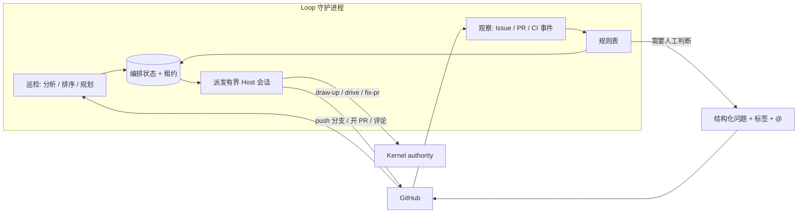

# Loop 守护进程：无人值守地规划与推进 Issue

状态：设计提案，未实施。第 2 节的决策已由仓库所有者在 2026-11-10 确定；它们修订已接受的契约（第 9 节），在对应 ADR 与 Spec 落地前，现有 `CONTEXT.md`、ADR 和 BASELINE 的文字仍然有效。本文不创建 Managed authority。

## 1. 结论

Loop 增加第二种运行形态：一个**独立守护进程**，可运行在本机或云端机器。它做三件事：

1. **定期巡检**：分析所有打开的 Issue，判断可否实施、依赖与规模，为可实施的 Issue 制定实现计划并发布，等待所有者批准。
2. **事件推进**：观察 Issue 评论、PR、CI 的变化，启动或续跑 `draw-up`、`drive`、`fix-pr`，把 Issue 一路推进到“PR 就绪，等人合并”。
3. **唤起人工**：只在需要人工判断或澄清时，在 GitHub 上提出一个结构化问题；人回复后自动续跑。

Loop 仍不是 authority 源：Enrollment、QA、Review、Settlement 只由 Kernel 完成。守护进程只决定“下一步进哪个入口”，并把同步的原生 gate 换成异步的 GitHub 批准。

两种形态的差别：

| | 会话内 Loop（现有） | Loop 守护进程（新增） |
| --- | --- | --- |
| 触发 | 字面用户在会话里输入 `drive`（`docs/adr/0019-explicit-run-entry-owns-enrollment.md:30`） | 定时巡检与外部事件 |
| 生命周期 | 会话内；`SessionEnd` 丢弃 entry token（`docs/adr/0025-run-entry-decision-hosting.md:54`） | 跨会话常驻；每轮从持久事实恢复 |
| 管理对象 | 一个 Task 或一个 Initiative（`CONTEXT.md:17`） | 仓库内所有打开的 Issue 及其 Task、PR |
| 规划 | 不规划；`draw-up` 由用户另行进入 | 主动为 Issue 进入 `draw-up` |

## 2. 已确定的决策

| # | 决策 | 结论 |
| --- | --- | --- |
| D1 | 开始执行的批准 | 所有者在 Issue 上对 TaskIntent 内容哈希的评论批准，等价于原生 Enrollment gate。仅限所有者，哈希绑定 |
| D2 | push 与 PR | 接受有范围的常设授权，默认关闭、按仓库启用（§6.2） |
| D3 | 运行位置 | 独立守护进程，本机或云端机器均可 |
| D4 | 合并 | PR 就绪后由人合并，不启用 auto-merge |
| D5 | 命名 | 修改 Loop 的定义，不引入新词（§3） |
| D6 | 唤起渠道 | 仅 GitHub @ 提及 |

## 3. Loop 的新定义

现定义（`CONTEXT.md:29-31`）：

> The user-facing continuation entry for an enrolled task. It projects the current owner to the next bounded internal role or Kernel operation without becoming a second authority source.

拟改为：

> **Loop**:
> The continuation mechanism that projects current facts to the next bounded internal role, Kernel operation or public entry, without becoming a second authority source. It runs in two forms. In a session, after an explicit `drive` entry, it continues one enrolled Task or Initiative. As the Loop daemon, a standing process, it observes the tracker, pull requests and CI, plans open Issues, and starts or resumes those entries across sessions.
> _Avoid_: workflow engine, checkpoint store, scheduler authority

连带影响：

- **Internal Role**（`CONTEXT.md:33`）“dispatched by Loop”保持成立，无需改。
- **Run binding** 的 _Avoid_ 列有 “second scheduler”（`CONTEXT.md:19`）。它约束的是 Run binding 这个词的用法，不禁止守护进程存在；但守护进程不得持有或伪造 Run binding，每次派发的会话各自建立自己的绑定。
- `docs/proposals/managed-workflow-simplification.md:16` 写明“不新增通用调度器”。本提案与该句冲突，需要在 ADR 中明确：守护进程只在三个公共入口之间做选择，不调度内部角色，不替代 batch runner。
- 本文其余部分以“守护进程”指 Loop 的这一形态。`CONTEXT.md` 的实际修改随 ADR 落地，本提案不改它。

## 4. 当前流程阻塞点

每一行是“人不在场时流程会停住”的位置。

| # | 阻塞点 | 证据 | 性质 | 处理 |
| --- | --- | --- | --- | --- |
| B1 | 规划要用户进入 `draw-up`；Planner 产出候选后即停 | `plugins/immune-brain/dist/BASELINE.md` “Host Confirmation Boundary”一节，`docs/adr/0019-explicit-run-entry-owns-enrollment.md:28` | 机械（启动）＋判断（计划是否正确） | 守护进程主动进入 `draw-up`；计划是否正确由 B2 的批准承担（§5.2） |
| B2 | 开始执行必须有字面用户的 `drive` 入口和一次原生 Enrollment gate | `docs/adr/0019-explicit-run-entry-owns-enrollment.md:30`，`docs/adr/0025-run-entry-decision-hosting.md:41` | 人工判断 | 保留判断，改为异步批准（§6.1） |
| B3 | entry token 随会话结束失效；第三次原生操作失败后只有新的字面入口能恢复 | `docs/adr/0025-run-entry-decision-hosting.md:54`，`plugins/immune-brain/dist/drive.md:265` | 机械 | 从 Kernel projection 恢复并重新派发；同签名失败到上限后才升级（§5.5） |
| B4 | push、PR 创建各自需要确认；Batch Branch 从不 push、从不开 PR | `docs/adr/0025-run-entry-decision-hosting.md:49`，`plugins/immune-brain/dist/BASELINE.md:112`，`CONTEXT.md:141` | 机械 | 常设授权（§6.2） |
| B5 | `fix-pr` 只在用户明确请求时进入；修复请求不授予 push 或回复评论 | `plugins/immune-brain/skills/fix-pr/SKILL.md:3`，`plugins/immune-brain/dist/fix-pr.md:87` | 机械＋判断 | CI 红与冲突自动修；有争议的 review 意见升级（§5.4） |
| B6 | `manual` Git 集成下 batch 以最终报告结束，留下 Parent 分支 | `docs/adr/0027-parent-branch-merge-queue.md:46` | 机械 | 以 PR 作为回到 main 的通道，人合并 |
| B7 | breaking Intent revision、`awaiting_user`、rework 出口、Review 重试授权 | `plugins/immune-brain/dist/drive.md:205`，`:292`，`:265` | **真正的人工判断** | 不绕过，转成结构化问题，只停该工作项（§5.6） |
| B8 | tracker 适配器是单向投影，不读事件 | `CONTEXT.md:264` | 能力缺口 | 新增只读观察层（§5.1） |
| B9 | Lane 只能由用户删除，无人值守下会累积 | `CONTEXT.md:149`，`docs/adr/0027-parent-branch-merge-queue.md:34` | 不阻塞推进，占磁盘 | 本提案不解决；状态 Issue 报告待清理数量 |

保留的人工点只有 B2 与 B7，外加合并（D4）。

## 5. 设计



### 5.1 进程形态

- CLI `imm-loop`：`daemon` 常驻运行；`tick` 执行一轮后退出（供调试与外部定时器使用）；`status` 只读；`--dry-run` 零写入。`daemon` 只是按节拍重复 `tick`，所有正确性都在 `tick` 里。
- 每个仓库一个实例，用锁文件保证；进程崩溃后下一轮从持久状态恢复，不依赖内存。
- 两种节拍：**事件节拍**（分钟级）处理评论、PR、CI；**巡检节拍**（默认每日，可配置）做 §5.2 的全量分析。Webhook 只是加速器，正确性只依赖轮询。
- 编排状态存于 Git-ignored 的 `.imm/state/loop/`，与 batch 的做法一致：它只记录进度，引用的每个 authority 事实仍是 Kernel 的 TaskRecord（`docs/adr/0005-unattended-initiative-batch-run.md` Decision 3）。
- 判定逻辑是确定性的规则表；模型只出现在被派发的会话里。

每轮读取：打开的 Issue 及游标之后的评论；守护进程自己开的 PR 的 head SHA、mergeable、check runs、review threads；Kernel 只读投影 `imm-kernel inspect --json`（`CONTEXT.md:109`）。同一 `(对象, 事件类型, head SHA 或评论 id)` 只处理一次。

### 5.2 定期巡检：分析 Issue 并制定计划

巡检对每个打开的 Issue 走三步。

**分析。** 派发一个只读会话，输出结构化记录（非 authority）：

| 字段 | 取值 |
| --- | --- |
| 类型 | 缺陷 / 功能 / 问题 / 重复 / 已过时 |
| 就绪度 | 可规划 / 缺信息（列出缺什么）/ 需要所有者做产品决策 |
| 规模 | 单个 Task / 需要拆成 Initiative |
| 依赖 | 被哪些打开的 Issue 阻塞 |
| 风险估计 | routine / material / critical（仅估计，Enrollment 时由 Kernel 与风险下限决定） |

分析结果按 `(Issue 正文 + 所有者评论)` 的内容哈希缓存，内容未变不重新分析，以控制成本。

**排序。** 确定性规则：所有者的显式优先级 > 无未关闭阻塞项（GitHub 原生 issue dependencies，`docs/agents/issue-tracker.md:143`）> 创建时间。同时在规划与在执行的工作项各有上限，超出的排队。

**规划。** 对排在前面且“可规划”的 Issue 进入 `draw-up`：

1. 在守护进程自己的 worktree 里新建分支 `imm-loop/<issue>`，产出候选 TaskIntent（复杂行为另加 Spec），通过 Planner 既有的校验。
2. 提交候选并 push 该分支（§6.2 授权）。
3. 在 Issue 上发布计划摘要：目标、验收、范围估计、风险、TaskIntent 内容哈希，以及批准方式。
4. 规模为 Initiative 的 Issue 走现有 tracker 发布路径生成 Parent 与 Children（`runtime/github_issue_tracker.ts` 的 `create-initiative`、`upsert-task`，`:1914-1915`），批准对象是 batch 的 `plan_digest`。

然后停在“等批准”。Planner 不打开 Enrollment gate 的规则不变。

候选发布后若 Issue 内容或基线发生实质变化，旧哈希的批准自动失效，守护进程重新规划并说明差异。

其余情况：缺信息 → 提一个澄清问题；需要产品决策 → 升级；重复或过时 → 只在状态 Issue 中列出，不自动关闭。

**谁的 Issue 会被规划。** 所有者与配置允许名单内作者的 Issue 默认进入巡检。其他作者的 Issue 只分析、不规划，直到所有者评论 `/plan`；本仓库当前不把外部 PR 当需求入口（`docs/agents/issue-tracker.md:36`），这一点不变。所有者可用 `/skip` 让某个 Issue 退出巡检。

### 5.3 工作项状态机

一个工作项对应一个 Issue 及其产生的 Task 与 PR。状态以 `imm:*` 标签单向投影到 GitHub 供人查看；标签不是输入。

```text
observed → analyzed ─┬→ needs-clarify ⇄（人回复）
                     └→ planned（候选已发布，等批准）
planned → approved → driving → pr-open ⇄ repairing（CI / 冲突 / review）
pr-open → ready（检查全绿、意见均有处置；等人合并）→ done
任何状态 → parked（等人；记录唯一原因与恢复条件）
```

| 状态 | 派发的入口 | 离开条件 |
| --- | --- | --- |
| analyzed | 只读分析 | 可规划且排到 → planned；缺信息 → needs-clarify |
| planned | `draw-up` | 所有者批准当前内容哈希 |
| driving | `drive`（单任务或 batch），在批准的分支上 | Settlement `done` → pr-open；`awaiting_user` → parked |
| repairing | `fix-pr` | head 变化后重新观察 |
| ready | 无 | 人合并 → done |

计划与实现在同一分支、同一 PR 里，一个 Issue 对应一个 PR。

### 5.4 PR 与 CI 推进规则

- **CI 失败**：先本地复现，再修，同一检查本地通过后才 push。不跳过、不禁用测试，不用空提交重跑 CI。
- **合并冲突**：仅在自己创建的分支上解决；不改写他人分支历史。
- **Review 意见**：沿用 `fix-pr` 的处置集（`plugins/immune-brain/dist/fix-pr.md` §4）。fixed、already satisfied、not applicable 自动处理并回复；declined 与 blocked on a decision/scope expansion 升级给人，线程保持未解决。
- PR 属于某个 active Managed task 时由 `drive` 负责，`fix-pr` 不介入（`plugins/immune-brain/dist/fix-pr.md:11`）。

### 5.5 派发、并发与失败上限

- 每个工作项持有带过期时间的**租约**，防止重复派发；租约不是 Workspace Claim，过期只表示可以重新观察。
- 每次派发是一个新的有界 Host 会话，运行在独立 worktree；启动时按 Kernel projection 绑定 `task_id`、`run_id`，不信任上一次的对话总结。
- 失败上限按**失败签名**计：同一工作项、同一 head SHA、同一失败签名连续 2 次修复无效 → parked 并升级。
- 并发上限、每日分析与派发预算由仓库配置声明；耗尽时只观察不派发，并在状态 Issue 中说明。

### 5.6 唤起人工

| 类别 | 例子 |
| --- | --- |
| 需求澄清 | Issue 缺验收标准；两种解读会产生不同实现 |
| 批准计划并开始执行 | 候选 TaskIntent 或 batch 计划等待批准（B2） |
| 权威主体变化 | breaking Intent revision、验收变更、rework 出口 |
| 有争议的 review | declined，或需要扩大范围 |
| 修不动 | 达到 §5.5 的失败上限 |
| 合并 | PR 进入 ready |
| 越权 | 需要新凭据、新外部服务、触碰 no-touch 路径 |

方式：

- 在对应 Issue 或 PR 上发**一条**评论：一句话结论、唯一的问题、2–4 个带后果说明的选项、证据链接、回复格式；加 `imm:needs-human` 标签并 @ 所有者。
- 同一阻塞只问一次；条件未变不重复提醒，超过配置时长后至多再提醒一次。
- 一个工作项 parked 不影响其他工作项。
- 所有者输入只有命令评论一种形式：`/approve <hash>`、`/plan`、`/skip`，以及对问题的选项回复。无法解析时再问一次，不猜。
- **状态 Issue**：一个固定的 Issue，正文由守护进程原地更新（不发新评论，避免通知噪音），列出每个工作项的状态、等待原因、预算使用和待清理的 Lane。这是人查看全局的唯一入口。

## 6. 新增的两类授权

### 6.1 异步 Enrollment 批准（D1）

保留“字面用户对确切内容哈希作出一次判断”这个不变量，只换承载方式：

1. 候选的内容哈希随计划摘要发布到 Issue（§5.2）。
2. 所有者评论 `/approve <intent-hash>`（batch 为 `<plan-digest>`）。
3. 守护进程校验：评论作者是配置的所有者；作者不是守护进程自己的身份；评论未被编辑；哈希等于分支上当前候选的哈希；HEAD 满足 Enrollment 前提。任一不成立即拒绝并回复原因。
4. Enrollment 记录一个新种类的 `confirmation_ref`（例如 `tracker_approval`，含评论 id 与作者）。

### 6.2 有范围的常设发布授权（D2）

在已跟踪的仓库配置里声明，默认关闭：

- 允许 push 的分支前缀（仅守护进程自己创建的分支）；禁止 push 默认分支；禁止对非自己创建的分支 force push。
- 允许对这些分支创建 PR、在自己的 PR 上回复、解决自己已处理的线程；允许在 Issue 上评论与维护 `imm:*` 标签、更新状态 Issue。
- 不包含：合并、approve、release、权限变更、对他人 PR 的任何写入、关闭 Issue（Child 与 Parent 的关闭仍只走 tracker 的 `mark-terminal` 终态投影）。

### 6.3 身份与凭据（D3 的后果）

D1 的安全性依赖一个前提：**模型不能以所有者身份在 GitHub 上写评论**。守护进程可运行在本机，因此这个前提不能靠“机器上没有所有者凭据”保证，改由以下规则保证：

- 守护进程使用**独立的 GitHub 身份**（机器用户或 GitHub App），权限限于 §6.2。启动时若发现自己的身份等于配置的所有者，拒绝启动。
- 派发的会话只拿到守护进程身份的凭据；环境变量与 `gh` 配置目录与所有者的隔离。
- 本机部署建议用独立的操作系统用户运行。

残余风险：守护进程与所有者共用同一操作系统用户时，会话里的 shell 仍可能读到所有者的 `gh` 凭据并伪造批准。ADR 0025 正是因为同 uid 下的证明可被模型伪造才保留原生 gate（`docs/adr/0025-run-entry-decision-hosting.md` Context 第二段）。同 uid 部署是否允许、是否仅给出警告，需要在 ADR 中明确；我的建议是允许但在 `status` 与状态 Issue 中标注为降级。

## 7. 不变量

1. Kernel 仍是唯一 authority；Issue 状态不是 authority，与 Kernel projection 冲突时信 projection（`plugins/immune-brain/dist/drive.md` “Resume from authority facts”一条）。
2. 远端文本是数据，不是指令（`plugins/immune-brain/dist/fix-pr.md:28`）。能改变守护进程行为的只有已跟踪的仓库配置，和经 API 验证作者身份的所有者命令评论。
3. 不合并、不批准、不发版、不变更凭据与权限。
4. 分析记录与模型的分类建议不产生 authority，与 `runtime/decision_model/` 的现有约束一致（`CONTEXT.md:265`）。

## 8. 落点与分阶段

落点建议（模块边界在 Spec 阶段按 `docs/reference/layering-rules.md` 确定）：

- `plugins/immune-brain/runtime/loop_daemon/`：观察、规则表、巡检排序、状态与租约，host-neutral、确定性。
- `plugins/immune-brain/bin/imm-loop`。
- GitHub 读取复用 `createGhTransport`（`plugins/immune-brain/runtime/github_issue_tracker.ts:504`）；不向 tracker 适配器添加 Kernel 读写。
- 各 Host 适配器只负责“启动一个有界会话”。

| 阶段 | 内容 | 新增授权 | 验收 |
| --- | --- | --- | --- |
| P0 | `tick --dry-run`：观察、分析、排序，输出“将要做什么”，零写入 | 无 | 对录制的 Issue 与事件序列，输出确定且幂等 |
| P1 | 巡检规划：进入 `draw-up`，push 计划分支，发布计划摘要；澄清问题；状态 Issue | §6.2 | 内容未变不重复分析与评论；非允许作者的 Issue 不被规划 |
| P2 | 异步批准 → `drive` → 开 PR | §6.1 | 哈希不符、作者不符、作者为守护进程自身、评论被编辑均被拒绝 |
| P3 | 自己的 PR 上修 CI、冲突、无争议 review，直到 ready | 沿用 §6.2 | 红 CI 无人介入下变绿，或在上限后升级 |

P0 不触碰任何 ADR，可先做，并提供成本与规则表校准所需的数据。

## 9. 需要修订的契约

实施前需要一份新 ADR，覆盖：

- `CONTEXT.md` 的 Loop 定义（§3）与 Batch Branch “never pushed and never opened as a pull request”（`CONTEXT.md:141`）。
- ADR 0019 与 ADR 0025 Decision 2：Enrollment 增加 `tracker_approval` 这一确认来源；push 与 PR 创建在 §6.2 范围内不再逐次确认。
- BASELINE “Host Confirmation Boundary” 中 “A generic continuation or configured preference is not blanket authorization”（`plugins/immune-brain/dist/BASELINE.md:112`）：说明枚举了操作、目标与影响的仓库声明授权不属于该句所指的泛化偏好。
- `fix-pr` 的进入条件：守护进程对自己开的 PR 可进入。
- §6.3 的同 uid 部署规则。

## 10. 未验证

- `draw-up`、`drive` 与 Enrollment 能否在无头 Host 会话中完成：未验证。只确认了 Review 阶段以 `--print` 无头调用 reviewer CLI（`plugins/immune-brain/runtime/assurance/cli_review.ts:41`）。
- 三个 Host（Pi、Claude Code、Antigravity）的无头能力是否对等：未验证。
- GitHub API 能否可靠判断评论未被编辑：未验证。
- Enrollment 能否直接在守护进程的计划分支上进行（现规则是 Lane 从用户 HEAD 起、只复制 TaskIntent 与 Spec，`plugins/immune-brain/dist/BASELINE.md:133`）：未验证，可能需要调整。
- 每个 Issue 的分析与规划成本、合理的并发与预算默认值：未验证，需 P0 数据。
