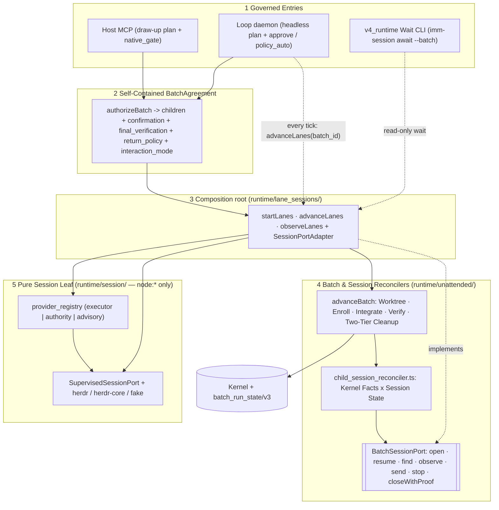

# Unified Lane Sessions: Architecture Design (v4.1)

**Status:** accepted by the repository owner on 2026-11-18 (`OD-1..OD-15`, `BR-DEC-1..5`); planned, not implemented. **Issue:** #570. **Normative text:** [Spec](../specs/unified-lane-sessions.spec.md) (decisions D1–D20, acceptance by Slice). **Initiative:** [carrier](../initiatives/unified-lane-sessions.md), eight TaskIntents in `docs/plans/`.

This document explains the v4.1 target architecture, why it has this shape, which seams later work extends, and what it replaces. It adds no decision of its own; where it and the Spec disagree, the Spec wins. Line references describe HEAD `c5b13485f3`.

## 1. Summary

One Lane is executed one way, whoever started the batch and however many children it has.

- **Two governed entries, one declarative execution path.** Host `drive` and the Loop daemon each produce a self-contained **Batch Agreement** (`confirmation`, `final_verification`, `return_policy`, `interaction_mode`) via `authorizeBatch` and hand it to the `runtime/lane_sessions/` composition root (`startLanes` on creation, `advanceLanes` on every re-entry or tick). That module only wires a provider to the reconciler and owns no state transition, so it is deliberately not a domain term and shares no name with the batch coordinator of ADR 0018 or `AssuranceCoordinator`.
- **Single-writer declarative session reconciliation.** `advanceBatch` and its cohesive `child_session_reconciler.ts` own every Lane and session state transition through an injected `BatchSessionPort` (`open`, `resume`, `find`, `observe`, `send`, `stop`, `closeWithProof`), comparing Kernel `record_revision` against each generation's recorded `baseline`. There is no side-door `steerLane` or ungated `imm-session send|stop --batch` CLI.
- **Role-indexed session providers as a pure leaf.** `runtime/session/` imports only `node:*`, declares capabilities per role (`executor | authority | advisory`) in `provider_registry.ts`, checks every provider against one conformance suite, and resolves once per batch from `session_providers`.
- **Two-tier proof-based cleanup and per-child citizenship.** Every integrated child removes its own worktree and `imm-lane/` branch once `closeWithProof` proves exit; `refs/heads/imm/<slug>` is deleted only after whole-batch `checkout_delivery` succeeds and is retained under `retain_branch` (Host Initiatives and `loop_daemon` PRs). Decisions, `stop`, `coordinator: correct`, and `lane_rebinds` work for every child by scanning active `v3` records by `task_id`.
- **Retired:** `startBatch`, `batch_runner.ts`, `LaneSupervisor` and its `--print` Executors, `executor_mode`, the `herdr` switch, `lane_executor_requires_tui`, `.imm/state/lane-supervisors/`, `closeRecordUnproven` / `session_closes`, and `loop_daemon/exit_recorder.ts`.

## 2. Problem

A Pi user in Herdr with no `herdr` key gets `lane_executor_requires_tui` for every single-task `drive`, while an Initiative on the same machine opens Herdr tabs (#570). The symptom exposes structural splits ([Spec §1](../specs/unified-lane-sessions.spec.md#1-problem-and-evidence)):

| Split | Evidence |
| --- | --- |
| Executor launch chosen by plan shape and a switch | `host-core/runtime.ts:1438` gates single-task interactive mode on `herdr` (default `false`, `config/layered_config.ts:162`); otherwise `LaneSupervisor` spawns `--print` (`unattended/lane_supervisor.ts:70,106`) and refuses Pi (`:224`) |
| Supervision, relay, rebind, cleanup, and checkout delivery split on `plan_source` | `batch_runner.ts:248-273`, `lane_decision.ts:72-78` (`findExistingActiveBatch` matches `initiative_slug` only), `batch_state.ts:458-461,939-945,1204-1213`, `lane_cleanup.ts:74-79` (deletes `parentRef`), `batch_lanes.ts:1495-1517`, `assurance/run_continuation.ts:99-106` |
| Interactive TUI turns end in `idle`/`done` without exiting; `tab close` before proof loses label check | `session/herdr_provider.ts:59-66,236-241,279-295,326-330,416-427`; `session/cli.ts:106-120` peeks into `.imm/state/batches/` |
| Two copies of batch authorization; daemon exit recorder gates PRs on `exit_code === 0` | `host-core/runtime.ts:1405`, `loop_daemon/agent_handlers.ts:1763-1776`, `loop_daemon/dispatch.ts:1090-1148` |

## 3. Goals and non-goals

**Goals**

1. One declarative execution path for Host and daemon, single task and Initiative (`BR-DEC-1`, `OD-1`, `OD-8`, `OD-11`, `OD-13`).
2. Executor sessions only through the Supervised Session Port, never `--print` (`BR-REQ-1`, `OD-12`).
3. Role-indexed provider registry, explicit ordered `session_providers`, resolved once and fixed per batch (`BR-DEC-3`, `OD-2..OD-4`, `OD-14`, `OD-15`).
4. Crash-safe session ownership via bounded write-ahead `laneSessionKey` and `findSession` / `closeWithProof` (`BR-DEC-3`, `OD-9`, `OD-15`).
5. Two-tier proof-based cleanup separating per-child `imm-lane/` removal from batch `return_policy` (`BR-DEC-2`, `OD-7`).
6. Keep every capability a later step needs; design for long-term iteration (`OD-14`).

**Non-goals and deferred items**

- `herdr-core` Executor Host admission (#495) and `herdr` sign-in `blocked` detection (#496) (`BR-OUT-1`, `D18`).
- Headless Pi, migrating `v2` Lane batch records (`D17`), and switching Review/Advisory callers off `herdr` in this Initiative (`BR-OUT-2`, `BR-OUT-3`; `provider_registry.ts` already models their roles).
- Deferred (`BR-DEFER-1`): `loop_daemon` upstream Initiative carrier drafting, parent-Issue `/approve <digest>`, and multi-task Initiative PR creation (`BatchAgreement` and execution already support them via `D3`).

## 4. Architecture overview

### 4.1 Layers



### 4.2 Two entries, one path

| Aspect | Host Parent | Loop daemon |
| --- | --- | --- |
| Plan producer | `draw-up` → Initiative carrier or one TaskIntent | `plan_drafter` → TaskIntent, digest published on Issue |
| Confirmation | `native_gate`, literal user | `tracker_approval` (`/approve <digest>`) or `policy_auto`, `LOOP_DAEMON_ACTOR_ID` |
| Agreement policies | Single-task: `checkout_delivery`, `final_verification.required: false`; Initiative: `retain_branch`, `required: true`; both `interactive_host` | `retain_branch`, `final_verification.required: false`, `parent_relayed` |
| Initial start | `startLanes(agreement)` | `startLanes(agreement)` |
| Re-entry & waiting | Arms `imm-session await --batch <id>`, which returns on the D20 wake set with `next_action`; on `advance` re-enters `advanceLanes(root, batch_id)` | Every tick calls `advanceLanes(root, batch_id)` directly |
| Decisions & stop | Host MCP tools (`native_gate` on `stop` / breaking revision) → `relayLaneDecision` → `advanceLanes` | Verified GitHub/local reply → `relayLaneDecision` → `advanceLanes`; startup dialog triggers `planEscalation` |

## 5. Components

### 5.1 Batch Agreement — `runtime/unattended/batch_agreement.ts` (S3)

S3 also fixes the `v3` record shape (§7), and its first acceptance proves that record-level `rebindBatchChildIdentity` keeps the Parent identity of an Initiative before any later Slice relies on that shape.

| Field | Meaning |
| --- | --- |
| `children` | Ordered by `projectBatchPlan`; `plan_digest` computed from them |
| `plan_source` | `"initiative"` or `"single_task"` — how the plan was read, never read by execution modules |
| `confirmation` | `{ source: "native_gate" \| "tracker_approval" \| "policy_auto", ref }` |
| `final_verification` | `{ required: boolean, commands: string[] }`, authorized once by `confirmation` |
| `return_policy` | `"checkout_delivery"` (stage to checkout + drop `imm/<slug>`) or `"retain_branch"` (keep `imm/<slug>`) |
| `interaction_mode` | `"interactive_host"` or `"parent_relayed"` (injects `LANE_EXECUTOR_ENV=headless` for unattended TUI sessions) |

### 5.2 Composition root — `runtime/lane_sessions/` (S5)

Entry functions live in `runtime/lane_sessions/index.ts`; refusals are `LaneSessionRefusal`.

| Operation | Responsibility |
| --- | --- |
| `startLanes(agreement, deps)` | Resolves `session_provider` once via `resolveSessionProvider({ role: "executor", ... })` (refusing `lane_session_unavailable` before writing anything), builds `SessionPortAdapter`, and runs `advanceBatch` |
| `advanceLanes(root, batch_id, deps)` | Re-checks the recorded `session_provider` requirement (never switching providers), builds `SessionPortAdapter`, and runs idempotent `advanceBatch` |
| `observeLanes(root, batch_id, options)` | Read-only observation; `wait: true` backs `imm-session await --batch <id>` routed from `v4_runtime.ts`, returning on the first child `idle | done | blocked | exited`, `entry_submitted: false`, Kernel settlement or pending decision, or timeout, with `next_action` (`advance`, `relay_dialog`, `ask_user`, `wait`, `complete`) so the Parent does not decide re-entry itself (`D20`) |

### 5.3 Batch state machine & `child_session_reconciler.ts` — `runtime/unattended/` (S4, S6, S7)

```ts
interface BatchSessionPort {
  readonly provider: string;
  open(input: { key: string; cwd: string; label: string; entry: string; env?: Record<string, string> }): Promise<OpenedSession | PortRefusal>;
  resume(handle: string, entry: string): Promise<OpenedSession | PortRefusal>;
  find(key: string): Promise<{ handle: string } | "not_found" | PortRefusal>;
  observe(handle: string): Promise<{ state: SessionState; provenance: string } | PortRefusal>;
  send(handle: string, text: string): Promise<{ state: SessionState } | PortRefusal>;
  stop(handle: string): Promise<{ ok: true } | PortRefusal>;
  closeWithProof(handle: string, key: string): Promise<SessionExitProof | { ok: false; condition: string }>;
}
```

`SessionState` here is the port's own `SessionObservation` (`working | blocked | idle | done | exited | unknown`), and `SessionExitProof` is structural; neither is imported from `runtime/session/`. The adapter maps `pane_not_found` to `exited` and other provider failures to `unknown`; `working`, `unknown`, and observe refusals hold without touching counters.

`child_session_reconciler.ts` computes desired session actions from Kernel facts and `observe(handle)` without bloating `batch_lanes.ts`.

### 5.4 Role-indexed session providers — `runtime/session/` (S2)

- **Registry**: `provider_registry.ts` indexes capabilities by `roles: { executor, authority, advisory }`. `herdr` requires `HERDR_ENV=1` and `HERDR_WORKSPACE_ID`.
- **Key & Agent Naming**: `laneSessionKey` produces `imm-<folded_task_16>-g<n>-<sha256(batch_id + "\0" + task_id + "\0" + n).slice(0, 12)>` (`<= 36` chars `[a-z0-9-]`), and `herdrAgentName` takes `slice(-12)` so shared-prefix siblings never collide.
- **Lookup & Close Proof**: `findSession` uses `herdr tab list --workspace <ws>`; `closeWithProof` verifies live `[imm:<session_key>]` ownership before closing pane/tab and proves crash re-entry via `pane_not_found` + `findSession(key) === "not_found"`.

### 5.5 Configuration (S1)

`session_providers` (default `["herdr"]`) replaces `herdr` (`retired_key` warning, stripped by `imm-kernel config migrate --write`).

## 6. Dependency rules

| Module | May import | Must not | Enforced by |
| --- | --- | --- | --- |
| `host-core/`, `loop_daemon/` | `lane_sessions/`, `batch_agreement.ts`, `lane_decision.ts` | `runtime/session/`, `batch_lanes.ts` | `tests/runtime-layering-boundary.test.ts`, `tests/loop-daemon-boundary.test.ts` |
| `v4_runtime.ts` | `lane_sessions/` (for `await --batch`), `session/cli.ts` | ungated `send\|stop --batch` | `tests/lane-sessions.test.ts` |
| `lane_sessions/` | `session/`, `unattended/` | decide Lane state, mention `plan_source` | `tests/runtime-layering-boundary.test.ts` |
| `unattended/` | `kernel/`, `assurance/`, `config/` | `session/`, `lane_sessions/`; `plan_source` in execution modules | `tests/supervised-session-boundary.test.ts`, `tests/runtime-layering-boundary.test.ts` |
| `session/` | `node:*` and its own files | any outside module or `.imm/state/batches/` file | `tests/supervised-session-boundary.test.ts` |

## 7. Batch record `v3` (`D17`, `OD-15`)

```text
session_provider: "herdr"                 // batch-level, resolved once at startLanes
confirmation:     { source, ref }
final_verification: { required, commands }
return_policy:    "checkout_delivery" | "retain_branch"
interaction_mode: "interactive_host" | "parent_relayed"

children[].session: {
  key:             "imm-<task16>-g<n>-<hash12>"  // written before open, never recomputed
  generation:      n
  baseline:        <Kernel record_revision>      // progress baseline
  handle:          <opaque> | null
  entry_submitted: boolean
  attention:       string | null
  no_progress:     0 | 1 | 2
  exit_proof:      SessionExitProof | null
}
lane_rebinds[]:   { task_id, from_digest, to_digest, ... }
children[].lane_removed | children[].lane_retained
```

## 8. Lifecycle, cleanup, decisions and daemon PR gate

- **Crash safety (`D8`)**: `key` (`handle: null`) is persisted before `open`; re-entry calls `find(key)` first.
- **Interactive TUI reconciliation (`D8`)**: `entry_submitted: false` or `blocked` holds without penalizing `no_progress` and `resume`s when cleared; `idle | done` with `record_revision !== baseline` resets `no_progress` and `resume`s; at unchanged `baseline`, `exited` (either mode) and `idle | done` under `parent_relayed` close with proof, rotate once, and park `lane_executor_no_progress` on the second stall; under `interactive_host`, `idle | done` at `baseline` holds as `stalled_idle` without closing the tab, and `await --batch` returns `next_action: ask_user` so the Parent asks the user, whose answer arrives as `instruction`, `correction`, or a gated `stop`.
- **Two-tier cleanup (`D11`)**: Per-child cleanup on `closeWithProof` removes only the child's worktree and `imm-lane/<slug>/<task_id>`; `refs/heads/imm/<slug>` is deleted only after whole-batch `checkout_delivery` succeeds.
- **Per-child relay & rebind (`D12`)**: `findActiveLaneBatchForTask` locates active `v3` batches by child `task_id`; `rebindBatchChildIdentity` (proven in S3) advances `plan_digest` along `lane_rebinds`; `coordinator: correct` rotates to `g(n+1)`.
- **Daemon PR gate (`D13`)**: `loop_daemon/dispatch.ts` reads `commit` from the `v3` Batch Record and `verification_evidence_digest` from `.imm/audit/<task_id>/` on retained `refs/heads/imm/<task_id>`.

## 9. Failure model

| Code | Raised by | Meaning | Recovery |
| --- | --- | --- | --- |
| `lane_session_unavailable` | `lane_sessions/` / reconciler | No configured provider can serve, or recorded `session_provider` lost its requirement | Per-provider recovery text; re-entry retries same provider |
| `batch_agreement_invalid` | `authorizeBatch` | Invalid `confirmation`, `return_policy`, `interaction_mode`, or `final_verification` | Fix caller input; nothing written |
| `batch_record_retired` | record read | Stored `v2` Lane record | `retire_stale_batch`, start fresh batch |
| `lane_executor_no_progress` | reconciler | Two consecutive stalls at unchanged `baseline` (`exited`, or `idle | done` under `parent_relayed`) | Inspect Lane; resume with fresh confirmation |
| `batch_lane_retained` | cleanup | Proof or Git cleanliness condition failed (named) | Resolve named condition |
| `retired_key` (warning) | config | `herdr` key present | `imm-kernel config migrate --write` |

## 10. Delivery plan (serialized S1–S8)

| Slice | Task | Lands | Blocked by |
| --- | --- | --- | --- |
| S1 | `session-provider-config` | `session_providers`, retired `herdr`; fixes #570 inside Herdr | — |
| S2 | `session-provider-registry` | Role-indexed descriptors, `session_key`, trailing-hash `herdrAgentName`, `findSession`, `closeWithProof`, conformance suite | S1 |
| S3 | `batch-agreement-v3` | Initiative `lane_rebinds` proof first; `BatchAgreement` (`return_policy`, `interaction_mode`), record `v3`, `plan_source` removed from execution modules, `v2` fixtures migrated | S2 |
| S4 | `batch-session-port` | `BatchSessionPort`, `child_session_reconciler.ts`, `advanceBatch` | S3 |
| S5 | `host-entries-via-lane-sessions` | `startLanes` / `advanceLanes` / `observeLanes`; Host entries switch; `v4_runtime` `await --batch` with `next_action` | S4 |
| S6 | `session-lane-cleanup` | Two-tier proof-based cleanup; `closeRecordUnproven` & `session_closes` retired | S5 |
| S7 | `per-child-lane-decisions` | `findActiveLaneBatchForTask`, per-child relay, `stop`, `coordinator: correct`, `lane_rebinds` | S6 |
| S8 | `loop-daemon-drives-via-port` | Daemon cutover, audit-backed PR gate, deletion of `startBatch`, `batch_runner.ts`, `LaneSupervisor`, `exit_recorder.ts` | S7 |

**Accepted regression (`D18`, `OD-6`, confirmed 2026-11-18):** today the Loop daemon can run `--print` Executors outside Herdr. After S8 and until #495 lands, daemon `drive` outside Herdr refuses `lane_session_unavailable`. S8 does not wait for #495.
