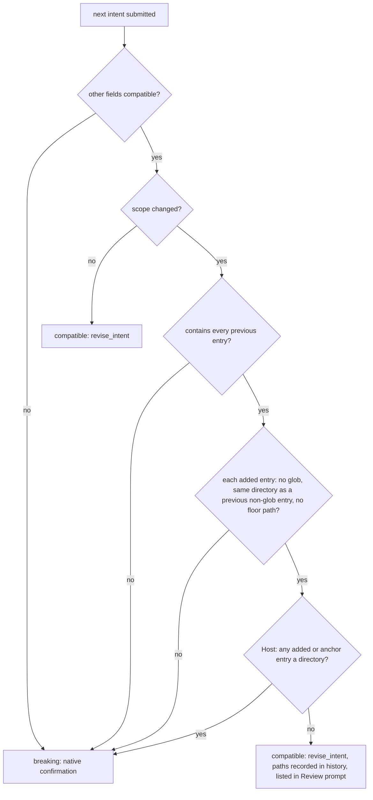

# Reduce ineffective ceremony found in the r647 retro

**Status**: Candidate; not enrolled.
**Design risk**: High — S2 changes which TaskIntent revisions need a native user confirmation (Kernel revision classifier, both Hosts' revision preparation), S1 changes what a QA failure returns across the Tool boundary, and S3 adds a Host edit guard.
**Execution posture**: characterization-first for S2 (pin the current refusal of a revision whose worktree already holds the paths the revision would add, before changing it); test-first elsewhere.
**Document language**: English, following the Planner document-language default.
**Source**: Direct Planner entry on 2026-10-12, after a retro of one Claude Code planning session and one Pi execution session on a consumer repository (worktree `refine-r647`). User-owned decisions are `U1`–`U6`; everything else is repository evidence or a delegated technical choice.

## Outcome

Four changes that remove ceremony which cost time without protecting anything, and leave the gates that do protect (isolated QA, independent Review, user confirmation of goal and acceptance) as they are.

- A QA `prepare` failure tells the Executor the conditions it ran under and shows a bounded tail of its error output, so the failure can be located without guessing.
- Adding a sibling file to the scope of an enrolled task no longer needs a native confirmation; anything wider still does. A revision is no longer refused because the worktree already holds the paths it is about to add.
- A Planner session cannot edit the files of a task another session is executing.
- The Loop and Planner contracts drop three requirements that produced text nobody used.

## User decisions

| ID | Decision | Source |
|---|---|---|
| U1 | The `prepare` stage may return a bounded stderr tail and its execution conditions; the check stage keeps the existing no-output rule. | User reply "全部同意", 2026-10-12. |
| U2 | A purely additive scope extension that touches no risk-floor path needs no native confirmation and is disclosed to Review instead. | User reply "全部同意", 2026-10-12. |
| U3 | The extension in U2 is limited to the same-directory rule: only concrete files may be added, and only in a directory that already holds a file of the enrolled scope. A new directory or a glob still needs confirmation. No count limit. | User answer "同目录规则", 2026-10-12. |
| U4 | One GitHub Initiative, four serial Slices: S1, S2, S3, S4. S2 is `critical`. | User answer "确认，按此发布", 2026-10-12. |
| U5 | S4 makes three named contract changes and produces a rule audit as a report; the audit removes no rule. | User answer "只做三项点名改动，审计只出报告", 2026-10-12. |
| U6 | Risk tiering stays out of this Initiative; it is tracked on Issue #204. | User reply "全部同意", 2026-10-12. |

## User scenarios

| ID | Mode | Scenario | Acceptance |
|---|---|---|---|
| SCN-1 | automated | Given an enrolled task whose `prepare` command times out in QA, when the Executor reads the `advance_assurance` result, then it shows that `prepare` ran in an isolated delivery with no worktree `node_modules`, the declared timeout, and the last lines of the error output. | CT-S1-A1 |
| SCN-2 | automated | Given an enrolled task whose scope lists `src/events/a.ts`, when the Executor needs `src/events/index.ts` and submits the revision, then it applies without a confirmation dialog. | CT-S2-A2 |
| SCN-3 | automated | Given the same task, when the revision adds a file under a Kernel path, a new directory, or a glob, then it is refused as not compatible and the native confirmation remains the only way to apply it. | CT-S2-A2 |
| SCN-4 | automated | Given a workspace with an active task and a session that entered the Planner, when that session edits a file inside the active task's scope, then the edit is denied with the reason `revision_owner_required` and one recovery action. | CT-S3-A1 |

Each scenario belongs to the Slice that first makes it observable: SCN-1 to S1, SCN-2 and SCN-3 to S2, SCN-4 to S3. S4 has no user-visible change: it edits only the contract text agents read.

## Decision trace

| ID | Decision | Source |
|---|---|---|
| D1 | The stderr tail and the execution conditions travel only in the direct `advance_assurance` Tool result. They are not part of `QaCheckDiagnostic`, and never reach TaskRecord, findings, audit evidence, batch state, or tracker projection. | Repository evidence: `docs/specs/batch-execution-recovery.spec.md:120` forbids verifier output in those places and any raw-output cache; `runtime/unattended/batch_state.ts:828` persists `QaCheckDiagnostic[]`. Refines U1. |
| D2 | The tail is stderr only, at most 2048 bytes taken from the end, with control characters other than newline and tab removed, returned for `prepare` outcomes `timeout`, `nonzero_exit` and `output_limit`. | Delegated technical choice refining U1. `prepare` runs with a scrubbed environment (`runtime/assurance/verification.ts:136`), so it holds no inherited credential. |
| D3 | A scope revision is `compatible` when every other field already qualifies as compatible and the scope delta is same-directory additive: the next scope contains every previous entry (scope validation already keeps it sorted and non-overlapping, so order carries no meaning) and adds entries that (a) contain no `*` or `?`, (b) share their parent directory with a previous entry that itself contains no `*` or `?`, and (c) touch no path in `RISK_FLOOR_SCOPE_PREFIXES`, `docs/specs` or `docs/plans`. | U2, U3. Repository evidence: `runtime/kernel/intent.ts:44` (floor), `:59` (changed-path floor), `:379` (scope inequality is breaking today). |
| D4 | The classifier is pure and cannot tell a file from a directory written without a trailing slash. Both Hosts therefore check, before submitting `revise_intent`, that no added entry and no anchoring previous entry is a directory in the worktree, and refuse with the breaking route otherwise. | Delegated technical choice closing a gap in D3. |
| D5 | Self-served additions are disclosed in the Review prompt, derived from Kernel history. The `revise_intent` history entry's existing `reason` string carries the added paths; no TaskRecord field is added. | Delegated technical choice refining U2. Repository evidence: `runtime/kernel/types.ts:215` (`reason: string`), `runtime/kernel/validation.ts:280` (history fields are closed), `runtime/assurance/coordinator.ts:503` (the prompt's intent line). |
| D6 | While a revision is being prepared, the authorization-envelope check is evaluated against the next intent's scope. A changed path outside both the previous and the next scope still refuses before any gate. | Repository evidence: `runtime/workspace_scope.ts:84` checks staged and dirty paths against the scope it is given; `runtime/claude/kernel_ports.ts:611` and `.pi-extension/imm-canary-work.ts:852` derive it from the record's previous intent. Observed in the r647 Pi session as a refusal before the native confirmation. Not reproduced yet; see Assumptions. |
| D7 | The edit guard denies only when the session's latest phase entry is a plan entry and the workspace has an active Managed claim. A missing or unreadable entry store denies nothing. | Delegated technical choice. The guard prevents one mistake; it is not an authority boundary, so failing closed would block ordinary edits in an executing session whose store is unreadable. |
| D8 | The guard covers the Host file-edit tools only (Claude `Edit`, `Write`, `MultiEdit`, `NotebookEdit`; Pi `edit`, `write`). Shell commands are not intercepted. | Repository evidence: `runtime/claude/lane_guard.ts:38` and its header comment; the same limit already holds for the Lane guard. |
| D9 | The Loop owner prepares a scope or acceptance revision in the executing session. The Planner's Enrolled Intent Revision route is for a change of goal, bound Spec design, or decomposition. | Delegated technical choice from the retro: an instruction given in the Planner session never reached the executing session. |
| D10 | The Planner contract stops requiring `Diagram decision: not_required`. The legacy Spec validator `runtime/plan_core.ts` was first left unchanged; after the S4 Review it was relaxed (diagram fields optional, still accepts `not_required`) so a Spec written to the new wording validates. | Repository evidence: `plan_core.ts:684` is reached only from `v4_runtime.ts` for archived Plans; no Kernel or Assurance path reads the field. |
| D11 | The batch, Lane and Herdr sections move to `dist/imm-run-batch.md` unchanged in wording; `skills/imm-run/SKILL.md` routes to them there. | U5. Repository evidence: `dist/imm-run.md:138-464`; `skills/imm-run/SKILL.md:28-32` already loads them by anchor. |

## Out of scope

- Risk tiering and any decision-model use (U6, Issue #204).
- Reusing a host package cache in QA, raising the 600 s descriptor bound, or any change to the disposable delivery.
- Removing any rule the S4 audit lists (U5).
- Detecting scope paths a delivery never touched, listing changed acceptance assertions in Review evidence, and a language check on TaskIntent text. All three came up in the retro and are deferred.
- Intercepting shell writes in the S3 guard (D8).
- The count-based second-rework rule; Issue #204 S1 owns its enforcement signal.

## Discovery evidence and reference closure

- S1. Producer: `runtime/assurance/qa.ts:68-135` builds `QaCheckDiagnostic` and throws `QaPreparationError`. Type and sanitizer: `runtime/assurance/coordinator.ts:230-277`. Failed result: `coordinator.ts:1184`. Host results: `.pi-extension/imm-canary-work.ts:1737`, `.pi-extension/pi-canary-tool-failure.ts`, `runtime/claude/kernel_ports.ts` and `runtime/claude/mcp_server.ts`. Batch facts that must stay unchanged: `imm-canary-work.ts:291`, `kernel_ports.ts:924`, `runtime/unattended/batch_runner.ts:84`. Contract sentence: `dist/imm-run.md:543-546`. Tests: `tests/shared-deterministic-qa.test.ts`, `tests/host-neutral-assurance-coordinator.test.ts` (`:272` asserts injected output fields are stripped), `tests/pi-canary-work-extension.test.ts`. Bundle: `dist/claude/mcp-server.mjs`, checked by `tests/claude-host-package.test.ts`.
- S2. Classifier: `runtime/kernel/intent.ts:367`. Its callers: `runtime/kernel/reducer.ts:474` and `runtime/unattended/batch_delegation.ts:73`. Envelope check: `runtime/workspace_scope.ts:84`, called at `:461` and `:599`. Revision preparation: `runtime/claude/kernel_ports.ts:584-720`, `.pi-extension/imm-canary-work.ts:836-900` and `:1478-1500`. Review prompt: `runtime/assurance/coordinator.ts:495-510`. Contract text: `dist/imm-planner.md:182-186` and `:497-516`, `dist/imm-run.md:82-84` and `:488-519`, `runtime/prompts/executor.md:22-23` with its mirror `dist/role-prompts/executor.md`. Loop routing: `runtime/loop_contract.ts:61` sends every `scope_expansion` to the Planner and must agree with D9. Tests: `tests/kernel-intent-v2.test.ts:185` (asserts an expanded scope is breaking), `tests/kernel-r2c1-boundary.test.ts`, `tests/loop-execution-routing.test.ts`, `tests/breaking-intent-revision-gate.test.ts`, `tests/batch-delegation-gate.test.ts`, `tests/host-neutral-assurance-coordinator.test.ts`. Related decision: ADR 0018.
- S3. Entry state: `runtime/assurance/phase_entry.ts:65-76` keeps only `run_live`; the log already records `plan` entries. Claude guard: `runtime/claude/lane_guard.ts:57`, registered in `hooks/hooks.json`. Pi guard: `.pi-extension/imm-canary-work.ts:455` and `laneEditRefusal` at `:1252`. Active claim: `runtime/unattended/batch_preflight.ts` `readActiveClaimTaskId`. Tests: `tests/phase-entry.test.ts`, `tests/pi-phase-entry-gate.test.ts`, `tests/dual-host-assurance-conformance.test.ts`.
- S4. Delivery Evidence: `runtime/prompts/executor.md:15-55` (mirror `dist/role-prompts/executor.md`, per `scripts/dist-sync-manifest.ts:64-72`), `dist/imm-run.md:90-91`. Diagram fields: `dist/imm-planner.md:437` and `:440`, asserted by `tests/technical-design-conformance-contract.test.ts`. Batch sections: `dist/imm-run.md:138-464`, routed from `skills/imm-run/SKILL.md:28-32`, registered in `scripts/dist-sync-manifest.ts:120`, asserted by `tests/role-prompt-bridge.test.ts:325-374`, `tests/unattended-contracts.test.ts:26` and `:473`, `tests/loop-execution-routing.test.ts:183`. One external link names a moved anchor: `plugins/immune-brain/dist/docs/reference/immune-brain-config.md:81` (`imm-run.md#lane-preferences`).
- `dist/imm-run.md` and `dist/imm-planner.md` are their own authoring source (`scripts/dist-sync-manifest.ts:120-133`).

## Assumptions to characterize first

- A1 (S2): a revision is refused before its gate when the worktree holds changed paths that only the next scope covers. Source evidence in D6; the r647 transcript shows the refusal but not its exact message. S2 first writes the characterization in `tests/scope-revision-envelope.test.ts`. If the current code already admits such a revision, CT-S2-A1 passes without a runtime change and D6 becomes a pinned behavior rather than a fix.
- A2 (S1): the r647 `prepare` timeout was a cold dependency install exceeding the bound. Not verified; S1 does not depend on it. It only makes the cause visible.
- A3 (S3): how the Planner session in r647 changed the active task's files was not checked. If it used a shell command, the S3 guard would not have stopped it (D8); the contract sentence in CT-S3-A3 is the remaining protection.

## Technical Design

**Design views**: state transitions (revision classification), service/component interfaces (Tool result, Host guard), data flow (where the stderr tail may and may not go).
**Diagram decision**: required
**Diagram reason**: the classification has four inputs and two outcomes, and the wrong branch removes a user confirmation.

### Invariants

- I1: no QA output reaches TaskRecord, findings, audit evidence, batch state, or tracker projection (unchanged; D1).
- I2: the check stage returns no output text in any result (unchanged; U1).
- I3: a scope revision that removes an entry, adds a glob, enters a new directory, or touches a floor path is `breaking` (D3).
- I4: every path a compatible scope revision added is named in the next Review prompt (D5).
- I5: a changed path outside both the previous and the next scope refuses a revision before any gate (D6).
- I6: the edit guard never denies in a session whose latest entry is a run entry, in a workspace with no active claim, or for a path outside the active scope (D7).

### T1. QA prepare diagnostics (S1; source D1, D2)

`QaPreparationError` gains an optional prepare observation: the fixed execution-condition facts (isolated delivery materialization, fresh `HOME`/`TMPDIR`/cache directory, no worktree `node_modules`), the descriptor's declared `timeout_ms`, and the stderr tail of D2. The coordinator copies it onto the `failed` result under its own keys, beside `diagnostics`, and never into them. Both Hosts return it in the `advance_assurance` Tool result. The batch `facts` objects keep their three fields. The failure text states that a reproduction in the live worktree is not equivalent. `dist/imm-run.md` replaces "contains no stdout/stderr" with the stage-specific rule.

### T2. Scope revision (S2; source D3–D6, D9)

- `classifyIntentRevision` implements D3. `tests/kernel-intent-v2.test.ts:185` is split into the positive, negative and bound controls of I3.
- The reducer writes the added paths into the history entry's `reason` for a compatible scope revision.
- Both Hosts apply D4 before `revise_intent` and D6 while preparing either revision operation.
- The Review prompt lists the added paths as self-served additions the user did not confirm.
- `batch_delegation.ts` keeps refusing a widening it cannot delegate; a same-directory addition now reaches it as `compatible`, which needs no delegation.
- Contract text: the Planner authors ordinary implementation scope as the smallest module directory by default; the Loop owner submits a same-directory addition itself through `revise_intent`.
- ADR 0021 records the changed authority rule and its relation to ADR 0018.

### T3. Revision ownership (S3; source D7–D9)

`PhaseEntryState` also reports whether the latest entry is a plan entry. A host-neutral function decides a refusal from that state, the active claim's scope and the target path; planning sidecars under `docs/plans/` and `docs/specs/` are exempt. The Claude `PreToolUse` hook and the Pi `tool_call` handler call it beside the existing Lane guard and return `revision_owner_required` with one recovery action: return the proposal to the executing session. The Planner and Loop contracts state D9.

### T4. Contract slimming (S4; source U5, D10, D11)

- Delivery Evidence: the table is returned for rework, where it names the violated invariant and its trigger classes. Before the first Assurance attempt the Executor runs its checks and stages; no table is required.
- Diagram fields: a Medium or High risk Spec records `Diagram decision` and `Diagram reason` only when a diagram is required, and no longer explains omitted design views.
- Batch sections move per D11.
- The audit report `docs/reports/contract-rule-audit-r647.md` lists each normative rule of `dist/imm-run.md` (Execution Loop, Decisions and Recovery), `dist/imm-planner.md` (Candidate Authoring, Enrolled Intent Revision, Core Responsibilities) and `runtime/prompts/executor.md` with its enforcement point: Kernel, Host hook, test, or none.

### Alternatives rejected

- Putting the stderr tail inside `QaCheckDiagnostic`: it would be persisted in batch state (D1).
- Any additive scope extension without the same-directory limit: in a consumer repository no floor prefix matches, so the Executor could widen scope anywhere (U3).
- A new TaskRecord field for added paths: it needs a version gate and every reader enumerated; the existing `reason` string carries the same fact (D5).
- A scope lint that warns about missing barrel files: directory-grained scope removes the cause instead of adding a check.
- Failing the edit guard closed (D7).

### Compatibility, interruption, rollback

- Compatibility: a revision that was `breaking` and is now `compatible` is refused by `approve_breaking_intent_revision` with the existing "requires a breaking revision" message; the Executor resubmits through `revise_intent`. Enrolled tasks and stored records need no migration.
- Interruption: revision preparation already restores the staged sidecar on failure; D6 changes only the scope the check reads.
- Rollback: each Slice is one commit. Reverting S2 restores the confirmation for every scope change; history entries written meanwhile stay valid because `reason` is free text. Reverting S1, S3 or S4 has no persisted effect.

## Verification and acceptance mapping

| Acceptance | Slice | Agreed seam | Controls |
|---|---|---|---|
| CT-S1-A1 prepare failure returns conditions and a bounded tail | S1 | `tests/qa-prepare-diagnostics.test.ts` (new) through `runDeterministicQa` and the coordinator's `advance`; also asserts the `dist/imm-run.md` sentence | positive: timeout, nonzero exit, output limit; negative: a failing check returns neither; bound: stderr over 2048 bytes keeps only the end, empty stderr, control characters removed |
| CT-S1-A2 nothing is persisted | S1 | `tests/shared-deterministic-qa.test.ts`, `tests/host-neutral-assurance-coordinator.test.ts` | positive: existing strip assertions stay; negative: the tail is absent from `diagnostics`, from the batch facts, and from the stored record after a failed run |
| CT-S1-A3 both Hosts return the same fields | S1 | `tests/pi-canary-work-extension.test.ts`, `tests/claude-host-package.test.ts` | Pi Tool result carries the fields; Claude bundle matches source |
| CT-S2-A1 a revision is judged against its next scope | S2 | `tests/scope-revision-envelope.test.ts` (new), `tests/breaking-intent-revision-gate.test.ts` | positive: changed path covered only by the next scope reaches the gate (breaking) or applies (compatible) on both Hosts; negative: a path outside both scopes refuses and the gate port is never called; bound: failure restores the staged sidecar |
| CT-S2-A2 same-directory additive scope is compatible | S2 | `tests/kernel-intent-v2.test.ts` | positive: sibling file; negative: removal, glob, new directory, an entry that swallows a previous one, each floor prefix, `docs/specs`, `docs/plans`, combined with a breaking field; bound: anchor entry is itself a glob, Host refuses when an entry is a directory |
| CT-S2-A3 additions are disclosed to Review | S2 | `tests/host-neutral-assurance-coordinator.test.ts` | positive: prompt lists every added path across two revisions; negative: a task with no scope revision has no such line |
| CT-S2-A4 Lane delegation, contracts and ADR agree | S2 | `tests/batch-delegation-gate.test.ts`, `tests/scope-revision-contract.test.ts` (new), `tests/claude-host-package.test.ts` | delegation still refuses a non-compatible widening; contract sentences present in every copy; bundle in sync |
| CT-S3-A1 Claude guard | S3 | `tests/revision-owner-guard.test.ts` (new) on the hook output | positive: plan entry, active claim, in-scope path denied; negative: run entry, no claim, out-of-scope path, planning sidecar, unreadable store; bound: non-file tool untouched |
| CT-S3-A2 Pi guard and shared reason | S3 | `tests/pi-phase-entry-gate.test.ts`, `tests/dual-host-assurance-conformance.test.ts`, `tests/phase-entry.test.ts` | same controls through the `tool_call` handler; equal reason code and recovery action; entry-state transitions |
| CT-S3-A3 contracts state the ownership rule | S3 | `tests/revision-owner-contract.test.ts` (new), `tests/claude-host-package.test.ts` | sentences present in Planner and Loop contracts; bundle in sync |
| CT-S4-A1 Delivery Evidence is rework-only | S4 | `tests/ceremony-trim-contract.test.ts` (new), `tests/dist-docs-sync-contract.test.ts` | positive: rework wording present; negative: "before the first Assurance attempt" requirement absent from all three files; mirror identical |
| CT-S4-A2 Diagram fields only when required | S4 | `tests/technical-design-conformance-contract.test.ts` | updated assertions; no test deleted |
| CT-S4-A3 batch sections live in their own contract | S4 | `tests/role-prompt-bridge.test.ts`, `tests/unattended-contracts.test.ts`, `tests/loop-execution-routing.test.ts`, `tests/skill-dist-consistency.test.ts` | every loader anchor resolves in the new file; the sections are absent from `dist/imm-run.md`; wording unchanged |

The S4 audit report has no acceptance. It is named in the S4 goal and scope and is read by the Reviewer; a test of a one-off report would only check its shape.

## Devil's Advocate Audit

- **Rollback resilience**: the Slices are serial and each leaves a working system. If only S1 lands, nothing about authority changes. If S2 lands and is reverted, compatible scope revisions already applied remain in history and in the enrolled intent; the revert only restores the confirmation for later ones. S3 without S2 is not reachable (blocked by S2). S4 moves text; a half-applied move is caught by the loader-anchor tests.
- **Verification vanity**: CT-S2-A2 is the acceptance where a weak test removes a user confirmation, so its negative controls enumerate every way out of the rule, including each floor prefix by name. CT-S2-A1 asserts the gate port is not called, not that a message appears. The S1 persistence claim reads the stored record after a failed run instead of trusting the type. Contract-text acceptances (CT-S2-A4, CT-S3-A3, CT-S4-A1) prove wording only; that is why each rule they describe also has a runtime acceptance, except Delivery Evidence, which has no runtime form.
- **Spec dilution**: the retro's "every rule is enforced or removed" became an audit report with no removals (U5), shown to and chosen by the user. "Small revisions close inside the executing session" is delivered as D9 contract text plus the S2 classifier, not as a new mechanism. The S3 guard does not stop shell writes (D8, A3), stated here and in the Slice result rather than implied.

## Delivery boundary

One Initiative, four serial Slices. S2 depends on S1 only because both edit `dist/imm-run.md`; S3 depends on S2 for the contract text it extends; S4 depends on S1 and S3 because it moves and edits the same two contracts last.
