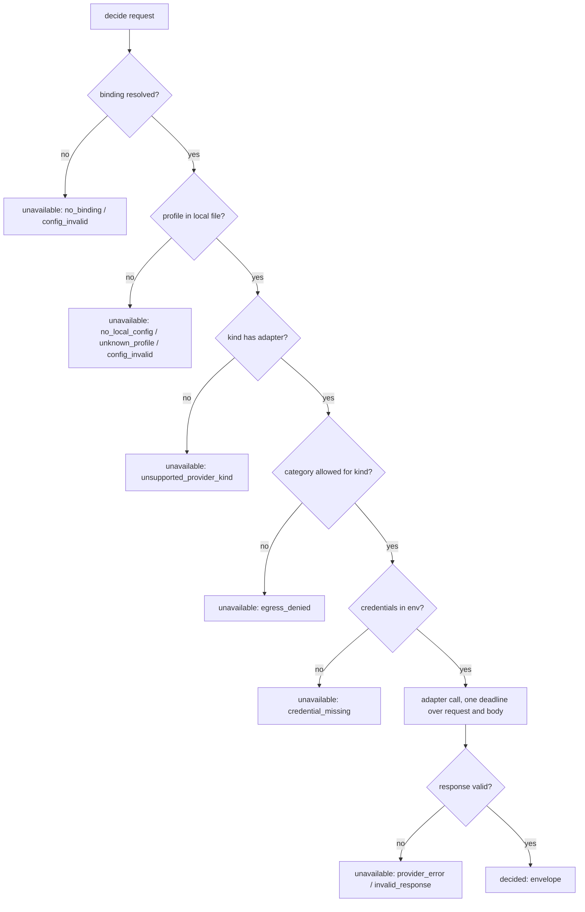

# Decision-model core and the A14 offline eval

**Status**: Candidate; no execution authority.
**Task ID**: `decision-model-core` (source issues #204 and #286; first slice of the decision-model programme).
**Design risk**: High — the slice adds the project's first outbound call to a hosted model provider, so it creates a data-egress trust boundary (which input categories may leave the machine), a credential-handling surface, and two new configuration files (one user-local, one tracked). No Kernel, Assurance, record, store or authority path changes, and no file under `plugins/immune-brain/runtime/` imports or is imported by the new code.
**Design views**: architecture layers (dependency direction and prohibited coupling), service/component interfaces (`decide()`, the two configuration files, the provider adapter, the result envelope, the eval report), data flow (configuration → egress gate → provider → response validation → envelope → report).
**Diagram decision**: required
**Diagram reason**: the decide path has five early exits to `unavailable` before and after the provider call; the flow diagram shows that no exit reaches the network before the egress gate.
**Document language**: English, following Planner's default document policy; the user's reply-language preference does not change document language.

## Outcome

A maintainer can run an offline evaluation of PR comment triage (application point A14) against a hosted decision model and read a dated report. The report shows, for each labelled comment, the per-option probabilities, the model id and version, the threshold-set version and a truncation flag. It also compares the model against today's `fix-pr` behaviour, which repairs every unresolved thread and so acts as an "everything is blocking" classifier. The decision-model component the eval uses is shared code. Later application points, and later live use in standalone Skills, call the same `decide()` instead of building their own path.

| Slice | Observable when it has landed | Remaining gap |
|---|---|---|
| `decision-model-core` | `decide()` resolves a profile from the user-local `.imm/decision-models.local.json` and the tracked `.imm/decision-bindings.json`, enforces the egress allowlist before any request, calls Clef through Workers AI REST (or the `fake` provider), validates the answer and returns a result envelope or an `unavailable` reason; `scripts/decision-eval/a14/extract.ts` turns saved `imm-pr-diag` JSON into corpus rows; `scripts/decision-eval/a14/run.ts` writes a dated JSON and Markdown report against the `all_blocking` baseline; all of it proved with the fake provider and a stubbed `fetch` | a real A14 report needs a labelled corpus and Clef credentials (BR-DEP-1); the Jev adapter; live A14 use in `fix-pr`; every other application point (see Brainstorm Trace) |

## Sources

- **Brainstorm manifest** — the `clarify` session of 2026-11-01 on #204, adopted in full by the user ("采用建议"). Items are cited by their `BR-*` IDs; the complete mapping is in Brainstorm Trace.
- **#286** — "Jev-style decision models in Immune-Brain: complete application plan" (https://github.com/dereknex/immune-brain/issues/286). Cited as `#286-§n`. §3 holds the constitution and admission criteria; §5's A14 row defines the option set {blocking, nit, out-of-scope, duplicate} and names PR history as its label source; §6 defines the score envelope, the code-owned threshold registry and the "no private measurement path" rule.
- **#204** — the originating proposal (https://github.com/dereknex/immune-brain/issues/204); S4 describes A14 as the low-risk pilot because `fix-pr` is a standalone Host-native Skill outside Managed authority.
- **Clef API** — Cloudflare Workers AI model page and raw schemas, fetched 2026-11-01: `https://developers.cloudflare.com/workers-ai/models/clef/index.md`, `.../schema-input.json`, `.../schema-output.json`. Verified facts used here: endpoint `POST https://api.cloudflare.com/client/v4/accounts/{account_id}/ai/run/@cf/cloudflare/clef` with `Authorization: Bearer <token>`; request fields `model` (pattern `clef|clef-flash`), `state` (string or JSON), `questions` (1–64 ids; `choice` takes `instructions` and a `criteria` map of 2–255 option ids); response `model`, `answers.<id>` (`choice` answer: `type`, `choice`, `probabilities` summing to 1, `confidence`), `usage.input_tokens`; context window 65,536 tokens; "the text `state` is truncated to fit the remaining space" with no truncation field in the response. The Jev API was not verified, and the docs page calls Clef's request shape a "System One API" extension, which says nothing about Jev compatibility.
- Repository evidence:
  - `docs/adr/0006-unattended-review-dispatch-authority.md:28-29` — the runtime never invokes an Executor or reviewer model. #286-§6 extends this to "a runtime form is forbidden".
  - `docs/adr/0033-lane-preferences-local-preset.md` — the user-local preset pattern: a gitignored `.imm/*.local.json`, no `contract` field, reported and refused on malformed JSON, unknown key or unknown profile.
  - `docs/adr/0023-project-declared-risk-floor.md` and `.imm/risk-floor.json` — the tracked project-declaration pattern with a `contract` field. `plugins/immune-brain/runtime/kernel/storage_layout_migration.ts:187-247` only treats retired evidence paths under `.imm/` specially, so a new tracked `.imm/` file is inert to it, as `.imm/risk-floor.json` already is.
  - `.gitignore:8` — `.imm/lanes.local.json` is ignored by exact name; this slice adds `.imm/decision-models.local.json` the same way.
  - `plugins/immune-brain/dist/fix-pr.md:31-57` — `fix-pr` classifies observed blockers into `check_repair`, `feedback_repair` and `conflict_repair`; every unresolved review thread or effective change request is feedback to repair. This is the incumbent behaviour behind the `all_blocking` baseline.
  - `plugins/immune-brain/bin/imm-pr-diag:187-245` — output fields: `pr_target.{number,repository,url}`, `reviews[].{id,url,author,state,body,submitted_at}`, `comments[].{id,url,author,body,created_at}`, `review_threads[].{id,path,line,comments[],isResolved,isOutdated}` with `comments[].{id,url,author.login,body,createdAt}`.
  - `docs/specs/review-verifier-eval.spec.md:182-247` — the #284 eval template: an offline extractor, a committed `tests/fixtures/review-eval/corpus.jsonl` whose committed copy (not extractor output) is the eval input, a labelling-protocol README, and a runner that reads its model configuration as data.
  - `tsconfig.json` `include` covers `scripts/**/*.ts`, so `bun run typecheck` checks the new code; root `package.json` `files` does not ship `scripts/`, so no release or changeset is needed.
  - `.imm/risk-floor.json` — `scripts/`, `tests/` and `.imm/` are not floor paths; only this Spec and the TaskIntent (`docs/specs`, `docs/plans`, `changed_only`) raise the task to `material`.

## Threat model and supported environment

Inputs and their trust: PR comment text from `imm-pr-diag` output is untrusted remote text and may try to steer the model. In this slice it can only shift probabilities in an offline report, which no decider reads. Provider responses are untrusted and are schema-validated before use. `.imm/decision-models.local.json` is trusted as the local user's own choice. `.imm/decision-bindings.json` is tracked repository configuration. An agent or contributor could edit it to widen egress, so a widening shows up as a reviewable diff, and an invalid file fails closed (no request). Credentials are read only from environment variables named in the local file and are never written to a report, an envelope or an error detail. Adversary: a PR commenter writing injected instructions, and a malformed or hostile provider response. Supported environment: macOS and Linux with Bun; UTF-8 JSON files; network access only from the Clef adapter, and never during acceptance tests (`fetch` is injected).

## Brainstorm Trace

| Item | Disposition | Where |
|---|---|---|
| BR-SCN-1 | covered (`automated`) | User scenarios; AC6 |
| BR-SCN-2 | deferred to the live A14 slice: in this slice `fix-pr` has no model path, so the scenario first becomes observable when `fix-pr` consumes `decide()`; this slice delivers the precondition (every failure returns `unavailable`, AC4) | Remaining gap |
| BR-SCN-3 | covered (`automated`) | User scenarios; AC2 |
| BR-DEC-1 | decisioned for this slice: offline only, no decider reads the output; the live-Skill threshold rule and the security/red-circle exclusion apply to the live A14 slice | D1; Remaining gap |
| BR-DEC-2 | covered: one profile per call, global default plus per-point override, no fallback chain | D3, D5; AC1, AC4 |
| BR-DEC-3 | covered: user-local profiles, tracked bindings and egress, code-owned thresholds | D3, D6; AC1, AC7 |
| BR-DEC-4 | covered | D4; AC2 |
| BR-DEC-5 | covered: Clef (verified API) and `fake`; `jev` is a known kind reported as `unsupported_provider_kind` until its adapter slice | D2, D5; AC1, AC3 |
| BR-DEC-6 | decisioned: this slice is Phase 0's shared component plus the first consumer; the other points stay phased successors | Remaining gap |
| BR-DEC-7 | out of this TaskIntent: the parallel #284 S1 item 7 → #204 S1 line is its own `draw-up` | Remaining gap |
| BR-OUT-1 | excluded: no multi-model call, fusion or fallback chain | D5 |
| BR-OUT-2 | excluded: no generic-LLM provider kind | D2 |
| BR-OUT-3 | excluded: the bindings file plus the code registry stand in for a separate registry | D3, D6 |
| BR-DEFER-1…5 | deferred, not touched by this slice (A5 sampling, rework-budget unit, A9, #284 A1–A3 migration, #316 revision) | Remaining gap |
| BR-DEP-1 | dependent-blocked: the real A14 report run needs Clef credentials and a labelled corpus | Remaining gap |
| BR-DEP-2 | dependent-blocked: Issue edits are not part of this slice | Remaining gap |

## Decisions and technical design

### D1 — Placement and dependency direction (source: BR-DEC-1; ADR 0006; delegated technical choice for the directory)

The component lives in `scripts/decision-model/` and the A14 eval in `scripts/decision-eval/a14/`. Dependency direction: `decision-eval → decision-model`, never the reverse. No file under `plugins/immune-brain/runtime/` or `plugins/immune-brain/.pi-extension/` imports either directory, and neither imports from them. AC4 pins this with an import scan. Offline is the only form in this slice. Nothing writes to a TaskRecord, batch record, digest, audit record or Kernel store.

Choosing `scripts/` over a shipped plugin directory is a delegated choice. The only consumer in this slice is offline. The module has no host coupling, so the live A14 slice can move it under `plugins/immune-brain/` together with the packaging change that slice needs anyway.

> **Superseded by `docs/specs/layered-config.spec.md` D8 (Initiative `layered-config`, #360).** The component moves to `plugins/immune-brain/runtime/decision_model/` and ships with the plugin; `scripts/decision-eval/` imports it from there. No authority-path runtime file (`runtime/kernel/`, `runtime/assurance/`, `runtime/unattended/`, `runtime/claude/`, `.pi-extension/`) imports it, which replaces the import scan of AC4. The text above stays as the record of the original slice.

### D2 — Provider kinds (source: BR-DEC-5; Clef API source)

Kinds known to the parser: `clef`, `fake`, `jev`. `clef` and `fake` have adapters. A profile of kind `jev` parses but resolves to `unavailable` with reason `unsupported_provider_kind` until the Jev adapter slice, because the Jev API is unverified. Any other kind is `config_invalid`. There is no generic-LLM kind (BR-OUT-2).

> **Superseded by decision-models S3 (`jev-adapter`, #351).** `jev` now has an adapter: `scripts/decision-model/providers/jev.ts`, wired in `scripts/decision-model/decide.ts:30`. A `jev` profile takes `api_key_env` (required) and optional `base_url`, `context_window` and `timeout_ms` (`scripts/decision-model/config.ts` `parseJevProfile`), and no longer resolves to `unsupported_provider_kind`. The adapter is still unverified against TypeSafe's own reference. The header of `jev.ts` and `tests/fixtures/decision-eval/a14/README.md` record its sources and what they did not confirm, and a response that does not match the Clef choice shape surfaces as `unavailable`. The text above describes this slice as delivered.

- **`clef`** profile fields: `kind`, `model` (`"clef"` or `"clef-flash"`), `account_id_env`, `token_env` (environment variable names, both required), optional `context_window` (positive integer, default 65536) and optional `timeout_ms` (1000–120000, default 30000).
- **`fake`** profile fields: `kind`, `answers` (map of `trace_id` → probability map) and `default` (probability map, optional). It returns the entry for the request's `trace_id`, else `default`, else `unavailable/provider_error`. It never touches the network. It reports `model: "fake"`, `model_version: null`, `input_tokens: null`.

### D3 — Two configuration files (source: BR-DEC-3, BR-DEC-2; ADR 0033 and ADR 0023 patterns)

**User-local `.imm/decision-models.local.json`** (gitignored, no `contract` field):

```json
{ "profiles": { "default": { "kind": "clef", "model": "clef", "account_id_env": "CLOUDFLARE_ACCOUNT_ID", "token_env": "CLOUDFLARE_AUTH_TOKEN" } } }
```

The only top-level key is `profiles`, and each profile's keys are the ones its kind allows (D2). Unknown keys, wrong types and malformed JSON are all `config_invalid`. A missing file is `no_local_config`.

**Tracked `.imm/decision-bindings.json`**:

```json
{
  "contract": "immune_brain/decision_bindings/v1",
  "default_profile": "default",
  "bindings": {},
  "egress": {}
}
```

- `default_profile` is a profile name or `null`.
- `bindings` maps a registered application-point id (D6) to a profile name or `null`, and overrides the default for that point.
- `egress` maps a provider kind to the list of sensitive input categories it may receive (D4).

An unknown application point, an unknown kind, an unknown category, an unknown key or malformed JSON is `config_invalid`. A missing file means nothing is bound (`no_binding`). Profile names are local and the bindings name them, so a clone with no local file, or with a local file that lacks the named profile, resolves to `no_local_config` or `unknown_profile`, never to a call.

Resolution for a point: `bindings[point]` if the key is present, else `default_profile`. `null` means `no_binding`. Then the profile is looked up in the local file. Exactly one profile answers a call (BR-DEC-2).

> **Superseded by `docs/specs/layered-config.spec.md` D2, D4, D7 and D9 (#360).** Profiles, the default profile and bindings move to the user file `~/.config/immune-brain/config.json`, with per-repository overrides; the egress ceiling and enabled points move to the tracked `.imm/config.json`. Both files above are read as deprecated legacy sources for one major version, and `.imm/decision-bindings.json` is deleted from this repository. The text above stays as the record of the original slice.

### D4 — Egress gate (source: BR-DEC-4)

Input categories:

- **Non-sensitive** (always allowed): `pr_comment` (a PR comment, review body or review thread, with its author, thread discussion, file path and line, never a diff hunk), `command_text`, `session_event`.
- **Sensitive** (allowed only when listed under the provider's kind in `egress`): `finding`, `diff`, `goal_scope`, `spec_source`.

Listing a non-sensitive category in `egress` is `config_invalid`, so that a reader of the file sees only real decisions. The gate runs after profile resolution and before credential lookup and any adapter call. A denied category returns `unavailable` with reason `egress_denied` and a detail naming the category and kind, and the adapter is not invoked. The gate applies to every kind, `fake` included, so that tests prove it without a network. The rule is the same offline and live.

### D5 — `decide()` and the result envelope (source: #286-§6 score envelope; BR-DEC-2; BR-OUT-1)

`decide(request, deps)`:

- `request` is `{ point, state, trace_id? }`. `state` is a string or JSON value.
- `deps` is `{ root, env, fetch, now }`, all injectable.

It returns either `{ status: "decided", envelope }` or `{ status: "unavailable", reason, detail }`. Reasons: `no_binding`, `no_local_config`, `unknown_profile`, `config_invalid`, `unsupported_provider_kind`, `egress_denied`, `credential_missing`, `provider_error`, `invalid_response`. `decide()` never throws for these. A thrown adapter error becomes `provider_error`. `unavailable` always leads to the caller's baseline behaviour. There is no retry and no second profile.

The envelope has these fields: `application_point`, `question_type`, `option_set` (ordered option ids), `probabilities`, `choice`, `confidence`, `provider_kind`, `profile`, `model`, `model_version` (string or `null`), `threshold_set_version`, `input_tokens` (number or `null`), `context_window` (number or `null`), and `truncation`. `truncation` is `"possible"` when `input_tokens >= floor(0.99 × context_window)`, `"none"` when it is below that, and `"unknown"` when either value is `null`.

The 0.99 heuristic is a delegated choice. Clef truncates silently, and a truncated state fills the window.



**Clef adapter.**

- **Request**: one `choice` question keyed by the point id, carrying the point's `instructions` and option `criteria` (D6). The request's `state` is the `state` field, `model` is the profile's model, and the URL is the verified endpoint with the account id from `env[account_id_env]`.
- **Deadline**: one `AbortSignal` deadline of `timeout_ms` covers the request and the body read. A timeout is `provider_error` with detail `timeout`.
- **Response handling**:
  - The adapter accepts the Workers AI REST wrapper `{ success, result: { model, answers, usage } }`. Cloudflare REST wraps every v4 response in it; the model page shows only the inner object. The Executor confirms this against the docs or a recorded response and records the source in the test fixture comment.
  - `success: false` or a non-2xx status is `provider_error`, and the detail carries the status but not the body.
  - The adapter validates the answer before using it. `invalid_response` covers each of these: `answers[point]` missing; a `type` other than `choice`; probability keys that differ from the option set; a value outside [0, 1]; a sum more than 1e-3 away from 1; a `choice` outside the option set; a `confidence` outside [0, 1].
- **Envelope values**: `model_version` is `null` (the response carries only `model`), and `input_tokens` comes from `usage.input_tokens`.

### D6 — Application-point registry and thresholds (source: #286-§6 threshold registry; #286-§5 A14 row)

`scripts/decision-model/thresholds.ts` is the code-owned registry: one entry per application point. This slice registers one point:

- **id**: `a14_pr_comment_triage`
- **question type**: `choice`
- **input category**: `pr_comment`
- **options**:
  - `blocking`: must change before merge
  - `nit`: optional polish
  - `out_of_scope`: valid but belongs to another change
  - `duplicate`: restates an earlier comment in the same PR
- **instructions**: a fixed English sentence asking which option fits the target comment, given its thread and the earlier PR comments
- **threshold set**: `{ version: "a14/v0", values: null }`

The values stay `null` because #286-§6 sets threshold values from baseline data at implementation time of the live form, never in advance. The registry is the only place a point's option set and threshold-set version live, and the bindings parser reads point ids from it.

### D7 — A14 corpus extraction (source: #286-§5 A14 label source "PR history"; #284 corpus template)

`bun scripts/decision-eval/a14/extract.ts --diag <file>... --corpus <path>` reads saved `imm-pr-diag` JSON files. It never calls `gh` or the network. The maintainer saves `imm-pr-diag <PR>` output per PR.

**One corpus row per item**, for each review thread, each non-empty PR comment and each review with a non-empty body:

| Field | Value |
|---|---|
| `id` | `<repository>#<number>/<thread\|comment\|review>/<item id>` |
| `repository`, `pr`, `kind` | taken from the diag output |
| `author`, `created_at` | taken from the item |
| `body` | the first comment for a thread |
| `discussion` | the bodies of later thread comments |
| `path`, `line` | threads only |
| `resolved`, `outdated` | threads only, `null` otherwise |
| `gold` | `"unlabeled"` |
| `labeler`, `labelled_at` | `null` |

**Re-extraction into an existing corpus** keeps each existing row's `gold`, `labeler` and `labelled_at` by `id`. It keeps rows that are absent from the new diags, adds new rows as unlabeled, and writes rows sorted by `id`. An existing row whose `gold` is not one of `unlabeled`, `blocking`, `nit`, `out_of_scope` or `duplicate` stops the extraction with exit 1 and `invalid_gold_label: <id>`, before anything is written. Validation precedes the merge.

**Labelling protocol**: `tests/fixtures/decision-eval/a14/README.md` carries it, including that `resolved` is a hint and not a label. The committed corpus, not extractor output, is the eval input, the same as in #284.

### D8 — A14 eval runner and report (source: BR-SCN-1; #286-§3 "measured offline first, against a named baseline"; #286-§6)

`bun scripts/decision-eval/a14/run.ts --corpus <path> --out <dir> [--root <dir>] [--date YYYY-MM-DD]`. For each labelled row it calls `decide()` with `point: "a14_pr_comment_triage"`, `trace_id: id`, and `state: { target, discussion, path, line, earlier }`. `earlier` holds the bodies of up to 20 earlier items of the same PR by `created_at`, which the `duplicate` option needs. All of these fields are `pr_comment` category.

**Exit codes.**
- 1 with `no_labelled_cases` when the corpus has no labelled rows.
- 1 with `corpus_invalid: <line>` on a malformed corpus line.
- 2 with `no_cases_decided` when every case came back `unavailable`. This is checked after the report is written, so the unavailable reasons stay readable.

**Report files.** The runner writes `<out>/a14-<date>.json` and `<out>/a14-<date>.md`. `date` defaults to the run date; tests pass it.

The JSON report has contract `immune_brain/decision_eval_report/v1`:

| Field | Content |
|---|---|
| `application_point`, `date` | the point id and the run date |
| `corpus_sha256` | hash of the corpus file |
| `profile`, `provider_kind`, `model`, `threshold_set_version` | from the resolved binding and the registry |
| `counts` | `total`, `labelled`, `unlabeled`, `decided`, `unavailable` by reason |
| `metrics.accuracy` | correct ÷ labelled; an `unavailable` case counts as not correct |
| `metrics.decided_accuracy` | correct ÷ decided |
| `metrics.macro_f1`, `metrics.per_class` | per class: `precision`, `recall`, `support` |
| `metrics.brier` | over decided cases |
| `metrics.ece` | 10 equal-width confidence bins |
| `metrics.coverage_at` | confidence 0.50 to 0.95 in 0.05 steps, each with `coverage` and `accuracy` |
| `baseline` | `all_blocking` predicts `blocking` for every labelled case; carries `accuracy` and `macro_f1` |
| `cases[]` | `id`, `gold`, and either the full envelope or `{ unavailable: reason }` |

The Markdown file has a summary table (model vs baseline) and one line per case with gold, choice, every option's probability, model, model version, threshold-set version and truncation.

## User scenarios

- **BR-SCN-1** — `automated` (AC6). Actor: maintainer. Given the user-local config names a decision-model provider and the tracked binding maps A14 to it, When they run the `fix-pr` offline eval, Then they see a report with per-option probabilities, model id/version, threshold version, and a truncation flag for each comment.
- **BR-SCN-3** — `automated` (AC2). Actor: maintainer. Given a provider's allowlist does not enable a sensitive input category, When an application point would send that category, Then no request is sent and the result states the category is not enabled.
- **BR-SCN-2** is deferred to the live A14 slice (Brainstorm Trace).

## Verification and acceptance mapping

Seams: `tests/decision-model.test.ts` exercises `decide()` through its public signature with a temp `root`, an injected `env` and an injected `fetch` that records calls. `tests/decision-eval-a14.test.ts` runs the two CLIs as subprocesses (`Bun.spawnSync`) against temp corpora and a temp local config with a `fake` profile, and reads the written files. Prior art: `tests/review-retro-analyzer.test.ts` builds inline inputs under a temp root and asserts the CLI's printed contract and output shape. `tests/imm-pr-diag.test.ts` owns the diag shape the extractor reads. The seams catch the regressions that matter here: an egress or credential check that runs after the network call shows up as a recorded `fetch`; a lost label on re-extract shows up in the written corpus; a report that counts abstentions as correct shows up in `metrics.accuracy`.

| AC | Invariant (decision) | Positive / negative / bound controls |
|---|---|---|
| AC1 | resolution (D2, D3) | +override wins over default; −missing local file, unknown profile, unknown point, unknown key, malformed JSON, `jev`, unknown kind, `default_profile: null`; bound: the point key present with `null` beats a non-null default |
| AC2 | egress before adapter (D4) | +listed sensitive category reaches `fetch` once; −unlisted sensitive category, zero `fetch` calls, detail names category and kind; −non-sensitive category listed is `config_invalid` |
| AC3 | Clef adapter (D5) | +valid wrapped response gives an envelope with exact URL, bearer header and body; −missing token env (zero calls), HTTP 500, `success:false`, key-set mismatch, sum 1.002, choice outside set, deadline exceeded; bound: sum 1.0009 accepted, truncation at exactly floor(0.99×window) is `possible` and one token less is `none`; credentials absent from every detail |
| AC4 | envelope and isolation (D1, D5) | +fake envelope fields; −adapter throw becomes `provider_error`; import scan both directions |
| AC5 | extraction (D7) | +rows from sample diag; +labels kept on re-extract; −invalid gold stops before write; bound: empty-body comment and review produce no row |
| AC6 | report (D8; BR-SCN-1) | +report fields and metrics on a 4-case corpus; −zero labelled cases exit 1; −all unavailable exit 2 with report present; bound: an unavailable case lowers `accuracy` but not `decided_accuracy` |
| AC7 | configuration files (D3) | +tracked file content; +local file ignored by Git; +CONTEXT vocabulary |

## Devil's Advocate Audit

- **Rollback resilience.** The slice adds new directories, two config files, one `.gitignore` line and one `CONTEXT.md` entry; nothing existing imports the new code (AC4). Reverting the commit removes it with no migration. A partial implementation cannot change any Skill, Kernel or runtime behaviour, because no existing caller is wired to `decide()`. Leaving `.imm/decision-bindings.json` in place without the code is inert: nothing reads it.
- **Verification vanity.** The egress test would pass vacuously if `fetch` were never reachable, so AC2 has a positive control in which an allowed category does call `fetch` exactly once. The eval could look healthy if abstentions counted as correct, so AC6 pins `accuracy` below `decided_accuracy` when a case is unavailable, and fails the run when nothing is decided. Response validation has a bound control on each side of the 1e-3 sum tolerance. The Clef REST wrapper is the one fact not taken from the fetched docs, so D5 makes the Executor record its source. A wrong wrapper assumption fails the first real run with `invalid_response`, never silently. No acceptance needs the network, credentials or the real corpus, and the remaining gap states that a real report is not yet produced.
- **Spec dilution.** The confirmed first slice is "shared component + A14 offline eval as first consumer" (manifest Next Action, BR-DEC-6). Both are delivered end to end, from extraction through to the dated report. The Jev adapter, live A14 and the other points are not quietly dropped: the Brainstorm Trace and the remaining gap list them as successors. The `fake` provider is test scaffolding and is not counted as a delivered provider; Clef is.

## Remaining gap after this slice

- Real A14 report: run `imm-pr-diag` on chosen PRs, extract, label the corpus under the README protocol, set Clef credentials, run the eval. Needs BR-DEP-1.
- ~~Jev adapter slice, once its API is verified (BR-DEC-5).~~ Delivered by decision-models S3 (#351). Its API is still unverified (see the D2 note).
- Live A14 in `fix-pr`: move the module to a shipped path, set thresholds from the report, apply BR-DEC-1's live rules, deliver BR-SCN-2.
- Other application points, phased per #286-§7; BR-DEFER-1…5; BR-DEC-7's parallel line; Issue edits (BR-DEP-2).
