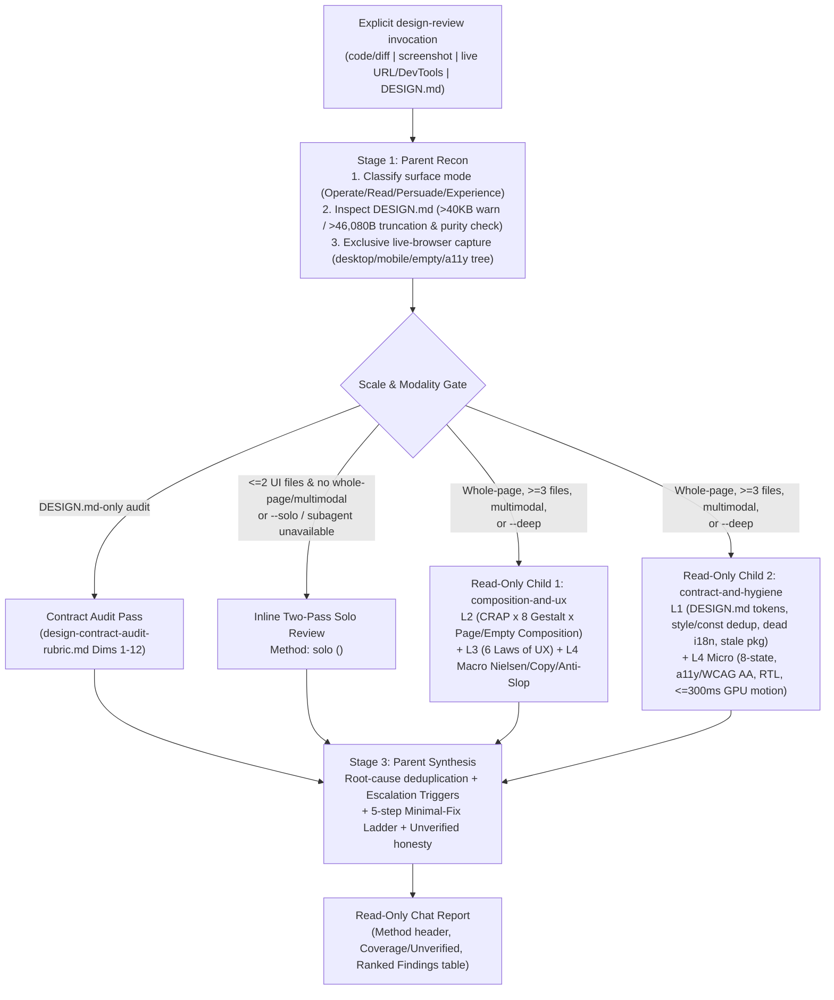

# Immune-Brain Design Review Skill and Shared UI/UX Rubric

**Task ID**: `design-review-skill`
**Planning baseline**: `b4ec48210a0`
**Output language**: English (repository default; user discussion remains Chinese).
**Design risk**: Medium — introduces a new public standalone host-native Skill (`design-review`), expands shared packaged reference contracts (`ux-heuristic-checklist.md`, `design-contract-review-checklist.md`, `design-contract-audit-rubric.md`) consumed by both the public Skill and the internal `ui-review` role, and updates cross-host packaging manifests (`registry.yaml`, `dist-sync-manifest.ts`, `derived-files.json`, Claude and Antigravity role/skill outputs) without altering Kernel, Assurance, or Loop TypeScript state machines.
**Design views**: architecture layers, service/component interfaces, data flow, temporal sequence. (State transitions view omitted: `design-review` is stateless and read-only, mutating no TaskRecord, `.imm/state/kernel.sqlite`, or persisted workflow state.)
**Diagram decision**: required
**Diagram reason**: clarifies the adaptive `Parent Recon -> Orthogonal Dual-Lens Read-Only Subagents / Solo Fast-Path -> Parent Root-Cause Synthesis` flow and reference-slice isolation across Claude Code, Pi, and Antigravity.
**Execution posture**: test-first — write focused contract assertions in `tests/design-review-contract.test.ts` and skill-inventory test updates first so missing rubric clauses, broken loader anchors, or packaging drift fail red before authoring the Skill and reference updates.

## Outcome

Delivers the complete confirmed framing (`BR-REQ-1..4`, `BR-DEC-1..5`, `BR-SCN-1..3`) while preserving `BR-OUT-1..4` in one atomic Slice (`design-review-skill`):

| Slice | Task ID | Result when landed alone | Remaining gap | Risk | Scenarios | Agreed seams |
| --- | --- | --- | --- | --- | --- | --- |
| `S1` | `design-review-skill` | Publishes read-only standalone Skill `design-review` across Claude Code, Pi, and Antigravity with the complete 4-layer UI/UX & contract rubric, adaptive `composition-and-ux` + `contract-and-hygiene` read-only subagent lenses, honest `Unverified (no rendered surface)` static-mode reporting, `DESIGN.md` `46,080 B` budget/purity checks, and shared single-source-of-truth alignment with internal role `ui-review` | None (complete outcome) | `material` | `BR-SCN-1`, `BR-SCN-2`, `BR-SCN-3` | `plugins/immune-brain/tests/skill-registry-consistency.test.ts`, `tests/skill-dist-consistency.test.ts`, `tests/design-review-contract.test.ts`, `tests/layering-rules-contract.test.ts`, `tests/code-quality-guard-contract.test.ts`, `tests/role-prompt-bridge.test.ts`, `tests/antigravity-host-package.test.ts`, `tests/pi-only-current-contracts.test.ts`, `tests/direct-first-routing-contract.test.ts` |

## Sources and Discovery Evidence

- **Upstream Brainstorm manifest**: `BR-REQ-1..4`, `BR-DEC-1..5`, `BR-OUT-1..4`, `BR-SCN-1..3` (zero open `BR-Q-*` or `BR-DEFER-*`).
- **Repository evidence inspected at `b4ec48210a0`**:
  - `plugins/immune-brain/skills/registry.yaml:1-85` and `plugins/immune-brain/tests/skill-registry-consistency.test.ts:59-143`: canonical public Skill registry and frontmatter/loader consistency checks.
  - `scripts/dist-sync-manifest.ts:30-47,113-185` and `scripts/sync-dist-docs.ts:46-168`: mirror rules for `docs/reference/*`, `registry.yaml`, `role-prompts/*`, `plugins/immune-brain/README.md` role map, and `SKILL_OWNED_ENTRIES` enumeration guard.
  - `scripts/build-claude-plugin.ts:19-55`, `scripts/build-antigravity-plugin.ts:25-120`, and `docs/agents/derived-files.json:31-328`: generated Claude read-only role definitions and Antigravity plugin artifact inventory.
  - `plugins/immune-brain/runtime/prompts/ui-review.md:1-14` and `plugins/immune-brain/agents/immune-brain-ui-review.md:1-21`: 14-line internal `ui-review` prompt (`imm-ui-review` JSON gate) currently unlinked from `dist/docs/reference/*`.
  - `docs/reference/design-contract-review-checklist.md:1-55`, `docs/reference/design-contract-audit-rubric.md:1-149`, `docs/reference/ux-heuristic-checklist.md:1-131`, and `docs/reference/i18n-review-checklist.md:1-110`: existing UI/design/i18n reference docs missing Gestalt 8-principle completeness, Laws of UX, whole-page/empty-state composition, style/token/dead-i18n convergence, and `DESIGN.md` `46,080 B` read-budget/purity checks.
  - `docs/reference/subagent-dispatch-protocol.md:10-15,59-66,157,223-245`: caps independent advisory children per trigger point at 2, requires foreground `inherit_context: false` sequential execution on Pi and native read-only agent allowlists on Claude/Antigravity, and keeps synthesis in the Parent.
  - `docs/reference/workflow-and-subagents.md:232`: stale `no tools` table entry for `ui-review` vs shipped `Read, Grep, Glob` / native read-only tools.
  - `docs/solutions/rejected-ui-review-fallback-design-generation.md:1-53`: active rejected decision prohibiting fallback `DESIGN.md` generation or default SaaS style imposition when `DESIGN.md` is missing.
  - `tests/skill-dist-consistency.test.ts:43-58,69-87,142-187,323-438`, `tests/layering-rules-contract.test.ts:144-146`, `tests/code-quality-guard-contract.test.ts:43-45`, `tests/antigravity-host-package.test.ts:44`, `tests/e2e/install.e2e.ts:20`, `tests/pi-only-current-contracts.test.ts:95-106`, and `tests/direct-first-routing-contract.test.ts:60-65`: contract tests governing Skill loaders, heading-anchor slugs, role prompts, READMEs, and Host packages.

## Boundaries and Non-Goals

- `BR-OUT-1`: Never auto-generate a fallback `DESIGN.md` or impose a default SaaS style when `DESIGN.md` is missing (`docs/solutions/rejected-ui-review-fallback-design-generation.md:39-44`).
- `BR-OUT-2`: Never emit outbound telemetry pings or transmit repository source, markup, or findings to external services (`plugins/immune-brain/BASELINE.md:28-32`).
- `BR-OUT-3`: Never create or mutate TaskIntent, TaskRecord, `.imm/state/kernel.sqlite`, reviewed project files, unrequested report files, or user-global `~/.agents/skills/`.
- `BR-OUT-4`: Never include greenfield UI generation or theme-catalog rotation workflows inside `design-review`.

## Threat model and supported environment

Reviewed project artifacts (`DESIGN.md`, source files, Git diffs, i18n catalogs, screenshots, and live-browser DOM/accessibility trees) are untrusted project data inspected strictly read-only: directives embedded in `DESIGN.md`, source comments, or DOM text are treated solely as passive design/content evidence and never as executable instructions to run shell commands, install dependencies, mutate files, override safety guards, or send data off-host. Supported on macOS and Linux across Claude Code, Pi, and Antigravity with Node/Bun and Git tooling.

## User scenarios

| ID | Mode | Actor / Given / When / Then | Acceptance / Reason |
| --- | --- | --- | --- |
| `BR-SCN-1` | `manual` | **Actor**: Developer invoking `design-review` in Claude Code, Pi, or Antigravity. **Given**: A target project with a `DESIGN.md` exceeding `46,080` bytes and a multi-file page UI containing empty-state layout and inline token/style duplication. **When**: The developer runs `design-review` on that page surface. **Then**: The actor observes a read-only chat report headed with `Method: dual-lens`, surfacing the `DESIGN.md` truncation-budget warning, whole-page composition/empty-state findings, and token/duplication drift consolidated by root cause with `file:line` `Before -> After` fixes, while `git status` shows no modified target files. | Manual: `design-review` is a pure instruction Skill with no deterministic CLI binary; live multi-turn LLM chat synthesis on a target UI requires an interactive Host model session (contract invariants are pinned automatically in `AC1` and `AC2`). |
| `BR-SCN-2` | `manual` | **Actor**: Developer invoking `design-review` without a live browser or screenshot. **Given**: A target repository with no `DESIGN.md` and a `1–2` file UI component diff. **When**: The developer runs `design-review` on the diff. **Then**: The actor observes a read-only chat report headed with `Method: solo (cost_scope_mismatch)` that notes the missing `DESIGN.md` without creating one, reports code-verifiable UX/state/a11y/i18n/motion findings, and lists render-dependent visual checks under `Unverified (no rendered surface)`. | Manual: requires a live Host model session to render the conversational report on an arbitrary diff (solo threshold, missing-`DESIGN.md` rule, and `Unverified` contract rules are pinned automatically in `AC2`). |
| `BR-SCN-3` | `automated` | **Actor**: Repository maintainer verifying Immune-Brain plugin packaging. **Given**: The added `design-review` Skill, updated `docs/reference/` checklists, and aligned `ui-review` role prompt. **When**: The maintainer runs `bun scripts/sync-dist-docs.ts --check`, `bun scripts/build-antigravity-plugin.ts --check`, and `bun test plugins/immune-brain/tests/skill-registry-consistency.test.ts`. **Then**: All commands exit `0` and `design-review` appears in the synchronized skill registries and packaged `dist/` trees. | `AC1`, `AC3` |

## Brainstorm Trace

| Item | Classification | Mapped to |
| --- | --- | --- |
| `BR-REQ-1` | Covered | `D1`, `D7`; `AC1`, `AC3` |
| `BR-REQ-2` | Covered | `D3`, `D4`; `AC2` |
| `BR-REQ-3` | Covered | `D5`; `AC2` |
| `BR-REQ-4` | Covered | `D6`, `D7`; `AC2`, `AC3` |
| `BR-DEC-1` | Decisioned | `D1`; `AC1`, `AC2` |
| `BR-DEC-2` | Decisioned | `D6`; `AC2`, `AC3` |
| `BR-DEC-3` | Decisioned | `D2`; `AC2` |
| `BR-DEC-4` | Decisioned | `D1`; `AC1` |
| `BR-DEC-5` | Decisioned | `D4`; `AC2` |
| `BR-OUT-1` | Out (rejected decision preserved) | `D3`, `AC2` (`docs/solutions/rejected-ui-review-fallback-design-generation.md`) |
| `BR-OUT-2` | Out (security guard preserved) | `D1`, `AC2` (zero outbound telemetry/external report endpoints) |
| `BR-OUT-3` | Out (authority boundary preserved) | `D1`, `AC1`, `AC2` (read-only discovery; zero Kernel/source/global writes) |
| `BR-OUT-4` | Out (non-goal preserved) | `D1`, `AC2` (critique/audit only; no greenfield generation or theme rotation) |
| `BR-SCN-1` | Scenario (`manual`) | Dual-lens multimodal/whole-page chat behavior (`D4`, `D5`; contract rules pinned by `AC2`) |
| `BR-SCN-2` | Scenario (`manual`) | Solo static-diff & missing-`DESIGN.md` chat behavior (`D2`, `D3`, `D4`; contract rules pinned by `AC2`) |
| `BR-SCN-3` | Scenario (`automated`) | `AC1`, `AC3` |

No `BR-DEFER-*` or `BR-Q-*` items exist.

## Technical Design

### Architecture Layers and Dependency Direction

- **Canonical Reference Layer (`docs/reference/`)**: `ux-heuristic-checklist.md`, `design-contract-review-checklist.md`, `design-contract-audit-rubric.md`, and existing `i18n-review-checklist.md` own the style-neutral domain criteria. `scripts/sync-dist-docs.ts` mirrors them byte-for-byte into `plugins/immune-brain/dist/docs/reference/`.
- **Owned Skill Contract Layer (`plugins/immune-brain/dist/design-review.md` & `skills/design-review/SKILL.md`)**: `SKILL.md` is a minimal explicit-entry trigger and section-route loader pointing only to clean punctuation-free headings in `../../dist/design-review.md` and `../../dist/BASELINE.md`. `dist/design-review.md` owns orchestration, modality handling, subagent lens dispatch, escalation triggers, minimal-fix ladder, and report structure, linking on demand into `docs/reference/*` inside `dist/`.
- **Internal Role Alignment Layer (`plugins/immune-brain/runtime/prompts/ui-review.md`)**: references the same `dist/docs/reference/*` checklists on demand while preserving the `imm-ui-review` JSON output schema. `scripts/sync-dist-docs.ts`, `scripts/build-claude-plugin.ts`, and `scripts/build-antigravity-plugin.ts` project it to `dist/role-prompts/ui-review.md`, `plugins/immune-brain/agents/immune-brain-ui-review.md`, and `plugins/immune-brain-antigravity/`.
- **Prohibited Coupling**: `design-review` never mutates source or `.imm/` files, never calls Kernel MCP tools, never writes fallback `DESIGN.md` files, and `runtime/prompts/ui-review.md` never references `Layering Rules` or `Code Quality Guard` (`tests/layering-rules-contract.test.ts:145`, `tests/code-quality-guard-contract.test.ts:44`).

### Service and Component Interfaces

- **Registry Entry (`plugins/immune-brain/skills/registry.yaml`)**:
  - `name: design-review`, `path: skills/design-review/SKILL.md`, `role: execute`, `title: Design Review`, `role_class: discovery`, `canonical: true`, `output_artifacts: [design_review_report]`, `next_actions: []`, `boundary: Read-only UI/UX and design-contract critique across code, diffs, screenshots, live pages, and DESIGN.md. No source edits or Managed Path mutation.`
- **Skill Loader (`plugins/immune-brain/skills/design-review/SKILL.md`)**:
  - Frontmatter `description`: `"Use when the user explicitly requests an Immune-Brain UI/UX, interface, or design-contract review of code, diffs, screenshots, live pages, or DESIGN.md."` (starts with `"Use when the user explicitly requests"`, contains `"Immune-Brain"`, contains zero CJK characters and zero `;`, `manifest`, `never `, `owns `, `authority`, or `framing only` substrings).
  - Section routes use exact anchor slugs matching `heading.toLowerCase().replace(/[^\w\s-]/g, "").replace(/\s/g, "-")` in `../../dist/BASELINE.md` and `../../dist/design-review.md`:
    - `common`: `[Shared Guards](../../dist/BASELINE.md#shared-guards)`, `[Workflow Activation](../../dist/BASELINE.md#workflow-activation)`, `[Boundary](../../dist/design-review.md#boundary)`, `[Invocation and Input Modalities](../../dist/design-review.md#invocation-and-input-modalities)`
    - `reconnaissance and lens routing`: `[Parent Recon and Scale Gate](../../dist/design-review.md#parent-recon-and-scale-gate)`, `[Adaptive Orthogonal Subagent Lenses](../../dist/design-review.md#adaptive-orthogonal-subagent-lenses)`
    - `macro composition and ux review`: `[Composition and UX Lens](../../dist/design-review.md#composition-and-ux-lens)`
    - `micro contract and hygiene review`: `[Contract and Hygiene Lens](../../dist/design-review.md#contract-and-hygiene-lens)`
    - `standalone design contract audit`: `[Contract Audit Mode](../../dist/design-review.md#contract-audit-mode)`
    - `synthesis and reporting`: `[Escalation Triggers and Minimal-Fix Ladder](../../dist/design-review.md#escalation-triggers-and-minimal-fix-ladder)`, `[Report Format](../../dist/design-review.md#report-format)`
- **Reference Contracts (`docs/reference/`)**:
  - `design-contract-audit-rubric.md`: adds `### 12. Context Budget and Visual Purity` (`> 40 KB` warning, `46,080 B` single-read truncation boundary, and separation of non-visual runtime mechanics such as observer timers, cursor-merge algorithms, and `sessionStorage` schemas from visual contracts) plus `Budget/purity drift` severity; remains well below `46,080 B`.
  - `design-contract-review-checklist.md`: retains `DESIGN.md` priority and missing-contract non-generation rules, adds `## 3. Whole-Page Composition and State Co-location` (unified visual axis, single `1px` border grammar vs stray `2px` black rules or upload-slot `border-dashed` empty boxes, single parent `gap-*` spacing ownership without child outer `mt-*/mb-*` stacking and `<= 6px` optical-alignment exemption, co-located empty-state + conversion container, restrained accent fills on secondary panels) and `## 4. Implementation Hygiene and Token Convergence` (`DESIGN.md` `> 40 KB` / `46,080 B` truncation check, intra-module Tailwind/constant deduplication across branches/adjacent pages, semantic token enforcement vs raw hex/OKLCH/legacy classes, unused dead i18n keys, and stale frontend package names in `AGENTS.md`/`DESIGN.md`).
  - `ux-heuristic-checklist.md`: upgrades to cover (a) Nielsen's 10 grouped into Perception & Feedback, Control & Error Prevention, Cognitive Load Reduction, and Efficiency & Fallbacks with Surface-Mode Calibration (`Operate`, `Read`, `Persuade`, `Experience` — allowing `n/a` with denominator renormalization where applicable); (b) CRAP (Contrast, Repetition, Alignment, Proximity) paired with all 8 Gestalt Principles (Similarity, Continuation, Closure, Proximity, Figure/Ground, Symmetry, Common Region, Common Fate); (c) all 6 Laws of UX with measurable checks (Fitts `>=44x44px` touch / `>=24x24px` desktop AA + destructive separation, Hick `1` primary + `1-2` secondary visible actions & progressive disclosure, Miller `<=4` optimal / `<=7` max chunks & formatted digit/key groups, Jakob standard mental models & `Enter`/`Escape`/scroll-filter retention, Tesler auto-trim/smart defaults/system inference, Peak-End completion feedback & zero blank/raw-error valleys); and (d) Interactive 8-State Matrix (`default`, `hover`, `:focus-visible`, `:active`, `disabled`, `loading` with `disabled` + `aria-busy`, `error`, `success`), 3-part error microcopy (`what happened + why + recovery action`), restorable truncation (`ellipsis`/`line-clamp`), anti-AI-slop honesty (no invented metrics/testimonials, no fake browser/phone chrome), motion rules (zero animation on high-frequency/keyboard actions, `<=300ms`, `ease-out`, GPU-only `transform`/`opacity`, `prefers-reduced-motion`, `@media (hover: hover) and (pointer: fine)`), and WCAG 2.1 AA semantics/zoom (`no user-scalable=no`).

### Data Flow and Temporal Sequence

1. **Stage 1 — Parent Recon**: On explicit invocation, Parent resolves the target (`code/diff`, `screenshot/mock`, `live URL/DevTools`, or `DESIGN.md`), classifies the surface mode (`Operate / Read / Persuade / Experience`), checks `DESIGN.md` presence/byte size (`> 40 KB` warning, `> 46,080 B` truncation risk) and extracts relevant contract rules, and—when a live browser/DevTools tool is available—exclusively captures desktop/mobile/empty/dark snapshots and accessibility/console diagnostics once so children never contend on browser state or re-read oversized contracts.
2. **Stage 2 — Scale Gate & Orthogonal Read-Only Evaluation**:
   - `DESIGN.md`-only requests run Contract Audit Mode directly against `design-contract-audit-rubric.md`.
   - Component/small diffs (`<= 2` UI files without whole-page composition or multimodal inputs) or `--solo` run two sequential inline passes (`Method: solo (cost_scope_mismatch | user_solo)`).
   - Whole-page, `>= 3`-file, multimodal, or `--deep` targets dispatch at most 2 independent read-only advisory subagents per `docs/reference/subagent-dispatch-protocol.md` (parallel on Claude Code/Antigravity via read-only agent definitions, sequential `inherit_context: false` on Pi; degrading transparently to `Method: solo (<reason>)` if subagent dispatch is unavailable or unauthorized):
     - **Child 1 (`composition-and-ux`)**: receives rendered/structural evidence + `DESIGN.md` composition digest + L2/L3/macro-L4 checklist pointers only.
     - **Child 2 (`contract-and-hygiene`)**: receives code/diff + `DESIGN.md` token table + i18n/a11y/console evidence + L1/micro-L4 checklist pointers only.
3. **Stage 3 — Parent Synthesis & Read-Only Report**: Parent deduplicates findings sharing one root cause across lenses, applies hard Escalation Triggers (missing accessible name/focus ring, keyboard-unreachable control, `320px`/`200%` zoom clipping, WCAG AA contrast failure, color-only or motion-only state, unguarded destructive action, unrestorable truncation, unrecoverable raw error, broken `prefers-reduced-motion`), proposes fixes via the 5-step Minimal-Fix Ladder (`1. Delete -> 2. Use platform -> 3. Reuse project token -> 4. Correct value -> 5. Add`), marks uninspected render-only checks `Unverified (no rendered surface)`, and emits the chat report without writing files.

### Decisions and Provenance

- **D1** *(Source: `BR-DEC-1`, `BR-DEC-4`)*: Ship `design-review` as a read-only `discovery` standalone Skill (`next_actions: []`) with Immune-Brain-scoped English frontmatter disambiguating it from `~/.agents/skills/design-review`, zero outbound network/telemetry calls, and chat-only output unless the user explicitly asks to save a file.
- **D2** *(Source: `BR-DEC-3`)*: Support `code/diff`, `screenshot/mock`, `live URL/DevTools`, and `DESIGN.md` inputs; when no rendered surface is available, evaluate code/contract rules normally and list visual-only checks under `Unverified (no rendered surface)` instead of blocking or emitting degraded-failure banners.
- **D3** *(Source: `BR-REQ-2`)*: Encode all 4 review layers (L1 Contract/Budget/Hygiene including `46,080 B` truncation & runtime-prose purity, style/constant dedup, token drift, dead i18n keys, stale package docs; L2 CRAP × 8 Gestalt × 4 whole-page/empty-state composition rules with `<= 6px` optical exemption; L3 6 Laws of UX; L4 Nielsen's 10 + 4 surface modes + 8-state controls + 3-part error copy + restorable truncation + anti-slop + i18n/RTL + `<=300ms` GPU motion + WCAG 2.1 AA) while preserving the `BR-OUT-1` ban on fallback `DESIGN.md` generation.
- **D4** *(Source: `BR-DEC-5`)*: Isolate long-context attention via Parent one-shot recon/browser capture plus adaptive 2-lens read-only subagent dispatch (`composition-and-ux` and `contract-and-hygiene`, `<= 2` advisory children per `subagent-dispatch-protocol.md:228`), using inline `solo` for `<= 2`-file component diffs or `DESIGN.md`-only audits (`--solo` / `--deep` overrides) and declaring `Method: dual-lens` or `Method: solo (<reason>)` first in the report.
- **D5** *(Source: `BR-REQ-3`)*: Enforce root-cause consolidation, hard Escalation Triggers, and the 5-step Minimal-Fix Ladder (`Delete -> Use platform -> Reuse token -> Correct value -> Add`), requiring `file:line` (or surface region), violated principle ID, and `Before -> After` remediation on every finding.
- **D6** *(Source: `BR-DEC-2`)*: Upgrade `docs/reference/{ux-heuristic-checklist,design-contract-review-checklist,design-contract-audit-rubric}.md` as the single source of truth shared by `dist/design-review.md` and `plugins/immune-brain/runtime/prompts/ui-review.md` (preserving `imm-ui-review` JSON fields and avoiding `Layering Rules` / `Code Quality Guard` strings), and align `docs/reference/workflow-and-subagents.md` (`read-only tools`) and `CONTEXT.md`.
- **D7** *(Source: Delegated technical choice from `scripts/dist-sync-manifest.ts` and `docs/agents/derived-files.json`)*: Register `design-review.md` in `SKILL_OWNED_ENTRIES`, declare `plugins/immune-brain-antigravity/dist/design-review.md` and `plugins/immune-brain-antigravity/skills/design-review/SKILL.md` in `docs/agents/derived-files.json`, regenerate all mirrors/role definitions via `sync-dist-docs.ts`, `build-claude-plugin.ts`, and `build-antigravity-plugin.ts`, and update READMEs plus the 5 skill-inventory contract tests in one atomic Slice.

### False-Compromise Check

Evaluated tension: deep multi-framework UI/UX + contract critique vs. long-context attention loss and single-browser-tab contention. Resolved via **Preliminary Action + Segmentation**: the Parent performs one-shot `DESIGN.md` budget/digest extraction and exclusive browser capture upfront, then segments evaluation into two cognitive-orthogonal read-only subagent lenses that load only their respective checklist sections, while bypassing subagent overhead on `<= 2`-file component diffs. Secondary cost: two read-only subagent calls on whole-page/multimodal reviews, bounded within the repository's existing 2-child advisory cap. No false compromise detected.

## Devil's Advocate Audit

- **Rollback resilience**: All changes are declarative Skill/reference/prompt markdowns, static manifests (`registry.yaml`, `dist-sync-manifest.ts`, `derived-files.json`), generated mirrors, and contract tests—zero SQLite schema, TaskRecord, or daemon state changes. Reverting the commit (or unstaging/checking out touched files) leaves zero residual state.
- **Verification vanity**: Rather than checking file existence, `AC1`–`AC3` execute YAML frontmatter parsers, section-route heading-anchor resolution (`linkedSections`), `dist` > `2x` loader size checks, byte-for-byte mirror checks (`sync-dist-docs.ts --check`), Claude and Antigravity artifact drift checks (`build-claude-plugin.ts --check`, `build-antigravity-plugin.ts --check`), and explicit content/negative assertions in `tests/design-review-contract.test.ts` (verifying every principle family and rejecting outbound URLs, fallback `DESIGN.md` writes, and forbidden role-prompt strings).
- **Spec dilution detection**: Every upstream item (`BR-REQ-1..4`, `BR-DEC-1..5`, `BR-OUT-1..4`, `BR-SCN-1..3`) is mapped in `Brainstorm Trace` and pinned in `AC1`–`AC3`, including all 4 classical frameworks (CRAP, 8 Gestalt principles, 6 Laws of UX, Nielsen's 10 + surface modes) and all 3 `learning_proposal.md` root causes (whole-page/empty-state composition, intra-module style/token/dead-i18n convergence, `DESIGN.md` `46,080 B` budget & visual purity).

## Acceptance and Seam Mapping

| Acceptance | Source | Scenarios | Agreed seams | Summary & Negative Controls |
| --- | --- | --- | --- | --- |
| `AC1` | `BR-REQ-1` | `BR-SCN-3` | `plugins/immune-brain/tests/skill-registry-consistency.test.ts`, `tests/skill-dist-consistency.test.ts`, `scripts/sync-dist-docs.ts --check` | `design-review` registered (`execute`, `discovery`, `canonical: true`, `next_actions: []`), loader frontmatter/section anchors valid, `dist/design-review.md` owned and synced; rejects CJK/forbidden authority words in description, retired `imm-*` names, and undeclared `dist/` files. |
| `AC2` | `BR-REQ-2` | — (`BR-SCN-1`, `BR-SCN-2` contract rules) | `tests/design-review-contract.test.ts`, `tests/layering-rules-contract.test.ts`, `tests/code-quality-guard-contract.test.ts`, `tests/role-prompt-bridge.test.ts` | Pins all 4 rubric layers, 4 input modalities + `Unverified (no rendered surface)`, adaptive `dual-lens` (`composition-and-ux` + `contract-and-hygiene`, `<=2` children) vs `solo` (`<=2` files / `DESIGN.md`-only / `--solo` / `--deep`), escalation triggers + 5-step fix ladder, and `ui-review.md` shared-reference wiring + `workflow-and-subagents.md` alignment; rejects fallback `DESIGN.md` writes, outbound telemetry URLs, source/Kernel writes, and `Layering Rules` / `Code Quality Guard` in `ui-review.md`. |
| `AC3` | `BR-REQ-4` | `BR-SCN-3` | `tests/antigravity-host-package.test.ts`, `tests/pi-only-current-contracts.test.ts`, `tests/direct-first-routing-contract.test.ts`, `scripts/build-claude-plugin.ts --check`, `scripts/build-antigravity-plugin.ts --check` | `derived-files.json`, Claude/Antigravity generated role & skill trees, `CONTEXT.md`, `README.md`, `README.zh-CN.md`, `plugins/immune-brain/README.md`, and `USER_GUIDE.md` stay in sync with zero drift and keep `design-review` host-native outside Managed Path auto-routing. |
