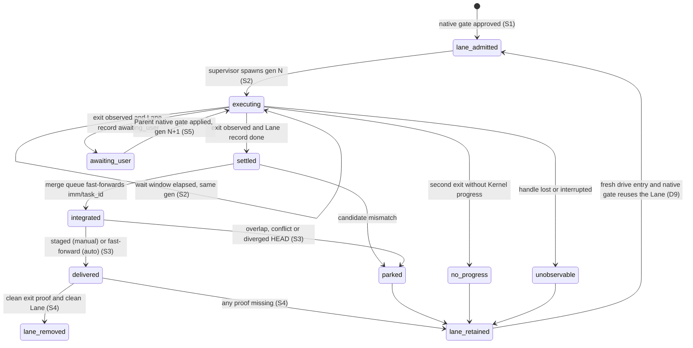

# Drive always uses Lanes

**Status**: candidate decomposition, confirmed by the user on 2026-11-04 (Initiative name, slug and the seven-Slice decomposition in one review table). This document grants no execution authority.
**Initiative name**: Drive always uses Lanes
**Immutable slug**: `drive-always-lanes`
**Carrier**: GitHub, resolved by `imm-kernel config --json` (`initiative_carrier: github`, source `project`, from `.imm/config.json`).
**Source issue**: #387
**Planning baseline**: `0dfa18ad`. Recheck the affected paths if HEAD changes before Enrollment.
**Document language**: English. User discussion stays in Chinese.
**Design risk**: High. The work moves the single-task execution host from the Parent conversation to a runtime-spawned Lane process (process lifecycle and settlement), delegates one native gate across two Authority Stores (authority), writes the user's checkout at delivery (trust boundary, persisted state), deletes worktrees and branches (destructive lifecycle), and retires two Host tools on both Hosts (cross-runtime contract).
**Execution posture**: characterization-first for S3 (pin today's batch return step in `batch_final_report.ts` before adding the single-task return) and for S7 (pin which tests use the Host enroll tools as setup before deleting them).
**Design views**: architecture layers, component interfaces, state transitions, temporal sequence, data flow.
**Diagram decision**: required
**Diagram reason**: the single-task Lane state machine spans supervision, a user decision relay, checkout delivery and cleanup; the legal transitions and their proof conditions are clearer as one diagram.
**Threat model and supported environment**: the adversary is the executing model in the Lane, which may leave the Lane dirty, stop without settling, deliver paths outside its estimate, or print misleading output. Executor exit codes, stdout and Host notifications (Claude Code background completion notices, Herdr idle/done) are untrusted for settlement and for cleanup. The user, the user's concurrent edits in their checkout, the Parent's loaded runtime and the literal-user native gate are trusted; concurrent user edits must never be overwritten. Supported: Git 2.38+, SHA-1 object format, UTF-8 paths, macOS and Linux, Bun 1.4, Claude Code CLI with `--print`, Pi CLI with `--print`.

## Outcome

Every `drive` entry delivers through a Lane. A single TaskIntent becomes a one-child Lane batch authorized by one native gate. Inside Herdr the Parent launches and supervises an interactive Executor tab; outside Herdr the runtime spawns a non-interactive Executor and observes its exit itself. Both paths integrate the settled child onto the task's Parent ref and deliver the result into the user's checkout according to the Git integration preference. Only runtime-observed exit proof permits automatic Lane removal; interactive Lanes remain retained. User decisions the Lane Executor reaches can be answered in the Parent session. In-place Enrollment is retired.

## Sources

| ID | Source |
| --- | --- |
| I387 | Issue #387, "Drive always uses lanes" (Decisions 2026-11-03, Design, Acceptance, Open points). |
| BR | The `clarify` manifest confirmed in this session on 2026-11-04 (`BR-REQ-1..7`, `BR-DEC-1..8`, `BR-OUT-1..2`, `BR-SCN-1..5`). |
| U1 | User decision, 2026-11-04, in this session: Q5 option A (the Parent opens the native gate for a Lane decision and the runtime relaunches a new Executor generation), together with confirmation of the seven-Slice decomposition, including "tasks already enrolled in place stay resumable until terminal". |
| E1 | `plugins/immune-brain/runtime/kernel/batch_authority.ts:379`: `deriveChildEnrollment` derives a Lane child's Enrollment from the Batch Authorization; `runtime/unattended/batch_lanes.ts:1025` `enrollInLane` calls it from the Parent process into the Lane store. |
| E2 | `plugins/immune-brain/runtime/unattended/batch_preflight.ts:656` and `batch_worktrees.ts:62` (`copyLanePlanningInput`): an uncommitted TaskIntent or Spec reaches the Lane without a commit. |
| E3 | `plugins/immune-brain/runtime/unattended/batch_plan.ts:69`: `observeInitiative` reads children only from a GitHub or Local Initiative carrier; `InitiativeObservationReader` (`types.ts:90`) is injectable. |
| E4 | `plugins/immune-brain/runtime/unattended/batch_final_report.ts:40`: `returnBatchToCoordinator` does nothing under `manual` and, under `auto`, fast-forwards only a clean tree whose HEAD is an ancestor. |
| E5 | `docs/adr/0024-git-integration-preference.md:35`: `manual` writes no runtime commit outside a batch. `docs/adr/0027-parent-branch-merge-queue.md:46,65,79`: return rule, retained Lanes, and the conditions for reconsidering automatic cleanup. |
| E6 | `plugins/immune-brain/dist/drive-batch.md:319-367`: the Parent (a model), not the runtime, launches Lane Executors today; `drive-batch.md:459` reports a Lane child waiting on a user decision instead of relaunching it. |
| E7 | `claude --help` and `pi --help` on the planning host: `claude --print` with `--plugin-dir`, `--model`, `--effort`; `pi --print` with `--model`, `--thinking`. |
| E8 | `plugins/immune-brain/runtime/claude/mcp_server.ts:34` (`enroll`) and `.pi-extension/imm-canary-enroll.ts:602` (`imm_canary_enrollment`) are the Parent-side in-place Enrollment entries; 22 test files reference them (`grep` at the planning baseline). |
| E9 | Repository drain convention: `dist/drive.md` (legacy hash-less Review reader, "drain-only (owner: runtime)") and `dist/drive-batch.md` (legacy `lane_offers` records "retire when the old records drain"). |

## Brainstorm Trace

| Item | Coverage |
| --- | --- |
| BR-REQ-1 | S6 (default routing) and S7 (retirement): S6-A1, S7-A1, S7-A2. |
| BR-REQ-2 | S1-A1. |
| BR-REQ-3 | S2-A1, S2-A2, S2-A3. |
| BR-REQ-4 | S1-A3 (Parent-ref integration and mismatch park) and S3-A3 (checkout conflict park). |
| BR-REQ-5 | S1-A2. |
| BR-REQ-6 | S2-A1. |
| BR-REQ-7 | S7-A2, with D12 for the full-suite part. |
| BR-DEC-1 | D5; S3-A1, S3-A2, S3-A4. |
| BR-DEC-2 | D6; S3-A3. |
| BR-DEC-3 | D7; S4-A1, S4-A2, S4-A3. |
| BR-DEC-4 | D3; S2-A1. |
| BR-DEC-5 | D1, D2; S1-A1. |
| BR-DEC-6 | D10; S6-A1, S7-A1. |
| BR-DEC-7 | Captured decision: no acceptance measures or limits Lane setup cost. |
| BR-DEC-8 | D4 (Host wait bound and its verification), D8 (stop and cancel), D7 (retirement timing), D9 (what survives a park and what a resume reuses). |
| BR-OUT-1 | Excluded: the review stage (#386). No Slice changes Review dispatch. |
| BR-OUT-2 | Excluded: batch Lanes stay retained; S4-A4 is the regression control. |
| BR-SCN-1 | S4, automated, S4-A1. |
| BR-SCN-2 | S4, automated, S4-A2. |
| BR-SCN-3 | S3, automated, S3-A3. |
| BR-SCN-4 | S3, automated, S3-A3. |
| BR-SCN-5 | S4, automated, S4-A3. |
| U1 (Q5-A) | D11; S5-A1, S5-A2. |

No `BR-Q-*` item is open.

## User scenarios

| ID | Actor | Given | When | Then | Mode | Slice |
| --- | --- | --- | --- | --- | --- | --- |
| BR-SCN-1 | developer | a repository in `manual` mode with a childless TaskIntent | they run `drive` and approve the single native gate | their checkout shows the task's changes as staged, uncommitted changes, no second confirmation dialog appeared, and `git worktree list` shows no remaining Lane | automated | S4 |
| BR-SCN-2 | developer | a repository in `auto` mode | a single-task `drive` settles | their current branch has advanced to the delivery commit and no `imm-lane/` branch remains | automated | S4 |
| BR-SCN-3 | developer | they edited a delivered path in their checkout while the Lane ran | integration runs | `drive` reports the task parked `needs_human` naming the overlapping path, and their edit is unchanged | automated | S3 |
| BR-SCN-4 | developer | they edited only unrelated files during the Lane run | integration runs | the delivery appears in their checkout and their unrelated edits remain intact | automated | S3 |
| BR-SCN-5 | developer | the Lane Executor was interrupted, or its exit could not be observed | they read the `drive` report | the report lists `batch_lane_retained` and the Lane worktree still exists | automated | S4 |

## Discovery evidence

- Entry and plan: `runtime/unattended/batch_plan.ts`, `types.ts`, `batch_preflight.ts`, `batch_runner.ts`; Claude `runtime/claude/mcp_server.ts`, `kernel_ports.ts`, `interaction.ts`; Pi `.pi-extension/imm-unattended-batch.ts`. The generated bundle `plugins/immune-brain/dist/claude/mcp-server.mjs` inlines the runtime (`docs/agents/derived-files.json`), and each runtime Slice ships a `.changeset/*.md`.
- Lane lifecycle and state: `batch_lanes.ts` (admission, `enrollInLane`, retained notices, completion), `batch_state.ts` (record schema), `batch_reasons.ts`, `batch_disposition.ts`, `batch_worktrees.ts`, `lane_workspace.ts`.
- Return step: `batch_final_report.ts:40`, read by `batch_lanes.ts:1345` and `batch_git.ts:1211`; the preference is read through `runtime/git_integration_preference.ts`.
- Lane Preferences: `runtime/config/layered_config.ts` resolves `lanes`; today the Parent model applies them (`drive-batch.md:262`).
- Decisions on Pi: `.pi-extension/imm-canary-work.ts:562,586` (`request_authorization`, `approve_breaking_intent_revision` operations); on Claude: `mcp_server.ts:38,40`.
- Entry gating: `runtime/assurance/phase_entry.ts:158` admits `enroll`, `start_unattended_batch` and `retire_stale_batch` under a literal `drive` entry.
- Test seams with prior art: `tests/claude-batch-authority.test.ts` and `tests/pi-batch-authority.test.ts` (native gate count and batch authorization on each Host), `tests/unattended-batch-lanes.test.ts` (Lane admission, retention), `tests/batch-parent-branch.test.ts` (return step), `tests/breaking-intent-revision-gate.test.ts`, `tests/unattended-contracts.test.ts` and `tests/explicit-phase-entry-run-contract.test.ts` (contract text).

## Technical Design

### Architecture layers

- **Kernel** (`runtime/kernel/`): owns Enrollment, Batch Authorization and the derived child Enrollment. It is unchanged except for one rebind operation (D11) that lets a literal-user approval of a breaking revision update the single-task batch's approved identity.
- **Unattended runner** (`runtime/unattended/`): owns the single-task plan source (S1), the Lane supervisor (S2), checkout delivery (S3), Lane cleanup (S4) and the decision relay state (S5). It never opens a native gate.
- **Host adapters** (`runtime/claude/`, `.pi-extension/`): open the one native gate, expose the single-task entry through `start_unattended_batch`, select interactive mode from `HERDR_ENV=1` for new tasks, hold runtime Executor handles where applicable, and relay decisions. Adapters depend on the runner; the runner never imports an adapter.
- **Contracts** (`dist/drive.md`, `dist/drive-batch.md`): describe the Parent's obligations. Inside Herdr the Parent launches and supervises the single-task Executor tab; elsewhere the runtime owns that process.

Prohibited coupling: the runner never treats Host output (exit code, stdout, a notification) as Kernel progress, and an adapter never writes a Lane store directly.

### Component interfaces

- `start_unattended_batch` gains `task_id` (exclusive with `initiative_slug`; both or neither refuses `batch_entry_ambiguous`). With `task_id` it records a v2 Lane batch with `plan_source: "single_task"`, slug equal to `task_id`, `max_parallel` 1, and the child's approved intent identity. An Initiative-slug entry never matches a `single_task` record and a `task_id` entry never matches an Initiative record (`batch_entry_kind_mismatch`).
- Outside Herdr the single-task call supervises synchronously (S2): it admits the Lane, spawns the Executor, and waits inside the call. Inside Herdr it records `executor_mode: "interactive"` and returns an `executor` handoff for the Parent's tab; the recorded mode survives re-entry, and existing runtime-owned tasks retain their original supervision. Its runtime-supervised report adds `lane_supervision: { generation, state: "running" | "exited" | "unobservable", exit }`. `stop: true` on the same entry terminates the current generation (S2-A3). `lane_decision` carries a relayed decision (S5).
- `status` with `task_id` already returns `batch.record` for a slug; S1 makes the single-task record and its child state readable through that read on both Hosts.
- Errors are stable reason codes in `batch_reasons.ts`: `batch_entry_ambiguous`, `batch_entry_kind_mismatch`, `lane_executor_unavailable`, `lane_executor_unobservable`, `lane_executor_no_progress`, `checkout_delivery_overlap`, `checkout_delivery_conflict`, `coordinator_head_diverged` (existing), `lane_decision_stale`. No retirement-wall reason is introduced: S7 deletes the tools instead.

### Data flow

1. Source: the validated TaskIntent at `docs/plans/<task_id>.intent.json` (tracked or uncommitted, E2).
2. Gate: the adapter projects the single-task plan and opens one native gate bound to the TaskIntent revision, content hash and preparation digest (BR-REQ-2).
3. Lane: the runner creates `imm/worktrees/<task_id>/<task_id>` on `imm-lane/<task_id>/<task_id>` at the user's HEAD, copies uncommitted planning input, and enrolls the child via `deriveChildEnrollment` (E1).
4. Execution: inside Herdr the Parent opens one interactive Executor tab; otherwise the supervisor spawns the Executor. The Lane's own Assurance produces the settled TaskRecord and audit pair.
5. Integration: the existing merge queue commits the settled delivery on the Lane branch and fast-forwards `imm/<task_id>` to a matching candidate; a mismatch parks (BR-REQ-4).
6. Delivery: S3 applies `base..integrated` to the user's checkout (`manual`) or fast-forwards the user's branch (`auto`), after the overlap check.
7. Cleanup: S4 removes the Lane only with exit proof and a recorded delivery.

Validation precedes every write: the overlap and apply checks run before any byte of the checkout changes (S3), and the exit proof is checked before any removal (S4).

### State transitions

The diagram below describes runtime supervision outside Herdr. Interactive Lanes
instead enter execution through the Parent's tab, use Kernel facts for settlement
and pending decisions, and always finish with `lane_retained` because tab state
provides no trusted exit observation.

States of a single-task child: `lane_admitted` → `executing(gen)` → (`settled` | `awaiting_user(gen)` | `no_progress` | `unobservable`) → `integrated` → (`delivered` | `parked`) → (`lane_removed` | `lane_retained`). Terminal ownership: Kernel lifecycle facts come only from the Lane TaskRecord; exit facts only from the runtime's own child-process exit event; delivery facts only from the return step's Git result; the literal user owns every decision relayed in S5.

### Temporal sequence

1. Literal `drive <task_id>` → adapter projects plan → one native gate → Batch Authorization issued (authority: literal user).
2. Runner admits the Lane and enrolls the child (authority: derived Enrollment).
3. Adapter call spawns generation N and waits (authority: none; observation only). Interruption of the call terminates the generation and records `interrupted`.
4. Exit event → runner reads the Lane projection and moves the child per the state machine.
5. Settled → integration → delivery → cleanup in that order within one call. Each step persists before the next, so a replay after interruption resumes at the first unrecorded step and never repeats a recorded Git write (idempotency).

### Settlement enumeration (S2, S4, S5)

- **Trigger sources**: Executor exit (code or signal), wait-window elapse, Parent `stop`, call cancellation (AbortSignal), Host process shutdown (handle lost), spawn failure (binary missing), Lane projection `awaiting_user`, relayed decision applied or cancelled.
- **State inventory**: per generation `spawned`, `running`, `exited`, `stopped_by_parent`, `interrupted`, `unobservable`; per child the states above.
- **Terminal ownership**: a generation's exit is settled only by the runtime's own `child.on("exit")` for a process it spawned in this Host process, bound to repository, Lane path and generation. Non-authoritative: exit code, stdout, Claude Code background notices, Herdr state, elapsed time, a missing claim, a clean Lane. Kernel settlement is owned by the Lane TaskRecord. Decisions are owned by the literal-user native gate.
- **Same-state-machine coverage**: `batch_lanes.ts`, `batch_state.ts`, `batch_reasons.ts`, `batch_disposition.ts`, `lane_supervisor.ts`, `lane_cleanup.ts`, `lane_decision.ts`, and both adapters are listed in the owning Slices' `scope_hint`.

## Decisions

| ID | Decision | Source |
| --- | --- | --- |
| D1 | A single task is a one-child Lane batch, `max_parallel` 1, slug equal to `task_id`, recorded with `plan_source: "single_task"`. | BR-DEC-5 |
| D2 | Lane Enrollment uses `deriveChildEnrollment`; uncommitted planning input reaches the Lane through the existing preflight copy. | BR-DEC-5 |
| D3 | Inside Herdr (`HERDR_ENV=1`), a new single-task entry records `executor_mode: "interactive"`; the Parent launches one tab in the admitted Lane and supervises it through the existing Herdr Lane Tabs contract. Outside Herdr the runtime spawns `claude --print` or `pi --print` with the Lane as cwd and `drive <task_id>` as its only prompt. Both use the loaded plugin location and Lane Preferences. Re-entry keeps the recorded execution mode; existing runtime-owned tasks continue until settlement. Interactive session state never supplies cleanup exit proof. | BR-DEC-4, E7; owner correction 2026-11-05; `tests/claude-batch-authority.test.ts`, `tests/pi-batch-authority.test.ts`, `tests/single-task-lane-batch.test.ts` |
| D4 | Synchronous supervision waits inside the Host tool call for at most a wait window no longer than the verified tool-call limit of that Host; on elapse the call returns `running` for the same generation, and the next call re-attaches without spawning. S2 verifies the Claude Code MCP and Pi tool-call limits during implementation and pins each Host's window as a named constant whose test asserts it stays below the verified limit; the Spec is not edited. | delegated technical choice (BR-DEC-8) |
| D5 | Delivery: `manual` applies the delivered delta to the index and worktree with no commit and no HEAD move; `auto` fast-forwards the user's current branch when HEAD is an ancestor. ADR 0024 and ADR 0027 §5 are amended for single tasks only. | BR-DEC-1 |
| D6 | The overlap check compares delivered paths with every dirty entry (staged, unstaged, untracked, deleted, renamed source or target). Any overlap parks `needs_human` with `checkout_delivery_overlap: <paths>` and writes nothing. Unrelated dirt never blocks and is left byte-identical. | BR-DEC-2 |
| D7 | Cleanup runs in the same call right after a successful delivery and removes the Lane worktree, `imm-lane/<task_id>/<task_id>` and `imm/<task_id>` only when the current generation's exit was observed by the runtime as a normal exit, the observation's generation is current, and `git status --porcelain --untracked-files=all` in the Lane is empty. Ignored files are not unknown files. Otherwise the Lane is retained and reported as `batch_lane_retained` with the failed condition. | BR-DEC-3, delegated technical choice for the timing and the unknown-file test |
| D8 | Stop and cancel: Parent `stop` terminates the generation (SIGTERM, then SIGKILL after a grace period) and records `stopped_by_parent`; cancellation of the call does the same and records `interrupted`. Neither is cleanup proof. The Kernel stop of the Lane TaskRecord is a literal-user decision relayed under D11. | delegated technical choice (BR-DEC-8) |
| D9 | A parked or retained single-task Lane keeps its worktree, branch, store and record. A fresh `drive <task_id>` opens a fresh native gate and resumes in the same Lane with a new generation; no Lane is recreated. | delegated technical choice (BR-DEC-8), consistent with E5 |
| D10 | Transition: S6 makes the Lane path the default for new entries while the in-place tools still exist; S7 deletes the tools. An in-place TaskRecord enrolled before S7 stays resumable through the loop tools until terminal (drain-only, owner: runtime). | BR-DEC-6, U1, E9 |
| D11 | A Lane decision is answered in the Parent: the adapter opens the Parent Host's native gate with the Lane record binding (task, run, record revision), the runtime applies it to the Lane store through the same Kernel operation, and the supervisor starts generation N+1. A breaking revision approved this way also rebinds the single-task batch's approved identity in the same transaction, so the next tick does not refuse `plan_changed`. Batch (Initiative) children keep today's behavior (E6). | U1 |
| D12 | The full-suite part of BR-REQ-7 is checked by the batch `final_verification` (`bun test`, `bun run typecheck`), not by an acceptance descriptor, per descriptor discipline. | repository evidence: `dist/draw-up.md` Verification Descriptor Discipline |

## Slices

| Slice | Task | Result when it alone lands | Risk | Blocked by |
| --- | --- | --- | --- | --- |
| S1 | `drive-always-lanes-s1-single-lane-batch` | `start_unattended_batch` with `task_id` creates a one-child Lane batch under one native gate on both Hosts; `status <task_id>` shows its Lane state; settled children integrate onto `imm/<task_id>`. Executors are still launched by the Parent under today's supervision rules. | material | — |
| S2 | `drive-always-lanes-s2-lane-supervisor` | The single-task call spawns, waits for, re-attaches to and stops a runtime-owned Executor and records a generation-bound exit observation. | critical | S1 |
| S3 | `drive-always-lanes-s3-checkout-delivery` | A single-task delivery appears in the user's checkout (staged or fast-forwarded) or parks on overlap or conflict without touching it; ADR 0024 and 0027 amended. | critical | S1 |
| S4 | `drive-always-lanes-s4-lane-cleanup` | A delivered single-task Lane with exit proof is removed; every other case is retained and reported. | critical | S2, S3 |
| S5 | `drive-always-lanes-s5-lane-decision-relay` | A Lane decision is answered through the Parent's native gate and execution continues in a new generation. | critical | S2 |
| S6 | `drive-always-lanes-s6-lane-default` | `drive.md` and `drive-batch.md` route every new single-task entry to the Lane path. | material | S4, S5 |
| S7 | `drive-always-lanes-s7-retire-in-place` | The in-place Enrollment tools and their contract text are deleted on both Hosts. | material | S6 |

Remaining gap after all seven Slices: none against the confirmed outcome. The review stage (BR-OUT-1) and batch Lane cleanup (BR-OUT-2) stay excluded.

## Acceptance mapping

| Acceptance | Seam | Controls |
| --- | --- | --- |
| S1-A1 | `tests/single-task-lane-batch.test.ts` (new), `tests/claude-batch-authority.test.ts`, `tests/pi-batch-authority.test.ts`: the Host entry with a native gate stub that counts openings | positive: one gate, child enrolled in the Lane store; negative: both inputs, invalid intent, task already in an active batch, Initiative/record kind mismatch; bound: uncommitted TaskIntent copied |
| S1-A2 | same files: `status` read | positive: record and child state; negative: unknown task returns no record |
| S1-A3 | `tests/single-task-lane-batch.test.ts` with a settled Lane fixture | positive: `imm/<task_id>` fast-forwarded; negative: mismatching candidate parks `needs_human`, ref unmoved |
| S2-A1..A3 | `tests/lane-supervisor.test.ts` (new) with fake `claude` and `pi` executables on `PATH`; adapter tests on both Hosts | live, exited, unknown processes per provider; spawn argv; Herdr env ignored; window elapse and re-attach; stop and abort |
| S3-A1..A3 | `tests/single-task-checkout-delivery.test.ts` (new); `tests/batch-parent-branch.test.ts` as the batch regression control | staged/no HEAD move; ff; diverged/detached park; overlap per dirt kind; unrelated dirt byte-identical; apply conflict writes nothing |
| S3-A4 | `sh -c` grep of the two ADR amendment headings | presence of each amendment heading |
| S4-A1..A4 | `tests/single-task-lane-cleanup.test.ts` (new); `tests/unattended-batch-lanes.test.ts` as the batch control | manual and auto end-to-end; each missing proof retained; batch Lanes retained |
| S5-A1..A2 | `tests/single-task-lane-decision.test.ts` (new); `tests/breaking-intent-revision-gate.test.ts` | gate applied and gen N+1; stale revision; cancelled gate; batch child refused; breaking revision rebinding; relayed stop |
| S6-A1..A2 | `tests/unattended-contracts.test.ts`, `tests/explicit-phase-entry-run-contract.test.ts` | required single-task Lane text present; in-place entry text absent from new-entry instructions |
| S7-A1..A2 | `tests/packaged-contract-tool-surface.test.ts`, `tests/claude-host-package.test.ts`, `tests/pi-canary-lifecycle-package.test.ts`, `tests/unattended-contracts.test.ts` | tool surfaces without the two tools; contract text without in-place Enrollment; drain of a pre-existing in-place record |

## Devil's Advocate Audit

- **Rollback resilience**: S1 to S5 are additive behind the `task_id` entry, so reverting any one leaves the in-place path working until S6. S6 is text and reverts cleanly. S7 deletes tools; it lands last and only after S6 has run on the Lane path, so a revert restores the tools without data migration. A crash mid-call resumes from the persisted record at the first unrecorded step (temporal sequence 5). Retained Lanes are never auto-deleted, so a defect in S4 fails toward retention.
- **Verification vanity**: every supervisor acceptance uses real child processes (fake executables), not mocked exit events, so a supervisor that trusts stdout or exit code fails the "exit code 0 with Lane record not done" control. Delivery tests compare checkout bytes before and after, so a partial write fails. Cleanup tests assert the Lane path still exists for each missing proof. Gate count is asserted at the adapter, not inferred from a log.
- **Spec dilution detection**: the Brainstorm Trace maps every `BR-*` item once; S7 deletes the tools rather than walling them (Retirement Completion Contract); D10 limits the in-place survivor to records enrolled before S7, so "no drive entry executes in place" holds for every new entry. A plan that stopped at S6 would leave BR-REQ-1 unmet and is not the confirmed outcome.
