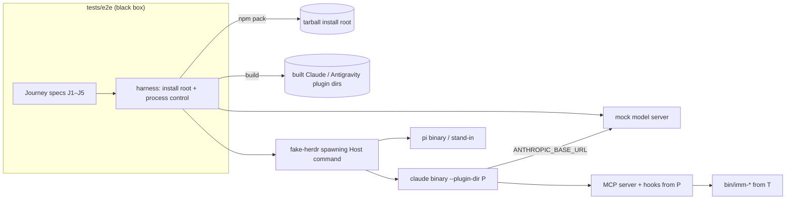
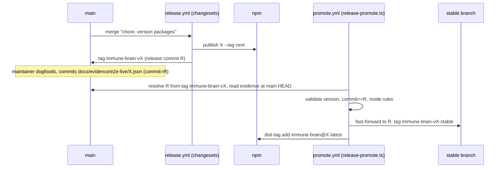

# E2E Release Gate: Deterministic Host E2E, Live Smoke Evidence, and a Promoted Stable Channel

- **Initiative**: `e2e-release-gate` (short name `e2e-gate`).
- **Output language**: English (repository default; the design interview ran in Chinese).
- **Design risk**: High — changes the release pipeline and the distribution channel of all three Hosts (npm dist-tags for Pi, the marketplace plugin source for Claude Code, the install branch for Antigravity), adds a required CI job, and adds a black-box test harness that launches real Host binaries against packaged output.
- **Design views**: architecture layers, service/component interfaces, data flow, temporal sequence.
- **Diagram decision**: required
- **Diagram reason**: the release sequence spans four actors (changesets, npm, the `stable` branch, the promote workflow) whose ordering and idempotency decide whether a partial run is recoverable.
- **Execution posture**: Standard; S2 starts with two throwaway probes (Pi mock-model provider, Claude `git-subdir` + `ref` install) whose decisions are recorded in this Spec before dependent work.

## Outcome

Defects that today reach users after a release and are fixed in follow-up releases are caught before a version reaches the default install channel of any Host. Every pull request runs a deterministic black-box e2e suite (L1) against the packed release artifacts with real Host binaries and a scripted model; every version is first published to a pre-release channel and reaches `latest` / `stable` only through a promote workflow that checks committed live-smoke evidence (L2) bound to the release commit.

| Slice | Task ID | Result when landed alone | Remaining gap | Risk | Blocked by | Scenarios |
| --- | --- | --- | --- | --- | --- | --- |
| `S1` | `e2e-gate-s1-release-channel` | A merged version PR publishes npm `next` only; Claude Code installs from the `stable` branch through a `git-subdir` + `ref` marketplace entry; Antigravity docs install from `stable`; `scripts/release-promote.ts` (run by a manual `promote` workflow) advances `stable` and npm `latest` only for a version whose checklist evidence matches its release commit, and its `rollback` mode restores the previous stable version | Evidence is a manual checklist until `S9` | `critical` | — | `SCN-1`, `SCN-2`, `SCN-3` |
| `S2` | `e2e-gate-s2-harness` | `bun run e2e` packs the tarball, installs it into a temp root, starts the scripted Anthropic-compatible mock model, and runs a smoke case that launches the pinned `claude` binary with the built plugin against the mock; a lint test rejects runtime imports under `tests/e2e/`; `bun test` excludes `tests/e2e/`; the Pi mock-provider probe outcome is recorded in this Spec | Journeys `J1`–`J5` (`S3`–`S7`) | `material` | — | exempt: maintainer-facing test tooling, observed through `SCN-4` in `S3` |
| `S3` | `e2e-gate-s3-install-journey` | J4: the packed tarball installs and loads in Claude Code (pinned and minimum supported `claude`), Pi, and the Antigravity plugin directory; Skills and slash commands are listed, the MCP server answers `tools/list`, hooks resolve | none for install coverage | `material` | `S2` | `SCN-4` |
| `S4` | `e2e-gate-s4-single-task-journey` | J1: a scripted single-task `drive` runs enrollment → Executor launch through fake-herdr → implementation → QA/Review → terminal → audit → delivery, on Claude Code and on Pi (or its recorded fallback) | none for single-task coverage | `material` | `S2` | `SCN-5` |
| `S5` | `e2e-gate-s5-review-journey` | J3: Review dispatch starts a reviewer, the receipt arrives through the MCP tool, and a verdict is recorded | none for Review coverage | `material` | `S2` | `SCN-6` |
| `S6` | `e2e-gate-s6-batch-journey` | J2: a two-child batch runs parallel Lanes, integration and final verification, then delivers or retains its branch | none for batch coverage | `material` | `S2` | `SCN-7` |
| `S7` | `e2e-gate-s7-skew-journey` | J5: an old plugin cache against a newer source, and a too-old runtime, each produce their named diagnostic instead of parking a Lane or hanging | none for skew coverage | `material` | `S2` | `SCN-8` |
| `S8` | `e2e-gate-s8-ci-gate` | CI runs `e2e` as its own job beside `verify`; a pull request titled `fix…` that changes plugin runtime fails CI unless it changes `tests/e2e/` or states `e2e-exempt: <reason>`; `roadmap-e2e` is renamed to a contract test | none for PR gating | `material` | `S3` | `SCN-9` |
| `S9` | `e2e-gate-s9-live-evidence` | `bun run e2e:live` runs J1, J2 and J4 against real `claude`, `pi` and `herdr` with one retry, records cassettes, and writes `docs/evidence/e2e-live/<version>.json`; `release-promote` refuses checklist-mode evidence and requires a passing live record | none — complete confirmed release gate | `critical` | `S1`, `S3`, `S4`, `S6` | `SCN-10` |
| `S10` | `e2e-gate-s10-host-bump-metrics` | A weekly workflow opens a PR that bumps `tests/e2e/hosts.json` to the latest Host versions and runs L1; `scripts/release-escape-report.ts` reports post-release fix counts per version with the v8.6.0–v9.1.0 baseline | none — complete confirmed outcome | `routine`-eligible paths only, declared `material` | `S8` | `SCN-11` |

Remaining gap after all slices: the Loop daemon journey (`J6`) is deferred to a second Initiative (`BR-DEC-E9`); prompt-adherence evaluation stays out of the gate (`BR-DEC-E1`).

## Sources and Discovery Evidence

- **Design interview** (grilling session, 2026-11-23, Chinese): questions Q1–Q23 with the user's answers, recorded below as `BR-DEC-E1`–`BR-DEC-E20` with Spec-local scenarios `SCN-1`–`SCN-11` confirmed in that interview. Q4 was first answered with the recommendation (gate on the version PR) and then revised by the user to `b` (npm `next` + promote, Claude from a `stable` branch).
- **Escaped-defect evidence** (`git log immune-brain-v8.6.0..HEAD`): `.changeset/lane-executor-launch-fixes.md` (claude-code Executor launched without `--plugin-dir`, entry not the `/immune-brain:drive` slash command, empty `final_verification`, "until relaunched by hand"); the `uls-review-repair` commits (Herdr attention, stop, `pane_not_found`); "fix(review): submit review receipts through an MCP tool"; dist mirror drift fixes. v9.0.0 and v9.1.0 were both published on 2026-11-17.
- **Release pipeline**: `.github/workflows/release.yml` runs `changesets/action@v1` on `push: main` with `publish: bun run changeset:publish` (`package.json` → `bun run verify:release && changeset publish`, i.e. dist-tag `latest`) and tags `immune-brain-v<version>`; `.github/workflows/ci.yml` has one `verify` job (typecheck, build `--check` for Claude and Antigravity, `sync-dist-docs --check`, `plugin_versioning validate`, `bun test --parallel=4 --no-isolate --timeout=30000`). `.changeset/config.json` uses `baseBranch: main`.
- **Distribution**: `README.md:64-65` installs Claude Code through `claude plugin marketplace add dereknex/immune-brain`; `.claude-plugin/marketplace.json` sets `"source": "./plugins/immune-brain"` (default branch); `README.md:79` installs Antigravity from `./plugins/immune-brain-antigravity`; root `package.json` is the Pi npm package. The Claude plugin cache is keyed by `plugin.json` `version` (`~/.claude/plugins/cache/immune-brain/immune-brain/9.1.0/`).
- **Claude Code marketplace contract** (documentation only, not yet executed): https://code.claude.com/docs/en/plugins/marketplace-reference.md lists `git-subdir` plugin sources with `url`, `path`, `ref`, `sha` ("`ref`: a branch or tag. Defaults to the repository's default branch"); https://code.claude.com/docs/en/plugins/loading.md states `plugin.json` `version` wins over the computed version and that auto-update is off by default for third-party marketplaces.
- **Host binaries on the maintainer machine**: `herdr 0.9.5`, `claude 2.1.330`, `pi 1.5.2`, `agy` (shell function). `plugins/immune-brain/runtime/session/herdr_provider.ts:53` maps Hosts to `claude`, `pi`, `agy`; `herdr_core_provider.ts:48` requires `claude >= 2.1.295`; `README.md:43` states `>= 2.1.236`.
- **Existing tests at the same seams**: `tests/pi-only-release-contract.test.ts` (pins the `changeset:version` / `changeset:publish` scripts), `tests/claude-host-package.test.ts` and `tests/pi-only-package-surface.test.ts` (package and marketplace surface), `tests/helpers/fake-herdr.ts` + `tests/fixtures/fake-herdr/herdr`, `tests/helpers/fake-herdr-core.ts`, `tests/helpers/roadmap-e2e-harness.ts` + `tests/roadmap-plan-e2e.test.ts` (legacy Plan validation through the real `bin/` CLI, not a Host e2e), `tests/dual-host-assurance-conformance.test.ts` (simulated Host transcripts and hooks). None launches a real Host binary.
- **Existing evidence directory**: `docs/evidence/` already holds `goal-driven-run-host-smoke.json` and `workflow-execution-reliability-host-check.md`.
- **Recurring field failures** recorded in maintainer notes: plugin cache skew against repository source, Lane cwd mistakes, Lanes parked as `batch_lane_lost` / `batch_lane_unreadable`, `HERDR_*` leaking into tests and opening real tabs.

## Threat model and supported environment

- **Inputs**: the promote workflow takes a version string from a maintainer with `workflow_dispatch` rights and reads a committed evidence JSON file. Both are trusted-maintainer input; the script still validates the version format (`^\\d+\\.\\d+\\.\\d+$`), refuses a version with no `immune-brain-v<version>` tag on `main`, and refuses evidence whose `version` or `commit` disagrees. Cassettes are maintainer-recorded and redacted before commit; replay treats them as data.
- **Credentials**: L1 uses no model credentials (mock model only). L2 runs only on the maintainer machine with the maintainer's own Host logins; no model credential is added to GitHub. Promote uses the existing npm Trusted Publishing / `NPM_TOKEN` and a token able to push the protected `stable` branch.
- **Supported environment**: L1 on `ubuntu-latest` GitHub runners and macOS developer machines, Bun 1.4.2, Node 24, SHA-1 Git repositories. L2 on macOS with `herdr`, `claude` and `pi` installed. Antigravity is covered by install and MCP/hook launch only.

## User scenarios

| ID | Slice | Actor | Given | When | Then | Mode | Acceptance |
| --- | --- | --- | --- | --- | --- | --- | --- |
| `SCN-1` | `S1` | maintainer | a version PR is merged | the release workflow publishes | npm `next` points to the new version, npm `latest` and the `stable` branch are unchanged, and a Claude Code marketplace install still resolves the previous stable `plugin.json` version | automated | `S1-AC1` |
| `SCN-2` | `S1` | maintainer | evidence for version X binds X's release commit | promote runs for X | `stable` fast-forwards to X's release commit, `immune-brain-vX-stable` is tagged and npm `latest` points to X; a rerun changes nothing; evidence with a mismatched commit or version is refused before any write | automated | `S1-AC2` |
| `SCN-3` | `S1` | maintainer | X is promoted and a previous `-stable` tag exists | rollback runs | `stable` moves to the previous `-stable` commit and npm `latest` to that version; with no previous tag it refuses before any write | automated | `S1-AC3` |
| `SCN-4` | `S3` | contributor | a pull request | `bun run e2e` runs J4 | each Host loads the packed plugin and lists its Skills, slash commands and MCP tools; a package missing a declared file fails with the missing path | automated | `S3-AC1` |
| `SCN-5` | `S4` | contributor | a pull request | J1 runs | the scripted task reaches a terminal TaskRecord with audit and delivered commit; a launch without `--plugin-dir` or with a non-slash entry fails the journey | automated | `S4-AC1` |
| `SCN-6` | `S5` | contributor | a material-risk scripted task | J3 runs | the reviewer's receipt arrives through the MCP tool and the verdict is recorded; a missing receipt fails with its named refusal | automated | `S5-AC1` |
| `SCN-7` | `S6` | contributor | a two-child Initiative | J2 runs | both Lanes integrate and final verification passes, or a forced final-verification failure retains the branch | automated | `S6-AC1` |
| `SCN-8` | `S7` | user | a stale plugin cache or too-old runtime | they enter `drive` | they see the named skew diagnostic and its single recovery action; no Lane is parked | automated | `S7-AC1` |
| `SCN-9` | `S8` | contributor | a `fix` pull request touching plugin runtime | CI runs | CI fails unless `tests/e2e/` changed or the body states `e2e-exempt: <reason>` | automated | `S8-AC2` |
| `SCN-10` | `S9` | maintainer | version X is on `next` | they run `bun run e2e:live` and promote | a passing live evidence file lets promote proceed; checklist-mode evidence is refused | automated (gate) + manual (live run: needs the maintainer's Host logins and a macOS Herdr session) | `S9-AC2` |
| `SCN-11` | `S10` | maintainer | a new `claude` or `pi` release | the weekly workflow runs | a PR bumps `tests/e2e/hosts.json` and runs L1 against the new version | automated | `S10-AC1` |

## Brainstorm Trace

| Item | Decision | Mapped to |
| --- | --- | --- |
| `BR-DEC-E1` (Q1) | The gate targets Host-boundary defects (launch, plugin load, slash entry, MCP/hook wiring, Herdr lifecycle), cross-module workflow defects, and packaging defects; prompt adherence is observed by sampling only | D1; out of scope |
| `BR-DEC-E2` (Q2) | Two layers: L1 deterministic e2e per PR, L2 live Host smoke per release | D2, D6 |
| `BR-DEC-E3` (Q3) | L2 runs locally through `bun run e2e:live` and commits evidence; a self-hosted runner is a later evolution | D6; `S9` |
| `BR-DEC-E4` (Q4, revised) | Pre-release channel: npm `next` + promote; Claude Code from a `stable` branch | D7; `S1` |
| `BR-DEC-E5` (Q5) | L1 covers all three Host adapters; L2 covers Claude Code + Herdr and Pi + Herdr, Antigravity install-only | D3; `S3`, `S9` |
| `BR-DEC-E6` (Q6) | Success metric: post-release fixes within 7 days per version, v8.6–v9.1 baseline; every escape adds an L1 scenario | D10; `S8`, `S10` |
| `BR-DEC-E7` (Q7) | Scripted Host: real `claude` against a local mock via `ANTHROPIC_BASE_URL`; Pi the same if its provider can target the mock, else PATH stand-in; Antigravity through direct MCP stdio and hooks | D3; `S2` |
| `BR-DEC-E8` (Q8) | L1 extends fake-herdr to spawn the Host launch command; real Herdr only in L2 | D4; `S2`, `S4` |
| `BR-DEC-E9` (Q9) | First version covers J1–J5; J6 (Loop daemon) deferred | `S3`–`S7`; out of scope |
| `BR-DEC-E10` (Q10) | Every L1 journey runs against the `npm pack` tarball plus built plugin directories | D2; `S2` |
| `BR-DEC-E11` (Q11) | L1 is its own required CI job; promote checks committed evidence | D8; `S8`, `S1`, `S9` |
| `BR-DEC-E12` (Q12) | `tests/e2e/` only via `bun run e2e`, black-box import lint, `roadmap-e2e` renamed | D5; `S2`, `S8` |
| `BR-DEC-E13` (Q13) | Machine-checked escape rule: `fix` PR touching runtime needs an e2e change or `e2e-exempt: <reason>` | D9; `S8` |
| `BR-DEC-E14` (Q14) | Model scripts are record/replay cassettes matched by turn and tool name; a few hand-written error branches | D3; `S2`, `S9` |
| `BR-DEC-E15` (Q15) | Host versions pinned in `tests/e2e/hosts.json`; minimum `claude` tested once in J4; weekly bump PR; L2 records actual versions | D3; `S3`, `S10` |
| `BR-DEC-E16` (Q16) | L1 ≤ 10 min in parallel with `verify`; L2 ≤ 30 min on a low-cost model; one retry, both attempts recorded | D6, D8 |
| `BR-DEC-E17` (Q17) | The `next` channel ships first with checklist evidence | `S1` |
| `BR-DEC-E18` (Q18) | Deliver as this Spec plus Initiative `S1`–`S10` in the stated order | this table |
| `BR-DEC-E19` (Q19) | Claude Code reaches `stable` through a `git-subdir` + `ref: "stable"` marketplace entry with no install-command change; raise the documented minimum `claude` version if verification requires it | D7; `S1` |
| `BR-DEC-E20` (Q20–Q23) | Promote order: locate release commit → check evidence → fast-forward `stable` + tag `immune-brain-vX-stable` → npm `latest`; `stable` protected; rollback through environment approval; Antigravity installs from `git clone -b stable`; maintainer dogfoods `next` (Pi) and `--plugin-dir` main (Claude) | D7; `S1` |

## Technical Design

### D1. Scope of the gate (`BR-DEC-E1`)

The gate asserts observable end states — TaskRecord terminal state, `.imm/audit/<task-id>/` presence, delivered commit or retained branch, named diagnostics, Host-visible Skill and tool listings. It never asserts model wording. Prompt adherence remains outside acceptance.

### D2. Architecture layers (`BR-DEC-E2`, `BR-DEC-E10`)



- Dependency direction: `tests/e2e/` → process boundaries only (`bin/imm-*`, MCP stdio, Host binaries, `git`, `herdr`). It never imports `plugins/immune-brain/runtime/**` or `plugins/immune-brain/.pi-extension/**` (D5).
- Ownership: `tests/e2e/harness/` owns temp roots, port selection, child-process lifetime and cleanup; journey files own assertions only.
- Every run builds once: `npm pack` into a temp dir, extract, and point Pi at the extracted package; Claude Code and Antigravity use the checked-in built plugin directories after `--check` passes.

### D3. Scripted model and Host pinning (`BR-DEC-E5`, `BR-DEC-E7`, `BR-DEC-E14`, `BR-DEC-E15`)

- **Mock model** (`tests/e2e/harness/mock-model.ts`): an Anthropic Messages-compatible HTTP server on a free port serving streamed responses from a cassette. Inputs: the request body. Output: the next scripted assistant turn. Matching key: (turn index within the conversation, ordered tool names of the expected `tool_use` blocks). A request whose key does not match fails the journey with `cassette_mismatch` naming the turn and expected tools — never a silent fallback. Unknown endpoints return 404 and fail the journey.
- **Cassettes** (`tests/e2e/cassettes/<journey>/<host>.jsonl`): one line per turn; secrets, home paths and timestamps are redacted at record time by the recorder. Until a journey has a recorded cassette, the Executor may author one by hand in the same format; `S9`'s live run records replacements.
- **Recorder** (`bun run e2e:record <journey>`, delivered in `S2`): a pass-through proxy between the Host and the real API that writes a cassette. Running it needs the maintainer's credentials and is a maintainer action, never a QA descriptor.
- **Pi**: `S2` probes whether Pi 1.5.2 can direct its Anthropic provider at the mock. If yes, Pi journeys use the real `pi` binary; if no, a PATH stand-in replays the same cassette and the Spec records the decision and its residual risk (Pi launch flags and extension loading then remain L2-only).
- **Antigravity**: no Host binary in L1; the harness speaks MCP stdio to `plugins/immune-brain-antigravity/mcp_config.json`'s server and runs its `hooks.json` commands directly.
- **Pinning**: `tests/e2e/hosts.json` holds `{ claude: { pinned, minimum }, pi: { pinned } }`. CI installs the pinned versions; J4 additionally installs `claude` at `minimum`.

### D4. fake-herdr spawning (`BR-DEC-E8`)

`tests/fixtures/fake-herdr/herdr` gains a spawning mode: tab/pane creation runs the requested command as a child process with the requested cwd and env, records lifecycle events (create, attention, stop, exit, `pane_not_found`) to a JSONL log the journey reads, and kills children on harness teardown. The harness scrubs every inherited `HERDR_*` variable before setting its own.

### D5. Test-suite separation (`BR-DEC-E12`)

- `bunfig.toml` / test root config excludes `tests/e2e/` from `bun test`; `package.json` adds `e2e`, `e2e:record`, `e2e:live` scripts.
- `tests/e2e-black-box-boundary.test.ts` (runs in the default suite) parses every import under `tests/e2e/` and fails on any specifier resolving under `plugins/immune-brain/runtime/` or `.pi-extension/`, naming the file and specifier.
- `tests/roadmap-plan-e2e.test.ts` and `tests/helpers/roadmap-e2e-harness.ts` are renamed to `*-contract` names in `S8`; their assertions are unchanged.

### D6. Live smoke and evidence (`BR-DEC-E3`, `BR-DEC-E16`)

Evidence file `docs/evidence/e2e-live/<version>.json`, contract `immune_brain/e2e_release_evidence/v1`:

```json
{
  "contract": "immune_brain/e2e_release_evidence/v1",
  "version": "9.2.0",
  "commit": "<40-hex release commit>",
  "mode": "checklist | live",
  "hosts": { "claude": "2.1.330", "pi": "1.5.2", "herdr": "0.9.5" },
  "journeys": [
    { "id": "J1", "host": "claude", "result": "pass", "attempts": [ { "result": "pass", "duration_ms": 0, "log_sha256": "<hex>" } ] }
  ],
  "checklist": [ { "item": "<text>", "checked": true } ]
}
```

- `checklist` mode (S1): every item `checked: true`; `journeys` may be empty.
- `live` mode (S9): `journeys` contains `J1`, `J2` for `claude` and `pi`, and `J4` for `claude`, `pi`, `antigravity`; each `result` is `pass`; at most two attempts each; a journey whose two attempts both failed has `result: "fail"`. L2 uses a low-cost model tier and a 30-minute budget per run.

### D7. Release channel and promote sequence (`BR-DEC-E4`, `BR-DEC-E17`, `BR-DEC-E19`, `BR-DEC-E20`)



- `changeset:publish` publishes with `--tag next`; nothing else in `release.yml` moves `latest`.
- `.claude-plugin/marketplace.json` on `main` sets the plugin source to `{ "source": "git-subdir", "url": "https://github.com/dereknex/immune-brain.git", "path": "plugins/immune-brain", "ref": "stable" }`. The marketplace catalog is still read from `main`; the plugin payload comes from `stable`.
- Authority at each step: release.yml holds npm publish rights only for `next`; only `promote.yml` (environment `release`, required reviewer) may push `stable` and move `latest`. `stable` is a protected branch whose only allowed pusher is that workflow's token — a repository setting the maintainer applies once (privileged, outside the Executor's authority; `S1` documents it and its descriptor does not depend on it).
- Idempotency: every step checks before writing (`stable` already at R → skip; tag exists at R → skip; tag exists elsewhere → refuse; `latest` already X → skip), so a rerun after a mid-sequence failure finishes only the missing steps. A non-fast-forward `stable` update is refused in promote mode.
- Rollback mode: input `--rollback`; resolves the newest `immune-brain-v*-stable` tag below the current `stable` commit, force-moves `stable` there and sets npm `latest` to that version. No previous tag → refuse before any write.
- `scripts/release-promote.ts` takes `--git` and `--npm` command seams so its tests run against a temp Git repository with a bare remote and a stub `npm` executable; the workflow is a thin wrapper.
- Antigravity: `README.md` and `plugins/immune-brain-antigravity/README.md` install from `git clone -b stable`.
- Verification of the documented `git-subdir` + `ref` behavior: `S1` records a maintainer install check on `claude 2.1.330` and the minimum supported version in this Spec's Amendments section; if the documented minimum does not support it, `README.md:43` and `hosts.json` `minimum` are raised in the same slice with a changeset.

### D8. CI wiring (`BR-DEC-E11`, `BR-DEC-E16`)

`ci.yml` gains job `e2e` (parallel with `verify`, `timeout-minutes: 10`) that installs the pinned Hosts and runs `bun run e2e`. Making it a required status check is a repository setting the maintainer applies (privileged).

### D9. Escape rule (`BR-DEC-E13`)

`scripts/check-e2e-escape-rule.ts` reads the PR title, body and changed paths (from the `pull_request` event and `git diff --name-only base...head`). It fails when the title matches `^fix(\\(|:|!)` and a changed path is under `plugins/immune-brain/runtime/`, `plugins/immune-brain/.pi-extension/` or `plugins/immune-brain/hooks/`, unless a changed path is under `tests/e2e/` or the body has a line `e2e-exempt: <non-empty reason>`. Non-PR events skip.

### D10. Metric (`BR-DEC-E6`)

`scripts/release-escape-report.ts` lists, per `immune-brain-v*` tag, commits within 7 days after it whose subject starts `fix` or whose changeset names `Fixes-release: <version>`, plus closed Issues labeled `bug` in that window via `gh` when available; it prints the v8.6.0–v9.1.0 baseline. A `Fixes-release:` line becomes a documented changeset convention.

### Compatibility

- Pi users installing `immune-brain` keep receiving `latest`; new versions arrive only after promote. Users who want pre-releases install `immune-brain@next`.
- Claude Code users keep their install command; after the marketplace entry change they receive the `plugin.json` version on `stable` the next time they run `claude plugin update` (auto-update is off for third-party marketplaces). Until the first promote, `stable` is created at the latest released commit so no user regresses.
- Antigravity users switch to a `stable` checkout through the README; existing checkouts keep working.

### False-compromise check

The accepted trade-off is that a release reaches `latest` only after a manual live run, adding latency between merge and default availability. Pattern **Preliminary Action** (record evidence while dogfooding on `next`, so promote is a check rather than a run) is already the design; **Self-Service** (a self-hosted runner that produces evidence automatically) removes the manual step at the cost of maintaining a machine with Host logins and is the recorded later evolution (`BR-DEC-E3`). No false compromise detected beyond that deferral.

## Verification and Acceptance Mapping

| Acceptance | Agreed seam | Done looks like |
| --- | --- | --- |
| `S1-AC1` | `tests/pi-only-release-contract.test.ts`, `tests/claude-host-package.test.ts` | `changeset:publish` publishes with `--tag next`; release.yml moves no `latest`; marketplace entry is the `git-subdir` + `ref: "stable"` source; negative: a relative-path source or a missing `ref` fails the contract test |
| `S1-AC2` | `tests/release-promote.test.ts` (temp repo + bare remote + stub npm) | promote fast-forwards, tags, sets `latest`; rerun is a no-op; negatives: evidence `commit` ≠ R, `version` ≠ X, unchecked checklist item, missing `immune-brain-vX` tag, non-fast-forward `stable`, malformed version — each refused before any write, with its named code |
| `S1-AC3` | `tests/release-promote.test.ts` | rollback moves `stable` and `latest` to the previous `-stable` tag; negative: no previous tag refuses before any write |
| `S2-AC1` | `tests/e2e/smoke.e2e.ts` via `bun run e2e` | tarball install root built, mock model serves, pinned `claude` loads the plugin and completes a one-turn scripted exchange; negative: a cassette mismatch fails with `cassette_mismatch` |
| `S2-AC2` | `tests/e2e-black-box-boundary.test.ts` | an e2e file importing `plugins/immune-brain/runtime/*` fails naming file and specifier; `bun test` collects no `tests/e2e/` file |
| `S3-AC1` | `tests/e2e/install.e2e.ts` | J4 lists Skills, slash commands and MCP tools for each Host; negatives: a tarball with a declared file removed, `claude` below minimum |
| `S4-AC1` | `tests/e2e/single-task.e2e.ts` | J1 terminal TaskRecord + audit + delivery; negatives: Executor launch lacking `--plugin-dir`, non-slash entry |
| `S5-AC1` | `tests/e2e/review.e2e.ts` | J3 verdict recorded from an MCP receipt; negative: no receipt → named refusal |
| `S6-AC1` | `tests/e2e/batch.e2e.ts` | J2 integrated delivery; negative: forced final-verification failure retains the branch |
| `S7-AC1` | `tests/e2e/skew.e2e.ts` | J5 named diagnostics for stale cache and old runtime; negative: no Lane parked |
| `S8-AC1` | `tests/ci-e2e-job-contract.test.ts` | `ci.yml` has job `e2e` running `bun run e2e` with `timeout-minutes: 10`; roadmap contract tests renamed and passing |
| `S8-AC2` | `tests/e2e-escape-rule.test.ts` | rule cases: fix+runtime without e2e fails; with `tests/e2e/` change passes; with `e2e-exempt: reason` passes; empty reason fails; non-fix title passes |
| `S9-AC1` | `tests/e2e-live-evidence.test.ts` | live runner writes schema-valid evidence with retries recorded (runner exercised with the mock model standing in) |
| `S9-AC2` | `tests/release-promote.test.ts` | promote refuses `checklist` mode and any failing or missing required journey |
| `S10-AC1` | `tests/e2e-host-bump.test.ts` | bump script rewrites `hosts.json` from stubbed registry versions; weekly workflow contract present |
| `S10-AC2` | `tests/release-escape-report.test.ts` | report counts fixture tags/commits within 7 days; baseline output |

L1 journey acceptances (`S2`–`S7`) run `bun run e2e <journey>` and need the pinned `claude` installed; their descriptors declare that prerequisite and fail when the binary is absent (an absent Host is a failed check, not a skip).

## Devil's Advocate Audit

- **Rollback resilience**: `S1` is reversible by restoring `marketplace.json`'s relative source and removing `--tag next`; `stable` is created at the current released commit so a reverted entry and a stuck promote leave users exactly where they are today. Each L1 slice adds files under `tests/e2e/` only and is removable alone. `S8`'s required-check setting is a repository toggle.
- **Verification vanity**: an e2e suite that always passes is the main risk. Each journey names a negative control reproducing a real escaped defect (missing `--plugin-dir`, non-slash entry, missing receipt, stale cache). The mock fails closed on any unexpected request, and an absent Host binary fails rather than skips.
- **Spec dilution**: the confirmed outcome has two layers and three channels. `S9` is the slice that converts the gate from checklist to live evidence; it is not optional and the Initiative is incomplete without it. `J6` and prompt-adherence evaluation are the only exclusions, both confirmed.
- **Flake risk**: real Host binaries in CI can change behavior on upgrade; pinning (`hosts.json`) plus the weekly bump PR isolates that change into its own PR.

## Assumptions (to resolve in the named slice)

- `A1` (`S2`): Pi 1.5.2 can target a custom Anthropic base URL. Fallback recorded in D3.
- `A2` (`S2`): real `herdr` cannot run headless on Linux CI; L1 uses fake-herdr. Revisit only with new evidence.
- `A3` (`S1`): the documented `git-subdir` + `ref` source installs and updates as documented on `claude 2.1.330`; the minimum supported version is confirmed or raised.
- `A4` (`S2`): the pinned `claude` binary installs on `ubuntu-latest` through npm and runs non-interactively against the mock without a login.

## Out of scope

- `J6` Loop daemon journey (second Initiative).
- Model prompt-adherence evaluation as a gate.
- Moving L2 to a self-hosted runner.
- Changing the GitHub repository settings (branch protection, required checks) — the maintainer applies them; slices document them.

## Amendments to Settled Specs

None yet. Probe outcomes for `A1`, `A3`, `A4` are recorded here by their slices.
