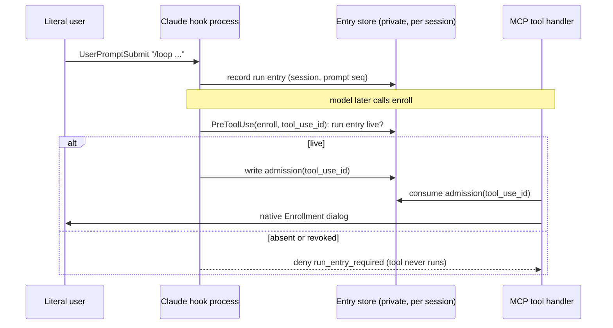

# Human-launched planning and execution entry

**Status**: Candidate; not enrolled.
**Design risk**: High — a cross-Host authority change: the packaged Planner, Loop, Brainstorm and BASELINE contracts, the Claude Code hook and MCP tool boundary, and the Pi extension tool boundary all change which input may reach the native Enrollment gate.
**Execution posture**: characterization-first for the two Host input payloads (record the real `UserPromptSubmit` and Pi `input` payload of a slash entry before fixing the recognizer), then test-first on the gate.
**Document language**: English, following the Planner document-language default.
**Source**: Direct Planner entry on 2026-10-11. User-owned decisions are `U1`–`U4` below; everything else is repository evidence or a delegated technical choice.

## Outcome

Planning and implementation are two phases, and the literal user launches each one. A design confirmation never starts implementation.

- `imm-planner` (and `imm-brainstorm`) always stop after candidate validation and publication. They never call the native Enrollment gate.
- Enrollment is the first step of `imm-run`. A literal-user `imm-run` entry plus the native Enrollment dialog is the only start of implementation.
- Both Hosts refuse Enrollment and batch start, before any native dialog opens, in a session whose literal user has not entered `imm-run`.
- On Claude Code the model cannot enter `imm-planner`, `imm-brainstorm` or `imm-run` by calling the Skill tool on its own.

## User decisions

| ID | Decision | Source |
|---|---|---|
| U1 | Planning/design and implementation are each launched and confirmed by the human. | User statement in the analysis conversation, 2026-10-11. |
| U2 | Apply all three proposed fixes: runtime enforcement, two-phase contract text, and blocking model self-entry. | User reply "按建议来", 2026-10-11. |
| U3 | Enrollment moves from the Planner to `imm-run`. | User reply "Enrollment 移到 imm-run", 2026-10-11. |
| U4 | Later Slices in the same session each pass their own native Enrollment dialog and do not need a fresh `imm-run` entry. | User accepted the stated default, 2026-10-11; scope rule refined in D3, confirmed at Initiative review. |

## User scenarios

| ID | Mode | Scenario | Acceptance |
|---|---|---|---|
| SCN-1 | automated | Given a validated candidate from `/planner`, when the user replies "confirm" without entering `imm-run`, then no Enrollment dialog opens and the reply names `imm-run` as the next user action. | EPE-S1-A1 |
| SCN-2 | automated | Given a validated candidate, when the user enters `imm-run` (or an alias such as `/loop`), then the native Enrollment dialog opens and, once confirmed, implementation proceeds. | EPE-S1-A2 |
| SCN-3 | automated | Given a session that entered `imm-run` and finished one Slice, when the user says "continue S2", then S2's Enrollment dialog opens without a new `imm-run` entry. | EPE-S2-A1, EPE-S2-A2 |
| SCN-4 | automated | Given a Claude Code session with no Planner entry in the latest user prompt, when the model calls the Skill tool for `imm-planner`, then the call is denied with the reason `phase_entry_required`. | EPE-S2-A3 |
| SCN-5 | manual | In a real Claude Code and a real Pi session, grilling or brainstorming followed by "confirm" ends with candidate artifacts and no Enrollment dialog. Manual because it depends on live model behaviour and each Host's real input payload. | — |

Each scenario belongs to exactly one Slice, the first that makes it observable: SCN-1 and SCN-2 to S1, where the contract first states them (S2 and S3 then enforce them at runtime under their own acceptance); SCN-3 and SCN-4 to S2; SCN-5 to S3 as the closing manual check.

## Decision trace

| ID | Decision | Source |
|---|---|---|
| D1 | The Planner's "execution-bearing request invokes Enrollment directly" route is removed from every contract copy; Planner Next Action reports the candidate and waits. | U2, U3 |
| D2 | `imm-run` owns Enrollment: on entry with no active claim it resolves the validated candidate and invokes the native gate once, without chat pre-confirmation. | U3 |
| D3 | A run entry is a session-scoped credential. It stays valid for later prompts in that session, and a later literal Planner or Brainstorm entry in the same session revokes it. It is not bound to an Initiative slug. | Delegated technical choice refining U4. Evidence: Initiative membership is read from the tracker (`runtime/unattended/batch_plan.ts:67`, a network read) and task ids do not share the Initiative slug as a prefix (`lane-followups-s3-host-parity` in Initiative `lane-mode-followups`), so an Initiative binding cannot be checked offline. Every Slice still passes its own native dialog. |
| D4 | Model self-entry is blocked on Claude Code by a `PreToolUse` gate on the Skill tool, not by `disable-model-invocation: true`. | Delegated technical choice refining U2. Evidence: the user's aliases (`~/.claude/commands/planner.md`, `loop.md`, `brain.md`) reach the Skill through a model Skill call, which that frontmatter flag would refuse. |
| D5 | The Pi Host cannot block the model from reading a `SKILL.md`; on Pi the enforced boundary is the Enrollment and batch-start tools. | Repository evidence: Pi skills are plain files and `.pi-extension/` has no skill-load hook. Stated to the user in the analysis. |
| D6 | The gate sits at the Host tool boundary, not inside Kernel enrollment, so batch-internal child enrollment and `reuseOnly` continuation are unaffected. | Repository evidence: `runtime/claude/kernel_ports.ts:461`. |
| D7 | Entry recognition covers the packaged names and user aliases, and accepts both the raw slash line and the Host-expanded command form. | Delegated technical choice; the real payload shape is an open fact (see Assumptions). |

## Out of scope

- Any change to Kernel enrollment validation, the native dialog content, QA, Review, or completion authority.
- Blocking the Pi model from reading packaged Skill files (D5).
- The untracked project alias `.claude/commands/loop.md`, which still names the retired `imm-loop` skill. It is outside Git and is reported to the user instead.
- Editing the existing historical fixtures under `tests/fixtures/workflow-decision-closure-sources/`, which are frozen snapshots. S1 adds a preserved pre-change `BASELINE.md` there, because the historical evidence binds that file by hash (found during S1; intent revision 2).

## Discovery evidence and reference closure

- Direct-Enrollment wording: `plugins/immune-brain/BASELINE.md` and its two byte-identical copies (`skills/BASELINE.md`, `dist/BASELINE.md`, per `scripts/dist-sync-manifest.ts:52`), `dist/imm-planner.md` (Managed Request Routing, Kernel TaskIntent Routing, Initiative Carrier Preference, Boundary, Next Action), `dist/imm-brainstorm.md`, `skills/imm-planner/SKILL.md`.
- `dist/imm-planner.md` and `dist/imm-run.md` are their own authoring source (`scripts/dist-sync-manifest.ts:120-133`).
- Asserting tests: `tests/imm-planner-kernel-intent-contract.test.ts`, `tests/direct-first-routing-contract.test.ts`. Hash-bound historical evidence: `tests/workflow-behavior-evidence.test.ts` binds `plugins/immune-brain/BASELINE.md`. User-facing wording: `README.md`. Mirror checks: `tests/dist-docs-sync-contract.test.ts`, `tests/skill-dist-consistency.test.ts`.
- Pi Enrollment tool guidance: `plugins/immune-brain/.pi-extension/imm-canary-enroll.ts:611`; tested by `tests/pi-canary-enroll-extension.test.ts`.
- Claude hooks: `plugins/immune-brain/hooks/hooks.json` (`PreToolUse` matches only file tools), `runtime/claude/lane_guard.ts`, dispatched from `runtime/claude/mcp_server.ts` `runHook`.
- Claude tool boundary: `runtime/claude/mcp_server.ts:157` (`start_unattended_batch`) and `:233` (`enroll`); the handler already requires `claudecode/toolUseId` and fails closed with `correlation_missing`. `NativeAuthorityError` lives in `runtime/claude/interaction.ts:31`.
- Hook-to-tool correlation precedent: `runtime/claude/review_host.ts` keeps a private per-session hook event log keyed by the hook `session_id`; the MCP server has only its own connection id, so the hook side must hand the admission to the tool side by tool-use id.
- Claude bundle: `scripts/build-claude-plugin.ts` builds `dist/claude/mcp-server.mjs` from `runtime/claude/mcp_server.ts`; `tests/claude-host-package.test.ts` checks it.
- Pi input and tools: `.pi-extension/imm-canary-work.ts:343` (`input`, already skips `source === "extension"`), `.pi-extension/imm-canary-enroll.ts` (`imm_canary_enrollment`), `.pi-extension/imm-unattended-batch.ts:425` (`start_unattended_batch`).
- Aliases: `~/.claude/commands/{planner,loop,brain}.md` and `~/.pi/agent/prompts/{planner,loop,brain}.md`, each a one-line body naming the target skill.

## Assumptions to characterize first

- A1: the Claude Code `UserPromptSubmit` payload carries a slash entry either as the raw `/name args` line or as an expanded body. Characterized in S2 on Claude Code 2.1.296 with a payload-recording hook: for a user alias (`/loop task`), a plugin Skill (`/immune-brain:imm-run task`) and a bare alias (`/planner`), `prompt` is the raw line the user typed. The same run recorded that a `PreToolUse` `tool_use_id` equals the `claudecode/toolUseId` the MCP server receives for that call, which is what binds a hook admission to one tool call. The recognizer still accepts the expanded form, only at the start of the prompt.
- A2: the Pi `input` event carries the raw text before prompt-template expansion and marks extension-injected input with `source === "extension"`. The second half is repository evidence; the first is not verified and is characterized in S3.
- A3: a headless Lane executor started with an `imm-run` prompt presents that prompt as literal input, so it records its own run entry. Verified by the existing Lane tests staying green in S2 and S3.

## Technical Design

**Design views**: state transitions (the entry credential), service/component interfaces (hook, tool boundary, Pi extension), temporal sequence (prompt, hook, tool call). Architecture layers and data flow add nothing beyond these three.
**Diagram decision**: required
**Diagram reason**: the Claude path crosses two processes (hook and MCP server) whose only link is a tool-use id; the order matters.

### Invariants

- I1: no native Enrollment or batch-start dialog opens in a session without a live run entry.
- I2: only literal user input creates or revokes an entry. Model output, tool results, hook context and extension-injected input never do.
- I3: a missing or unreadable entry store, a missing hook observation, or a missing admission is a refusal, never an allowance.
- I4: the gate adds no authority. A live entry only lets the existing native gate open; the dialog remains the authority boundary.
- I5: batch-internal enrollment and `reuseOnly` continuation do not consult the gate.

### T1. Shared entry module (source: D3, D7)

A new host-neutral module `runtime/assurance/phase_entry.ts` owns three pure parts:

- `recognizePhaseEntry(text, aliasReader)` returns `plan`, `run` or `null`. It matches a first-token slash command whose name is `imm-planner`, `imm-brainstorm` or `imm-run`, with or without a `immune-brain:` or `skill:` prefix, or an alias whose command file body names exactly one of those skills (the retired name `imm-loop` maps to `run`). It also matches the Host-expanded form carrying the command name. Text that merely mentions a skill name mid-sentence is `null`.
- An entry state per session: `{ run: live | absent, plan_prompt_seq, prompt_seq }`. Every literal prompt increments `prompt_seq`. A `run` entry sets `run: live`. A `plan` entry sets `plan_prompt_seq` and sets `run: absent`.
- `admit(operation, state, context)`:
  - `enroll`, `start_unattended_batch`: allowed only when `run` is live.
  - Skill `imm-run`: allowed only when the run entry was recorded in the latest prompt.
  - Skill `imm-planner` or `imm-brainstorm`: allowed when the plan entry was recorded in the latest prompt, or when `run` is live and the workspace has an active Managed claim (the Enrolled Intent Revision route).

The store is a private file per session beside the existing hook event log, written with the same private-directory helpers.

### T2. Claude Code gate (source: D4, D6)

- `UserPromptSubmit` updates the entry state before returning the existing active-task notice.
- `hooks.json` adds `PreToolUse` matchers for the Skill tool and for the plugin's `enroll` and `start_unattended_batch` MCP tools.
- For a gated call the hook either denies with `permissionDecision: deny` and reason code `run_entry_required` or `phase_entry_required`, each with exactly one recovery action ("ask the user to enter imm-run" / "ask the user to enter the Skill"), or writes an admission keyed by `tool_use_id`.
- The MCP handler for `enroll` and `start_unattended_batch` consumes the admission for its `claudecode/toolUseId` before any preparation or dialog and throws `NativeAuthorityError("run_entry_required")` when none exists. This keeps I3 when hooks are not installed.
- Errors: both codes are stable, same-Host, and never suggest another Host or an unmanaged path.

### T3. Pi gate (source: D5, D6)

- The `input` handler updates the entry state for every non-extension input, keyed by the Pi session.
- `imm_canary_enrollment` and `start_unattended_batch` check `admit` at the start of `execute`, before the authority dialog, and return the same `run_entry_required` reason and recovery action.
- The tool `promptGuidelines` say the tool is called only as the first step of `imm-run`.

### T4. Contract text (source: D1, D2)

- Planner: one route. After validation (and Initiative publication when applicable) report the candidate, the recommended first Task, and "enter `imm-run` to enroll and execute". No Enrollment call on any branch.
- BASELINE Host Confirmation Boundary: routine Enrollment is the first step of an explicit `imm-run` entry; the single native confirmation still carries the task through execution and QA.
- `imm-run`: a new first step for an entry with no active claim — resolve the candidate, invoke the native gate once, continue on success.
- Brainstorm: its handoff names the Planner as the next user-launched entry.
- An ADR records the decision and supersedes the "execution-bearing" route.

### Alternatives rejected

- `disable-model-invocation: true` on the three Skills: breaks the user's aliases (D4).
- Binding the run entry to an Initiative: needs a tracker read at every Enrollment (D3).
- Gating inside Kernel enrollment: would also gate batch-internal children (D6).
- Keeping Enrollment in the Planner with a forced stop afterwards: leaves an active task with no runner; rejected by U3.

### Compatibility, interruption, rollback

- Compatibility: a workflow that relied on "plan and execute in one request" now needs one extra user entry. This is the confirmed outcome (U1).
- Resumed or compacted Claude sessions keep their `session_id`, so the entry survives. A brand-new session has no entry; the user enters `imm-run` to resume, which the contract already requires.
- Interruption: an admission written by the hook and never consumed is harmless; it is keyed by a tool-use id that never recurs.
- Rollback: each Slice is one commit. Reverting S2 or S3 removes only that Host's gate; reverting S1 restores the old text. S2 and S3 fail closed if S1 is absent (the Planner would be refused and report the reason).

## Verification and acceptance mapping

| Acceptance | Slice | Agreed seam | Controls |
|---|---|---|---|
| EPE-S1-A1 Planner contract never routes to Enrollment | S1 | `tests/explicit-phase-entry-planner-contract.test.ts` (new) over `dist/imm-planner.md`, `skills/imm-planner/SKILL.md`, `dist/imm-brainstorm.md`, the three BASELINE copies | positive: Next Action names `imm-run`; negative: the removed phrases are absent from every copy; bound: Plan-only wording still present |
| EPE-S1-A2 `imm-run` owns Enrollment as its first step; Pi tool guidance agrees | S1 | `tests/explicit-phase-entry-run-contract.test.ts` (new) over `dist/imm-run.md` and the Pi Enrollment tool guidance | positive: first-step text and guideline present; negative: "natural-language routing selects Enrollment" absent |
| EPE-S1-A3 mirrors and existing contract tests stay consistent | S1 | `tests/dist-docs-sync-contract.test.ts`, `tests/skill-dist-consistency.test.ts`, `tests/imm-planner-kernel-intent-contract.test.ts` | updated assertions; no test deleted |
| EPE-S2-A1 entry recognition and state transitions | S2 | `tests/phase-entry.test.ts` (new) on the pure module | positive: packaged names, prefixes, aliases, expanded form; negative: mid-sentence mention, model text, unknown command; bound: plan entry revokes run, later prompts keep run live, unreadable store refuses |
| EPE-S2-A2 Claude `enroll` and `start_unattended_batch` refuse without a live run entry | S2 | `tests/claude-phase-entry-gate.test.ts` (new) through `laneGuardHookOutput`-level hook output and `handleJsonRpc` | positive: entry then call reaches the gate port; negative: no entry, revoked entry, no admission for the tool-use id each return `run_entry_required` and never call the gate port; bound: `reuseOnly` continuation unaffected |
| EPE-S2-A3 Claude Skill gate | S2 | `tests/claude-phase-entry-skill-gate.test.ts` (new), hook output for a Skill `PreToolUse` payload | positive: entry in latest prompt allowed, revision route allowed; negative: self-entry denied with `phase_entry_required`; bound: other Skills untouched |
| EPE-S2-A4 packaged bundle and hook manifest carry the gate | S2 | `tests/claude-host-package.test.ts` | bundle in sync; `hooks.json` matchers present |
| EPE-S3-A1 Pi tools refuse without a live run entry | S3 | `tests/pi-phase-entry-gate.test.ts` (new) driving the registered `input` handler and tool `execute` | positive: literal entry then call reaches the dialog port; negative: no entry and extension-sourced entry each refuse before the dialog; bound: plan entry revokes |
| EPE-S3-A2 both Hosts expose the same reason code and recovery action | S3 | `tests/dual-host-assurance-conformance.test.ts` | equality of code and action across Hosts |

## Devil's Advocate Audit

- **Rollback resilience**: if only S1 lands, the model can still self-enroll but the contract no longer tells it to; if S2 lands without S3, Pi is unguarded and that gap is the Initiative's stated remaining gap until S3. No Slice leaves a state where the user cannot enroll: the recovery is always "enter `imm-run`".
- **Verification vanity**: text assertions (S1) prove wording, not behaviour, which is why SCN-1 and SCN-2 also map to the runtime gates. The gate tests assert that the dialog port is never reached, not merely that an error string appears. The recognizer's real-payload risk (A1, A2) is not provable by unit tests, hence the characterization step and manual SCN-5.
- **Spec dilution**: U2's third fix is delivered as a Skill-tool gate rather than a frontmatter flag (D4), and U4's scope as a session credential (D3). Both keep the confirmed outcome and are shown to the user at Initiative review. The Pi self-read gap (D5) was stated before confirmation and is not a silent narrowing.

## Delivery boundary

Three Slices in one Initiative, serial: S1 contract, S2 shared module and Claude gate, S3 Pi gate. S2 depends on S1 so the contract never instructs a call the gate refuses; S3 depends on S2 for the shared module.
