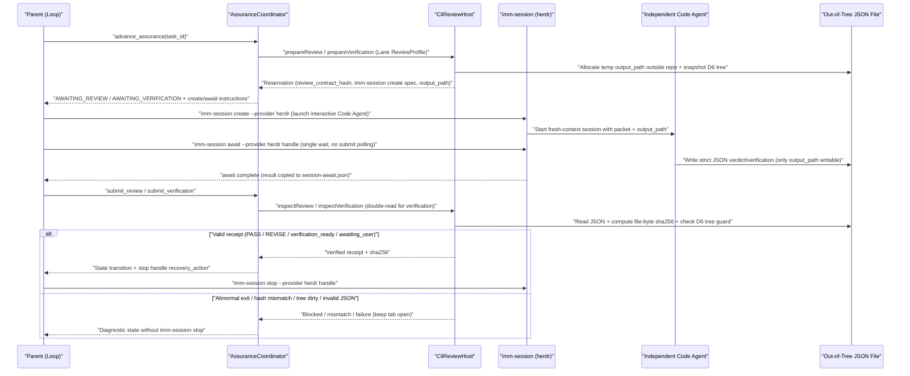

# Explicit Port Review Session (`S1`)

- **Task ID**: `explicit-port-review-session`
- **Initiative**: `explicit-port-review-and-retro-hygiene` (`Explicit Port Review and Retro Signal Hygiene`)
- **Design risk**: High
- **Diagram decision**: required
- **Diagram reason**: Review and Findings Verification dispatch crosses Host runtime (`plugins/immune-brain/runtime/host-core/runtime.ts`), Assurance Coordinator (`plugins/immune-brain/runtime/assurance/coordinator.ts`), `CliReviewHost` (`plugins/immune-brain/runtime/assurance/cli_review.ts`), `SupervisedSessionPort` (`imm-session`), an isolated out-of-tree temp JSON verdict/verification output file, and Kernel receipt consumption (`submit_review` / `submit_verification`).
- **Threat model and supported environment**: Inputs come from approved repository configuration (`layered_config.ts`), Kernel manifests, Host env, and the user's trusted Herdr/Host workspace (`herdr` provider via `imm-session`). Untrusted live worktree edits by Reviewer/Verifier and raw terminal scrollback are never authority evidence (`docs/adr/0037-authority-review-cli-stage.md`, `docs/adr/0038-supervised-session-port.md`, `docs/adr/0039-verification-cli-stage.md`). Crossed authority/security boundaries: isolated temp JSON output path write access (`CLAUDE_REVIEW_SETTINGS` `Write(<targetPath>)` on Claude Code; `D6` Git tree guard across hosts), `sha256` receipt + Verification double-read integrity, and strict module separation forbidding imports from `plugins/immune-brain/runtime/session/` (`tests/supervised-session-boundary.test.ts`).
- **Design views**:
  1. *Control flow*: Parent Loop receives explicit `imm-session create` -> `imm-session await` instructions, waits cleanly once, calls `submit_review`/`submit_verification`, and closes single-round tabs via `imm-session stop` after valid receipt consumption (or keeps open on abnormal failure).
  2. *Configuration propagation*: Lane `ReviewProfile` (`host`, `model`, `effort`, plus `transport` and verifier model where applicable) propagates from `layered_config.ts` through `host-core/runtime.ts` and `coordinator.ts` into `cli_review.ts` (`BR-REQ-1`).
  3. *Data/Artifact flow*: `prepareReview` and `prepareVerification` allocate dedicated out-of-tree temp JSON files; `CliReviewHost` validates JSON + file-byte `sha256` receipt (+ Verification double-read) + `D6` tree guard (`BR-REQ-2`, `BR-DEC-2`).
  4. *Prompt/Packaging parity*: Role prompts, `role_prompt_bridge.ts`, `SKILL.md`, `immune-brain-review-verifier.md`, and bundled `dist/role-prompts/*` stay consistent (`tests/skill-dist-consistency.test.ts:112-120`).
- **Execution posture**: Bounded implementation slice implementing explicit Port session mechanics, out-of-tree JSON output channel, Lane profile propagation, non-polling pending recovery (`F1`), and automatic `imm-session stop` cleanup (`BR-DEC-3`). Global retirement of the legacy `"process"` transport default and fallback is explicitly sequenced to `S2` (`retire-process-review-transport`).

---

## 1. Problem and Evidence

1. **Hidden headless command wrapper instead of an explicit independent interactive Code Agent (`BR-REQ-1`)**:
   - Currently `docs/adr/0038-supervised-session-port.md:121-132,150-153` runs `herdr` review/verification through `imm-session run --provider herdr`, executing `writeProcessScript` (`plugins/immune-brain/runtime/assurance/cli_review.ts:250-264`) around hidden non-interactive `--print` arguments (`reviewArguments` `cli_review.ts:84-141`, `verificationArguments` `cli_review.ts:152-167`), while `host-core/runtime.ts:441` constructs `new CliReviewHost(this.host)` and `coordinator.ts:880-899,1721-1755` omits full Lane profile propagation (including `transport` and requested model).
   - An explicit interactive Code Agent session via `imm-session create` -> `imm-session await` gives the user inspectable interactive progress in a dedicated tab while preserving fresh-context isolation.
2. **Terminal scrollback is unsuitable as structured authority channel (`BR-REQ-2`, `BR-DEC-2`)**:
   - Interactive Code Agents do not emit `--print --json-schema` machine-clean stdout. Terminal scrollback can echo prompts, progress banners, or tool logs (`docs/adr/0038-supervised-session-port.md:139-140`). Reading strictly from a dedicated out-of-tree temp JSON file (`output_path`) + verifying its file-byte `sha256` receipt (with Verification double-read consistency) and checking `D6` (`reviewTreeState`/`treeChanged`, `cli_review.ts:214-230`) preserves tamper-evident authority receipts across Claude Code, Pi, and Antigravity.
3. **Polling-inducing pending recovery strings (`BR-REQ-1`, `F1`)**:
   - `plugins/immune-brain/runtime/assurance/cli_review.ts:403` returns `"review process still running; wait for it to exit, then call submit_review again"`, `cli_review.ts:340` returns `"verification process still running; wait for it to exit, then call submit_verification again"`, `review_mediation.ts:51-52` returns `"Wait for the dispatched reviewer to finish, then call submit_review again with its verdict; do not dispatch or continue another reviewer"`, and `coordinator.ts:2030` returns `"wait for the reserved verifier, then submit_verification"`.
   - Meanwhile `plugins/immune-brain/dist/drive.md:220` states `"Do not poll"`. The `recovery_action` wording causes models to hot-poll `submit_review` dozens of times in seconds instead of awaiting completion via `imm-session await`.

---

## 2. Architecture & Design Decisions

Each design decision traces to an exact source requirement (`BR-*`) or explicit delegated technical choice:

- **D1 — Explicit Interactive Port Session Launch without Runtime Coupling** *(Source: `BR-REQ-1`, `BR-OUT-1`)*:
  - Keep zero imports from `plugins/immune-brain/runtime/session/` inside `plugins/immune-brain/runtime/assurance/`, Kernel, and Host adapters (`BR-OUT-1`, `tests/supervised-session-boundary.test.ts`).
  - `CliReviewHost` (`cli_review.ts`) and `HostReviewReservation` / `VerificationReceipt` contracts (`host_port.ts`) emit explicit `imm-session create --provider herdr ...` and `imm-session await --provider herdr ...` instruction fields/commands for interactive Review and Verification sessions when `herdr` Port transport is active, rather than wrapping headless `--print` inside `imm-session run`.
- **D2 — Dedicated Out-of-Tree JSON Output Path + `sha256` Receipt + `D6` Tree Guard** *(Source: `BR-REQ-2`, `BR-DEC-2`)*:
  - `prepareReview` (`cli_review.ts:348-393`) and `prepareVerification` (`cli_review.ts:297-330`) allocate a dedicated out-of-tree temporary JSON file path (`output_path`) outside the repository worktree.
  - On Claude Code, the interactive session keeps the read-only reviewer boundary: `--settings CLAUDE_REVIEW_SETTINGS` (`disableAllHooks`, so a user hook cannot rewrite an allowed `git` call), `--tools Read,Grep,Glob,Bash,Write`, `--permission-mode dontAsk`, and `--allowedTools` limited to `REVIEW_GIT_ALLOWED_TOOLS` plus one `Edit(//<output_path>)` rule (Claude Code governs `Write` through `Edit` path rules; an absolute path takes a leading `//`). Every other write is denied. On Pi the session runs `--tools read,grep,find,ls,bash,write`; on Pi and Antigravity, repository immutability continues to be enforced by `D6` (`reviewTreeState`/`treeChanged`).
  - `inspectReview` (`cli_review.ts:399-430`) and `inspectVerification` (`cli_review.ts:333-346`) read ONLY from `output_path` (never terminal scrollback), validate strict JSON, and hand the receipt bytes on; `review_mediation.ts` binds the receipt by computing its file-byte `sha256` and checking `task_id` / `snapshot_digest` / `review_contract_hash`, and retain `consumeReviewVerification` double-read consistency (`coordinator.ts:903-943`) for Verification.
- **D3 — Lane Profile Propagation End-to-End** *(Source: `BR-REQ-1`)*:
  - `ReviewProfile` (`layered_config.ts:12`), `chooseReviewer` (`layered_config.ts:23-28`), `host_port.ts` (`ReviewRequest` / `VerificationRequest`), `host-core/runtime.ts`, and `coordinator.ts` carry request-selected Lane review config (`transport`, `host`, `model`, `effort`, and verifier model where applicable) end-to-end into `CliReviewHost` reservation and command/prompt generation.
- **D4 — Remove Polling-Inducing Recovery Messages** *(Source: `BR-REQ-1`, `F1`)*:
  - Replace `"then call submit_review again"` / `"then call submit_verification again"` in `cli_review.ts:340,403`, `review_mediation.ts:51-52`, and `coordinator.ts:2030` with explicit instructions telling the Parent to wait via `imm-session await <handle>` until the session finishes (and never hot-poll `submit_review` / `submit_verification`).
  - Note (`delegated technical choice`): Exact error/blocked string copy inside `cli_review.ts`, `review_mediation.ts`, `coordinator.ts`, and `dist/drive.md` removes repeat-call polling loops while preserving stable top-level machine states (`state: "blocked"` / `"review_pending"`).
- **D5 — Single-Round Tab Cleanup Policy (`imm-session stop`)** *(Source: `BR-DEC-3`)*:
  - Once `submit_review` or `submit_verification` consumes a valid receipt yielding `PASS` / `REVISE` (`review_mediation.ts:64-113`) or `verification_ready` / `awaiting_user` (`coordinator.ts:903-943,2017-2083`), recovery/completion guidance and Parent Loop instructions (`dist/drive.md`) direct Parent to run `imm-session stop --provider herdr <handle>` automatically to close the single-round session tab.
  - The consumed result carries the session's `stop_command`, so the Parent runs it from the same response that records the decision.
  - Abnormal session exit is observed, not inferred from silence: `await_command` copies the `imm-session await` result to `session-await.json` beside the receipt. When the output file is absent and that record shows the session stopped or went idle (`exited`, `changed`; a `timeout` or refused await claims nothing), `inspectReview` / `inspectVerification` release the reservation with `review_session_aborted` / `verification_session_aborted` instead of `still running`. Without an await record the round still reads as running, because the Parent has not yet awaited the session. An await that ends on `blocked` is a dialog the user answers in the tab, so the round stays open and names `await_command` again; a `create_command` that printed `entry_submitted: false` is followed, once the user answered, by `resume_command` (the same create with `--resume <handle>`).
  - On abnormal session exit, `review_contract_hash` mismatch, `D6` tree-guard failure, missing/invalid output JSON, or retained reservation while still running, keep the session tab open (`imm-session stop` MUST NOT run) so the operator can inspect diagnostics.
- **D6 — Role Prompt and Packaging Parity** *(Source: `BR-REQ-2`, `delegated technical choice`)*:
  - Update `runtime/prompts/code-review.md`, `runtime/prompts/review-verifier.md`, `runtime/role_prompt_bridge.ts`, `skills/authority-review/SKILL.md`, `agents/immune-brain-review-verifier.md`, `dist/role-prompts/code-review.md`, and `dist/role-prompts/review-verifier.md` to instruct Reviewer/Verifier to write strict JSON exclusively to the reservation's dedicated out-of-tree `output_path`, preserving `tests/skill-dist-consistency.test.ts:112-120,395-438`.

---

## 3. Sequence Diagram (Required)

---

## 4. Settlement-Design Contract

- **Authority channel**: Only the reserved out-of-tree temp JSON file (`output_path`) verified against the active reservation's `review_contract_hash` / `snapshot_digest`, file-byte `sha256`, Verification double-read equality (`coordinator.ts:903-943`), and `D6` tree-state invariance settles a Review or Verification round. Terminal output (`imm-session read`) is explicitly excluded from Kernel authority evidence (`ADR 0038`, `BR-DEC-2`).
- **Pending idempotency & non-polling recovery**: While `output_path` has not been validly written by a running session, repeated accidental `submit_review` / `submit_verification` calls remain non-mutating (`retained` reservation) and return `awaiting`/pending recovery naming `imm-session await` instead of instructing repeated `submit_review`/`submit_verification` calls (`BR-REQ-1`, `F1`).
- **Cleanup / failure posture (`BR-DEC-3`)**: Single-round tab closure (`imm-session stop`) occurs **only** after Kernel consumes a valid receipt into `PASS` (`ready`/`completed`), `REVISE` (`rework`), `verification_ready`, or `awaiting_user`. Every abnormal failure path (missing file, parse error, contract mismatch, tree-guard violation, abnormal session exit) leaves the reservation/tab inspectable with zero silent auto-pass or fallback.

---

## 5. Agreed Seams & Exact File Scope (`15` paths)

1. `plugins/immune-brain/runtime/assurance/host_port.ts` — extend `ReviewRequest`, `VerificationRequest`, `HostReviewReservation`, `VerificationReceipt`, and `ReviewProfile` / launch spec fields to carry `output_path`, explicit Port launch commands/args, and Lane `transport`/`model`/`effort`.
2. `plugins/immune-brain/runtime/assurance/cli_review.ts` *(shared with `S2`)* — allocate out-of-tree temp JSON `output_path`, emit explicit `imm-session create` / `imm-session await` interactive Agent launch specs when `transport === "herdr"`, allowlist `Write(<output_path>)` on Claude Code, read/hash strict JSON + `D6` tree guard, and remove polling `"call submit_review again"` / `"call submit_verification again"` messages.
3. `plugins/immune-brain/runtime/assurance/coordinator.ts` — pass selected Lane `ReviewProfile` (including `transport`, `model`, `effort`) into `prepareReview`/`prepareVerification`, replace `submitVerification` polling copy (`coordinator.ts:2030`), preserve Verification double-read consistency (`coordinator.ts:903-943`), and emit release/`imm-session stop` guidance on consumed receipts.
4. `plugins/immune-brain/runtime/assurance/review_mediation.ts` — update `RETAINED_REVIEW_RECOVERY`, `RELEASED_REVIEW_RECOVERY`, and `MISMATCH_REVIEW_RECOVERY` (`review_mediation.ts:49-54`) to remove polling instructions and surface single-round `imm-session stop` vs keep-open outcomes.
5. `plugins/immune-brain/runtime/host-core/runtime.ts` — wire host env, workspace, and resolved Lane `ReviewProfile` cleanly into `CliReviewHost` (`runtime.ts:441`) and assurance dispatch calls.
6. `plugins/immune-brain/runtime/config/layered_config.ts` *(shared with `S2`)* — add `transport` field to `ReviewProfile` (`layered_config.ts:12`) and propagate `review_transport` / `review_model` / `review_effort` / `review_verifier_model` cleanly in `chooseReviewer` (`layered_config.ts:23-28`).
7. `plugins/immune-brain/runtime/role_prompt_bridge.ts` — update shared review/verifier delegation rules for out-of-tree JSON `output_path` writing under explicit Port sessions.
8. `plugins/immune-brain/runtime/prompts/code-review.md` — instruct Reviewer to write strict Loop JSON verdict directly to the reservation's dedicated out-of-tree `output_path`.
9. `plugins/immune-brain/runtime/prompts/review-verifier.md` — instruct Verifier to write strict `assurance_kernel/review_verification/v1` JSON directly to its dedicated out-of-tree `output_path`.
10. `plugins/immune-brain/skills/authority-review/SKILL.md` — keep compiled/generated skill definition synced with `code-review.md` & `role_prompt_bridge.ts` (`scripts/build-claude-plugin.ts:49-70`).
11. `plugins/immune-brain/agents/immune-brain-review-verifier.md` — keep Claude verifier agent definition synced with `review-verifier.md` (`tests/skill-dist-consistency.test.ts:115`).
12. `plugins/immune-brain/dist/role-prompts/code-review.md` — keep bundled mirror byte-identical to `runtime/prompts/code-review.md`.
13. `plugins/immune-brain/dist/role-prompts/review-verifier.md` — keep bundled mirror byte-identical to `runtime/prompts/review-verifier.md`.
14. `plugins/immune-brain/dist/drive.md` *(shared with `S2`)* — update Parent Review & Verification Loop steps to run `imm-session create` -> `imm-session await` -> `submit_review`/`submit_verification` -> `imm-session stop` upon consumed receipt, eliminating polling wording (`drive.md:220`).
15. `tests/cli-review-dispatch.test.ts` *(shared with `S2`)* — test explicit Port launch command creation, out-of-tree JSON output path allocation & `Write(<output_path>)` settings, file-byte `sha256` receipt & Verification double-read, `D6` tree guard, Lane `ReviewProfile` propagation, non-polling pending messages, and `imm-session stop` vs keep-open recovery signals.

---

## 6. User Scenarios (`BR-SCN-1`)

| ID | Actor | Given | When | Then | Mode | Acceptance |
| --- | --- | --- | --- | --- | --- | --- |
| `BR-SCN-1` | Loop Parent inside Herdr | Lane profile requests `review_transport: "herdr"` and a configured `review_model` for an active Review or Verification stage | Coordinator prepares the reservation and Parent dispatches via `imm-session create` + `imm-session await`, then calls `submit_review` / `submit_verification` after the agent writes the out-of-tree JSON file | Interactive Code Agent session opens in a visible tab using the Lane profile; if submitted early, Kernel instructs `imm-session await` without suggesting repeat `submit_review` polling; once valid `PASS`/`REVISE`/`verification_ready` receipt is consumed via file `sha256` and `D6` tree guard, tab closes via `imm-session stop` | `automated` | `AC1, AC2` |

---

## 7. Acceptance & Controls

- **AC1 (Explicit Port session dispatch & Lane profile propagation — `BR-REQ-1`, `BR-OUT-1`, `BR-SCN-1`)**:
  - At the seam of `layered_config.ts`, `host-core/runtime.ts`, `coordinator.ts`, `cli_review.ts`, and `review_mediation.ts`, request-selected Lane `ReviewProfile` (`transport`, `host`, `model`, `effort`, verifier model) propagates into `prepareReview`/`prepareVerification`. Under `herdr`, reservations provide explicit `imm-session create` + `imm-session await` launch specs (zero `runtime/assurance/` imports from `runtime/session/`) and omit repeat `submit_review`/`submit_verification` polling phrasing from pending `recovery_action` / `reason` fields (`cli_review.ts:340,403`, `review_mediation.ts:51-52`, `coordinator.ts:2030`).
- **AC2 (Out-of-tree JSON output channel, `sha256` receipts, `D6` guard & `imm-session stop` policy — `BR-REQ-2`, `BR-DEC-2`, `BR-DEC-3`, `BR-SCN-1`)**:
  - `prepareReview` and `prepareVerification` allocate dedicated out-of-tree temp JSON files; Claude Code settings allowlist `Write(<output_path>)` exclusively for that file; `inspectReview` and `inspectVerification` parse strict JSON from `output_path` (with Verification double-read consistency and `sha256` receipt binding) + `D6` worktree cleanliness check; consumed valid receipts direct `imm-session stop`, while abnormal exits, contract mismatches, dirty worktrees, or invalid JSON retain the session tab without cleanup.
- **AC3 (Role prompt, SKILL, Agent, and Loop contract consistency — `BR-REQ-1`, `BR-REQ-2`, `delegated technical choice`)**:
  - `runtime/prompts/code-review.md`, `runtime/prompts/review-verifier.md`, `role_prompt_bridge.ts`, `skills/authority-review/SKILL.md`, `agents/immune-brain-review-verifier.md`, `dist/role-prompts/*`, and `dist/drive.md` agree on out-of-tree JSON file output and `imm-session create` -> `imm-session await` -> `submit_*` -> `imm-session stop` workflow without drift (`tests/skill-dist-consistency.test.ts`).

### Done looks like
- Focused suite passes (`bun test tests/cli-review-dispatch.test.ts tests/supervised-session-boundary.test.ts tests/skill-dist-consistency.test.ts`) plus `bun run typecheck`.
- Both positive (`herdr` interactive launch + valid JSON output -> `sha256` receipt -> `imm-session stop`), negative (pending session returns non-polling recovery without `"call submit_review again"`; dirty tree / contract mismatch / invalid JSON fails closed and keeps tab open), and bound (`runtime/assurance/` zero imports from `runtime/session/`, Claude `Write(<output_path>)` scoped solely outside worktree) cases are verified in `tests/cli-review-dispatch.test.ts`.

---

## 8. Devil's Advocate Audit

1. *What if a Reviewer/Verifier echoes valid JSON inside terminal scrollback without writing `output_path`?* Rejected by design (`BR-DEC-2`): `inspectReview` / `inspectVerification` read ONLY `output_path`; missing or empty `output_path` blocks/fails closed and keeps the tab open.
2. *Could Claude Code `Write(<output_path>)` let the Reviewer modify repository source files?* Mitigated by path allocation outside the workspace temp directory and exact path allowlist (`Write(<output_path>)`), backed by `D6` Git tree-state comparison before receipt acceptance (`cli_review.ts:214-230`).
3. *Could Verification pass on a partially written file if read concurrently?* Preserved double-read consistency in `consumeReviewVerification` (`coordinator.ts:903-943`) requires two stable reads of `output_path` matching `task_id`, `snapshot_digest`, and `verdict_sha256`.
4. *Could `runtime/assurance/` violate layering by calling `imm-session` directly?* Forbidden (`BR-OUT-1`, `docs/adr/0038-supervised-session-port.md:131`, verified by `tests/supervised-session-boundary.test.ts`): Kernel/Assurance emit data/commands only; Parent executes `imm-session`.

**False-compromise check**: No false compromise detected — `S1` delivers the full explicit Port session mechanism, out-of-tree JSON channel, `sha256`/double-read/`D6` verification, non-polling pending recovery (`F1`), and `imm-session stop` lifecycle, cleanly serialized before `S2` retires the `"process"` transport globally.

---

## 9. Brainstorm Trace

| Item | Ownership | Notes |
| --- | --- | --- |
| `BR-REQ-1` | **S1** (core) + **S2** (global switch & batch docs) | Interactive `imm-session create`/`await`, Lane profile propagation, remove polling retry strings (`F1`). |
| `BR-REQ-2` | **S1** | Out-of-tree JSON `output_path`, `sha256` receipt, Verification double-read, `D6` tree guard. |
| `BR-REQ-3` | S3 (`mcp-completion-delivery-workspace-typing`) | Out of `S1` scope (`F2`). |
| `BR-REQ-4` | S4 (`revisit-synthetic-input-filter`) | Out of `S1` scope (`F3`). |
| `BR-DEC-1` | **S2** (`retire-process-review-transport`) | Fail-closed global retirement of `"process"` transport. |
| `BR-DEC-2` | **S1** | Dedicated out-of-tree file as sole verdict channel (`Write(<targetPath>)` + `D6`). |
| `BR-DEC-3` | **S1** | `imm-session stop` on valid consumed receipt; keep tab open on error/mismatch/dirty tree. |
| `BR-DEC-4` | S3 (`mcp-completion-delivery-workspace-typing`) | Composition-root `options.cwd ?? process.cwd()` preserved in `S3`. |
| `BR-DEC-5` | S4 (`revisit-synthetic-input-filter`) | `synthetic: true` preserved in `revisit_evidence/v2` `events[]` in `S4`. |
| `BR-OUT-1` | **S1** (and **S2**) | Zero `runtime/assurance/` / Kernel / Host-adapter imports from `runtime/session/`. |
| `BR-OUT-2` | Excluded (`S1..S4`) | `herdr-core` dialog admission (`#495`) & sign-in dialog state detection (`#496`) excluded. |
| `BR-DEFER-1` | Deferred (`F2` follow-up) | Full `HostRuntime.this.cwd`/`bindWorkspace()` and `serveStdio` `callChain` (`mcp_runtime.ts:897-901`) deferred. |
| `BR-Q-1` | Resolved (`none`) | No open questions. |
| `BR-SCN-1` | **S1** (`AC1, AC2`) | Automated explicit Port Review & Verification round covered by `S1` (`tests/cli-review-dispatch.test.ts`). |
| `BR-SCN-2` | S2 (`AC1`) | Covered by `S2`. |
| `BR-SCN-3` | S4 (`AC1, AC2`) | Covered by `S4`. |

---

## 10. Completeness and Remaining Gap

- **Covered in S1**: Complete interactive Port session launch/await/stop lifecycle, out-of-tree JSON output + `sha256` + double-read + `D6` tree guard, Lane `ReviewProfile` propagation, non-polling pending recovery (`F1`), and prompt/skill/agent parity.
- **Intentional gap until S2**: Legacy `"process"` default and hidden script fallback remain in place solely until `S2` (`--blocked-by retire-process-review-transport=explicit-port-review-session`) removes `writeProcessScript` and flips `LANE_DEFAULTS.review_transport` to fail-closed `"herdr"`.

## 11. Rollback

- Revert `S1` changes in the 15 listed files (prior to `S2`) or restore via Git revision; no persistent Kernel DB schema migration is introduced.
