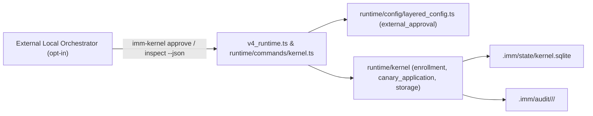

# Orchestrator-Neutral Single-Machine External Approval and Inspect Seam (ADR 0043 Slice 2)

- **Status**: Candidate; no execution authority.
- **Task ID**: `external-approval-seam`
- **Design risk**: High — extends the `v2` layered configuration permission model (`external_approval`), opens an opt-in Kernel Enrollment confirmation source (`"external_approval"` persisted on `TaskRecordV4`), adds a mutating CLI entrypoint (`imm-kernel approve`) exercising Enrollment and user-authority actions (`resolve_user_decision`, `stop`), extends `imm-kernel inspect` to project open user-decision details and verify settled `.imm/audit/` terminal proofs, amends `ADR 0043` and `ADR 0041`, and regenerates packaged Host artifacts.
- **Design views**: architecture layers, service/component interfaces, data flow, state transitions. (`temporal sequence` is omitted because each `imm-kernel` CLI call executes one synchronous, atomic local SQLite transaction or read-only snapshot projection with no multi-message handshake.)
- **Diagram decision**: required
- **Diagram reason**: clarifies how an external local orchestrator interacts exclusively through `imm-kernel --json` gated by `v2` `external_approval` while preserving strict inner-layer purity (`kernel` never imports `config` or any external orchestrator).
- **Threat model and supported environment**: Inputs come from local JSON configuration files (`~/.config/immune-brain/config.json` and `.imm/config.json`) and local CLI arguments to `imm-kernel` under the developer's own Unix UID; adversary is accidental unconfigured headless invocation, a project `.imm/config.json` attempting to override a user-level `external_approval: false`, stale/duplicate CLI replay against settled or already-resolved Kernel records, or in-session Agent self-invocation; supported environment is single-machine macOS and Linux with Bun, SQLite, and UTF-8 JSON in SHA-1 or SHA-256 Git repositories.
- **Document language**: English (following BASELINE Output Language Policy; user-facing chat replies remain Chinese).

---

## 1. Outcome and Slice Horizon

Slice 2 delivers the orchestrator-neutral single-machine CLI seam for `ADR 0043` with zero `takt` coupling and zero asymmetric-key ceremony: external approval is default-off (`external_approval: false` in `v2` config) and fail-closed; opting in enables `imm-kernel approve <task-id> ... --json` for headless `Enrollment`, mid-run `resolve_user_decision`, and `stop`, while `imm-kernel inspect [--task <task-id> [--run <run-id>]] --json` exposes open user-decision summaries and verifies settled `.imm/audit/<task-id>/<run-id>/` proofs.

| Slice | Closable result when landed | Remaining gap after this Slice |
| --- | --- | --- |
| **Slice 2 (`external-approval-seam` — this TaskIntent)** | `v2` layered config resolves boolean permission key `external_approval` (default `false`, strictest-wins across user/project); `verifyEnrollmentConfirmation` admits `"external_approval"` only when enabled across all risk tiers and persists `confirmation_source: "external_approval"` on `TaskRecordV4`; `imm-kernel approve` executes headless Enrollment, `resolve_user_decision`, and `stop` behind `external_approval: true`; `imm-kernel inspect [--task <id> [--run <run-id>]] --json` projects `unresolved_user_decisions` summaries when active and verified `.imm/audit/` proof facts when settled; `ADR 0043`, `ADR 0041`, config reference, instruction guards, and Claude/Antigravity/`dist/` mirrors are synced with zero `takt` references | **Slice 3 (`BR-DEFER-1`)**: decouple interactive single-task `/drive` from `BatchRunStateRecord` / `runtime/unattended/` into a pure single-task Kernel path, retire `runtime/unattended/` (`start_unattended_batch`, `retire_stale_batch`), and amend `ADR 0005`. |

---

## 2. Discovery Evidence

- **Layered `v2` permission-key precedent**: `plugins/immune-brain/runtime/config/layered_config.ts:28-36,149-165` defines `FILE_KEYS` and resolves `git_integration` with strictest-wins semantics (`manual` wins wherever set; invalid values or broken `$/contract` diagnostics resolve to the stricter value while emitting `config_invalid`, causing `imm-kernel config --json` in `v4_runtime.ts:192-195` to exit `1`). `plugins/immune-brain/runtime/config/migrate.ts:21,92-93` clones `v2` user/project objects and strips only `RETIRED_KEYS` (`herdr`, `loop`, `decision_models`).
- **Kernel confirmation membrane & `TaskRecordV4` persistence**: `plugins/immune-brain/runtime/kernel/types.ts:17-25,348` defines `ENROLLMENT_CONFIRMATION_SOURCES = ["user_session"]` and `RECORDED_ENROLLMENT_CONFIRMATION_SOURCES = ["user_session", "tracker_approval", "policy_auto"]`, validated in `validation.ts:745-750,824`. `plugins/immune-brain/runtime/kernel/enrollment_confirmation.ts:27-34` checks confirmation sources with zero external imports, and `enrollment.ts:259-268,313-334` validates `input.confirmation` before capability consumption and constructs `TaskRecordV4`.
- **CLI dispatch & synchronous `runKernelCommand` callers**: `plugins/immune-brain/runtime/v4_runtime.ts:171-235` is `async` (`runKernelCli`), whereas `plugins/immune-brain/runtime/commands/kernel.ts:1224` (`runKernelCommand`) is called synchronously by `tests/kernel-inspect.test.ts:81`. Keeping `runKernelCommand` synchronous for existing subcommands and exporting async `runKernelApproveCommand` from `commands/kernel.ts` (awaited in `v4_runtime.ts`) preserves every synchronous caller.
- **Mid-run user-authority invariants & `actor_id`**: `plugins/immune-brain/runtime/kernel/canary_application.ts:81,84,172-255,527-551` executes `resolve_user_decision` and `stop` using `MutationAuthorityRegistry` (`authority_port.ts:78-140`) and `TaskIntentIdentityToken` (`intent.ts` / `intent_token_registry.ts`). `plugins/immune-brain/runtime/kernel/reducer.ts:983-1030` rejects missing, non-user-decision, or already-resolved findings and requires `isLiteralUserActor(authorityAudit.actor_id)` (`"literal-user"` or `"user"`, `actor_identity.ts:16-33`) when resolving a `review_verifier_dispute`.
- **Audit reader & Host hook boundary**: `plugins/immune-brain/runtime/kernel/storage.ts:1082-1147` (`readAuditTaskPair`) and `storage_paths.ts:147-183` (`auditRunDirPath`, `auditEvidencePaths`) validate `.imm/audit/<task-id>/<run-id>/{task-record.json,terminal-proof.json}` hash integrity. `tests/claude-host-package.test.ts:135` pins `Bash` as `routed: false` on Claude `PreToolUse` hooks to avoid per-command Node spawn overhead, so in-session Agent prohibition on `imm-kernel approve` is enforced in `BASELINE.md` and `runtime/prompts/executor.md` (`BR-DEC-4`).

---

## 3. Technical Design

### 3.1 Architecture Layers

- **Layer responsibilities & dependency direction**: Outer CLI (`v4_runtime.ts`, `runtime/commands/kernel.ts`) depends on `runtime/config/` and `runtime/kernel/`. `runtime/kernel/` depends on neither `runtime/config/`, `runtime/host-core/`, host adapters, nor any external orchestrator (`tests/runtime-layering-boundary.test.ts`).
- **Ownership & prohibited coupling**: `layered_config.ts` alone resolves `external_approval`; `commands/kernel.ts` evaluates `resolveConfig(root)` and passes the boolean gate into `EnrollmentConfirmationInput`; zero `takt` identifiers, schemas, or paths exist anywhere in the repository.

### 3.2 Service / Component Interfaces and Decisions

- **D1 — Strictest-Wins `external_approval` Boolean Key in `v2` Config** *(Source: `BR-DEC-1`, `BR-DEC-4`, `BR-OUT-4`)*:
  - Add `"external_approval"` to `FILE_KEYS` in `plugins/immune-brain/runtime/config/layered_config.ts`.
  - Validate `typeof v === "boolean"` (`"expected true or false"`). Resolve across `[project, user]` using the permission-key rule: if any `error` diagnostic exists at `"external_approval"`, `"$"`, or `"contract"`, resolve `{ value: false, source }` for the broken file's layer; otherwise if either layer sets `false`, `{ value: false, source }` wins; otherwise take the first layer setting `true`, defaulting to `{ value: false, source: "default" }`.
  - Expose `external_approval: { value: boolean; source: string }` on `EffectiveConfig` (`immune_brain/effective_config/v2`). Non-boolean `external_approval` emits `config_invalid` (`severity: "error"`), causing `imm-kernel config --json` to exit `1`. `migrateConfig` preserves valid `v2` `external_approval` values untouched.

- **D2 — Kernel `"external_approval"` Confirmation Source & `TaskRecordV4` Provenance** *(Source: `BR-DEC-2`, `BR-OUT-4`)*:
  - Extend `ENROLLMENT_CONFIRMATION_SOURCES` to `["user_session", "external_approval"]` and `RECORDED_ENROLLMENT_CONFIRMATION_SOURCES` to `["user_session", "external_approval", "tracker_approval", "policy_auto"]` in `runtime/kernel/types.ts`.
  - Extend `EnrollmentConfirmationInput` in `runtime/kernel/enrollment_confirmation.ts` to `{ source: "user_session" } | { source: "external_approval"; external_approval_enabled?: boolean }`. `verifyEnrollmentConfirmation` returns `{ ok: true }` for `"user_session"`, `{ ok: true }` for `"external_approval"` only when `external_approval_enabled === true` (all risk tiers `routine`, `material`, `critical`), `{ ok: false, reason: "external_approval_disabled" }` when `external_approval_enabled !== true`, and `{ ok: false, reason: "unknown_confirmation_source: ..." }` for retired `"tracker_approval"`, `"policy_auto"`, or unknown strings.
  - Update `buildTaskRecordV4` in `runtime/kernel/enrollment.ts` so `confirmation_source: "external_approval"` is written when `input.confirmation?.source === "external_approval"`, while `"user_session"` Enrollments continue omitting `confirmation_source` for byte-identical compatibility.

- **D3 — Single Headless Write Command `imm-kernel approve`** *(Source: `BR-REQ-1`, `BR-REQ-3`, `BR-DEC-2`, `BR-DEC-3`, `BR-OUT-2`, `BR-OUT-3`)*:
  - Route `imm-kernel approve <task-id> [--finding <finding-id> --resolution <text> | --stop <reason>] [--actor <actor-id>] --json` in `v4_runtime.ts` to async `runKernelApproveCommand(args, root)` in `runtime/commands/kernel.ts` (keeping `runKernelCommand` synchronous).
  - Exit `2` (`error.code: "invalid_command"`) when `--json` is missing, `<task-id>` is missing or fails `TASK_ID_PATTERN`, unknown flags appear, `--finding`/`--resolution` is paired with `--stop`, `--finding` lacks a non-empty `--resolution` (or vice versa), `--stop` has an empty `<reason>`, or `--actor` is empty.
  - Exit `1` (`error.code: "external_approval_disabled"`) before any Kernel write whenever `resolveConfig(root).external_approval.value !== true`. Exit `1` (`error.code: "layout_not_ready"`) when `inspectStorageLayout(root).layout !== "ready"`.
  - Default `actorId` to `LITERAL_USER_ACTOR_ID` (`"literal-user"`), canonicalizing `--actor` via `canonicalActorId`, and set `confirmationRef` to `actorFlag ? "external_approval:" + actorId : "external_approval"`.
  - **Enroll mode** (no `--finding` or `--stop`): require `preparePiCanary` readiness, Git-tracked `TaskIntent` (and bound active `Spec` if any; else exit `1` `intent_untracked`), and call `enrollTask` with `confirmation: { source: "external_approval", external_approval_enabled: true }`. Return `{ contract: "assurance_kernel/approval_result/v1", action: "enroll", task_id, run_id, lifecycle: "active", intent_content_hash, git_base_head, confirmation_source: "external_approval" }` (exit `0`), or `{ error: { code: "enrollment_rejected", message } }` (exit `1`).
  - **Decision mode** (`--finding <id> --resolution <text>`): require active `BackendClaim` for `<task-id>`, mint single-use `"user"` capability for `resolve_user_decision`, and execute via `CanaryApplication`. Return `{ contract: "assurance_kernel/approval_result/v1", action: "resolve_user_decision", task_id, run_id, lifecycle, finding_id, resolution }` (exit `0`), or exit `1` (`no_active_claim` / `decision_resolution_rejected`).
  - **Stop mode** (`--stop <reason>`): require active `BackendClaim` for `<task-id>`, mint single-use `"user"` capability for `stop`, execute via `CanaryApplication` (exporting terminal `.imm/audit/<task-id>/<run-id>/`), and return `{ contract: "assurance_kernel/approval_result/v1", action: "stop", task_id, run_id, lifecycle: "stopped", audit_dir }` (exit `0`), or exit `1` (`no_active_claim` / `stop_rejected`).
  - High-risk exception actions (`accept_residual_risk`, `approve_breaking_intent_revision`, `authorize_rework`, `authorize_review_retry`) and headless `QA`/`Review` runners remain excluded (`BR-OUT-2`, `BR-OUT-3`).

- **D4 — Extended Read & Audit Verification on `imm-kernel inspect`** *(Source: `BR-REQ-4`, `BR-DEC-5`)*:
  - Extend `imm-kernel inspect [--task <task-id> [--run <run-id>]] --json` in `v4_runtime.ts` and `commands/kernel.ts` (remaining strictly read-only, lock-free, and journal-free; `--run` without `--task`, invalid IDs, or unknown flags exit `2` `invalid_command`).
  - When a task is active (default `inspect --json`, or `--task <id>` matching the active claim without `--run`): include `unresolved_user_decisions: Array<{ id: string; summary: string; acceptance_id: string | null }>` on `assurance.projection` for all open `unresolved_user_decision` findings, and `audit: null` when `--task` was supplied.
  - When `--task <task-id>` is passed and `<task-id>` has no active claim (or `--run <run-id>` is explicitly given): resolve the target `run_id` (`--run` if provided, else local terminal run in `sqlite_store` if present without creating a DB file, else single `run-*` directory under `.imm/audit/<task-id>/`), validate via `readAuditTaskPair(root, taskId, runId)`, and return exit `0` with `audit: { valid: true, task_id, run_id, lifecycle, audit_dir, intent_content_hash, final_record_hash, confirmation_source }` alongside `assurance_kernel/inspect/v1`. Missing audit pairs exit `1` (`task_audit_missing`); incomplete or hash-mismatched audit pairs exit `1` (`task_audit_invalid`).

- **D5 — ADR Amendments, Instruction Guard, and Derived Artifact Sync** *(Source: `BR-REQ-1`, `BR-REQ-2`, `BR-DEC-4`, `BR-OUT-1`)*:
  - Amend `docs/adr/0043-loop-daemon-freeze-and-extraction.md` Decision 4 and Slice 2 to describe the orchestrator-neutral `external_approval` + `imm-kernel approve` + `imm-kernel inspect [--task <id>] --json` seam, removing `takt/gate/v1`, `GateRequest`/`GateResponse`, `Ed25519 ApprovalProof`, and stale `policy_auto` wording.
  - Amend `docs/adr/0041-simplified-configuration.md` Decision 2 and update `docs/reference/immune-brain-config.md` for `external_approval`.
  - Add explicit instruction guard in `plugins/immune-brain/BASELINE.md`, `plugins/immune-brain/skills/BASELINE.md`, and `plugins/immune-brain/runtime/prompts/executor.md` forbidding Managed/Agent sessions from invoking `imm-kernel approve`.
  - Sync `plugins/immune-brain/dist/` (`sync-dist-docs.ts`), `plugins/immune-brain/dist/claude/mcp-server.mjs` (`build-claude-plugin.ts`), and `plugins/immune-brain-antigravity/` (`build-antigravity-plugin.ts`).

### 3.3 Data Flow & State Transitions

1. **Data flow**: CLI `argv` -> `v4_runtime.ts` -> `commands/kernel.ts` -> `resolveConfig(root)` checks `external_approval.value === true` -> `enrollTask` or `CanaryApplication.execute` mutates `.imm/state/kernel.sqlite` (and exports `.imm/audit/<task-id>/<run-id>/` on terminal `stop`); `inspect --task` reads `.imm/audit/` via `readAuditTaskPair` and emits verified JSON on stdout.
2. **State transitions**:
   - *Unowned workspace + tracked `TaskIntent`* --(`imm-kernel approve <id> --json` with `external_approval: true`)--> `TaskRecordV4` (`lifecycle: "active"`, `confirmation_source: "external_approval"`) + active `BackendClaim` + `WorkspaceClaim`. Re-running `approve <id> --json` fails closed (`task record already exists`).
   - *Active task with open `unresolved_user_decision`* --(`imm-kernel approve <id> --finding <fid> --resolution <txt> --json`)--> finding transitions `open -> resolved` (`next_obligation` advances); re-running with the same `--finding` fails closed (`already resolved`).
   - *Active task* --(`imm-kernel approve <id> --stop <reason> --json`)--> `lifecycle: "stopped"`, active claims cleared, tombstone and `.imm/audit/<id>/<run-id>/` exported; re-running fails closed (`no_active_claim`).

**False-compromise check**: No false compromise detected — Kernel's structural separation of `user` vs `qa` and `review` authority (`types.ts:385`) lets single-machine external approval drop asymmetric-key plumbing without weakening deterministic `QA`, independent `Review`, `.imm/risk-floor.json`, or `.imm/routine-classes.json`.

---

## 4. User Scenarios

| ID | Actor | Given | When | Then | Mode | Acceptance |
| --- | --- | --- | --- | --- | --- | --- |
| `BR-SCN-1` | Local CLI caller or external orchestrator | A repository with a validated, Git-tracked `docs/plans/<task-id>.intent.json` and default `v2` configuration (`external_approval` unset or `false`) | The actor runs `imm-kernel approve <task-id> --json` | The command exits with status `1` and outputs JSON containing `error.code: "external_approval_disabled"` on stdout, while `imm-kernel status --json` continues to report `kernel.claim: null` | `automated` | `AC2` |
| `BR-SCN-2` | Operator running a single-machine external orchestrator | `external_approval: true` is active in effective `v2` configuration and `docs/plans/<task-id>.intent.json` is validated and Git-tracked in a clean worktree | The actor runs `imm-kernel approve <task-id> --json`, inspects a mid-run open user decision with `imm-kernel inspect --json`, resolves it via `imm-kernel approve <task-id> --finding <finding-id> --resolution <text> --json`, and after task settlement runs `imm-kernel inspect --task <task-id> --json` | Enrollment exits `0` with JSON confirming active ownership of `<task-id>`; active `inspect --json` lists the open entry in `unresolved_user_decisions` with `id` and `summary`; decision resolution exits `0` clearing the open decision in `inspect --json`; and settled `inspect --task <task-id> --json` exits `0` with verified `.imm/audit/<task-id>/<run-id>/` proof metadata (`lifecycle`, `audit_dir`, and matching record/proof hashes) | `automated` | `AC2` |

---

## 5. Acceptance, Agreed Seams, and Controls

- **AC1 — `external_approval` Permission Config & Kernel Confirmation Membrane** *(Source: `BR-DEC-1`, `BR-DEC-2`, `BR-OUT-4`)*:
  - **Agreed seams**: `tests/layered-config.test.ts`, `tests/batch-agreement.test.ts`, `tests/kernel-enrollment-authority.test.ts`.
  - **Controls**:
    - *Positive*: `resolveConfig` defaults `external_approval` to `{ value: false, source: "default" }`, resolves `true` when set in user or project without an opposing `false`, and `verifyEnrollmentConfirmation` admits `{ source: "external_approval", external_approval_enabled: true }` across `routine`, `material`, and `critical` intents while `enrollTask` records `confirmation_source: "external_approval"` on `TaskRecordV4` (leaving `user_session` records omitting `confirmation_source`).
    - *Negative*: `user: { external_approval: false }` + `project: { external_approval: true }` (and vice versa) resolves `{ value: false }`; non-boolean `external_approval: "yes"` or malformed JSON resolves `{ value: false }`, emits `config_invalid`, and makes `imm-kernel config --json` exit `1`; `verifyEnrollmentConfirmation` rejects `{ source: "external_approval" }` without `external_approval_enabled: true` (`external_approval_disabled`) as well as `"tracker_approval"` and `"policy_auto"`.
    - *Bound*: `migrateConfig` preserves `external_approval` on `v2` files without adding Ed25519 key fields.
  - **Done looks like**: Focused `bun test` for `AC1` exits `0` with positive, negative, and bound config/membrane assertions green.

- **AC2 — `imm-kernel approve` Lifecycle & `imm-kernel inspect [--task]` Open-Decision and Audit Verification** *(Source: `BR-REQ-3`, `BR-REQ-4`, `BR-DEC-3`, `BR-DEC-5`, `BR-OUT-2`, `BR-OUT-3`, `BR-SCN-1`, `BR-SCN-2`)*:
  - **Agreed seams**: `tests/external-approval-cli.test.ts`, `tests/kernel-inspect.test.ts`, `tests/v4-runtime-launchers.test.ts`.
  - **Controls**:
    - *Positive*: With `external_approval: true`, `imm-kernel approve <id> --json` enrolls a tracked `TaskIntent` (exit `0`, `assurance_kernel/approval_result/v1`); `imm-kernel inspect --json` includes `unresolved_user_decisions: [{ id, summary, acceptance_id }]`; `imm-kernel approve <id> --finding <fid> --resolution <txt> --json` resolves an open user decision (and supports `accept_verifier_dispute` / `dismiss_verifier_dispute` under default `literal-user` actor); `imm-kernel approve <id> --stop <reason> --json` stops an active task and exports `.imm/audit/<id>/<run-id>/`; and `imm-kernel inspect --task <id> --json` validates and returns `audit` metadata (`valid: true`, `lifecycle`, `audit_dir`, `final_record_hash`, `confirmation_source`) for settled `done` and `stopped` runs without creating `.imm/state/kernel.sqlite` on an idle workspace.
    - *Negative*: With `external_approval` unset/`false`, `approve` exits `1` with `error.code: "external_approval_disabled"` (`BR-SCN-1`); untracked `TaskIntent` exits `1` (`intent_untracked`); duplicate `approve` on an already-enrolled task, already-resolved finding, or terminal task exits `1`; missing `--json`, conflicting `--finding` + `--stop`, or `--run` without `--task` exits `2` (`invalid_command`); `inspect --task <missing> --json` exits `1` (`task_audit_missing`) and tampered `terminal-proof.json` exits `1` (`task_audit_invalid`).
    - *Bound*: `runKernelCommand` remains synchronous for existing callers; `imm-kernel` exposes no flags for `accept_residual_risk`, `approve_breaking_intent_revision`, `authorize_rework`, `authorize_review_retry`, or headless `QA`/`Review` execution.
  - **Done looks like**: Focused `bun test` for `AC2` exits `0` and directly observes every `Then` clause of `BR-SCN-1` and `BR-SCN-2`.

- **AC3 — Zero-`takt` Decoupling, ADR 0043/0041 Sync, Layering Purity, Instruction Guard, and Host Bundle Parity** *(Source: `BR-REQ-1`, `BR-REQ-2`, `BR-DEC-4`, `BR-OUT-1`)*:
  - **Agreed seams**: `tests/runtime-layering-boundary.test.ts`, `tests/claude-host-package.test.ts`, `tests/antigravity-host-package.test.ts`, `tests/dist-docs-sync-contract.test.ts`.
  - **Controls**:
    - *Positive*: `ADR 0043` Decision 4 and Slice 2 and `ADR 0041` Decision 2 + `docs/reference/immune-brain-config.md` describe `external_approval`, `imm-kernel approve`, and `imm-kernel inspect [--task]`; `BASELINE.md` and `executor.md` forbid in-session Agent calls to `imm-kernel approve`; `checkClaudePlugin`, `build-antigravity-plugin.ts --check`, `sync-dist-docs.ts --check`, and `runtime-layering-boundary.test.ts` pass.
    - *Negative*: `plugins/`, `tests/` (outside negative assertions), `docs/reference/`, and `docs/adr/0043-loop-daemon-freeze-and-extraction.md` contain zero `takt/gate/v1`, `GateRequest`, `GateResponse`, `.takt/`, or `policy_auto` return clauses, and `runtime/kernel/` has zero imports from `runtime/config/` or `runtime/host-core/`.
    - *Bound*: Claude `hooks.json` `PreToolUse` keeps `Bash` unrouted (`routed: false` in `tests/claude-host-package.test.ts`).
  - **Done looks like**: Focused `bun test` for `AC3` exits `0` with zero mirror, bundle, or layering drift.

---

## 6. Devil's Advocate Audit

1. **Rollback resilience & interruption recovery**: Slice 2 adds an opt-in config key (`external_approval`, default `false`) and additive CLI/record fields without altering SQLite schema version (`1`) or existing `user_session` records. Interrupted execution inside a Managed Lane leaves the main checkout untouched and resumes via `drive`; post-merge rollback is a single `git revert` + bundle regeneration.
2. **Verification vanity**: Merely unit-testing `verifyEnrollmentConfirmation` would miss CLI argument parsing, `v4_runtime.ts` async dispatch, `TaskRecordV4` serialization, and `.imm/audit/` tamper rejection. `AC2` drives the shipped CLI entrypoint end-to-end across enrollment, open-decision inspection, resolution, stop, and corrupted-proof rejection, while `AC3` verifies real generated Claude/Antigravity bundles and `runtime-layering-boundary.test.ts`.
3. **Spec dilution detection**: Every confirmed capability from `BR-REQ-1..4` and `BR-DEC-1..5` (opt-in config, headless Enrollment, `resolve_user_decision` + `stop` relay, active open-decision summary, settled `.imm/audit/` verification, and `ADR 0043` decoupling) is delivered end-to-end in this single Slice; only `BR-DEFER-1` (Slice 3 `runtime/unattended/` retirement) remains deferred as confirmed.

---

## 7. Brainstorm Trace

| Upstream ID | Disposition | Mapping in this Spec / TaskIntent |
| --- | --- | --- |
| `BR-REQ-1` | Covered | `D3`, `D5`; `AC3` |
| `BR-REQ-2` | Covered | `D5`; `AC3` |
| `BR-REQ-3` | Covered | `D3`; `AC2` |
| `BR-REQ-4` | Covered | `D4`; `AC2` |
| `BR-DEC-1` | Decisioned | `D1`; `AC1` |
| `BR-DEC-2` | Decisioned | `D2`, `D3`; `AC1`, `AC2` |
| `BR-DEC-3` | Decisioned | `D3`; `AC2` |
| `BR-DEC-4` | Decisioned | `D1`, `D5`; `AC1`, `AC3` |
| `BR-DEC-5` | Decisioned | `D4`; `AC2` |
| `BR-OUT-1` | Out (explicit non-goal: zero `takt` adapter/schema inside `immune-brain`) | `D3`, `D5`; `AC3` |
| `BR-OUT-2` | Out (explicit non-goal: high-risk overrides stay interactive `user_session` only) | `D3`; `AC2` |
| `BR-OUT-3` | Out (explicit non-goal: no headless `QA`/`Review` runner CLI in Slice 2) | `D3`; `AC2` |
| `BR-OUT-4` | Out (explicit non-goal: no Ed25519 keys, signed stdin envelopes, `expires_at`, or SQLite nonce tables) | `D1`, `D2`; `AC1` |
| `BR-DEFER-1` | Deferred to ADR 0043 Slice 3 | Section 1 (`Remaining gap after this Slice`) |
| `BR-Q-NONE` | Resolved (`0` open questions) | Closed in Brainstorm before Planner entry |
| `BR-SCN-1` | Covered (`automated`) | Section 4; `AC2` |
| `BR-SCN-2` | Covered (`automated`) | Section 4; `AC2` |
