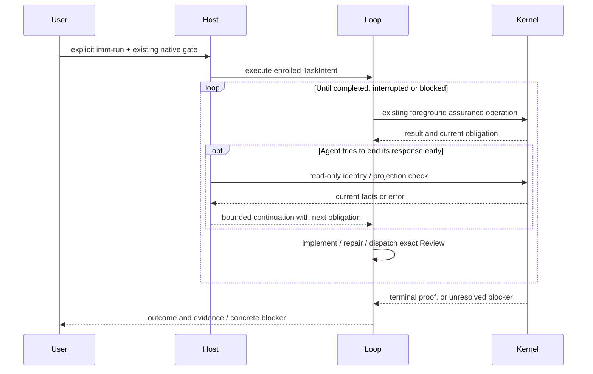

# Goal-driven imm-run

**Status**: Candidate design; not enrolled. Canonical TaskIntent authoring is pending the existing workspace owner.
**Design risk**: High — continuation crosses two Host lifecycle boundaries and must preserve literal-user entry, cancellation, Review ownership, and Kernel completion authority.
**Document language**: English.
**Execution posture**: test-first at the two Host lifecycle seams, reusing the existing Kernel and assurance fixtures.
**Source**: The user accepted all three responsibility recommendations, then requested a Spec/Plan for an `imm-run` loop that autonomously implements and verifies a goal.

## Outcome

After the user explicitly enters `imm-run` and grants the existing native Enrollment authorization (or resumes an already enrolled Task), Immune-Brain keeps the current Host conversation working through implementation, focused checks, deterministic QA, independent Review where required, and ordinary rework. A premature final answer does not require the user to type “continue”. The loop ends with Kernel-proven completion, an explicit interruption, or a concrete blocker that requires user action.

TaskIntent acceptance remains the definition of the goal. This adds reliable continuation to the existing Loop; it does not create a second goal object, a model-based completion authority, or a background scheduler.

## Confirmed framing

The IDs below capture the already accepted conversation decisions; they do not request another approval.

| ID | Confirmed item |
|---|---|
| BR-DEC-1 | The core product owns the engineering-task authorization, execution and verification loop. Product goals and material trade-offs remain user-owned. |
| BR-DEC-2 | Act autonomously inside the approved Task or batch. Stop at its completion; later work may be recommended but is not started automatically. |
| BR-DEC-3 | Keep adjacent maintenance capabilities optional. Models, providers, conversation execution and general environment capabilities belong to the Host. |
| BR-REQ-1 | Prepare a Spec and executable planning candidate for goal-driven implementation and verification through `imm-run`. |
| BR-OUT-1 | No automatic selection of new goals, general development platform, generic scheduler, new Kernel state machine, or new completion judge. |

## User scenarios

All scenarios derive from BR-REQ-1 and the user's acceptance of BR-DEC-2. They describe one outcome on both supported Hosts.

### BR-SCN-1 — Autonomous delivery

- **Actor**: Repository owner.
- **Given**: A validated TaskIntent, explicit `imm-run` entry, and accepted Enrollment.
- **When**: The agent implements the task, encounters an ordinary failing check or Review finding, and attempts to finish responding before the task is complete.
- **Then**: The owner sees implementation, repair and verification continue without a “continue” prompt, followed by a completion report backed by the task's terminal evidence.
- **Verification**: automated, GDR-A1, GDR-A2, GDR-A3.

### BR-SCN-2 — A real blocker remains visible

- **Actor**: Repository owner.
- **Given**: An explicitly running task encounters a decision outside its authorization or the owner interrupts execution.
- **When**: The agent reaches a response boundary.
- **Then**: The owner sees the concrete decision or interruption, and the agent does not restart cancelled work or repeatedly reopen the same authorization dialog.
- **Verification**: automated, GDR-A2, GDR-A3.

### BR-SCN-3 — Scope ends with the task

- **Actor**: Repository owner.
- **Given**: The owner is discussing a plan, has not entered `imm-run`, or the enrolled task has already completed.
- **When**: The agent finishes its response.
- **Then**: The response ends normally without starting implementation, enrolling another candidate, or continuing unrelated work.
- **Verification**: automated, GDR-A1, GDR-A2, GDR-A3.

## Discovery evidence and dependencies

| Evidence | Consequence |
|---|---|
| `CONTEXT.md`, Entry And Ownership and Kernel State | TaskIntent owns the goal; Kernel owns task state, assurance and settlement; Loop projects the next obligation. |
| `plugins/immune-brain/dist/imm-run.md`, Execution Loop | Implementation, staging, QA, Review, rework and terminal handling already exist as instructions. Preserve their ordering and foreground execution. |
| `plugins/immune-brain/.pi-extension/imm-canary-work.ts` | Registers input, session, tool and notice hooks but no final-response continuation boundary. Reuse this registration and the existing session identity. |
| `plugins/immune-brain/runtime/claude/mcp_server.ts`, `runtime/claude/lane_guard.ts`, `hooks/hooks.json` | Existing entry and tool-observation hooks can correlate sessions and tool results. There is no main-agent `Stop` handler. |
| `plugins/immune-brain/runtime/assurance/phase_entry.ts` | Literal run entry is already recognized. Model-injected reminders must not manufacture or renew it. |
| `plugins/immune-brain/runtime/kernel/assurance_projection.ts` | Projection exposes run identity, revisions, diff identity, lifecycle, findings and next obligation. Projection errors are not completion. |
| `plugins/immune-brain/runtime/assurance/coordinator.ts`, `deriveAssuranceRecovery` | Structured repair/environment/authorization guidance already exists. Consume it instead of constructing a competing assurance workflow. |
| `plugins/immune-brain/runtime/workspace_scope.ts`, `dirtyScopePaths`, `taskDeliveryIdentity` | Dirty implementation files can temporarily prevent a complete projection. A staging reminder must not reinterpret a failed projection as fresh QA or execution authority. |
| `tests/pi-canary-work-extension.test.ts`, `tests/helpers/pi-canary-assurance-harness.ts` | Existing fake ExtensionAPI and real Kernel fixtures support lifecycle integration testing; SDK mocks must be conditional and restored. |
| `tests/claude-phase-entry-gate.test.ts`, `tests/claude-host-authority.test.ts` | Hook-to-MCP fixtures already exercise entry, native confirmation and Kernel progression without a live model. |
| `tests/pi-canary-notification-correlation.test.ts` | Assurance completion delivery is foreground-only. Do not reintroduce follow-up delivery in `pi-canary-assurance.ts`. |
| `scripts/build-claude-plugin.ts`, `tests/claude-host-package.test.ts` | Runtime and hook changes require regeneration of `dist/claude/mcp-server.mjs`. |
| `scripts/dist-sync-manifest.ts`, `scripts/sync-dist-docs.ts` | `dist/imm-run.md` is a Skill-owned instruction source; BASELINE and executor prompts have generated mirrors. |
| Pi 1.2.0 `docs/extensions.md` and exported `extensions/types.d.ts` | `agent_before_settle` accepts a custom message and `continue: true`; it exposes outcome and `context.canContinue`. Use this final actionable boundary, not `agent_end`, timers or queued user messages. |
| [Claude Code goal documentation](https://code.claude.com/docs/en/goal), [Stop hook reference](https://code.claude.com/docs/en/hooks#stop) | `/goal` continues responses using a model judge. The desired interaction can instead consume Kernel facts through a command Stop hook. Stop does not fire for user interruption; errors are distinct from normal completion. Respect Host continuation limits. |

The existing `run-only-gates` work owns overlapping entry/Host files. Implement this task only after that owner has settled, then recheck these exact files for drift. Preserve its accepted entry and effect policies; this task neither reverts them nor absorbs its automatic-commit work. The currently installed canonical author command rejects a second task while a Kernel claim is active. This is an authoring prerequisite, not permission to stop or alter that task.

## Scope and responsibility

In scope: one standalone TaskIntent that delivers the same continuation invariant on Pi and Claude Code, focused Host integration tests, published usage/contract updates, and generated packaging.

Existing batch execution remains owned by the batch runner. A parent waiting inside an active batch tool must not start a competing single-task loop. A Lane Executor may use the same single-task continuation when its own session and enrolled run match. No new batch scheduling or task enrollment is introduced.

Out of scope: kernel reducer/storage/schema changes; automatically starting a new task; a new public goal command or tool; evaluator-model calls; model/provider configuration; new background agents, timers, cron, worktrees or Host sessions; automatic publish/deploy/push; a security sandbox; unrelated maintenance cleanup. Existing native authority gates and accepted Git-effect policies stay in force.

## Technical Design

**Design views**: architecture layers, component interfaces, state transitions and temporal sequence. The central invariant is identical on both Hosts: continuation may request another foreground model turn for an already authorized run but grants no task authority.
**Diagram decision**: required
**Diagram reason**: the Host response boundary must return control to the existing Loop without taking over QA, Review or settlement.



### Decisions and provenance

Each design decision has exactly one primary source. Supporting evidence is listed separately above.

| ID | Decision | Source |
|---|---|---|
| D1 | Use TaskIntent acceptance and Kernel terminal evidence as the only definition and proof of completion. | BR-DEC-1 |
| D2 | Continue only the session's explicitly entered and successfully bound run; disarm on terminality, cancellation or a concrete blocking failure. | BR-DEC-2 |
| D3 | Use each Host's native final-response boundary; no additional model judge or scheduler. | BR-DEC-3 |
| D4 | Keep the implementation in one TaskIntent because both Host adapters enforce one continuation invariant with shared acceptance and rollback. | Delegated technical choice: a partial Host rollout would leave the confirmed product behavior incomplete. |
| D5 | A shared, read-only continuation decision consumes authoritative observations and returns continue, yield, or inactive guidance. It performs no Kernel operation. | Repository evidence: `plugins/immune-brain/runtime/kernel/assurance_projection.ts` |
| D6 | Permit at most one corrective continuation without observable work since the previous reminder. Report a stall if it repeats; do not count narration or a repeated status read as progress. | Repository evidence: `plugins/immune-brain/BASELINE.md`, Verification and Local Recovery |
| D7 | Handle task-owned dirty files with a bounded ownership/staging reminder, without bypassing projection validation or staging from a lifecycle hook. | Repository evidence: `plugins/immune-brain/runtime/workspace_scope.ts` |
| D8 | Open a required native decision through the existing Loop once; a declined, cancelled, failed or already pending decision yields without automatic gate retry. | Repository evidence: `plugins/immune-brain/dist/imm-run.md`, Decisions and Recovery |
| D9 | Retain durable task recovery, but do not restart a conversation automatically after session replacement or interruption; explicit `imm-run` rebinds it. | Repository evidence: `CONTEXT.md`, Managed Path |
| D10 | Keep notices visible in normal task output/Task Rail and leave the Footer empty. | Repository evidence: `tests/pi-canary-work-extension.test.ts` |

### Components and interfaces

1. Add `runtime/assurance/run_continuation.ts` as a small Host-neutral policy module. Input consists of the current run/session binding, a fresh projection or typed observation failure, latest foreground operation disposition, activity outcome, pending native work, and the previous reminder observation. Output is one of `continue` with a bounded reason, `yield` with a concrete reason, or `inactive`. This is internal data, not a new public tool or Kernel enum.
2. Add Host-local adapters `.pi-extension/pi-run-continuation.ts` and `runtime/claude/run_continuation.ts`. They own response-boundary integration and non-authoritative session bookkeeping. Register the Pi adapter from `imm-canary-work.ts`; connect the Claude adapter to existing prompt/tool/session observations and the main-agent Stop branch in `mcp_server.ts`.
3. Reuse the existing session identity, phase-entry recognition, private Claude cache helpers and Kernel readers. Do not add a new general persistence abstraction. Bookkeeping contains only binding and deduplication facts, never acceptance results, workflow status or authority decisions. Losing it disables continuation until explicit re-entry; it never changes TaskRecord.
4. A binding identifies canonical workspace, Host session, task ID and Kernel run ID. Establish it from successful Enrollment or an explicit resume plus validated status for that exact task. A mere workspace claim, ordinary prompt, model-loaded Skill, task notice, or a status read in another session does not bind a run. A new literal run entry can establish a new binding; injected continuation cannot.
5. Kernel/assurance result observation must distinguish repairable results, pending decisions, cancellation and failed native gates structurally. Do not parse an assistant's final prose or infer permission from the absence of an error. For Claude, correlate tool-use ID, session and result through existing hooks; do not inspect arbitrary session logs. Tool result copies are observations and must be revalidated against the Kernel before use.

### Response-boundary decision

Evaluate in this order:

- An absent binding, a different workspace/session/run, a planning entry, a terminal task, or a pending batch/progression call requests no continuation.
- An aborted/error Host outcome, user interruption, failed native gate or explicit session replacement disables automatic continuation. Pending authorization yields; it is not completion or task stop.
- An unreadable/conflicting authority state yields with the concrete error. Never reconstruct a successful projection or pick a different owner.
- A matching active run with a valid executable obligation requests one next foreground turn. The message names the task, the missing obligation and the existing Loop action. `run_review` preserves the exact `review_ready.agent_params` handoff and immediate `submit_review`; the hook does not dispatch a replacement reviewer.
- `resolve_user_decision` or `revise_intent` may issue one reminder to use the existing owner/native gate when it has not yet been attempted. The hook itself opens nothing. After a pending/declined/failed gate it yields and never repeats the gate automatically.
- For the already bound active run only, a dirty-source condition may issue one reminder to inspect ownership, stage only task-owned paths, and obtain fresh status. The adapter verifies claim/run and TaskRecord identity through existing readers and identifies dirty paths with `dirtyScopePaths`; it must not treat every projection error as dirt or invent the next assurance obligation. No new binding can be established from this fallback. A changed record, frozen artifact, ambiguous ownership or unrelated authority error yields.
- `done` with matching terminal evidence is success. `stopped` is stopped. A final answer, a local test exit 0, `completion_ready` without settlement, or an empty/failed projection is not success.

No callback implements, stages, commits, mutates authority, retries a native gate, or runs QA. It only keeps the foreground conversation available for the existing Loop.

### Progress and interruption

Store the identity of the last reminder and evidence of substantive work since it. Use existing record/delivery identities for authority and source changes; use bounded scoped Git inspection for unstaged content; retain correlated foreground verification/Review dispositions. Repeated reads, equal failures and narration are not progress. A first premature final response receives one corrective continuation. A second response with the same facts and no substantive work yields a visible `no progress` explanation and leaves the task active.

The progress marker is a deduplication guard, not a proof of success or a new retry budget. Do not hash or retain secret-bearing stdout, whole transcripts, or out-of-scope files. Do not count timestamp-only changes as progress. User-provided limits and Host limits continue to apply; the implementation must not change Host environment variables to raise those limits.

Pi uses `agent_before_settle`: require `outcome === "completed"`, honor `context.canContinue`, preserve earlier handlers' entries and continuation requests, and add at most one custom-message entry for this boundary. Return `continue: true` only when the policy allows. Do not send a synthetic user message or use a follow-up queue.

Claude registers a synchronous command `Stop` hook through the existing packaged entry point. On continue, return the established `{ "decision": "block", "reason": "..." }` shape. On inactive, terminal, blocked or repeated no-progress observations, return no block and report the reason through supported output. Observe `stop_hook_active` together with the last reminder; do not unconditionally return a block. Do not depend on newer optional background-task fields or alter the documented Host block cap. Interrupted turns do not produce Stop; on the next literal input invalidate stale continuation observations before any rebind.

A repeated hook delivery for the same boundary is idempotent. State is isolated per session/workspace/run; a task ID reused for another run cannot inherit it. Cleanup uses existing session lifecycle hooks/private cache conventions. No permanent compatibility layer or migration is introduced.

### Existing execution sequence preserved

Implement within scope → focused local checks → stage task-owned paths → foreground `advance_assurance` → exact required foreground Review → immediately `submit_review` → only then edit on rework → resolve verified findings → fresh assurance → Kernel settlement.

Ordinary in-goal failures stay in this cycle; scope/goal changes retain their existing revision authority. All acceptance descriptors still run in the disposable delivery tree. Parent self-reports and reminder messages create no attestations.

## Verification and acceptance mapping

The four acceptance items below are the complete planned TaskIntent acceptance. Each descriptor uses `assurance_kernel/verification_descriptor/v2`, executable `bun`, argv `test` followed by the listed exact files, cwd `.`, timeout 120000 ms, max output 131072 bytes, and environment `{ "prepare": null, "writable_paths": [] }`. The QA Host supplies Bun; tests use tracked modules, built-in libraries and disposable temporary Git repositories. No network, dependency installation or live model call is needed.

| ID / primary source | Assertion and agreed seam | Positive, negative and boundary controls |
|---|---|---|
| GDR-A1 / BR-DEC-2 | The shared policy continues only a bound authorized run toward its actual Kernel obligation; it never grants authority or recognizes assistant prose as completion. `tests/run-continuation.test.ts` (new). | Active incomplete run continues; unrelated session/run, absent entry and terminal task do not. Same task ID with different run ID is rejected. Local pass and `completion_ready` do not imply settlement. First no-progress response is corrected; repeated identical observations yield. Dirty owned paths get only the bounded staging reminder; other projection errors fail closed. |
| GDR-A2 / BR-REQ-1 | Pi's registered final-response handler keeps implementation, verification and rework moving without another user prompt, then stops on matching terminal evidence or a real blocker. `tests/pi-run-continuation.test.ts` (new, reusing the existing extension/Kernel harness). | Drive actual registered handlers through an enrolled fixture with scripted executor actions, a failing check, a repair and terminal settlement; assert continuation entries and complete output. Assert no wakeup for planner/ordinary input, abort/error, queued Host continuation, pending batch, repeated failed gate or a foreign run. Pin exact Review-result submission before any rework edit. |
| GDR-A3 / BR-REQ-1 | Claude's packaged Stop hook implements the same closed loop and preserves session/tool correlation and user interruption. `tests/claude-run-continuation.test.ts` (new, reusing hook/MCP fixtures). | Feed real Hook JSON to the packaged `--hook` process and real enrolled fixture states; assert one block per eligible boundary and no block after terminal proof. Feed correlated failed/pending native results, a different session, malformed cache, repeated `stop_hook_active` with no progress, and resumed task with a new run ID. Script repair plus fresh QA/Review/settlement to prove more than a string match. |
| GDR-A4 / BR-DEC-1 | Published instructions explain the responsibility boundary, automatic continuation and concrete stop reasons, and the packaged runtime matches source. `tests/goal-driven-run-contract.test.ts` (new), `tests/claude-host-package.test.ts`, `tests/dist-docs-sync-contract.test.ts`, `tests/pi-canary-notification-correlation.test.ts`. | Hook is registered for main-agent Stop, Pi integration uses the actionable boundary, mirrored contracts remain consistent, generated bundle is current, and foreground assurance has no follow-up notification loop. Do not assert a release changeset's continued existence after release consumption. |

The deterministic tests prove adapter behavior with controlled Host events and actual Kernel fixtures. They do not claim that every model will converge or that all Host releases honor identical lifecycle contracts. Record a manual smoke result on Pi 1.2.0 and the supported Claude Code version when that Host is available during implementation, naming version, task, observed continuation and cancellation. Report an unavailable live-Host smoke separately; do not describe fixture tests as live-Host evidence.

Implementation validation additionally runs `bun run typecheck`, `bun scripts/build-claude-plugin.ts --check` and `bun scripts/sync-dist-docs.ts --check` after generating affected mirrors/bundle. These are Executor/release checks, not acceptance descriptors. Planning validates descriptor structure only; it does not run the future suite.

## Execution candidate and reference closure

One standalone TaskIntent: `goal-driven-run`, risk `material`, revision 1, owner `user`. Candidate path: `docs/plans/goal-driven-run.intent.json`. Bind this Spec as the sole active Spec. No Initiative, Issue publication or separate prose Plan is needed for this one coherent outcome.

| Implementation work within the single TaskIntent | Result | Remaining gap |
|---|---|---|
| Add shared decision policy and controlled observations with regression tests. | Continuation and stop rules are executable. | Host integration and delivery proof. |
| Wire Pi final-response and Claude Stop adapters; run their lifecycle tests. | Both Hosts continue eligible work and respect interruptions. | Packaging and published behavior. |
| Update contracts/usage, regenerate mirrors/bundle, run focused verification and Kernel assurance. | Complete approved outcome on both Hosts. | None after successful settlement; live-Host evidence retains its explicitly reported coverage limits. |

These rows are implementation ordering, not separately enrolled Steps or an additional workflow state machine.

The complete proposed `scope_hint` is:

```text
.changeset/goal-driven-run.md
CONTEXT.md
README.md
README.zh-CN.md
docs/plans/goal-driven-run.intent.json
docs/specs/goal-driven-run.spec.md
plugins/immune-brain/.pi-extension/imm-canary-work.ts
plugins/immune-brain/.pi-extension/pi-run-continuation.ts
plugins/immune-brain/BASELINE.md
plugins/immune-brain/dist/BASELINE.md
plugins/immune-brain/dist/claude/mcp-server.mjs
plugins/immune-brain/dist/imm-run.md
plugins/immune-brain/dist/role-prompts/executor.md
plugins/immune-brain/hooks/hooks.json
plugins/immune-brain/runtime/assurance/run_continuation.ts
plugins/immune-brain/runtime/claude/lane_guard.ts
plugins/immune-brain/runtime/claude/mcp_server.ts
plugins/immune-brain/runtime/claude/run_continuation.ts
plugins/immune-brain/runtime/prompts/executor.md
plugins/immune-brain/skills/BASELINE.md
plugins/immune-brain/skills/imm-run/SKILL.md
tests/claude-host-package.test.ts
tests/claude-phase-entry-gate.test.ts
tests/claude-run-continuation.test.ts
tests/dist-docs-sync-contract.test.ts
tests/explicit-phase-entry-run-contract.test.ts
tests/goal-driven-run-contract.test.ts
tests/pi-canary-notification-correlation.test.ts
tests/pi-canary-work-extension.test.ts
tests/pi-phase-entry-gate.test.ts
tests/pi-run-continuation.test.ts
tests/run-continuation.test.ts
```

Kernel projection, TaskRecord storage, `phase_entry.ts`, workspace scope and coordinator modules are read-only dependencies. Reuse their public internal functions; if implementation proves a write there is necessary, revise the candidate with that evidence before execution instead of silently widening it. Existing test helpers are reused without edits; newly needed continuation fixtures stay local to the three focused test files.

## Compatibility, recovery and rollback

- Keep TaskIntent, TaskRecord, verification and native-authority schemas unchanged. No migration or compatibility adapter is required.
- Ordinary Host work and plan-only requests retain their normal response lifecycle. Merely installing the plugin or discovering an active task never starts work.
- Existing task recovery remains explicit `imm-run`; this feature makes no promise of continuing while the Host process is closed.
- Both adapters and the shared decision are delivered atomically in one task. A partial working tree is not a releasable result. Rollback reverts the task's source, registrations, contracts and generated bundle together; enrolled tasks remain readable because authority schemas did not change.
- The planner does not change the active `run-only-gates` owner, stage its modifications or approve its pending decisions. Author/validate must be performed after the owner releases the workspace; reference closure is refreshed against the settled source before handoff.

## Devil's Advocate Audit

- **Runaway continuation**: a model can repeatedly announce completion, fail a tool or rewrite irrelevant text. Session/run binding, unchanged-observation detection, pending-gate suppression, scope-limited progress and Host cancellation prevent those events from becoming unlimited reminders. None of these observations proves success.
- **False completion**: string assertions such as “tests pass” are insufficient. Lifecycle integration tests must exercise failed verification, repair, fresh evidence and actual terminal state, with negative local-pass-only and stale-evidence controls.
- **Dirty worktree gap**: requiring a successful full projection before every reminder would strand an ordinary implementation before staging. D7 permits a single non-authoritative staging reminder for an already bound active run; it cannot rescue corrupt authority or create fresh assurance.
- **Review ordering**: a generic “keep fixing” reminder while artifacts are frozen can discard a Review verdict. Both adapters preserve the exact review dispatch and require submission before mutation.
- **Cancellation and authority**: a failed/cancelled dialog must never be read as unfinished work to auto-retry. Explicit interruption disables continuation without stopping the durable task or discarding evidence.
- **Rollback resilience**: Host-local bookkeeping contains no task truth. Removing the adapter loses convenience, not authority or the ability to resume existing tasks.
- **Spec dilution**: writing only stronger Skill prose would not meet BR-SCN-1. Both runtime lifecycle integrations and behavioral tests are required; a Pi-only implementation is not the complete deliverable.

## Brainstorm Trace and handoff completeness

| Upstream item | Disposition | Mapping |
|---|---|---|
| BR-DEC-1 | covered | D1; GDR-A4; Kernel remains the sole completion authority. |
| BR-DEC-2 | covered | D2; GDR-A1; bounded run ownership and terminal stop. |
| BR-DEC-3 | decisioned | D3; component boundaries preserve Host ownership. |
| BR-REQ-1 | covered in candidate | GDR-A2 and GDR-A3; implementation order covers the complete loop. |
| BR-OUT-1 | out | Scope and responsibility exclusions. |
| BR-SCN-1 | covered | GDR-A1, GDR-A2, GDR-A3. |
| BR-SCN-2 | covered | GDR-A2, GDR-A3. |
| BR-SCN-3 | covered | GDR-A1, GDR-A2, GDR-A3. |

Required phases are all retained: explicit entry/Enrollment; implementation; deterministic verification; required Review; repair and fresh verification; terminal reporting; interruption/blocker handling. No required phase is replaced by a documentation-only result. There are no open product decisions. The current handoff blocker is the active workspace owner and the resulting inability to create/validate the canonical TaskIntent; this Spec alone grants no execution authority.

## Planning validation result

The embedded author input passed `parseTaskIntentV1`; all four focused verification descriptors passed `parseVerificationDescriptor`; `inspectSpecBinding` resolved this document as the sole active Spec. All 32 scope entries were checked: existing source/test/mirror paths exist and the nine absent paths are explicitly planned new outputs. Scenario/acceptance and upstream mapping were checked against the tables above. No future acceptance suite was run.

Canonical authoring failed with `kernel_owner_active`. No canonical sidecar exists, nothing was staged, and canonical `intent validate`/`enrollment_ready` have not passed. This is a reviewable design and preserved execution candidate, not an execution-ready plan.

## Canonical author input (pending)

The canonical `imm-kernel intent author docs/plans/goal-driven-run.intent.json --stdin --json` attempt returned `kernel_owner_active`: "an active Kernel claim already owns this workspace; authoring is blocked". The JSON below is the complete preserved author input, not an enrolled or validated TaskIntent sidecar. After the current owner settles, refresh reference closure, supply these bytes to the canonical author command, stage only the new candidate artifacts, and run canonical validation. Do not write a sidecar directly to bypass this refusal.

```json
{
  "contract": "assurance_kernel/task_intent/v1",
  "task_id": "goal-driven-run",
  "owner": "user",
  "goal": "Make imm-run autonomously continue an explicitly authorized task through implementation, verification, ordinary repair and Kernel-proven completion on Pi and Claude Code, as specified in docs/specs/goal-driven-run.spec.md, without per-turn continuation prompts or new goal/completion authority; preserve user interruption, native gates and existing task scope.",
  "acceptance": [
    {
      "id": "GDR-A1",
      "assertion": "Source BR-DEC-2 in docs/specs/goal-driven-run.spec.md. Meet D1, D2, D5-D9 at the shared continuation boundary: only the explicitly bound active session/workspace/task/run can receive an obligation reminder; local passes, final prose and completion_ready without settlement never prove completion. A first unchanged boundary receives one correction, a repeated no-progress boundary yields. Dirty owned source permits only a bounded staging reminder for an already bound active run, while other authority errors fail closed. Pin foreign run/session, absent entry, terminal evidence and failed-gate controls in tests/run-continuation.test.ts.",
      "verification": "{\n  \"contract\": \"assurance_kernel/verification_descriptor/v2\",\n  \"command\": {\n    \"executable\": \"bun\",\n    \"argv\": [\n      \"test\",\n      \"tests/run-continuation.test.ts\"\n    ],\n    \"cwd\": \".\",\n    \"timeout_ms\": 120000,\n    \"max_output_bytes\": 131072\n  },\n  \"environment\": {\n    \"prepare\": null,\n    \"writable_paths\": []\n  }\n}\n"
    },
    {
      "id": "GDR-A2",
      "assertion": "Source BR-REQ-1 in docs/specs/goal-driven-run.spec.md. Deliver BR-SCN-1 through BR-SCN-3 on Pi via its registered agent_before_settle handler: an explicitly enrolled/resumed task continues implementation, failing verification, repair, fresh QA, required exact Review submission and settlement without another user prompt. Yield on abort/error, pending or cancelled/failed native authority, foreign run and no progress; preserve an existing Host continuation and suppress a competing batch-parent loop. Hooks grant no authority and never reopen a failed gate. Exercise registered handlers and real Kernel fixtures in tests/pi-run-continuation.test.ts.",
      "verification": "{\n  \"contract\": \"assurance_kernel/verification_descriptor/v2\",\n  \"command\": {\n    \"executable\": \"bun\",\n    \"argv\": [\n      \"test\",\n      \"tests/pi-run-continuation.test.ts\"\n    ],\n    \"cwd\": \".\",\n    \"timeout_ms\": 120000,\n    \"max_output_bytes\": 131072\n  },\n  \"environment\": {\n    \"prepare\": null,\n    \"writable_paths\": []\n  }\n}\n"
    },
    {
      "id": "GDR-A3",
      "assertion": "Source BR-REQ-1 in docs/specs/goal-driven-run.spec.md. Deliver BR-SCN-1 through BR-SCN-3 on Claude Code via the packaged main-agent Stop hook and correlated prompt/tool observations: continue only the explicitly bound run through failed verification, repair, fresh QA/required Review and settlement; return no block after completion, cancellation, pending/failed gates or repeated no progress. Wrong session/run, malformed cache and repeated stop_hook_active must not renew permission. Exercise real hook JSON, the packaged --hook process and enrolled Kernel fixtures in tests/claude-run-continuation.test.ts.",
      "verification": "{\n  \"contract\": \"assurance_kernel/verification_descriptor/v2\",\n  \"command\": {\n    \"executable\": \"bun\",\n    \"argv\": [\n      \"test\",\n      \"tests/claude-run-continuation.test.ts\"\n    ],\n    \"cwd\": \".\",\n    \"timeout_ms\": 120000,\n    \"max_output_bytes\": 131072\n  },\n  \"environment\": {\n    \"prepare\": null,\n    \"writable_paths\": []\n  }\n}\n"
    },
    {
      "id": "GDR-A4",
      "assertion": "Source BR-DEC-1 in docs/specs/goal-driven-run.spec.md. Publish the core responsibility, goal-driven continuation and concrete stop/recovery boundaries in usage and Loop contracts; register the main-agent Stop hook, preserve foreground assurance without follow-up notification delivery, and keep generated mirrors and the Claude bundle current. Verify contract/package boundaries in tests/goal-driven-run-contract.test.ts, tests/claude-host-package.test.ts, tests/dist-docs-sync-contract.test.ts and tests/pi-canary-notification-correlation.test.ts.",
      "verification": "{\n  \"contract\": \"assurance_kernel/verification_descriptor/v2\",\n  \"command\": {\n    \"executable\": \"bun\",\n    \"argv\": [\n      \"test\",\n      \"tests/goal-driven-run-contract.test.ts\",\n      \"tests/claude-host-package.test.ts\",\n      \"tests/dist-docs-sync-contract.test.ts\",\n      \"tests/pi-canary-notification-correlation.test.ts\"\n    ],\n    \"cwd\": \".\",\n    \"timeout_ms\": 120000,\n    \"max_output_bytes\": 131072\n  },\n  \"environment\": {\n    \"prepare\": null,\n    \"writable_paths\": []\n  }\n}\n"
    }
  ],
  "scope_hint": [
    ".changeset/goal-driven-run.md",
    "CONTEXT.md",
    "README.md",
    "README.zh-CN.md",
    "docs/plans/goal-driven-run.intent.json",
    "docs/specs/goal-driven-run.spec.md",
    "plugins/immune-brain/.pi-extension/imm-canary-work.ts",
    "plugins/immune-brain/.pi-extension/pi-run-continuation.ts",
    "plugins/immune-brain/BASELINE.md",
    "plugins/immune-brain/dist/BASELINE.md",
    "plugins/immune-brain/dist/claude/mcp-server.mjs",
    "plugins/immune-brain/dist/imm-run.md",
    "plugins/immune-brain/dist/role-prompts/executor.md",
    "plugins/immune-brain/hooks/hooks.json",
    "plugins/immune-brain/runtime/assurance/run_continuation.ts",
    "plugins/immune-brain/runtime/claude/lane_guard.ts",
    "plugins/immune-brain/runtime/claude/mcp_server.ts",
    "plugins/immune-brain/runtime/claude/run_continuation.ts",
    "plugins/immune-brain/runtime/prompts/executor.md",
    "plugins/immune-brain/skills/BASELINE.md",
    "plugins/immune-brain/skills/imm-run/SKILL.md",
    "tests/claude-host-package.test.ts",
    "tests/claude-phase-entry-gate.test.ts",
    "tests/claude-run-continuation.test.ts",
    "tests/dist-docs-sync-contract.test.ts",
    "tests/explicit-phase-entry-run-contract.test.ts",
    "tests/goal-driven-run-contract.test.ts",
    "tests/pi-canary-notification-correlation.test.ts",
    "tests/pi-canary-work-extension.test.ts",
    "tests/pi-phase-entry-gate.test.ts",
    "tests/pi-run-continuation.test.ts",
    "tests/run-continuation.test.ts"
  ],
  "risk": "material",
  "revision": 1
}
```
