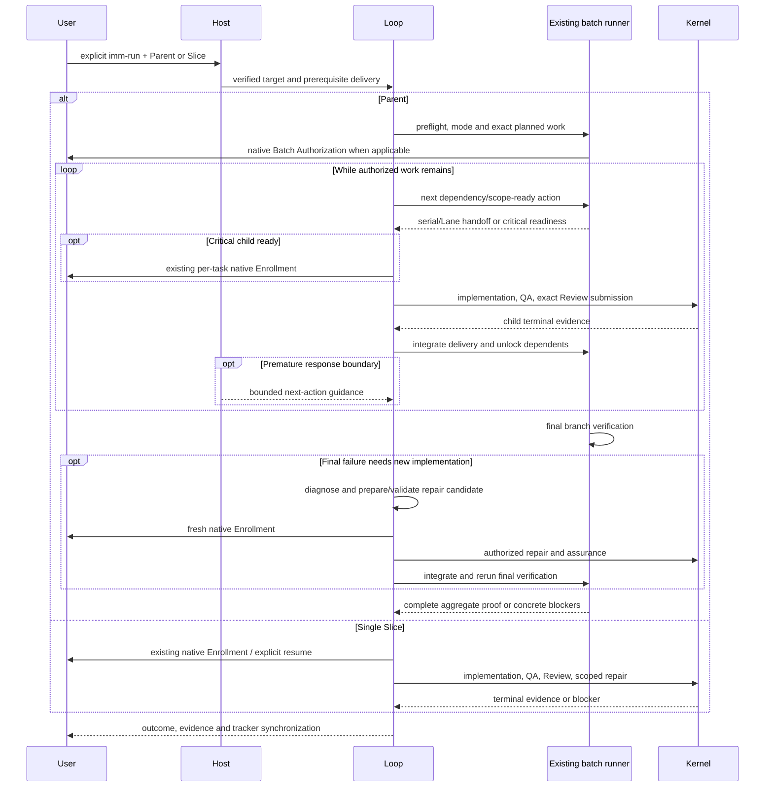

# Goal-driven imm-run

**Status**: Validated execution candidate; not enrolled. Canonical TaskIntent is Git-tracked; validation reports `valid: true` and `enrollment_ready: true`.
**Design risk**: High — continuation crosses two Host lifecycle boundaries and must preserve literal-user entry, cancellation, Review ownership, and Kernel completion authority.
**Document language**: English.
**Execution posture**: focused deterministic tests at the Host, batch and tracker seams, plus mandatory real-Host unattended evidence on both Hosts.
**Source**: The user confirmed the complete grilling outcome: automatic Parent batches, single-Slice isolation, dependency/scope scheduling, same-Host serial fallback, critical per-task gates, prepared post-settlement repair candidates, aggregate completion and mandatory live-Host acceptance.

## Outcome

After explicit `imm-run` entry, a named Initiative Parent Issue selects its complete planned delivery without a second chat opt-in. A named Slice/Child Issue selects only that TaskIntent. Existing native Enrollment or Batch Authorization confirms the exact execution authority; planning prose and Issue identity alone grant none.

For a Parent, resolve the execution mode before confirmation: use supervised Lanes for dependency-ready, scope-disjoint work within the project ceiling of 4; use the same Host's existing Managed serial path when Lane capability is unavailable. Dependency chains and scope conflicts serialize. Implementation, checks, deterministic QA, exact Review submission, ordinary repair, integration and subsequent handoffs continue without “continue” prompts. Isolate blocked children and their dependents while independent authorized work continues.

Critical children remain part of the required Parent delivery but require their own existing native Enrollment at readiness. A final failure after settlement triggers automatic diagnosis and preparation/validation of a minimal repair TaskIntent for the original goal, followed by a fresh native Enrollment before any new implementation. Declined or failed gates are never automatically retried. These exceptions permit required user decisions; they do not promise fully interaction-free execution in every failure case.

Whole-Parent success requires done terminal evidence for every required child, integrated delivery, passing verification on the final branch, and no unresolved required repair. Stops, exclusions, child closure and batch `completed` alone prove none of this. Parent Issue closure waits for that aggregate proof. A named Slice checks prerequisite delivery before Enrollment/resume, executes no siblings or prerequisites, and ends at its own task boundary.

TaskIntent and Kernel remain the task authority. Extend the existing batch plan/driver/report and tracker projection where needed; add no competing scheduler, authority store, model completion judge or Kernel lifecycle. Current-session continuation does not recover a closed Host process.

## Confirmed framing

The IDs below capture the already accepted conversation decisions; they do not request another approval.

| ID | Confirmed item |
|---|---|
| BR-DEC-1 | The core product owns the engineering-task authorization, execution and verification loop. Product goals and material trade-offs remain user-owned. |
| BR-DEC-2 | Act autonomously inside the approved target and authority. Prepare goal-related repair candidates when required, but execute each new task only after its fresh native authorization; start no unrelated goals. |
| BR-DEC-3 | Keep adjacent maintenance capabilities optional. Models, providers, conversation execution and general environment capabilities belong to the Host. |
| BR-REQ-1 | Prepare a Spec and executable planning candidate for goal-driven implementation and verification through `imm-run`. |
| BR-OUT-1 | No automatic selection of new goals, general development platform, generic scheduler, new Kernel state machine, or new completion judge. |
| GDR-DEC-1 | Status questions and in-scope corrections preserve the current binding after fresh validation. Explicit cancellation, planning entry or session replacement disarms it; recovery after cancellation requires explicit `imm-run`. |
| GDR-DEC-2 | Add no total run budget. Continue eligible work within existing user and Host limits; unchanged-observation detection prevents repeated empty work, not every form of non-convergence. |
| GDR-DEC-3 | Deliver the shared policy and both Host adapters in one TaskIntent. Each Host must pass its own lifecycle acceptance; one cannot substitute for the other. |
| GDR-DEC-4 | Explicit `imm-run` naming a verified Parent Issue selects its planned batch automatically; naming one Slice/Child executes only that Slice. Reading Parent context for a Child does not select the Parent batch. |
| GDR-DEC-5 | Reuse the existing dependency/scope scheduler and Lane supervision. Fill available eligible capacity up to the resolved ceiling; dependent or conflicting Slices serialize without asking the user to choose an execution mode. |
| GDR-DEC-6 | Maximize authorized completion through preflight, ordinary repair and existing coordinator correction. Isolate blocked children and continue independent work; never suppress a required gate, reset a failure budget or call a partial/failed result complete. |
| GDR-DEC-7 | Resolve mode before confirmation: supervised Lanes when available, otherwise same-Host Managed serial execution with the same QA, Review and aggregate checks. Do not switch a confirmed mode silently. |
| GDR-DEC-8 | Real unattended execution evidence on Pi and Claude Code is mandatory for delivery. Controlled fixtures cannot substitute for either Host; an unavailable Host leaves acceptance incomplete. |
| GDR-DEC-9 | List critical exceptions before entry and use each critical child's existing native Enrollment after dependency readiness. Its pending/declined gate blocks only its affected work; critical delivery remains necessary for Parent success. |
| GDR-DEC-10 | After settled delivery fails final verification, diagnose and prepare/validate a minimal original-goal repair TaskIntent automatically, then request fresh native Enrollment directly. Preserve deliveries; equal failures without new diagnosis or progress cannot mint repeated tasks. |

## User scenarios

All scenarios derive from BR-REQ-1 and the user's acceptance of BR-DEC-2. They describe one outcome on both supported Hosts.

### BR-SCN-1 — Autonomous delivery

- **Actor**: Repository owner.
- **Given**: A validated TaskIntent, explicit `imm-run` entry, and accepted Enrollment.
- **When**: The agent implements the task, encounters an ordinary failing check or Review finding, and attempts to finish responding before the task is complete. The owner may ask for status or supply an in-scope correction during execution.
- **Then**: The owner sees implementation, repair and verification continue without a “continue” prompt, followed by a completion report backed by the task's terminal evidence.
- **Verification**: automated, GDR-A1, GDR-A2, GDR-A3.

### BR-SCN-2 — A real blocker remains visible

- **Actor**: Repository owner.
- **Given**: An explicitly running task encounters a decision outside its authorization or the owner interrupts execution.
- **When**: The agent reaches a response boundary.
- **Then**: The owner sees the concrete decision or interruption, and the agent does not restart cancelled work or repeatedly reopen the same authorization dialog.
- **Verification**: automated, GDR-A2, GDR-A3.

### BR-SCN-3 — Scope ends with the task

- **Actor**: Repository owner.
- **Given**: The owner is discussing a plan, has not entered `imm-run`, or a directly selected single task has completed with no Parent coordination target.
- **When**: The agent finishes its response.
- **Then**: The response ends normally without starting implementation, enrolling another candidate, or continuing unrelated work.
- **Verification**: automated, GDR-A1, GDR-A2, GDR-A3.

### BR-SCN-4 — Parent execution fills eligible capacity

- **Actor**: Repository owner.
- **Given**: A published Parent with validated child TaskIntents, an acyclic dependency graph, final verification commands and supervised Lane capability.
- **When**: The owner enters `imm-run` with the Parent Issue and accepts its initial batch confirmation.
- **Then**: Ready scope-disjoint children fill available capacity up to 4; integration unlocks dependents without waiting for unrelated siblings. A blocked subtree does not strand independent work. Child settlement never finishes the Parent by itself.
- **Verification**: automated, GDR-A2/GDR-A3/GDR-A5; real Host, GDR-A7.

### BR-SCN-5 — Child entry stays local to its Slice

- **Actor**: Repository owner.
- **Given**: A Child belongs to a Parent with other pending Slices.
- **When**: The owner enters `imm-run` with that Child.
- **Then**: Verify Parent/Child ownership and prerequisite done/integration evidence before Enrollment or resume. Missing/stopped/unintegrated prerequisites block that Child; execute no prerequisite, sibling or Parent batch. Its completion starts no other work.
- **Verification**: automated, GDR-A2/GDR-A3/GDR-A5; real Host, GDR-A7.

### BR-SCN-6 — Same-Host serial fallback

- **Actor**: Repository owner.
- **Given**: The Parent is executable through the current Host's Managed path but supervised Lane supply/notification capability is unavailable.
- **When**: The owner enters the Parent target.
- **Then**: Before native confirmation, select serial execution on that Host. Sequential handoffs, ordinary repair, QA/Review and final verification remain automatic. No unsupervised worker, alternate Host or mid-batch silent mode change substitutes for it.
- **Verification**: automated, GDR-A5; real Host, GDR-A7.

### BR-SCN-7 — Critical work remains in the Parent goal

- **Actor**: Repository owner.
- **Given**: The Parent contains a critical Slice and an ordinary descendant, plus an independent ordinary branch.
- **When**: Critical prerequisites are integrated.
- **Then**: Request the existing per-task native Enrollment once at a safe authority/branch boundary. Independent permitted work continues while the critical decision is pending. Accepted critical delivery unlocks its descendants through the approved route; a refusal preserves incomplete status and does not downgrade risk or grant descendant authority silently.
- **Verification**: automated, GDR-A6; real Host exception path, GDR-A7.

### BR-SCN-8 — Repair after settlement

- **Actor**: Repository owner.
- **Given**: Required children are settled/integrated, but final verification fails.
- **When**: An authorized active integration owner cannot fix it and environment recovery is insufficient.
- **Then**: Diagnose and canonically prepare/validate a minimal repair TaskIntent linked to the Parent, failed verification and tested delivery identity. Request new native Enrollment directly, without a preliminary chat approval or implementation before the gate. Accepted repair returns through assurance/integration and final verification; no old task is reopened and Parent closure waits.
- **Verification**: automated, GDR-A6; real Host exception path, GDR-A7.

### BR-SCN-9 — Real unattended evidence is required

- **Actor**: Repository owner assessing delivery.
- **Given**: Deterministic fixtures and packaging checks pass.
- **When**: Feature acceptance is evaluated.
- **Then**: Both actual supported Hosts must run the Parent scenario with a dependency chain and independent branch through ordinary failure, Review, subsequent handoffs, integration and final pass, without human continuation prompts after the initial authorization. Also exercise serial fallback, Child isolation, cancellation and the explicitly permitted exception gates. Missing live evidence blocks acceptance.
- **Verification**: GDR-A7; records distinguish actual Host/model execution from tracker fixtures and operator-authorized gate interactions.

## Discovery evidence and dependencies

| Evidence | Consequence |
|---|---|
| `plugins/immune-brain/dist/imm-run-batch.md`, `runtime/unattended/batch_schedule.ts`, `batch_state.ts`, `batch_preflight.ts` | Batch Authorization, dependency/scope readiness, integration milestones and read-only record inspection already exist. Parent routing must select this path; Host continuation consumes it and never duplicates its transitions. |
| `plugins/immune-brain/dist/imm-run-batch.md`, `runtime/unattended/batch_runner.ts`, `batch_lanes.ts`, `batch_final_verification.ts` | Supervision/correction exists; final verification is implemented in the Lane path, while the serial runner only exposes its parameter. Extend the same serial driver to execute final checks. Lane cleanup is reported separately. |
| `runtime/unattended/batch_plan.ts`, `batch_preflight.ts`, `kernel/batch_authority.ts` | Current projection excludes critical and ordinary children blocked by unavailable dependencies. The capability binds exact child hashes and a closed dependency graph. Critical handoff/descendant resumption needs explicit batch extension, never silent membership or digest replacement. |
| `runtime/unattended/batch_lanes.ts` | A failed final check currently accompanies batch `completed`. Consume the separate final result; distinguish aggregate failure and its recovery rather than equating batch state with Parent success. |
| `docs/agents/issue-tracker.md`, `runtime/github_issue_tracker.ts`, `closeParentWhenComplete` | Tracker distinguishes native Parent/Child identity but currently closes a Parent from Child Issue closure alone. Delay whole-Parent closure until authoritative delivery and matching final-check proof; tracker status itself is no proof. |
| `runtime/kernel/pi_canary_prepare.ts`, `kernel/enrollment.ts` | Enrollment checks task/authority/Git identity, not GitHub prerequisites. Put a shared Child prerequisite check at both Host entry seams and revalidate the delivery observation before committing enrollment; do not presume Kernel enrollment performs it. |
| `runtime/assurance/phase_entry.ts`, `applyPrompt` | Literal run entry remains live until a literal planning entry/session interruption revokes it. Use the verified original Parent context for subsequent native gates; generating a reminder or candidate cannot manufacture a new entry. |
| `CONTEXT.md`, Entry And Ownership and Kernel State | TaskIntent owns the goal; Kernel owns task state, assurance and settlement; Loop projects the next obligation. |
| `plugins/immune-brain/dist/imm-run.md`, Execution Loop | Implementation, staging, QA, Review, rework and terminal handling already exist as instructions. Preserve their ordering and foreground execution. |
| `plugins/immune-brain/.pi-extension/imm-canary-work.ts` | Registers input, session, tool and notice hooks but no final-response continuation boundary. Reuse this registration and the existing session identity. |
| `plugins/immune-brain/runtime/claude/mcp_server.ts`, `runtime/claude/lane_guard.ts`, `hooks/hooks.json` | Hook prompts use the Claude session ID; MCP calls use a connection ID. Existing admission files are keyed by tool-use ID and contain only the operation. Reuse these seams, but establish the session/workspace/task/run association explicitly. Main-agent `Stop` and `PostToolUseFailure` are not currently registered. |
| `plugins/immune-brain/runtime/assurance/phase_entry.ts` | Literal run entry is already recognized. Model-injected reminders must not manufacture or renew it. |
| `plugins/immune-brain/runtime/kernel/assurance_projection.ts` | Projection exposes run identity, revisions, diff identity, lifecycle, findings and next obligation. Projection errors are not completion. |
| `plugins/immune-brain/runtime/assurance/coordinator.ts`, `projectTaskStatus`, `deriveAssuranceRecovery` | `projectTaskStatus` returns a valid read-only projection with `unstaged_scope_paths` warnings for dirty source. Reuse it and existing structured recovery guidance; do not add a projection-error fallback or reconstruct assurance state. |
| `plugins/immune-brain/runtime/workspace_scope.ts`, `taskStatusIdentity`, `taskDeliveryIdentity` | Read-only status tolerates unstaged scope paths; delivery identity still refuses them before freezing. Status observations never approve QA or authorize staging. |
| `tests/pi-canary-work-extension.test.ts`, `tests/helpers/pi-canary-assurance-harness.ts` | Existing fake ExtensionAPI and real Kernel fixtures support lifecycle integration testing; SDK mocks must be conditional and restored. |
| `tests/claude-phase-entry-gate.test.ts`, `tests/claude-host-authority.test.ts` | Hook-to-MCP fixtures already exercise entry, native confirmation and Kernel progression without a live model. |
| `tests/pi-canary-notification-correlation.test.ts` | Assurance completion delivery is foreground-only. Do not reintroduce follow-up delivery in `pi-canary-assurance.ts`. |
| `scripts/build-claude-plugin.ts`, `tests/claude-host-package.test.ts` | Runtime and hook changes require regeneration of `dist/claude/mcp-server.mjs`. |
| `scripts/dist-sync-manifest.ts`, `scripts/sync-dist-docs.ts` | `dist/imm-run.md` is a Skill-owned instruction source; BASELINE and executor prompts have generated mirrors. |
| Pi 1.2.0 `docs/extensions.md` and exported `extensions/types.d.ts` | `agent_before_settle` accepts a custom message and `continue: true`; it exposes outcome and `context.canContinue`. Use this final actionable boundary, not `agent_end`, timers or queued user messages. |
| [Claude Code goal documentation](https://code.claude.com/docs/en/goal), [Stop hook reference](https://code.claude.com/docs/en/hooks#stop-input) | A command Stop hook can consume Kernel facts without a model judge. `stop_hook_active` is a Boolean, not a boundary ID. The documented default cap is eight consecutive continuations, reset by a tool call; it does not replace progress detection. User interruption does not produce Stop; API errors use a distinct StopFailure event. |

The overlapping `run-only-gates` work has terminal audit evidence for all four slices. At this design review, read-only `imm-kernel inspect --json` returned `layout: ready`, `claim: null` and `current_working: null`; the earlier `kernel_owner_active` authoring refusal is historical, not a current blocker. Preserve the settled entry and Git-effect policies and recheck these exact dependencies before canonical authoring. A later active claim still blocks authoring a second task; do not stop or alter another owner to bypass that prerequisite.

## Scope and responsibility

In scope: one implementation TaskIntent delivering Parent/Child entry and prerequisite verification, current-session continuation on both Hosts, same-Host serial fallback, dependency/scope scheduling through the existing runner, critical per-task handoffs, original-goal repair-candidate preparation, aggregate verification/Parent closure, focused tests, mandatory live-Host evidence, contracts and generated packaging. This implementation TaskIntent is distinct from future Parent deliveries.

Extend existing batch projection, preflight, serial/Lane drivers, record/report validation and tracker projection where required. Preserve exact authorization, HEAD lineage and failure accounting. Parent context survives child and failed-final batch settlement while a permitted recovery remains; a Lane binds only its own child/run. A live batch call, Reviewer or supervised wait receives no competing invocation. No response callback implements work or opens a gate.

Out of scope: Kernel reducer/storage/native-authority schema rewrites, a new Kernel lifecycle, unrelated goals, implementation of a new repair task before its authorization, a new public goal command/tool, model completion judges, new providers/configuration, competing scheduler/authority store, timers/cron, automatic Host-process recovery after session loss, automatic publication/deploy/push, security sandbox and unrelated maintenance. Existing Git effects remain restricted to the approved execution route; critical and new repair tasks receive their own exact native authorization. No fixture or evidence collection publishes GitHub data without appropriate authorization.

## Technical Design

**Design views**: architecture layers, component interfaces, state transitions and temporal sequence. The central invariant is identical on both Hosts: continuation may request another foreground model turn for an already authorized run but grants no task authority.
**Diagram decision**: required
**Diagram reason**: the Host response boundary must return control to the existing Loop without taking over QA, Review or settlement.



### Decisions and provenance

Each design decision has exactly one primary source. Supporting evidence is listed separately above.

| ID | Decision | Source |
|---|---|---|
| D1 | Kernel proves individual task completion; whole-Parent success additionally requires all required delivery integrated, passing final verification and no unresolved required repair. Issue closure and batch state alone prove neither. | BR-DEC-1 |
| D2 | Keep the explicitly selected Parent context across child settlement and failed-final recovery; each executable task still needs matching current authority. Disarm at aggregate success, interruption or unresolved Parent-wide conflict. | BR-DEC-2 |
| D3 | Use each Host's native final-response boundary; no additional model judge or scheduler. | BR-DEC-3 |
| D4 | Deliver both Host adapters and the shared policy in one TaskIntent with independent Host acceptance and atomic rollback. | GDR-DEC-3 |
| D5 | A shared, read-only continuation decision consumes authoritative observations and returns continue, yield, or inactive guidance. It performs no Kernel operation. | Repository evidence: `plugins/immune-brain/runtime/kernel/assurance_projection.ts` |
| D6 | Permit one corrective continuation for an unchanged progress observation, then yield. No new total run budget is added; narration, repeated reads and unchanged failures cannot rearm the guard. | GDR-DEC-2 |
| D7 | Consume `projectTaskStatus` and its dirty-source warning for a bounded ownership/staging reminder. Any projection error yields; no fallback reconstructs authority. | Repository evidence: `plugins/immune-brain/runtime/assurance/coordinator.ts` |
| D8 | Use an existing required native decision once. A pending, declined, cancelled or failed gate suspends its affected work without automatic retry; an authorized Parent may continue independent children. | Repository evidence: `plugins/immune-brain/dist/imm-run.md`, Decisions and Recovery |
| D9 | Preserve the bound run across status questions and in-scope corrections after revalidation. Cancellation, planning entry or session replacement disarms it; explicit `imm-run` restores recovery. | GDR-DEC-1 |
| D10 | Keep notices visible in normal task output/Task Rail and leave the Footer empty. | Repository evidence: `tests/pi-canary-work-extension.test.ts` |
| D11 | Resolve Parent versus Child from verified tracker topology; automatically select the existing batch entry only for the named Parent. | GDR-DEC-4 |
| D12 | Use existing scheduler readiness, scope conflicts and resolved capacity; integration is the dependency-unlock milestone in either mode. | GDR-DEC-5 |
| D13 | Preflight executable inputs and recover within authority; isolate blocking subtrees and keep independent work moving. | GDR-DEC-6 |
| D14 | Choose supervised Lanes or same-Host Managed serial before confirmation, and execute aggregate checks in both drivers. | GDR-DEC-7 |
| D15 | Require actual unattended Host runs and matching recorded evidence on both Hosts before acceptance. | GDR-DEC-8 |
| D16 | Route critical readiness to existing per-task Enrollment; reconcile its delivery and descendants without using an ordinary batch capability to bypass that gate. | GDR-DEC-9 |
| D17 | Prepare original-goal repair candidates after final failure, then obtain fresh native authority before execution; identical unadvanced failures cannot mint repeated attempts. | GDR-DEC-10 |
| D18 | Keep the complete Parent dependency observation separate from the closed ordinary-child authorization manifest. Capture all validated planned ordinary children, including those waiting on critical delivery, before confirmation; critical work has no ordinary batch slot. Each actual enrollment rechecks full prerequisites and delivery without extending Kernel membership. | Repository evidence: `plugins/immune-brain/runtime/kernel/batch_authority.ts`, `validateChildren` |

### Components and interfaces

1. Add `runtime/assurance/run_continuation.ts` as a small Host-neutral policy module. Input includes a discriminated single-task or Parent-target binding (with its current authorized batch/task references); a fresh task status or validated batch record/report plus aggregate final/recovery facts and child projections; correlated operation dispositions, pending Host work and the previous progress observation. Output is `continue` with a bounded reason, `yield` with a concrete reason, or `inactive`. Batch reports guide actions but never replace child Kernel evidence or Plan Digest validation. This is internal data, not a public tool or Kernel enum.
2. Add Host-local adapters `.pi-extension/pi-run-continuation.ts` and `runtime/claude/run_continuation.ts`. They own response-boundary integration and non-authoritative session bookkeeping. Register the Pi adapter from `imm-canary-work.ts`; connect the Claude adapter to existing prompt/tool/session observations and the main-agent Stop branch in `mcp_server.ts`.
3. Reuse the existing phase-entry recognition, private Claude cache helpers and Kernel readers. Distinguish Host session ID from MCP connection ID; do not equate them. Add no general persistence abstraction. Bookkeeping retains only target/plan references, current authority identities, correlation and deduplication facts, including opaque operation/reservation references; it owns no task lifecycle, acceptance evidence or authority decision. Losing it disables continuation until explicit re-entry; it never changes TaskRecord.
4. A task binding identifies workspace/session/task/run and comes from successful Enrollment or explicit validated resume. A Parent target comes from literal entry plus verified topology/preflight and retains exact plan, required children, selected mode and current batch/task references. It is an execution context, not a capability. Each child action revalidates its batch slot or separate native Enrollment; each new repair task has a new run/capability. Bind accepted batch results to their batch ID/Plan Digest and preserve legitimate existing reseals only. A terminal child or failed-final batch does not erase the pending Parent recovery context. Critical-only or already-delivered Parents must not call an invalid empty batch; use their existing per-task gate/check route. Generic prompts, Skills, foreign reads and model reminders cannot create entry or grant membership.
5. Kernel/assurance result observation must distinguish repairable results, pending decisions, cancellation and failed native gates structurally. Do not parse an assistant's final prose or infer permission from the absence of an error. Claude's association chain is explicit literal entry → Hook session and canonical workspace → exact tool-use ID → matching tool result → fresh task/batch projection → current authority binding. Verified Parent preflight may establish only a non-authoritative target context for gate/check guidance; it never substitutes for successful task/batch authorization. The MCP connection ID is separate transport identity. Extend the existing private admission/observation cache to retain this association without changing Kernel or native-authority schemas. Missing, conflicting, stale or cancelled results never establish a binding. Explicit resume needs the same entry/session/workspace association and a validated status for the named existing run; a generic status read cannot resume it. Do not inspect arbitrary session logs. Revalidate observations against the Kernel before use.

### Parent/Child routing and batch continuation

Resolve Issue identity and native topology before selecting Enrollment. A Parent has one valid Initiative and exact Child identities; a Child must match its Parent, Initiative and Slice. Reject missing, foreign, ambiguous or conflicting ownership; never infer it from titles. Explicit local Initiatives retain the existing carrier path; task ID/TaskIntent path remains a single task.

For any single-task target associated with a Slice (Issue, task ID or TaskIntent path), read the relevant dependency graph and match prerequisite done terminal/audit evidence to delivery present on the execution branch. A genuinely standalone TaskIntent has no inferred Initiative dependencies. Stopped tombstones, closed Issues, unintegrated Lane exits and unknown observations do not satisfy a dependency. Check before Enrollment/resume and revalidate the observation at the enrollment write boundary. An unsatisfied prerequisite yields only that Child; no prerequisite or sibling is automatically selected. This entry check belongs at both Host seams, not in a new Kernel state machine.

For Parent entry, validate canonical inputs, graph closure/acyclicity, required children including critical work, already-delivered evidence, scope conflicts, final commands and their active integration owner. Resolve current Host capabilities before confirmation. Use supervised Lanes when available, capacity at most the resolved project ceiling (4 here); otherwise select the same Host's existing Managed serial driver. If neither route is executable, report that preflight blocker once. No alternate Host, unsupervised worker or silent change to a confirmed mode is permitted. Both modes execute the same QA/Review and final-verification contract.

The named Parent is the batch opt-in. Open the applicable existing native gate directly, without a second chat question. Ordinary work is authorized by its exact batch plan; critical work is announced as a separate per-task confirmation. Separate authorization eligibility from dependency readiness: downstream ordinary work must not disappear from the Parent simply because a critical ancestor awaits its gate. Extend the existing plan/preflight/report to preserve that full required graph and deferred handoffs. The automatically executable subset and its closed capability-bound graph must remain exact; do not add a deferred descendant to an old capability or replace a Plan Digest silently. Prove the chosen authorization/resumption route with a critical → ordinary chain and an independent ordinary branch. A critical-only Parent uses per-task gates; an already-delivered Parent verifies existing delivery and planned final checks without fabricating an empty child authorization.

Reuse existing readiness/scope scheduling on each integration or recovery event. Waves are previews, not barriers: ready work need not wait for unrelated siblings. Only done delivery present on the target branch unlocks dependents. At critical readiness, serialize its gate and enrollment against conflicting authority or branch mutation; independent Lane work may continue only where existing ownership/scope rules allow. Critical tasks never consume an ordinary delegated Enrollment as a substitute for their gate. Reconcile the accepted task's verified delivery and lineage before releasing descendants. Pending/declined/failed critical gates isolate their subtree and are never retried automatically.

At response boundaries, validate the Parent context plus the exact current task/batch authority and final/recovery observation. A live call, Reviewer or armed supervised wait suppresses competing calls. Otherwise request the next existing foreground handoff/reconciliation. Child done ends its own binding only. Parent success requires all required done/integrated delivery and a passing final result for that delivery, including any accepted repair. A batch `completed` with failed or missing final evidence leaves the Parent incomplete.

The ordinary authorization set and current execution readiness are different. Preserve the complete Parent topology and canonical child identities in the existing batch metadata; the Kernel manifest contains the exact validated ordinary children and only their internal dependency edges, keeping its current closed-graph contract. A valid ordinary descendant waiting on a critical prerequisite is confirmed up front but remains execution-blocked by the full Parent graph. The scheduler and both enrollment seams must retain and freshly verify external critical prerequisites; removing them from the ordinary manifest never removes the execution gate. Critical children have no ordinary slot and never consume a batch capability. Reconcile their separately authorized done/integration evidence at a safe coordinator authority/branch boundary before unlocking descendants, preserving exact HEAD lineage and budgets. Changed topology or newly added/unconfirmed ordinary membership requires the existing explicit revision/authorization route; it is not inferred from Issue closure or a refreshed listing. Critical-only and delivered-only Parents avoid creating an empty ordinary authorization.

### Failure recovery and aggregate delivery

| Condition | Required behavior |
|---|---|
| Ordinary local, QA or Review failure | Diagnose and repair inside the active child authority, run focused checks and fresh assurance. Submit Review verdict before editing. Do not park early merely because a check failed. |
| Repeated Lane failure or no delivery | Use existing coordinator correction/relaunch and limits. Current defaults are QA failure limit 2 and at most two Lane corrections; equal observations never renew them. |
| Recoverable authorized environment defect | Recover and revalidate locally; retry only with changed conditions/evidence. Credentials, trust choices, unknown write outcomes and failed native gates are not routine automatic retries. |
| Child gate, parked work or missing prerequisite | Isolate the child/dependents; continue independently authorized work. Preserve exact recovery conditions and evidence. |
| Authority/plan/lineage conflict | Suspend affected mutations and use the existing recovery path. Do not reset state, discard deliveries or invent approval. |
| All required delivery integrated | Run planned final checks on the target branch in serial and Lane modes, including accepted repair delivery. Match their tested Git/delivery identity to the success report. |
| Final failure, active authorized integration owner | Repair through that owner's ordinary cycle; do not reopen settled tasks. |
| Final failure after settlement | Recover an authorized environment defect first; otherwise diagnose and canonically prepare/validate a minimal original-goal repair candidate, then open a fresh native Enrollment once. No new implementation before acceptance. |
| Tracker projection failure | Report and use existing idempotent retry. Preserve local task/aggregate truth; failure to synchronize does not authorize new work or make a failed delivery successful. |

Planning assigns complete integration checks and appropriate repair scope to an owning final Slice with dependencies on required deliveries. Run these checks before that Slice settles, then independently verify the integrated final branch. This reduces late failures; it does not eliminate them or replace the post-settlement recovery route.

A repair candidate links to the original Parent/Spec, failed command/result identity and tested delivery; its goal stays bounded to diagnosing/fixing that failure, with concrete scope and verification. Reuse canonical author/validate and existing reports/intent artifacts for this relationship; create no separate authority store. If another owner is active, wait rather than taking its workspace. Preparing candidate artifacts grants no capability. Request fresh native Enrollment directly, without chat pre-confirmation; after acceptance run normal assurance/integration and final checks. A cancelled/failed gate pauses affected recovery without retry. The same unchanged failure without a new diagnosis or meaningful progress cannot create another task to evade failure limits. No new total runtime budget is added.

Extend the existing aggregate report/projection to retain final failure, tested delivery and required recovery. Do not reinterpret historical batch `completed` as Parent success or reopen its immutable task evidence. Only an authoritative done/integrated required-child set, passing final result and resolved required repair permit whole-Parent success. `stopped`, exclusion, unintegrated commits and process/Issue completion alone remain incomplete.

Delay automatic Parent Issue closure until that aggregate proof is present and fresh. Child closures may continue to project their own terminal evidence; closing the last Child alone cannot close the Parent. A standalone Child cannot infer Parent success. The existing tracker owns projection; no remote topology mutation, repair-Issue publication or deployment is automatically inferred from local candidate preparation. Preserve original Child history and disclose tracker synchronization errors separately.

### Host observation sources

| Observation | Pi source | Claude source and required association |
|---|---|---|
| Explicit entry or ordinary input | Existing literal input/session hooks; extension-injected messages cannot enter a phase. | `UserPromptSubmit` and existing entry recognition for the current Hook session/workspace. Injected or unidentifiable input cannot manufacture a run entry. |
| Successful Enrollment or explicit resume | Exact successful tool result plus fresh status for the entered task. | Correlate `PostToolUse` by tool-use ID with the entry association. Parse the structured result and revalidate the run; MCP connection identity alone is insufficient. |
| Repairable operation result | Structured Kernel/assurance result; inspect `isError` separately. | A transport-successful `PostToolUse` can still contain rework, blocked, failed or cancelled state. Interpret its structured disposition, not transport success alone. |
| Tool execution failure or cancelled native call | Tool error/cancellation and existing native invocation state. | Register `PostToolUseFailure` and correlate the failed call to its session/workspace. Missing or malformed outcomes yield; a failed native gate disarms continuation without retry. |
| Pending Review, gate or batch | Existing invocation/reservation and Host execution facts. | Use a correlated call start and completion or existing live invocation facts. A nonterminal batch file alone does not prove a call is pending. |
| Turn interruption or API error | Non-completed settle outcome and session replacement/abort facts. | Stop does not run on user interruption. Consume explicit failure/session observations when available; on later input, invalidate unfinished-call observations and revalidate before preserving a binding. An unresolved interrupted call yields until explicit resume. |

### Response-boundary decision

Evaluate in this order:

- An absent binding, mismatched workspace/session/task/batch identity, planning entry, or pending progression call requests no competing continuation. A terminal task disarms its task/Lane binding; a Parent first evaluates remaining authorized work, full required delivery and final/recovery evidence, including critical or newly accepted repair handoffs.
- An aborted/error Parent Host outcome, explicit user cancellation, failed Parent gate or session replacement disables Parent continuation. A child failure/gate outcome affects that child; the batch may still advance independent work. Pending authorization never means completion or stop.
- An unreadable/conflicting authority state yields with the concrete error. Never reconstruct a successful projection or pick a different owner.
- `resolve_user_decision` or `revise_intent` may issue one reminder to use the existing owner/native gate when it has not yet been attempted. The hook itself opens nothing. After a pending/declined/failed gate it yields and never repeats the gate automatically.
- A valid matching status projection with `unstaged_scope_paths` warnings permits one bounded reminder to inspect ownership, stage only task-owned changes, and obtain fresh status. Active artifacts are required. Frozen artifacts, ambiguous ownership or any projection error yield. Do not freeze or approve from the status identity, stage from the hook, or rebuild authority through separate readers.
- Apply the Review continuation table below before other executable-obligation guidance. Otherwise, a matching active run with a valid executable obligation requests one next foreground turn naming the task and legal existing Loop action. `run_review` alone never selects dispatch versus submission.
- Task `done` with matching terminal evidence is task success; whole-Parent success additionally needs all required delivery integrated and final verification passed with no pending required repair. `stopped` is stopped. Prose, local exit 0, Issue closure, `completion_ready` or batch `completed` with missing/failed final proof is not aggregate success.

No callback implements, stages, commits, mutates authority, retries a native gate, or runs QA. It only keeps the foreground conversation available for the existing Loop.

### Review continuation

The fresh Kernel projection and existing reservation validity remain authoritative. Correlated Host observations select only the next instruction; they cannot grant Review approval or retain a stale reservation. Apply this table before generic `run_review` guidance:

| Observed Review stage | Only permitted continuation guidance |
|---|---|
| Fresh `review_ready`, valid reservation, not yet dispatched | Invoke its exact `agent_params` once through the existing foreground Review boundary. The hook dispatches nothing. |
| The reserved Reviewer is still running | Request no competing continuation or replacement dispatch; the Parent consumes that invocation's result. |
| The reserved Reviewer returned, verdict not yet submitted | Submit that exact result through `submit_review` immediately. Do not edit, stage rework, or dispatch another Reviewer first. |
| Submission rejected with a correctable result | Follow the returned `recovery_action` and existing correction limit. Do not re-dispatch or manufacture a verdict. |
| Fresh `run_review` with no live reservation after explicit recovery | Remind the owner to call `advance_assurance` to obtain the current exact handoff, retaining valid QA. An unobserved or ambiguous prior dispatch yields rather than assuming it never ran. |

### Progress and interruption

Use a bounded progress observation, not tool-call counts, wall-clock timestamps or narration. The first premature final response for an unchanged observation receives one correction; another response without a qualifying change yields a visible `no progress` explanation and leaves the task active.

| Observation since the last reminder | Guard behavior |
|---|---|
| A fresh matching TaskRecord/delivery transition, or a changed correlated QA/Review disposition | Rearm for the new observation. Repeating the same failure alone does not qualify, even with a new operation ID, record revision or timestamp from recording that failure again. |
| Scope-owned source bytes changed, including unstaged content inspected within the bound scope | Rearm for those changed bytes. A subsequent identical failure can continue after this repair attempt. File timestamps and unrelated paths never qualify. |
| Equal source/delivery facts and repeated status reads, identical local test failures, duplicate tool events or narration | Do not rearm. One unchanged-observation correction is the limit. |
| Child integration, dependency-ready handoff, recorded coordinator correction, changed final disposition or a validated new recovery candidate from changed diagnosis | Rearm only for the matching Parent/authorized task observation. Candidate preparation never grants implementation authority; equal failures, repeated candidates and reconciliation reads do not qualify. |
| An outstanding gate, failed/cancelled gate or running Reviewer/batch | Suppress competing continuation for that operation. A batch Parent may still consume independently runnable handoffs after fresh batch validation. |

Scope-owned changes indicate activity, not semantic improvement: this guard does not identify every irrelevant edit or guarantee model convergence. Add no total run budget. Existing user/Host limits and cancellation still apply; never raise Host limits through environment variables. Do not hash or retain secret-bearing stdout, whole transcripts or out-of-scope files. Retain only bounded identities and structured dispositions needed for correlation.

Status questions and in-scope corrections preserve the existing task or batch binding after a fresh matching projection and identity validation. Refresh stale operation observations without granting a new entry or resetting the progress guard merely because a prompt arrived. Explicit cancellation, planning entry, session replacement or an unresolved interrupted invocation disarms continuation; an ordinary later prompt cannot rearm it. Recovery requires explicit `imm-run`. Scope/goal changes retain their existing revision gates and pause dependent work.

Pi uses `agent_before_settle`: require `outcome === "completed"`, honor `context.canContinue`, preserve earlier handlers' entries and continuation requests, and add at most one custom-message entry for this boundary. Return `continue: true` only when the policy allows. Do not send a synthetic user message or use a follow-up queue.

Claude registers synchronous command `Stop` and correlated `PostToolUseFailure` hooks through the existing packaged entry point. On continue, return `{ "decision": "block", "reason": "..." }`. Otherwise return no block and report the reason through supported output. `stop_hook_active` never identifies a boundary or renews permission. Deduplicate correlated events by their Host event/tool-use identities; a redelivery cannot update progress or create a new correction allowance. Use a Host boundary identifier when available. When successive Stops cannot be distinguished, treat them conservatively as an unchanged observation: after the first correction, yield without inventing an identifier from prose or time. The documented default cap is eight consecutive continuations and resets on a tool call; preserve the supported Host's cap and do not rely on it to detect empty work. Do not depend on newer optional background-task fields.

State is isolated per session/workspace/task/run or session/workspace/verified Parent target with its exact batch/task authority references; reused task IDs, Initiative slugs or repair candidates cannot inherit a different execution's observations. Cleanup uses existing lifecycle/private cache conventions. There is no new permanent compatibility layer or migration.

### Existing execution sequence preserved

Implement within scope → focused local checks → stage task-owned paths → foreground `advance_assurance` → exact required foreground Review → immediately `submit_review` → only then edit on rework → resolve verified findings → fresh assurance → Kernel settlement.

Ordinary in-goal failures stay in this cycle; scope/goal changes retain their existing revision authority. Deterministic QA runs acceptance descriptors in the task's working directory and enforces the frozen in-scope tracked content before and after each command. Disposable Git repositories are test fixtures; the separate batch integration recheck keeps its existing isolated-delivery semantics. Parent self-reports and reminder messages create no attestations.

## Verification and acceptance mapping

The seven acceptance items below are the complete planned TaskIntent acceptance. Each descriptor uses `assurance_kernel/verification_descriptor/v2`, executable `bun`, argv `test` plus the exact listed files, cwd `.`, timeout 120000 ms, max output 131072 bytes and environment `{ "prepare": null, "writable_paths": [] }`. Deterministic QA uses tracked modules and temporary Git repositories with no network/install/live model calls. GDR-A7 validates previously recorded actual Host evidence; it does not launch a model inside a descriptor or substitute fixtures for a real run.

| ID / primary source | Assertion and seam | Positive, negative and boundary controls |
|---|---|---|
| GDR-A1 / BR-DEC-2 | Shared policy preserves verified target/current-authority identity and legal continuation. `tests/run-continuation.test.ts` (new). | Task versus Parent bindings; new run/batch identity; required delivery/final/recovery facts; task done versus Parent success; equal observations and failure-budget bypass; changed scoped bytes; dirty warnings versus projection errors; no authority minted from reminders or candidates. |
| GDR-A2 / BR-REQ-1 | Pi registered boundary drives implementation, rework and Parent handoffs without continuation prompts. `tests/pi-run-continuation.test.ts` (new, existing harness). | Entry/resume, ordinary input, cancellation/planning/session replacement, Child prerequisite checks, batch versus child settlement, serial/Lane handoffs and exception gates; no competing call/wait/Reviewer; returned verdict must submit before edits. |
| GDR-A3 / BR-REQ-1 | Packaged Claude Stop preserves the same task/Parent lifecycle and explicit identity chain. `tests/claude-run-continuation.test.ts` (new, existing hook/MCP fixtures). | Hook-session/tool-use/result/fresh status chain; separate MCP connection ID; malformed/foreign/missing observations; tool-failure hooks and structured failures; duplicate/indistinguishable Stops; ordinary input and interruption; legal batch/critical/repair handoffs and Review order; preserve Host caps. |
| GDR-A4 / BR-DEC-1 | Contracts, hooks, mirrors and generated bundle describe and implement the approved boundaries. `tests/goal-driven-run-contract.test.ts` (new), `tests/claude-host-package.test.ts`, `tests/dist-docs-sync-contract.test.ts`, `tests/pi-canary-notification-correlation.test.ts`. | Publish mode selection, prerequisite checking, critical/new-task gates, aggregate closure, required real evidence and recovery limits. Stop/tool-failure registration; foreground assurance; empty Footer; byte-current mirrors/bundle; no changeset-existence assertion after release consumption. |
| GDR-A5 / GDR-DEC-4 | Parent/Child entry, serial/Lane scheduling and aggregate delivery are complete. `tests/goal-driven-batch-run.test.ts` (new, actual batch/Kernel fixtures), `tests/unattended-batch-commit.test.ts` (existing delivery/lineage regression). | Parent automatic route; Child cannot start siblings/prerequisites; missing/stopped/unintegrated prerequisites block it. A→C plus independent B; integration unlocks C without a wave barrier; scope/capacity/lineage guards; blocked subtree isolation. Missing Lane capability selects same-Host serial before confirmation, with final checks; no silent mode change. Failed/missing final result cannot complete Parent or close its Issue; child closure and `completed` alone are insufficient. |
| GDR-A6 / GDR-DEC-9 | Critical and post-settlement repair use their own exact native authority and preserve Parent recovery. `tests/goal-driven-run-recovery.test.ts` (new), `tests/batch-stale-disposition.test.ts` (existing retirement/report regression). | Critical → ordinary plus independent branch; pending/refused gate isolation; downstream membership/digest remains authorized; no delegated critical bypass or risk downgrade. Critical-only Parent and delivered-only final checks avoid invalid empty batch. Final failure prepares/validates a candidate tied to original goal/failure/delivery, then requires fresh Enrollment. No settled-task reopen, pre-gate implementation, unrelated goal, extra Issue publication or equal-failure task minting. Accepted repair integrates and reruns final checks; cancelled/failed gates are not retried. |
| GDR-A7 / GDR-DEC-8 | Matching actual Pi and Claude Code evidence proves the accepted unattended paths. `tests/goal-driven-run-live-evidence.test.ts` (new), tracked report `docs/evidence/goal-driven-run-host-smoke.json` (new, generated from actual runs). | Require both actual Hosts/versions, runtime/prompt/bundle byte identities, scenario coverage, run/task and terminal/integration/final references. Reject missing Host/scenario, stale tested bytes, failed outcome or ordinary-path human continuation. Distinguish authorized exception decisions and separate status/cancel inputs. Fixture-only output is not acceptable live evidence. |

Before implementation assurance, run the actual supported Pi (1.2.0 seam verified during design) and record the exact supported Claude Code version. Each must execute a Parent with a dependency chain and independent branch through ordinary failure/repair, required Review, subsequent handoffs, integrated final checks and success, without human continuation prompts after initial authorization. Also test serial fallback, single-Child isolation/prerequisite refusal, status input, cancellation/no automatic recovery, critical gate/descendant progression and final-failure/new-repair gate progression. Permitted native exception decisions are counted separately from manual continuation. Do not raise Host caps or hide manual interventions.

Capture bounded, sanitized evidence from actual Host execution in the tracked report: supported versions, tested source/active-prompt/hook/bundle hashes, scenario results, input/gate classifications and preserved task/run/terminal/integration/final references. Exclude transcripts, secret-bearing output and raw verifier stdout/stderr. Review the capture provenance and linked evidence; a structural report checker alone does not independently prove a live model ran. No placeholder `passed` report is allowed. Identify any carrier/API fixture explicitly; it may isolate remote side effects but cannot simulate the Host/model, its actionable response boundary or Kernel assurance. Missing credentials/capability or unavailable live Host leaves GDR-A7 incomplete.

Generate affected bundle/mirrors, run the focused acceptance files and affected batch/tracker/Host regression tests named in scope, plus `bun run typecheck`, `bun scripts/build-claude-plugin.ts --check` and `bun scripts/sync-dist-docs.ts --check`. Keep existing Kernel batch-authority regression coverage because its closed-plan contract is unchanged. Real runs occur before assurance; deterministic QA validates their preserved, matching evidence in its normal frozen delivery. Planning checks descriptor/reference structure only and does not run future suites or fake this evidence.

## Execution candidate and reference closure

One standalone implementation TaskIntent: `goal-driven-run`, risk `material`, revision 1, owner `user`. Candidate path: `docs/plans/goal-driven-run.intent.json`. This Spec is its sole active Spec. This feature's implementation does not itself require an Initiative or remote Issue publication; future Parent batches and authorized repair TaskIntents are separate execution subjects.

### Implementation sequence

Keep one material TaskIntent and one final assurance/Review boundary. The phases below are internal implementation order, not independently enrolled Slices or partial completion claims. Shared batch/Host contracts and the generated Claude bundle make artificial parallel Managed implementation tasks unsafe; the Parent Executor owns in-scope edits. Independent bounded read-only probes may help it, following the existing dispatch protocol.

| Phase / depends on | Concrete work and owned paths | Observable exit check / acceptance |
|---|---|---|
| P0 / explicit Enrollment | Revalidate workspace ownership, Intent/Spec bytes and the baseline. Record pre-existing scoped edits without overwriting or attributing them to this task. Probe both actual Hosts, their usable phase/response hooks and supervised Lane capabilities; prepare a way to collect live evidence early. No acceptance suite or live model run occurred during planning. | Actual tested Host/package versions and required capabilities are known; unavailable live verification is a delivery blocker. No mode change or new model/provider configuration is hidden. |
| P1 / P0 | Add the pure observation/continuation policy in `run_continuation.ts`. Define task versus Parent identity, unchanged observations, pending Host work, native-gate dispositions, exact Review phases and aggregate completion using existing projections. | Focused policy tests prove legal continuation and negative cases without authority writes; GDR-A1. |
| P2 / P1 | Extend existing `batch_plan.ts`, `batch_preflight.ts` and `types.ts` plus the Pi Enrollment/batch wrappers and Claude MCP entry. Resolve Parent/Child ownership, all required canonical children, prerequisite done/integration evidence, full dependency graph and pre-confirmation mode. Separate the exact ordinary authorization set from execution readiness; confirm ordinary critical-descendants up front, retain external prerequisite checks, and never place critical work in that capability. | Actual entry/Kernel fixtures reject foreign ownership, stopped/unintegrated prerequisites and stale observations at the write boundary. Single Child executes no other task. Empty ordinary sets use the critical/check route. GDR-A2/A3/A5/A6. |
| P3 / P2 | Extend `batch_runner.ts`, `batch_lanes.ts`, `batch_schedule.ts`, `batch_state.ts`, `batch_kernel_port.ts`, `batch_final_verification.ts`, `batch_reconfirmation.ts` and `batch_disposition.ts`. Use the existing scheduler for readiness/scope/capacity; persist selected mode and approved final commands; execute final verification in serial as well as Lane mode. Preserve budgets, reservations/waits, resume identity and existing optional-field absence in historical records. | A→C plus independent B progresses without a wave barrier; a blocked subtree does not stop B; serial final checks actually run. Missing/failed final results and retired/partial historical reports never prove Parent success. GDR-A5/A6 plus existing batch regressions. |
| P4 / P3 | Connect critical per-task handoffs and minimal original-goal repair preparation through the existing entry, driver and Git ports. Use `batch_git.ts` for scoped verified commits/lookup and exact lineage reconciliation; do not borrow an ordinary capability for critical or repair execution. Extend `github_issue_tracker.ts` to wait for aggregate proof and retry only confirmed-idempotent synchronization paths. | Critical/refused-gate and post-final repair fixtures demonstrate independent progress, fresh exact Enrollment, no settled-task reopen, no equal-failure task minting and final verification after integration. Child closure cannot prematurely close Parent. GDR-A5/A6 and tracker regression. |
| P5 / P4 | Add and register the Pi/Claude response adapters; wire the exact Hook-session/workspace/tool-use/result chain, including failures, through the existing private cache. Reuse phase-entry and Kernel readers; perform no work or gate opening inside response callbacks. | Registered boundary tests prove Parent handoff continuation, serial/Lane and exception actions, ordinary-input preservation, cancellation, no duplicate Reviewer/wait and verdict submission before edits. GDR-A2/A3. |
| P6 / P5 | Update the canonical BASELINE, imm-run/batch and Executor contracts, README translations, architecture/tracker documentation and changeset; regenerate mirrors and the Claude bundle. Run all new acceptance tests except the not-yet-recorded live-evidence check, affected existing regressions and type/package checks. | Published instructions and generated bytes match implementation. Required authority/lineage, report and Host regression checks pass; GDR-A1–A6. Fix ordinary failures without deleting, weakening or skipping checks. |
| P7 / P6 | Run both real Hosts against the implemented, packaged bytes, collect all required ordinary/exception/serial/Child/cancel scenarios and write the sanitized evidence report. Validate the capture with the live-evidence test, stage task-owned delivery, then run Kernel deterministic QA and the exact required foreground Review. Submit the verdict immediately before any rework; reverify changed runtime/bundle/evidence and obtain fresh assurance. | GDR-A7 has actual matching provenance from both Hosts; all seven acceptances, focused regressions and required type/package checks pass; fresh QA/Review produces Kernel settlement. Source/prompt/hook/bundle changes invalidate affected live evidence and require rerunning those real scenarios. |

#### Files, outputs and command order

Short path names in the phase table refer to the existing runtime modules below, all already listed in the concrete scope: `run_continuation.ts` = `plugins/immune-brain/runtime/assurance/run_continuation.ts`; plan/preflight/types and runner/lanes/schedule/state/kernelport/final/reconfirmation/disposition/git = their respective `plugins/immune-brain/runtime/unattended/` modules; tracker = `plugins/immune-brain/runtime/github_issue_tracker.ts`. New output modules remain only the shared policy and two adapters. Keep focused fixtures/capture checks in the named tests; add no generic scheduler, new persistent authority or compatibility bridge.

1. After every runtime change, regenerate the checked-in bundle with `bun scripts/build-claude-plugin.ts` before checks that compare generated bytes. Update canonical documentation sources first; then run `bun scripts/sync-dist-docs.ts`. The owned `plugins/immune-brain/dist/imm-run-batch.md` is edited directly; derived contracts and role prompts follow `scripts/dist-sync-manifest.ts`.
2. Run each acceptance descriptor's exact focused command as its implementation becomes available. GDR-A7 waits for actual evidence; do not mark it passed or create a placeholder report before the real runs. The existing batch/Host/tracker regressions listed in scope and unchanged Kernel batch-authority tests remain required when their shared behavior is affected.
3. Required local final checks are `bun run typecheck`, `bun scripts/build-claude-plugin.ts --check` and `bun scripts/sync-dist-docs.ts --check`, plus the concrete focused/regression files. The project uses `bun test`, not a nonexistent package test script. Do not place the full suite in a bounded descriptor; existing CI release verification remains separate.
4. The native Parent batch confirmation for future use must fix the final branch commands before execution. Scope-bounded commits/integration of critical and repair delivery must be disclosed by the respective exact authorization, with fresh assurance identity and lineage checks; no unchecked Git effect follows merely from candidate creation or an ordinary batch grant.
5. Live capture runs on the feature bytes through real supported Host/model execution and Kernel assurance. Carrier fixtures may avoid unapproved remote writes and are recorded as such. For every required scenario record Host/model/package versions, source/prompt/hook/bundle hashes, ordinary inputs versus exception decisions, terminal/integration/final evidence references and capture provenance. The current local binaries report Pi 1.2.0 and Claude Code 2.1.296; that proves binary availability only, not lifecycle/model/Lane acceptance.

Stop this implementation only at actual settlement or a concrete authorized-recovery/capability blocker. An unavailable live Host is a delivery blocker; passing fixtures never finish this TaskIntent by themselves.

The complete proposed `scope_hint` is:

```text
.changeset/goal-driven-run.md
CONTEXT.md
README.md
README.zh-CN.md
docs/agents/issue-tracker.md
docs/evidence/goal-driven-run-host-smoke.json
docs/plans/goal-driven-run.intent.json
docs/specs/goal-driven-run.spec.md
plugins/immune-brain/.pi-extension/imm-canary-enroll.ts
plugins/immune-brain/.pi-extension/imm-canary-work.ts
plugins/immune-brain/.pi-extension/imm-unattended-batch.ts
plugins/immune-brain/.pi-extension/pi-run-continuation.ts
plugins/immune-brain/BASELINE.md
plugins/immune-brain/dist/BASELINE.md
plugins/immune-brain/dist/claude/mcp-server.mjs
plugins/immune-brain/dist/imm-run-batch.md
plugins/immune-brain/dist/imm-run.md
plugins/immune-brain/dist/role-prompts/executor.md
plugins/immune-brain/hooks/hooks.json
plugins/immune-brain/runtime/assurance/run_continuation.ts
plugins/immune-brain/runtime/claude/lane_guard.ts
plugins/immune-brain/runtime/claude/mcp_server.ts
plugins/immune-brain/runtime/claude/run_continuation.ts
plugins/immune-brain/runtime/github_issue_tracker.ts
plugins/immune-brain/runtime/prompts/executor.md
plugins/immune-brain/runtime/unattended/batch_disposition.ts
plugins/immune-brain/runtime/unattended/batch_final_verification.ts
plugins/immune-brain/runtime/unattended/batch_git.ts
plugins/immune-brain/runtime/unattended/batch_kernel_port.ts
plugins/immune-brain/runtime/unattended/batch_lanes.ts
plugins/immune-brain/runtime/unattended/batch_plan.ts
plugins/immune-brain/runtime/unattended/batch_preflight.ts
plugins/immune-brain/runtime/unattended/batch_reconfirmation.ts
plugins/immune-brain/runtime/unattended/batch_runner.ts
plugins/immune-brain/runtime/unattended/batch_schedule.ts
plugins/immune-brain/runtime/unattended/batch_state.ts
plugins/immune-brain/runtime/unattended/types.ts
plugins/immune-brain/skills/BASELINE.md
plugins/immune-brain/skills/imm-run/SKILL.md
tests/batch-completion-verifier.test.ts
tests/batch-plan-reconfirmation.test.ts
tests/batch-stale-disposition.test.ts
tests/claude-batch-authority.test.ts
tests/claude-host-package.test.ts
tests/claude-phase-entry-gate.test.ts
tests/claude-run-continuation.test.ts
tests/dist-docs-sync-contract.test.ts
tests/explicit-phase-entry-run-contract.test.ts
tests/github-issue-projection-contract.test.ts
tests/goal-driven-batch-run.test.ts
tests/goal-driven-run-contract.test.ts
tests/goal-driven-run-live-evidence.test.ts
tests/goal-driven-run-recovery.test.ts
tests/pi-batch-authority.test.ts
tests/pi-canary-enroll-extension.test.ts
tests/pi-canary-notification-correlation.test.ts
tests/pi-canary-work-extension.test.ts
tests/pi-phase-entry-gate.test.ts
tests/pi-run-continuation.test.ts
tests/plugin-package-runtime.test.ts
tests/run-continuation.test.ts
tests/unattended-batch-commit.test.ts
tests/unattended-batch-integration.test.ts
tests/unattended-batch-lanes.test.ts
tests/unattended-batch-plan.test.ts
tests/unattended-batch-run.test.ts
tests/unattended-batch-schedule.test.ts
```

Batch projection/preflight, serial/Lane drivers, record/report validation, final verifier, Host Enrollment/batch wrappers and tracker implementation are now in scope because their current behavior cannot meet the confirmed outcome. Reuse them; do not build a competing scheduler. Kernel projection/reducer/storage, `phase_entry.ts`, native-capability schemas and workspace-scope/coordinator remain read-only dependencies. If a concrete additional write proves necessary, revise this candidate before execution rather than silently widening it. Existing helpers remain read-only; new focused fixtures/capture checks stay with the named tests. The real-Host report is a planned new output and must contain actual evidence before GDR-A7 can pass.

## Compatibility, recovery and rollback

- Keep TaskIntent, TaskRecord, verification and native-capability schemas unchanged. Extend existing batch record/report parsing only where necessary, preserving old optional-field absence/bytes and historical outcomes; old `completed` reports without aggregate proof cannot certify Parent success. Do not add a parallel store, permanent compatibility layer or fabricate historical evidence.
- Ordinary Host work and plan-only requests retain their normal response lifecycle. Merely installing the plugin or discovering an active task never starts work.
- Existing task recovery remains explicit `imm-run`; this feature makes no promise of continuing while the Host process is closed.
- Both adapters and required batch/tracker behavior are delivered atomically in one task. Rollback reverts source, registrations, contracts and generated packaging together. Enrolled tasks and historical deliveries remain readable; no authority schema or past task evidence is rewritten.
- Refresh reference closure and canonical author/validate against the current settled dependencies before handoff. If another owner has acquired the workspace, wait for its settlement; do not stage its modifications or approve its decisions.

## Devil's Advocate Audit

- **Batch truncation**: child settlement can tempt the Parent to finish before consuming another handoff. Separate Parent batch identity from child run identity and test continued progression, independent siblings and passing aggregate verification. Explicit Child entry never acquires sibling authority.
- **Parallelism illusion**: dependency independence alone does not prove safe concurrency. Enforce scope/capacity/integration readiness; choose same-Host Managed serial before confirmation when supervision is absent, and test its final checks.
- **Runaway continuation**: session/run binding, duplicate suppression and unchanged-observation detection bound empty continuations. Scope-owned edits can still be irrelevant; neither these guards nor the Host's tool-reset continuation cap prove convergence. Existing user/Host limits and explicit cancellation remain the controls; no total run budget is added.
- **False completion**: all Child Issues closed, stopped tombstones or batch `completed` cannot replace required done/integration/final evidence. Prevent early Parent closure and prove final failure → fresh repair authority → verified integration without reopening settled tasks.
- **Dirty worktree gap**: `projectTaskStatus` already returns a valid projection with dirty-source warnings. D7 reuses it for a staging reminder; actual projection errors yield without an authority fallback or fresh assurance.
- **Review ordering**: a generic “keep fixing” reminder while artifacts are frozen can discard a Review verdict. Both adapters preserve the exact review dispatch and require submission before mutation.
- **Cancellation and authority**: a failed/cancelled dialog must never be read as unfinished work to auto-retry. Explicit interruption disables continuation without stopping the durable task or discarding evidence.
- **Rollback resilience**: Host-local bookkeeping contains no task truth. Removing the adapter loses convenience, not authority or the ability to resume existing tasks.
- **Spec dilution**: stronger prose, fixture-only success or one live Host cannot finish the outcome. Required batch/tracker extensions, both runtime integrations, bounded recovery and matching actual Host evidence must all pass.

## Brainstorm Trace and handoff completeness

| Upstream item | Disposition | Mapping |
|---|---|---|
| BR-DEC-1 | covered | D1; GDR-A4; Kernel remains the sole completion authority. |
| BR-DEC-2 | covered | D2; GDR-A1; bounded run ownership and terminal stop. |
| BR-DEC-3 | decisioned | D3; component boundaries preserve Host ownership. |
| BR-REQ-1 | covered in candidate | GDR-A2 and GDR-A3; implementation order covers the complete loop. |
| BR-OUT-1 | out | Scope and responsibility exclusions. |
| BR-SCN-1 | covered | GDR-A1, GDR-A2, GDR-A3. |
| BR-SCN-2 | covered | GDR-A2, GDR-A3. |
| BR-SCN-3 | covered | GDR-A1, GDR-A2, GDR-A3. |
| GDR-DEC-1 | covered | D9; ordinary-input and cancellation controls in GDR-A2/GDR-A3. |
| GDR-DEC-2 | covered | D6; progress controls in GDR-A1 and Host-limit contract in GDR-A4. |
| GDR-DEC-3 | covered | D4; independent GDR-A2/GDR-A3 acceptance and atomic rollback. |
| GDR-DEC-4 | covered | D11; BR-SCN-4/BR-SCN-5; GDR-A5 and Host routing controls. |
| GDR-DEC-5 | covered | D12; dependency/scope/capacity and integration controls in GDR-A5. |
| GDR-DEC-6 | covered | D13; independent recovery and aggregate evidence in GDR-A5/GDR-A6. |
| GDR-DEC-7 | covered | D14; serial fallback and final checks in GDR-A5/GDR-A7. |
| GDR-DEC-8 | covered | D15; actual dual-Host execution and evidence in GDR-A7. |
| GDR-DEC-9 | covered | D16; critical/descendant gates and evidence in GDR-A6/GDR-A7. |
| GDR-DEC-10 | covered | D17; post-settlement candidate/authority/reverification in GDR-A6/GDR-A7. |
| BR-SCN-4 | covered | GDR-A2, GDR-A3, GDR-A5, GDR-A7. |
| BR-SCN-5 | covered | GDR-A2, GDR-A3, GDR-A5, GDR-A7. |
| BR-SCN-6 | covered | GDR-A5, GDR-A7. |
| BR-SCN-7 | covered | GDR-A6, GDR-A7. |
| BR-SCN-8 | covered | GDR-A6, GDR-A7. |
| BR-SCN-9 | covered | GDR-A7. |

Required phases remain: verified target/prerequisites; pre-confirmation mode selection; exact batch or per-task authority; implementation/checks/QA/Review; bounded repair and integration; critical/ordinary descendant handoffs; aggregate checks and freshly authorized post-settlement recovery; truthful reporting/closure; interruption handling. GDR-DEC-1 through GDR-DEC-10 and the complete combined scheme were confirmed by the user. No product decision remains open; no implementation, canonical validation or Enrollment is implied by that design confirmation. Historical owner observations must be refreshed before authoring.

## Planning validation result

The execution plan preserves all ten confirmed GDR decisions and nine scenarios, with P0–P7 covering the complete implementation and handoff. The expanded 67-entry concrete scope includes the existing Git/lineage and retired-report owners plus their regressions. Embedded author input, the scope list and the canonical sidecar match; all seven focused descriptor test paths are in scope. Twelve paths are future implementation outputs, including the required live evidence, its checker, the changeset, the shared policy and two adapters. No future output has been created as a placeholder.

Canonical `imm-kernel intent author docs/plans/goal-driven-run.intent.json --stdin --json` succeeded after fresh ownership/routing checks. Only the Planner-owned Spec and TaskIntent are staged. Canonical validation reports `valid: true`, `git_ownership: tracked`, `enrollment_ready: true`, risk `material`, and all seven descriptors eligible. These are planning checks; they do not execute acceptance suites or prove runtime implementation or actual Host evidence. Revalidate workspace ownership and Intent/Spec bytes at the literal execution entry; no Enrollment, implementation, commit, push or remote publication occurred during planning.

## Canonical author input

The JSON below matches the candidate created exclusively through canonical authoring at `docs/plans/goal-driven-run.intent.json` and validated after exact-path staging. It is ready for the current Host's explicit `imm-run` entry, which revalidates the candidate and opens native Enrollment as its first execution step. This planning candidate is not execution authority. Do not author it again or overwrite an enrolled Intent; later revisions follow the existing Kernel route. Acceptance principles refer to the detailed cases above; Host correlation changes do not alter Kernel or native-authority schemas.

```json
{
  "contract": "assurance_kernel/task_intent/v1",
  "task_id": "goal-driven-run",
  "owner": "user",
  "goal": "Make explicit imm-run deliver a verified Parent plan through dependency/scope-driven supervised Lanes or same-Host Managed serial execution, and a named Slice through one prerequisite-verified task, on Pi and Claude Code as specified in docs/specs/goal-driven-run.spec.md. Continue implementation, assurance, integration and bounded recovery without continuation prompts; use existing per-task gates for critical work and fresh original-goal repair candidates, and require all delivery plus passing final checks and matching real-Host evidence without new authority schemas or a competing scheduler.",
  "acceptance": [
    {
      "id": "GDR-A1",
      "assertion": "Source BR-DEC-2 in docs/specs/goal-driven-run.spec.md. Enforce D1-D2 and D5-D9 for verified single-task or Parent contexts with exact current task/batch authority. Fresh observations guide existing obligations, full required delivery and final/recovery handling without minting authority. Preserve progress limits, dirty-warning versus projection-error handling, task versus aggregate completion, interruption and pending-call controls in tests/run-continuation.test.ts.",
      "verification": "{\n  \"contract\": \"assurance_kernel/verification_descriptor/v2\",\n  \"command\": {\n    \"executable\": \"bun\",\n    \"argv\": [\n      \"test\",\n      \"tests/run-continuation.test.ts\"\n    ],\n    \"cwd\": \".\",\n    \"timeout_ms\": 120000,\n    \"max_output_bytes\": 131072\n  },\n  \"environment\": {\n    \"prepare\": null,\n    \"writable_paths\": []\n  }\n}\n"
    },
    {
      "id": "GDR-A2",
      "assertion": "Source BR-REQ-1 and GDR-DEC-4 through GDR-DEC-10 in docs/specs/goal-driven-run.spec.md. Deliver BR-SCN-1 through BR-SCN-8 on Pi through registered entry/tool and agent_before_settle handlers. Verify Child prerequisites and isolated scope; preserve Parent context across serial/Lane, critical and freshly authorized repair handoffs. Preserve ordinary input, exact Review submission, supervised waits and aggregate truth; never retry failed gates or manufacture entry. Exercise real Kernel/batch fixtures in tests/pi-run-continuation.test.ts.",
      "verification": "{\n  \"contract\": \"assurance_kernel/verification_descriptor/v2\",\n  \"command\": {\n    \"executable\": \"bun\",\n    \"argv\": [\n      \"test\",\n      \"tests/pi-run-continuation.test.ts\"\n    ],\n    \"cwd\": \".\",\n    \"timeout_ms\": 120000,\n    \"max_output_bytes\": 131072\n  },\n  \"environment\": {\n    \"prepare\": null,\n    \"writable_paths\": []\n  }\n}\n"
    },
    {
      "id": "GDR-A3",
      "assertion": "Source BR-REQ-1 and GDR-DEC-4 through GDR-DEC-10 in docs/specs/goal-driven-run.spec.md. Deliver BR-SCN-1 through BR-SCN-8 through packaged Claude Stop and prompt/tool-failure observations. Correlate Hook session/workspace/tool-use/result independently of MCP connection, with fresh task/batch authority. Cover Child prerequisites, serial/Lane and exception handoffs, Review ordering, interruption, duplicates, waits and Host caps using actual fixtures in tests/claude-run-continuation.test.ts.",
      "verification": "{\n  \"contract\": \"assurance_kernel/verification_descriptor/v2\",\n  \"command\": {\n    \"executable\": \"bun\",\n    \"argv\": [\n      \"test\",\n      \"tests/claude-run-continuation.test.ts\"\n    ],\n    \"cwd\": \".\",\n    \"timeout_ms\": 120000,\n    \"max_output_bytes\": 131072\n  },\n  \"environment\": {\n    \"prepare\": null,\n    \"writable_paths\": []\n  }\n}\n"
    },
    {
      "id": "GDR-A4",
      "assertion": "Source BR-DEC-1 and GDR-DEC-4 through GDR-DEC-10 in docs/specs/goal-driven-run.spec.md. Publish automatic target routing, prerequisite checks, pre-confirmation serial fallback, dependency/scope scheduling, critical/new-repair gates, full aggregate proof/Parent closure and mandatory dual-Host evidence. Keep hooks, mirrors and Claude bundle current; preserve foreground assurance and empty Footer. Check tests/goal-driven-run-contract.test.ts, tests/claude-host-package.test.ts, tests/dist-docs-sync-contract.test.ts and tests/pi-canary-notification-correlation.test.ts.",
      "verification": "{\n  \"contract\": \"assurance_kernel/verification_descriptor/v2\",\n  \"command\": {\n    \"executable\": \"bun\",\n    \"argv\": [\n      \"test\",\n      \"tests/goal-driven-run-contract.test.ts\",\n      \"tests/claude-host-package.test.ts\",\n      \"tests/dist-docs-sync-contract.test.ts\",\n      \"tests/pi-canary-notification-correlation.test.ts\"\n    ],\n    \"cwd\": \".\",\n    \"timeout_ms\": 120000,\n    \"max_output_bytes\": 131072\n  },\n  \"environment\": {\n    \"prepare\": null,\n    \"writable_paths\": []\n  }\n}\n"
    },
    {
      "id": "GDR-A5",
      "assertion": "Source GDR-DEC-4 through GDR-DEC-7 in docs/specs/goal-driven-run.spec.md. Meet BR-SCN-4/BR-SCN-5/BR-SCN-6 by exact Parent versus Child routing, prerequisite done/integration validation, existing dependency/scope scheduling, branch/authority guards and independent recovery. Select same-Host serial before confirmation when supervision is absent; both drivers execute final checks. Require all required integrated delivery and passing matching final evidence before Parent success/closure; stopped/excluded work, closed Issues and batch completed alone are insufficient. Check tests/goal-driven-batch-run.test.ts.",
      "verification": "{\n  \"contract\": \"assurance_kernel/verification_descriptor/v2\",\n  \"command\": {\n    \"executable\": \"bun\",\n    \"argv\": [\n      \"test\",\n      \"tests/goal-driven-batch-run.test.ts\",\n      \"tests/unattended-batch-commit.test.ts\"\n    ],\n    \"cwd\": \".\",\n    \"timeout_ms\": 120000,\n    \"max_output_bytes\": 131072\n  },\n  \"environment\": {\n    \"prepare\": null,\n    \"writable_paths\": []\n  }\n}\n"
    },
    {
      "id": "GDR-A6",
      "assertion": "Source GDR-DEC-9/GDR-DEC-10 in docs/specs/goal-driven-run.spec.md. Meet BR-SCN-7/BR-SCN-8 with critical per-task Enrollment, authorized descendant resumption and independent progress, including critical-only/delivered-only Parents. Final failure diagnoses and canonically prepares/validates a minimal original-goal repair candidate bound to failure/delivery, then requires new native Enrollment before implementation. Preserve settled evidence, existing limits and declined/failed-gate suppression; no equal-failure task minting, delegated critical bypass, unplanned authority or inferred Issue publication. Accepted repair reintegrates and reruns final checks. Verify tests/goal-driven-run-recovery.test.ts.",
      "verification": "{\n  \"contract\": \"assurance_kernel/verification_descriptor/v2\",\n  \"command\": {\n    \"executable\": \"bun\",\n    \"argv\": [\n      \"test\",\n      \"tests/goal-driven-run-recovery.test.ts\",\n      \"tests/batch-stale-disposition.test.ts\"\n    ],\n    \"cwd\": \".\",\n    \"timeout_ms\": 120000,\n    \"max_output_bytes\": 131072\n  },\n  \"environment\": {\n    \"prepare\": null,\n    \"writable_paths\": []\n  }\n}\n"
    },
    {
      "id": "GDR-A7",
      "assertion": "Source GDR-DEC-8 in docs/specs/goal-driven-run.spec.md. Meet BR-SCN-9 with actual unattended Pi and Claude Code runs, not fixture-only success. Preserve bounded evidence in docs/evidence/goal-driven-run-host-smoke.json: exact supported versions, tested runtime/prompt/hook/bundle hashes, dependency/independent-branch ordinary failure/Review/handoff/final-pass coverage, serial fallback, Child isolation, status/cancel boundaries and permitted critical/new-repair gates. Require matching run/delivery/final references and no manual continuation in the ordinary path; unavailable Host, stale bytes, missing coverage or placeholder reports leave acceptance incomplete. Verify preserved evidence in tests/goal-driven-run-live-evidence.test.ts; review capture provenance.",
      "verification": "{\n  \"contract\": \"assurance_kernel/verification_descriptor/v2\",\n  \"command\": {\n    \"executable\": \"bun\",\n    \"argv\": [\n      \"test\",\n      \"tests/goal-driven-run-live-evidence.test.ts\"\n    ],\n    \"cwd\": \".\",\n    \"timeout_ms\": 120000,\n    \"max_output_bytes\": 131072\n  },\n  \"environment\": {\n    \"prepare\": null,\n    \"writable_paths\": []\n  }\n}\n"
    }
  ],
  "scope_hint": [
    ".changeset/goal-driven-run.md",
    "CONTEXT.md",
    "README.md",
    "README.zh-CN.md",
    "docs/agents/issue-tracker.md",
    "docs/evidence/goal-driven-run-host-smoke.json",
    "docs/plans/goal-driven-run.intent.json",
    "docs/specs/goal-driven-run.spec.md",
    "plugins/immune-brain/.pi-extension/imm-canary-enroll.ts",
    "plugins/immune-brain/.pi-extension/imm-canary-work.ts",
    "plugins/immune-brain/.pi-extension/imm-unattended-batch.ts",
    "plugins/immune-brain/.pi-extension/pi-run-continuation.ts",
    "plugins/immune-brain/BASELINE.md",
    "plugins/immune-brain/dist/BASELINE.md",
    "plugins/immune-brain/dist/claude/mcp-server.mjs",
    "plugins/immune-brain/dist/imm-run-batch.md",
    "plugins/immune-brain/dist/imm-run.md",
    "plugins/immune-brain/dist/role-prompts/executor.md",
    "plugins/immune-brain/hooks/hooks.json",
    "plugins/immune-brain/runtime/assurance/run_continuation.ts",
    "plugins/immune-brain/runtime/claude/lane_guard.ts",
    "plugins/immune-brain/runtime/claude/mcp_server.ts",
    "plugins/immune-brain/runtime/claude/run_continuation.ts",
    "plugins/immune-brain/runtime/github_issue_tracker.ts",
    "plugins/immune-brain/runtime/prompts/executor.md",
    "plugins/immune-brain/runtime/unattended/batch_disposition.ts",
    "plugins/immune-brain/runtime/unattended/batch_final_verification.ts",
    "plugins/immune-brain/runtime/unattended/batch_git.ts",
    "plugins/immune-brain/runtime/unattended/batch_kernel_port.ts",
    "plugins/immune-brain/runtime/unattended/batch_lanes.ts",
    "plugins/immune-brain/runtime/unattended/batch_plan.ts",
    "plugins/immune-brain/runtime/unattended/batch_preflight.ts",
    "plugins/immune-brain/runtime/unattended/batch_reconfirmation.ts",
    "plugins/immune-brain/runtime/unattended/batch_runner.ts",
    "plugins/immune-brain/runtime/unattended/batch_schedule.ts",
    "plugins/immune-brain/runtime/unattended/batch_state.ts",
    "plugins/immune-brain/runtime/unattended/types.ts",
    "plugins/immune-brain/skills/BASELINE.md",
    "plugins/immune-brain/skills/imm-run/SKILL.md",
    "tests/batch-completion-verifier.test.ts",
    "tests/batch-plan-reconfirmation.test.ts",
    "tests/batch-stale-disposition.test.ts",
    "tests/claude-batch-authority.test.ts",
    "tests/claude-host-package.test.ts",
    "tests/claude-phase-entry-gate.test.ts",
    "tests/claude-run-continuation.test.ts",
    "tests/dist-docs-sync-contract.test.ts",
    "tests/explicit-phase-entry-run-contract.test.ts",
    "tests/github-issue-projection-contract.test.ts",
    "tests/goal-driven-batch-run.test.ts",
    "tests/goal-driven-run-contract.test.ts",
    "tests/goal-driven-run-live-evidence.test.ts",
    "tests/goal-driven-run-recovery.test.ts",
    "tests/pi-batch-authority.test.ts",
    "tests/pi-canary-enroll-extension.test.ts",
    "tests/pi-canary-notification-correlation.test.ts",
    "tests/pi-canary-work-extension.test.ts",
    "tests/pi-phase-entry-gate.test.ts",
    "tests/pi-run-continuation.test.ts",
    "tests/plugin-package-runtime.test.ts",
    "tests/run-continuation.test.ts",
    "tests/unattended-batch-commit.test.ts",
    "tests/unattended-batch-integration.test.ts",
    "tests/unattended-batch-lanes.test.ts",
    "tests/unattended-batch-plan.test.ts",
    "tests/unattended-batch-run.test.ts",
    "tests/unattended-batch-schedule.test.ts"
  ],
  "risk": "material",
  "revision": 1
}
```
