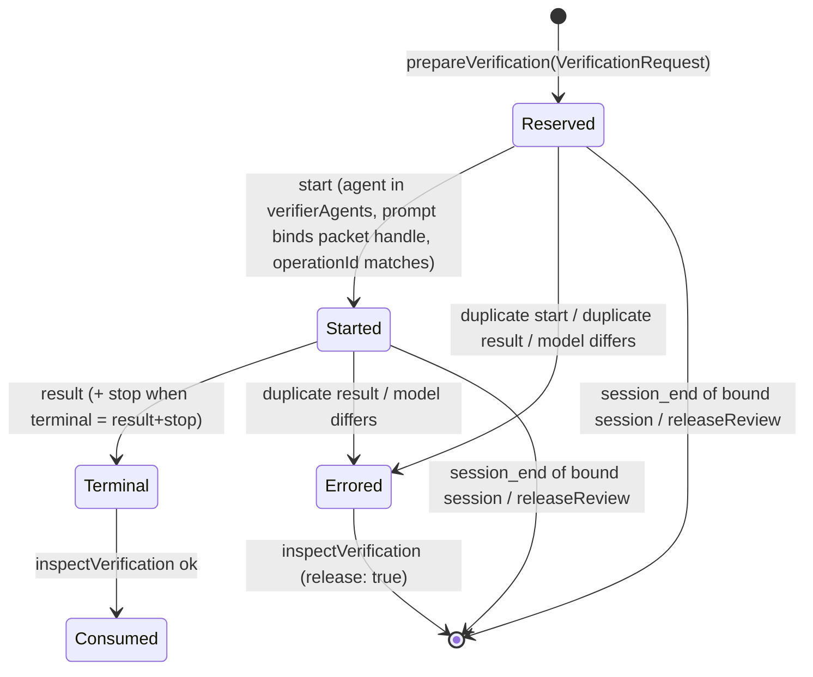

# Host-neutral adapter core

**Status**: Candidate; no execution authority.
**Initiative**: `host-neutral-adapter-core` (source issue #414, folding #417), five Slices S1–S5.
**Design risk**: High — it moves adapter machinery shared by the Claude Code and Antigravity Hosts into a new layer, replaces class inheritance between adapters with composition, rewrites the verifier observation state machine both Hosts settle verification receipts through, removes a field from the `AssuranceHostPort` request type, and changes which Antigravity hook events reach the event log.
**Design views**: architecture layers (new `runtime/host-core/` layer and dependency direction); service/component interfaces (host profile, typed hook events, `HookEventLog`, verifier observation); state transitions (verifier reservation observation).
**Diagram decision**: required
**Diagram reason**: the verifier observation crosses two Host hook vocabularies, one shared state machine and the Kernel coordinator; one state diagram shows which typed event each Host maps into which transition.
**Document language**: English, following Planner's default document policy.

## Outcome

Adapter machinery that Claude Code and Antigravity share lives once in a neutral layer `plugins/immune-brain/runtime/host-core/`, recorded by ADR 0038. Each adapter keeps only what is specific to its Host: hook payload parsing into typed events, subagent primitives, transcript reading, CLI spawn arguments, manifests and hooks, and native gate UX. No adapter imports or extends another adapter; the host-to-host import baseline in `tests/runtime-layering-boundary.test.ts` is empty and stays enforced at zero. The Antigravity review-verifier path, which never completed in production, settles through the shared state machine from real hook dispatch. The two #417 leftovers are removed: the verifier `PendingReview` binds `VerificationRequest` directly, and `ReviewRequest.prompt` is deleted.

No user-visible change outside BR-SCN-1: S1, S3, S4 and S5 move code without changing what any Host user observes; S2 makes Antigravity verification accept a receipt it previously rejected.

## Sources

- Issue #414 (problem, proposed shared core items 1–4, acceptance) and the folded #417 items (a) and (b).
- Brainstorm manifest from `clarify` on 2026-11-09 (`BR-*` IDs, see Brainstorm Trace).
- Decomposition confirmed by the user on 2026-11-09 (five Slices, Initiative name and slug, the two Planner decisions D11 and D12).
- Repository evidence listed under Discovery evidence, read at `origin/main` `28ec0ed14`.

## Threat model and supported environment

Hook payloads come from the Host process the user installed and are trusted for shape, not for content: a payload may be missing fields or name a different tool, and the adapter ignores what it cannot parse. The event log lives in a per-user cache directory under the OS temp root; the adversary is another local user planting a symlink or foreign-owned file there, which the existing ownership check refuses. No network input. Supported environment: macOS and Linux, Bun for tests, Node for the packaged bundles. Real Antigravity payload shapes are taken from `docs/specs/antigravity-harness.spec.md` and `plugins/immune-brain-antigravity/hooks.json`; no live `agy` run backs them, so conformance fixtures prove the seam logic, not real Host behavior.

## Discovery evidence

- Host-to-host baseline: `tests/runtime-layering-boundary.test.ts:25-28` lists three edges, all owned by #414: `antigravity/kernel_ports.ts -> claude/kernel_ports`, `antigravity/mcp_server.ts -> claude/mcp_server`, `antigravity/interaction.ts -> claude/interaction`. `AC2` pins `BASELINE` length 3. The inner-layer rule (`innerLayerViolations`) already treats every directory outside the `HOSTS` map as host-neutral, so a new `runtime/host-core/` is covered by it automatically.
- Layering doc drift: `docs/reference/layering-rules.md:59` still says "four-edge baseline", and `tests/layering-rules-contract.test.ts:50-53` pins the string `four-edge`; the real baseline has three edges. ADR 0035 (`docs/adr/0035-layering-doctrine.md`, Consequences) defers naming a neutral shared location to its own ADR; next free number is 0038 (`docs/adr/0037-authority-review-cli-stage.md` is the latest).
- Event log fork: `runtime/claude/review_host.ts:57-300` (`HookEventLog`, `MemoryHookEventLog`, `sessionHash`, `cacheDir` with `CACHE_DIR = "immune-brain-claude"`, `ownedByUs`, `ensurePrivateDir`, `appendPrivate`, `readPrivate`, `FileHookEventLog`) and `runtime/antigravity/review_host.ts:53-156` (same names, `CACHE_DIR = "immune-brain-antigravity"`, no `ownedByUs`, recursive `mkdirSync` without a mode or ownership check, `<hash>.events.jsonl` file names, and a `sessions()` that returns file-name hashes rather than session ids, so `list(sessions()[i])` hashes twice and reads nothing — `review_host.ts:140-147` against `:107-109`). The Claude file log names files `<hash>.jsonl` and derives `sessions()` from the events' `sessionId` (`claude/review_host.ts:263-283`).
- Private-file helper importers: `runtime/claude/lane_guard.ts:38` and `runtime/claude/run_continuation.ts:14` import `appendPrivate, cacheDir, ensurePrivateDir, ownedByUs, readPrivate, sessionHash` from `./review_host`; `runtime/antigravity/lane_guard.ts:21` imports `cacheDir, ensurePrivateDir, sessionHash` from `./review_host`.
- Verifier state machine fork: `runtime/claude/review_host.ts:304-575` (`PendingReview` with `request: ReviewRequest`, `drain`, `applyReviewEvent`, `inspectVerifier`, sync/async transcript resolution) and `runtime/antigravity/review_host.ts:158-345` (same shape; synthesizes a `ReviewRequest` at `:184`; requires `startEvent`, `postEvent` and `stopEvent` at `:319-322`).
- Antigravity hook gap: `runtime/antigravity/mcp_server.ts:39-90` `runHook` appends only a `PostToolUse` event for `invoke_subagent`/`Subagent` (agentId = `stepIdx`); PreToolUse goes to `antigravityPreToolUseHook` (`runtime/antigravity/lane_guard.ts:197`) and records nothing in the event log. `plugins/immune-brain-antigravity/hooks.json` routes PreToolUse for `invoke_subagent|Subagent` and PostToolUse for the same matcher to `--hook`. The Host emits no SubagentStart/SubagentStop (`docs/specs/antigravity-harness.spec.md:7`). `AntigravityPreToolUsePayload` carries `toolCall.{name,args}`, `stepIdx`, `conversationId` (`lane_guard.ts:49-61`); the verifier dispatch args are `TypeName`, `Role`, `Prompt`, `Model` (`review_host.ts:207-212`).
- `ReviewRequest.prompt`: declared at `runtime/assurance/host_port.ts:27`, assigned only at `runtime/assurance/coordinator.ts:1757`; `CliReviewHost.prepareReview` reads `snapshotPrompt` (`runtime/assurance/cli_review.ts:153-172`). Test doubles reading `ReviewRequest`: `tests/host-neutral-assurance-coordinator.test.ts:40,150,650-680`, `tests/fixtures/review-incomplete-fixture.ts:7,59`.
- Runtime inheritance: `runtime/antigravity/kernel_ports.ts` (20 lines) is `AntigravityRuntime extends ClaudeRuntime` with `observeAntigravity`; `runtime/claude/kernel_ports.ts` is 1338 lines. Host-specific points in it: host id, confirmation reference, the ReviewHost instance and its `observe` (`:362`), probe injection, lane relay construction. `NativeAuthorityError` lives in `runtime/claude/interaction.ts`; `runtime/antigravity/interaction.ts` imports it.
- Runtime constructions in tests: `tests/claude-host-authority.test.ts` (9), `tests/dual-host-assurance-conformance.test.ts` (8), `tests/antigravity-assurance-conformance.test.ts` (7), `tests/review-revision-identity-conformance.test.ts` (4), `tests/cli-review-dispatch.test.ts` (2), `tests/batch-stale-disposition.test.ts` (2), and one each in `tests/claude-batch-authority.test.ts`, `tests/goal-driven-run-recovery.test.ts`, `tests/batch-serial-retirement.test.ts`, `tests/scope-revision-envelope.test.ts`.
- MCP runtime: `runtime/claude/mcp_server.ts:126-260` `createMcpRuntime` options (`probeHost`, `consumePhaseAdmission`, `trustedClientNames`, `serverInfo`, `host`, `parentHost`); Claude-specific constants at `:11` (`CORE_CONTRACT`, `HOST_ID`, `MIN_CLAUDE_CODE_VERSION`), the `claudecode/toolUseId` meta key at `:439,546`, the elicitation refusal text at `:805`, `readRunToolSession` correlation at `:246,292`, hook dispatch at `:1029-1044`. `runtime/antigravity/mcp_server.ts:16-37` wraps it with its own client names and serverInfo; #429 (`85dc48eef`) added per-call workspace resolution covered by `tests/antigravity-assurance-conformance.test.ts` describe "MCP workspace resolution" (`:561`).
- Run continuation: `runtime/claude/run_continuation.ts` (293 lines) owns session metadata files (`statePath`, `callPath`), `readRunToolSession`, `selectedClaudeParent`, pause, `NATIVE_FAILURE_LIMIT = 3`, and the Stop/PostToolUse payload parsing (`stopBoundary`, `toolResponse`); `runtime/antigravity/run_continuation.ts` (58 lines) decides continue from projection lifecycle and `next_obligation`. Neutral projection facts already live in `runtime/assurance/run_continuation.ts`. Tests: `tests/claude-run-continuation.test.ts`, `tests/antigravity-assurance-conformance.test.ts` describe "Run Continuation Hook" (`:250`).
- Packaging: the Antigravity runtime copy is driven by `package.json` `files` entries under `plugins/immune-brain/runtime/` (`scripts/build-antigravity-plugin.ts:97-103`), and every copied file is an output in `docs/agents/derived-files.json`. A new `runtime/host-core` directory needs a `files` entry and derived outputs. `tests/claude-host-package.test.ts:243` and `tests/pi-canary-package-boundary.test.ts:60` assert specific `files` entries.
- Risk floor: `.imm/risk-floor.json` floors `runtime/assurance`, `runtime/claude/{review_host,kernel_ports,mcp_server}.ts` at `material`.
- Pi: `PiReviewHost` (`.pi-extension/pi-canary-assurance-progression.ts`) uses in-process transport and has no host-to-host edge (BR-OUT-4).

## Decisions and technical design

### D1 — Location and dependency direction (source: BR-DEC-1, BR-REQ-1)

New directory `plugins/immune-brain/runtime/host-core/`. Direction: `kernel ← assurance ← host-core ← adapters (claude, antigravity)`. `host-core` may import `kernel/`, `assurance/`, `config/`, `unattended/` and other host-neutral modules; it imports no adapter. `kernel/` and `assurance/` import nothing from `host-core`. Adapters may import `host-core`. ADR 0038 records this before any `host-core` code lands (ADR 0035 Decision 3), and `docs/reference/layering-rules.md` Dependency Rule names the layer. Pi stays outside this initiative (BR-OUT-4); `.pi-extension` may import `host-core` later but this initiative adds no such import.

### D2 — Enforcement (source: BR-REQ-5, repository evidence `tests/runtime-layering-boundary.test.ts`)

The boundary test gains one rule: no file under `runtime/kernel/` or `runtime/assurance/` imports a module under `runtime/host-core/`. The existing inner-layer rule already forbids `host-core` importing an adapter. The baseline shrinks as edges retire: S3 removes the `kernel_ports` and `interaction` edges, S4 removes the `mcp_server` edge and pins `BASELINE` at length 0. The Enforcement paragraph of `layering-rules.md` stops pinning a number before S4 ("a baseline owned by #414") and states the zero baseline after S4; `tests/layering-rules-contract.test.ts` follows each wording.

### D3 — Hook event log (source: BR-REQ-2)

`host-core/hook_event_log.ts` exports `HookEventLog<E>`, `MemoryHookEventLog<E>` and `FileHookEventLog<E>`; the file log takes the per-Host cache directory name as a constructor argument. Cache directory names stay `immune-brain-claude` and `immune-brain-antigravity`. The shared file log uses the Claude behavior for both Hosts (delegated technical choice): `<hash>.jsonl` file names, `sessions()` derived from the events' `sessionId`, and the private-file checks (`ownedByUs`, directory mode `0700`, file mode `0600`, `O_NOFOLLOW`). Claude session files written before the move stay readable. Antigravity `.events.jsonl` files written before the move are no longer read; they held only in-flight verifier events that could never complete a receipt (see Discovery evidence), so nothing settled is lost. `host-core/private_file.ts` exports `sessionHash`, `cacheDir(root, name)`, `ownedByUs`, `ensurePrivateDir`, `appendPrivate`, `readPrivate`. Neither adapter keeps its own copy of these names.

### D4 — Antigravity hook mapping (source: BR-DEC-3)

`runHook` maps, for `toolCall.name` in `{invoke_subagent, Subagent}`:

| Antigravity payload | Typed event appended | Fields |
| --- | --- | --- |
| PreToolUse with `stepIdx` present and `antigravityPreToolUseHook` decision `allow` | start | `sessionId = conversationId`, `agentId = String(stepIdx)`, `agent = args.TypeName`, `prompt = args.Prompt`, `model = args.Model` |
| PostToolUse (`stepIdx` and `result` or `error`) | terminal (result) | `sessionId`, `agentId = String(stepIdx)`, `result` string, `model`, `prompt` |

A PreToolUse without `stepIdx`, for another tool, or with a non-`allow` decision appends nothing. The PreToolUse stdout decision is unchanged. In S1 the start event uses the existing `SubagentStart` variant so the current Antigravity state machine consumes it; S2 renames the vocabulary when the shared machine lands.

### D5 — Verifier observation state machine (source: BR-REQ-2, BR-REQ-6, BR-DEC-2)

`host-core/verifier_observation.ts` owns one state machine over typed events `start`, `result`, `stop`, `session_end`, each carrying `sessionId`, `agentId` and optional `agent`, `prompt`, `model`, `result`, `taskId`, `operationId`. A `PendingVerification` binds the `VerificationRequest` directly (no synthesized `ReviewRequest`). A host profile passed to the machine supplies:

- `verifierAgents`: accepted `agent` names on `start`;
- `terminal`: `"result+stop"` (Claude: `PostToolUse` result and `SubagentStop`) or `"result"` (Antigravity: `PostToolUse` is terminal, per BR-DEC-3);
- `resolveResult(state)`: returns the reviewer text, or a typed incomplete/failed reason (Claude reads sync or async Agent transcripts; Antigravity returns the `result` event text);
- `actorPrefix`: `claude-code` / `antigravity` as today.

Inspect outcomes keep today's reason strings: no pending or no start → `reserved foreground Agent was not observed` (release); started but terminal incomplete → `foreground Agent terminal event order is incomplete` (no release); error → its reason (release); consumed → `review receipt already consumed` (release); packet handle invalid → the `verificationPacketError` reason (release). Claude-only reasons from transcript resolution (`sync Agent transcript is not readable`, `async Agent launch envelope names a different agent`, …) come back from `resolveResult` unchanged. Session cursors, `SessionEnd` clearing and per-session drain move with the machine.

Settlement enumeration: trigger sources are `start`, `result`, `stop`, `session_end`, `inspectVerification`, `releaseReview`. Terminal ownership stays with the coordinator's `submit_verification`, which accepts only an `ok` inspect; hook events alone settle nothing. The same-state-machine owners are both `review_host.ts` files, `host-core/verifier_observation.ts`, and the coordinator's `prepareVerification`/`inspectVerification` callers in `runtime/assurance/coordinator.ts`.

### D6 — `ReviewRequest.prompt` removal (source: BR-REQ-7)

Delete `prompt` from `ReviewRequest` in `runtime/assurance/host_port.ts` and its assignment in `coordinator.ts`. `snapshotPrompt` and every other field are unchanged. `VerificationRequest.prompt` is a different field and stays. Test doubles stop setting or reading `ReviewRequest.prompt`. This is the only Port type change (BR-OUT-1 exception).

### D7 — Runtime composition (source: BR-REQ-5)

`host-core/runtime.ts` holds the host-neutral body of today's `ClaudeRuntime` as `HostRuntime`, constructed with a `HostRuntimeProfile`: host id, native confirmation reference, the `AssuranceHostPort` instance plus its `observe` function, the probe, and the lane relay factory. `ClaudeRuntime` and `AntigravityRuntime` each own a `HostRuntime` and expose the methods their callers use; neither extends the other. Public method names used by tests and MCP servers stay, so test construction sites need no change beyond imports. `NativeAuthorityError` moves to `host-core/interaction.ts`; both adapters re-export or import it from there.

### D8 — MCP stdio runtime (source: BR-REQ-4)

`host-core/mcp_runtime.ts` holds `createMcpRuntime`, `handleJsonRpc` and `serveStdio`, configured by an `McpHostProfile`: `serverInfo`, `trustedClientNames`, the tool-call correlation meta key and its missing-key refusal, the elicitation-refusal text, the probe, the runtime factory, `consumePhaseAdmission`, the run-session correlation reader, and the hook dispatcher. #429's per-call workspace resolution order (`_meta["antigravity.google/workspace_paths"][0]`, then the first `file://` root from `roots/list`, then `options.cwd ?? process.cwd()`) is preserved. `claude/mcp_server.ts` and `antigravity/mcp_server.ts` become profile + entrypoint + hook dispatch.

### D9 — Run continuation (source: BR-REQ-3)

`host-core/run_continuation_session.ts` owns session metadata persistence, tool-call correlation records, pause, the native failure counter and binding migration, driven by typed events (`tool_call`, `tool_result`, `stop`, `prompt`). `claude/run_continuation.ts` keeps payload parsing (`stopBoundary`, `toolResponse`) and output rendering. The Antigravity Stop decision (continue when lifecycle is `active`, no user decision is open and `next_obligation` is an automated obligation) moves into `host-core` as a pure function over the projection; the Antigravity adapter keeps payload parsing and rendering.

### D10 — No registry, Pi untouched (source: BR-OUT-2, BR-OUT-3, BR-OUT-4)

Each adapter's composition root wires its own profiles; there is no host registry or dispatcher. No Pi file or Pi public Tool schema changes.

### D11 — Antigravity continuation semantics unchanged (source: user confirmation on 2026-11-09 of the decomposition)

D9 moves the Antigravity rule; it does not adopt the Claude phase-entry and call-correlation mechanism.

### D12 — ADR inside S1 (source: user confirmation on 2026-11-09 of the decomposition)

ADR 0038 lands in S1 with the first `host-core` code rather than as a documentation-only Slice.

### D13 — Packaging (source: repository evidence `scripts/build-antigravity-plugin.ts:97-103`, `docs/agents/derived-files.json`)

S1 adds `plugins/immune-brain/runtime/host-core` to `package.json` `files`; each Slice that adds a `host-core` file adds its Antigravity runtime copy to `docs/agents/derived-files.json` and regenerates both bundles. Each Slice carries one changeset.

## Slices

| Slice | Task | Result when it alone has landed | Depends on |
| --- | --- | --- | --- |
| S1 | `host-core-event-log` | ADR 0038 and the layering doc name `host-core`; one event log and one private-file helper set serve both Hosts; Antigravity `--hook` writes the start event; kernel/assurance → host-core imports fail the boundary test. | — |
| S2 | `host-core-verifier-observation` | One verifier state machine; Antigravity verification accepts a receipt from real hook dispatch (BR-SCN-1); `ReviewRequest.prompt` is gone. | S1 |
| S3 | `host-core-runtime-composition` | No runtime inheritance; `NativeAuthorityError` defined once; baseline has one edge. | S2 |
| S4 | `host-core-mcp-runtime` | One MCP stdio runtime; baseline is empty and pinned at zero; #429 behavior holds. | S3 |
| S5 | `host-core-run-continuation` | Run continuation state machine and the Antigravity Stop decision live in `host-core`; adapters parse and render only. | S1 |

S3 depends on S2 because both rewrite the ReviewHost wiring in `kernel_ports.ts`; S4 depends on S3 because the MCP runtime constructs the runtime. S5 shares `claude/run_continuation.ts` with S1 only. Parallel groups follow `imm-kernel intent overlap`.

## Acceptance mapping

Seams: S1 `tests/layering-rules-contract.test.ts`, `tests/runtime-layering-boundary.test.ts`, `tests/dual-host-assurance-conformance.test.ts`, `tests/antigravity-assurance-conformance.test.ts`. S2 `tests/dual-host-assurance-conformance.test.ts`, `tests/antigravity-assurance-conformance.test.ts`, `tests/host-neutral-assurance-coordinator.test.ts`, `tests/claude-host-authority.test.ts`. S3 `tests/runtime-layering-boundary.test.ts`, `tests/dual-host-assurance-conformance.test.ts`, `tests/antigravity-assurance-conformance.test.ts`, `tests/claude-host-authority.test.ts`. S4 `tests/runtime-layering-boundary.test.ts`, `tests/layering-rules-contract.test.ts`, `tests/antigravity-assurance-conformance.test.ts`, `tests/claude-host-authority.test.ts`. S5 `tests/claude-run-continuation.test.ts`, `tests/antigravity-assurance-conformance.test.ts`. The shared core is exercised through these conformance seams, not a separate unit suite (BR-REQ-8). Each TaskIntent acceptance names its exact seam, positive, negative and bound controls.

## User scenarios

- **BR-SCN-1** (Slice S2, `automated` → `host-core-verifier-observation` AC3). Actor: Antigravity developer. Given an enrolled task whose Review returned blocking findings, with the review-verifier dispatched through `invoke_subagent`. When the verifier subagent finishes and the developer calls `submit_verification`. Then the tool result reports an accepted verification receipt instead of "reserved foreground Agent was not observed".

## Brainstorm Trace

| Item | Mapping |
| --- | --- |
| BR-REQ-1 | D1; S1 AC1, AC2 |
| BR-REQ-2 | D3, D5; S1 AC3 (event log, helpers), S2 AC1 (state machine) |
| BR-REQ-3 | D9, D11; S5 AC1, AC2 |
| BR-REQ-4 | D8; S4 AC2, AC3 |
| BR-REQ-5 | D2, D7, D8; S3 AC1, AC2; S4 AC1 |
| BR-REQ-6 | D5; S2 AC1 |
| BR-REQ-7 | D6; S2 AC2 |
| BR-REQ-8 | D4, D5; S1 AC4, S2 AC3 |
| BR-DEC-1 | D1 |
| BR-DEC-2 | D5 (verifier observation only; authority Review stays in `assurance/cli_review.ts`) |
| BR-DEC-3 | D4, D5 |
| BR-OUT-1 | D6 exception only; no Kernel, Port method-set or verdict change |
| BR-OUT-2 | D10 |
| BR-OUT-3 | D10 |
| BR-OUT-4 | D10 |
| BR-SCN-1 | User scenarios; S2 AC3 |

## Assumptions

- Antigravity PostToolUse for `invoke_subagent` fires only after the subagent finishes, so it is a valid terminal (BR-DEC-3). Unverified against a live `agy`; the risk is recorded in the clarify framing.
- `stepIdx` is the same value in the PreToolUse and PostToolUse payloads of one `invoke_subagent` call, so it correlates start and terminal. Backed by the payload type (`lane_guard.ts:54`) and the existing PostToolUse mapping (`mcp_server.ts:74`); unverified live.

## Devil's Advocate Audit

- **Rollback resilience.** Each Slice is a refactor behind unchanged public adapter entrypoints and Port methods (except D6), merged on its own; reverting one Slice's merge restores the previous file set because later Slices depend on earlier ones only through `host-core` modules they add. Cache directory names stay (D3); Claude session files keep their format, and the Antigravity format change only abandons in-flight verifier events. The one persisted-format risk is S1 writing new start events into the Antigravity log: the start event uses the `SubagentStart` variant the pre-S1 Antigravity machine already parses, so a rollback after S1 leaves at most extra start events that the old machine reads as a start without completing a receipt.
- **Verification vanity.** Pure "tests still pass" would not catch a missed fork; each Slice therefore pairs behavior seams with a structural assertion that the duplicate is gone (the boundary baseline count, absence of the duplicated class names, absence of `extends ClaudeRuntime`). The Antigravity verifier acceptance spawns the real `--hook` entry and reads the real file log, so a mapping bug in `runHook` fails it; an in-memory event injection would not.
- **Spec dilution detection.** The Brainstorm Trace maps every `BR-*` item; the issue's four shared-core items map to S1/S2 (items 1 and 4, BR-DEC-2), S5 (item 2), S4 (item 3), and S3 covers the inheritance edge the issue lists. The baseline reaching zero is S4 AC1, so a plan that stopped at three Slices would visibly leave edges.

## Execution posture

`characterization-first` for S2 and S5: run the existing verifier and continuation tests against the moved state machines before deleting the adapter copies, since the two forks have subtle differences (ownership check, transcript resolution, metadata migration).
