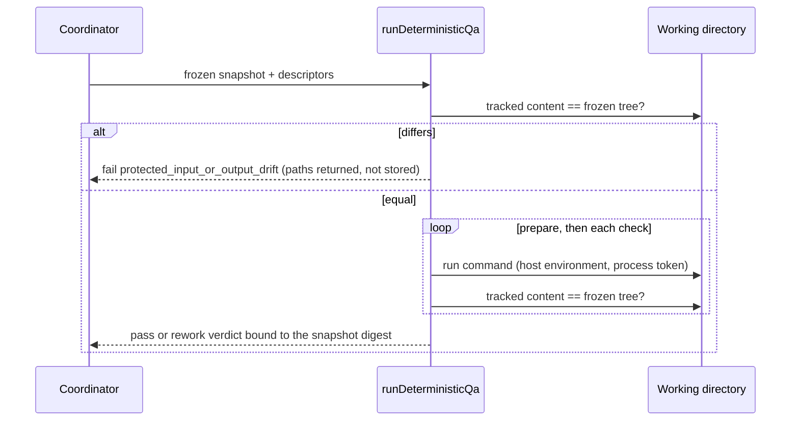

# Leave the development environment to the user

**Status**: Implemented by S1R and S2–S5; the original S1 was stopped and superseded by S1R.
**Design risk**: High — S1 changes where deterministic QA executes and removes the delivery materialization, S4 changes how the risk floor that forces Review is computed, and S3 changes what the Enrollment gate lets a task own.
**Execution posture**: characterization-first for S3 (pin today's read-only projection and Enrollment refusal before changing them) and S4 (pin the hash of an already-floored intent before moving the floor); test-first elsewhere.
**Document language**: English, following the Planner document-language default.
**Source**: Direct Planner entry on 2026-10-12, continuing the analysis that produced `qa-inherit-host-environment`. User-owned decisions are `U1`–`U6`; everything else is repository evidence or a delegated technical choice.

## Outcome

The Kernel constrains what a task delivers and stops prescribing how the user's development environment is arranged:

- deterministic QA runs in the task's own working directory, whatever isolates it (a worktree is one example, not a requirement);
- a QA command is whatever the user's `PATH` provides, including a tool behind a version-manager shim and a shell one-liner;
- the staging area is inspected when a snapshot is frozen, and not as a precondition of Enrollment or of reading status;
- the paths that force a higher risk come from the project, not from a list of this repository's own files compiled into the Kernel;
- a session with no active task in its workspace does not pay for Immune-Brain's event recording.

## User decisions

| ID | Decision | Source |
|---|---|---|
| U1 | The development environment is user-controlled. The Kernel makes no requirement on where QA is isolated; the user decides, and a worktree is only an example of such isolation. | User messages "开发环境用户自身控制，大部分已经由worktree做了隔离" and "E1，不做硬性要求，由用户自行决定。worktree只是举例", 2026-10-12. |
| U2 | QA runs in place in the task's working directory. The tracked content must equal the frozen snapshot before the run and must be unchanged after it; `environment.prepare` stays and runs in place. | Shown in the decomposition review as the reading of U1 and confirmed ("确认"), 2026-10-12. |
| U3 | The risk floor is project configuration and is empty when a project declares none. | User answer "其他按你建议" to the recommendation "默认为空", 2026-10-12. |
| U4 | Review cost (R1) and batch constraints (R2) are measured and investigated first. They are Issues, not Slices. | Same answer; recommendation "先只做测量". |
| U5 | Name "Leave the development environment to the user", slug `host-owned-environment`, short name `host-owned-env`, five serial Slices S1–S5 with the dependencies below, GitHub carrier. | Decomposition table confirmed ("确认"), 2026-10-12; carrier from `CLAUDE.md` `Initiative carrier default: github`. |
| U6 | Changing the wording of an acceptance assertion still needs the user's confirmation. | Proposal withdrawn by the Planner and not reopened by the user, 2026-10-12. |
| U7 | The Lane batch integration recheck keeps the materialized delivery copy; only task QA runs in place. | User answer "仅此处保留副本" to the S1 implementation question, 2026-10-13. |
| U8 | The in-place equality check covers only paths inside the task's scope; content outside the scope is the user's environment. | User answer "只比较 scope 内" to the S1 implementation question, 2026-10-13. |

## User scenarios

| ID | Mode | Scenario | Acceptance |
|---|---|---|---|
| SCN-1 | automated | Given a working directory whose dependencies are already installed in an ignored directory, when QA runs a check, then the check uses them and passes without any install step. | HE-S1-A1 |
| SCN-2 | automated | Given a working directory whose tracked content differs from the frozen snapshot, when QA starts, then it refuses before running any command and names the differing paths. | HE-S1-A1 |
| SCN-3 | automated | Given a check that rewrites a tracked file, when QA finishes that command, then the run fails as input drift instead of passing. | HE-S1-A1 |
| SCN-4 | automated | Given an acceptance command written as `sh -c "a && b"`, when QA runs it, then the exit status of the compound decides the result. | HE-S2-A2 |
| SCN-5 | automated | Given a host tool that is reached through a shim script, when QA resolves and runs it, then it runs instead of being refused, and a timeout still removes its processes. | HE-S2-A1 |
| SCN-6 | automated | Given an active task with an unstaged file inside its scope, when the user reads status, then the task projection is returned with a warning; `advance_assurance` still refuses. | HE-S3-A1 |
| SCN-7 | automated | Given staged or unstaged changes inside the scope before Enrollment, when the user confirms an Enrollment gate that lists them, then they are task work and appear in the first snapshot. | HE-S3-A2 |
| SCN-8 | automated | Given an enrolled task, when its scope is revised to a subset of itself, then the revision applies without a native confirmation. | HE-S3-A3 |
| SCN-9 | automated | Given a repository with no risk-floor declaration, when a task changes `docs/plans` or a path named like this repository's Kernel, then its declared risk is kept. | HE-S4-A1 |
| SCN-10 | automated | Given this repository's declaration, when a task scopes a Kernel path with risk `routine`, then it is raised to `material` as today. | HE-S4-A1 |
| SCN-11 | automated | Given a task whose scope or changed paths include the declaration file itself, then its risk is `critical`. | HE-S4-A2 |
| SCN-12 | automated | Given a workspace with no active task, when a tool call or a subagent event fires the hook, then nothing is written. | HE-S5-A1 |
| SCN-13 | automated | Given an active task, when the user submits a prompt or a Reviewer subagent starts, then the notice and the recorded Review events are as today. | HE-S5-A1 |

SCN-1 to SCN-3 belong to the replacement task `host-owned-environment-s1-task-qa-in-place` (Slice S1R, Issue #228) and are published there as SCN-14 to SCN-16, because the stopped Slice S1 (#222) keeps the original ids as history; they compare in-scope content only (U8). SCN-1 to SCN-5 follow U1 and U2; SCN-6 to SCN-8 were the staging-area items the user kept ("其他按你建议"); SCN-9 to SCN-11 follow U3; SCN-12 and SCN-13 are the hook item of the same confirmed table.

## Decision trace

| ID | Decision | Source |
|---|---|---|
| D1 | `runDeterministicQa` executes `prepare` and every check with the task's project root as the root. Task QA no longer calls `materializeDeliveryWorkspace`. The materialization stays for one caller, the Lane batch integration recheck, which verifies a merge candidate commit that is never checked out and so has no working directory to run in (U7). | U1, U2, U7. Repository evidence: `runtime/assurance/qa.ts:74-84`, `runtime/assurance/delivery_workspace.ts:120`, `:174`, `:211`; the materialization has one runtime consumer (`qa.ts:4`). |
| D2 | Before the first command of a run and after every command, the tracked content of the working directory inside the task's `scope_hint` is compared with the frozen tree, ignoring exactly the paths the snapshot already treats as non-delivery. Paths outside the scope are the user's environment and are not compared (U8). A difference before the run or after a command fails with the existing reason `protected_input_or_output_drift`; no reason code is added. The differing paths are returned to the caller through the non-persisted Tool-result channel and never stored. | U2, U8. Repository evidence: reason union in `runtime/assurance/coordinator.ts`; `isNonDeliveryPath` in `runtime/workspace_scope.ts`; "Paths and process output are not persisted" at `qa.ts:117`. |
| D3 | `environment.writable_paths` stays a parsed v2 field and no longer has an effect: untracked and ignored output is the user's environment. The descriptor contract version does not change, so no enrolled or planned TaskIntent needs revision. | Delegated technical choice. Repository evidence: `runtime/verification_descriptor.ts:99-105`; 63 TaskIntents under `docs/plans` carry the field. |
| D4 | The eight Git repository-binding variables stay filtered from the child environment. In place, an inherited binding would still point a command at a different repository than the working directory. | Repository evidence: `runtime/assurance/verification.ts:60-63`. |
| D5 | ADR 0022 records that QA runs in place and why the materialization was removed. `dist/imm-run.md:96-98` and `dist/imm-planner.md:383-389` are rewritten: QA runs in the task's working directory after an equality check with the frozen snapshot; a dependency already present in the working directory is valid provenance. | Delegated technical choice; the contract sentences state the removed behaviour. |
| D6 | Command resolution stops interpreting `#!` lines. The entry file is resolved through the absolute-entry `PATH` (or inside the project for `./file`), pinned by identity as today, and executed directly; the operating system resolves any interpreter. `FrozenCommand.interpreter` and `interpreter_args` are removed. | U1. Repository evidence: `runtime/assurance/verification.ts:91-117` (refusals at `:103`, `:106`, `:109`, `:114`), `:147-149`; consumers `qa.ts:110-115`, `:121`. |
| D7 | No descriptor field is added for shell commands. `executable: "sh"` with `argv: ["-c", "<line>"]` already parses and resolves; the Planner contract states it as the way to write a compound command and drops "do not infer a … runner" style limits that only existed for the materialization. | Repository evidence: `runtime/verification_descriptor.ts:64-78` accepts it; prior art `tests/pi-canary-verification-descriptor.test.ts:73`. Corrects the earlier chat statement that compound commands were impossible. |
| D8 | Enrollment no longer refuses a scope that is already dirty. The gate text on both Hosts lists the in-scope paths that are staged, modified or untracked; on confirmation they are left out of the Enrollment baseline, so later snapshots treat them as task work. A dirty scope is never claimed without that list being shown. | U1. Repository evidence: `runtime/kernel/enrollment.ts:213-225`, `:557`; `runtime/workspace_scope.ts:403-417`; gate text at `.pi-extension/imm-canary-enroll.ts:487` and `runtime/claude/kernel_ports.ts:378-383`. |
| D9 | A read-only status projection of an active task is returned when the scope holds unstaged or untracked paths, with those paths as a warning. Freezing a snapshot (`advance_assurance`, Review evidence) refuses exactly as today. | U1. Repository evidence: `runtime/workspace_scope.ts:464-466`, `:609-610`; mapping at `runtime/assurance/coordinator.ts:303`. Assumption A2 below. |
| D10 | A scope revision whose next entries are all previous entries is `compatible`. Everything `ceremony-trim-r647` S2 decides about additions is unchanged. | Delegated technical choice: narrowing removes authority. Repository evidence: `runtime/kernel/intent.ts:379`. |
| D11 | The index-flag refusal (`assume-unchanged`, `skip-worktree`) stays. It runs only when a snapshot is taken and protects the equality D2 relies on. | Repository evidence: `runtime/workspace_scope.ts:296-301`. Narrows the earlier chat proposal to relax it. |
| D12 | The risk floor leaves `parseTaskIntentV1`. Parsing returns the declared risk; the floor is applied where a risk is decided (Enrollment, revision classification, `classifyTaskRisk`, the `intent author`/`validate` report) from a project declaration. ADR 0023 records it. | U3. Repository evidence: `runtime/kernel/intent.ts:44-63`, `:115-119`, `:321-327`, `:347-359`; `runtime/commands/kernel.ts:210`, `:328`. |
| D13 | The declaration is one tracked file, `.imm/risk-floor.json`, holding `material` and `critical` path-prefix lists. A missing file means no floor. An unreadable or invalid file fails closed as `critical` for every task of that project. The file's own path is always `critical`. This repository's file carries today's two lists unchanged. | U3; format and location are a delegated technical choice. `immune-brain-config.md:3-5` reserves agent instruction files for preferences an Agent reads; a floor the Kernel enforces must not sit in a file the Executor edits as prose. |
| D14 | Stored TaskRecords keep the risk they were enrolled with. D12 must not change the canonical hash of an intent that is already enrolled; the characterization test pins one floored and one unfloored example before the move. | Repository evidence: `runtime/kernel/intent.ts:343` (`canonicalIntentHash`), about 20 `parseTaskIntentV1` call sites. |
| D15 | On `PostToolUse`, `SubagentStart`, `SubagentStop` and `SessionEnd`, the hook appends to the event log only when the workspace has an active task or an active batch. `PreToolUse` and `UserPromptSubmit` are unchanged, because a phase entry is recorded before any task exists. `hooks.json` keeps its registrations. | U1. Repository evidence: `runtime/claude/mcp_server.ts:749-770`; `hooks/hooks.json`; the log's only reader is the Review host (`runtime/claude/review_host.ts:231`, `kernel_ports.ts:286`). |
| D16 | Each Slice ships one changeset: S1 `major` (a check that relied on a pristine copy now sees the working directory), S2–S5 `minor`. | Delegated technical choice. |

## Out of scope

- The 600 s descriptor bound, the identical-failure counter and the five-round Review budget.
- Windows support for fixed verification.
- Batch branch names, worktree lifecycle, Herdr steps and whole-batch `plan_changed` (R2, an Issue).
- Review rounds and `inspected_paths` (R1, a comment on Issue #177).
- Risk-tier semantics beyond where the floor list lives; Issue #204 owns them.
- Removing the per-event process start of the Claude hook. D15 removes the write, not the spawn.
- `tests/fixtures/workflow-decision-closure-sources/imm-planner.md`, a frozen historical copy.

## Discovery evidence and reference closure

- S1 producer and caller: `runtime/assurance/qa.ts` (`runDeterministicQa`), `runtime/assurance/delivery_workspace.ts`, reason union and Tool result in `runtime/assurance/coordinator.ts`; Pi re-export `.pi-extension/pi-canary-verification.ts`. Tests that import the materialization: `tests/shared-deterministic-qa.test.ts`, `tests/pi-canary-verification-descriptor.test.ts`, `tests/pi-canary-assurance-authority.test.ts`. Comments that describe it: `tests/dual-host-assurance-conformance.test.ts:345-346`, `tests/unattended-contracts.test.ts:324-327`. Contracts: `dist/imm-run.md:96-98`, `dist/imm-planner.md:381-389`, asserted in `tests/workflow-verification-invariants.test.ts`.
- S2: `runtime/assurance/verification.ts:91-150`, consumer `qa.ts`; tests `tests/pi-canary-verification-descriptor.test.ts`, `tests/kernel-verification-descriptor.test.ts`; contract `dist/imm-planner.md:375-398`.
- S3: `runtime/kernel/enrollment.ts`, `runtime/workspace_scope.ts`, `runtime/kernel/intent.ts`, `runtime/assurance/coordinator.ts`, gate text in `.pi-extension/imm-canary-enroll.ts` and `runtime/claude/kernel_ports.ts`; tests `tests/enrollment-dirty-scope.test.ts`, `tests/managed-task-snapshot-isolation.test.ts`, `tests/kernel-intent-v2.test.ts`, `tests/host-neutral-assurance-coordinator.test.ts`, `tests/dual-host-assurance-conformance.test.ts`; contract `dist/imm-run.md`.
- S4: `runtime/kernel/intent.ts`, `runtime/kernel/enrollment.ts`, `runtime/commands/kernel.ts`; tests `tests/risk-tier-floor.test.ts`, `tests/risk-downgrade-guard.test.ts`, `tests/kernel-intent-v2.test.ts`, `tests/kernel-intent-validation.test.ts`; reference `dist/docs/reference/immune-brain-config.md`.
- S5: `runtime/claude/mcp_server.ts`, `runtime/claude/review_host.ts`; tests `tests/claude-host-authority.test.ts`, `tests/claude-review-host-async-agent.test.ts`.
- Every Slice that edits `runtime/` regenerates `dist/claude/mcp-server.mjs` (`bun scripts/build-claude-plugin.ts`, drift checked by `tests/claude-host-package.test.ts`) and adds one file under `.changeset/`.

## Assumptions to characterize first

- A1 (S1): `ceremony-trim-r647` S1 adds a non-persisted field to the QA failure Tool result. D2 returns the differing paths through it. If S1 lands with a different shape, D2 uses that shape; S1 of this Initiative is blocked by the whole of `ceremony-trim-r647` for that reason.
- A2 (S3): the read-only status path fails today only through the refusal at `workspace_scope.ts:466`/`:610` reached from `taskDeliveryIdentity`. The first S3 test reproduces the failure through the public status Tool on both Hosts; if another caller is involved, it is a same-module scope addition.
- A3 (S4): no stored TaskRecord is re-hashed from a re-parsed intent in a way that depends on the floor. The S4 characterization test proves or refutes this before the move (D14).

## Technical Design

**Design views**: temporal sequence (S1: check, run, re-check), service/component interfaces (S2 `FrozenCommand`, S4 the floor source), state transitions (S3 revision classification and the Enrollment baseline), data flow (S5 which events reach the log).
**Diagram decision**: required
**Diagram reason**: S1 replaces a copy-then-run sequence with compare-run-compare, and the failure points move.

### Invariants

- I1: a QA pass is issued only if the in-scope tracked content of the working directory equalled the frozen tree before the first command and after the last one (D2).
- I2: a task QA run creates and removes nothing outside what its commands write (D1). The batch integration recheck is outside this invariant (U7).
- I3: a command's entry file is identity-pinned for the whole run; timeout and abort still remove every process carrying the run token (D6).
- I4: no in-scope change that predates Enrollment becomes task work unless the confirmed gate listed it (D8).
- I5: a snapshot is never frozen over unstaged, untracked or index-flagged in-scope paths (D9, D11).
- I6: a scope revision that adds any entry is classified as before this Initiative (D10).
- I7: with no declaration the floor is empty; with an invalid one every task is `critical`; the declaration file itself is always `critical` (D13).
- I8: the canonical hash of an enrolled intent is the same before and after S4 (D14).
- I9: with an active task or batch, the event log receives the same events as today (D15).

### T1. QA in place (S1; D1–D5)

`runDeterministicQa` runs in place by default; the batch integration recheck passes an explicit option that selects the materialized delivery instead. Task QA tests supply a real temporary Git repository. The equality check is one function used at both points; it runs Git with the repository bindings removed and reads no index flags of its own. A failed check before the run reports stage `integrity`.

### T2. Command resolution (S2; D6, D7)

`resolveVerificationCommand` returns `{ entry }`. `runFixedVerification` spawns `entry.invocation_path` with the literal `argv`. `assertCommandIdentity` checks the entry only. The execution digest drops its `interpreter` member.

### T3. Staging checks (S3; D8–D11)

The Enrollment rehearsal reports in-scope dirt as a disclosed list instead of a blocker; both gate renderers print it; `writeEnrollmentBaseline` omits those paths. The status projection catches the unstaged refusal and returns the record with a warning. `classifyIntentRevision` gains the subset rule ahead of the breaking test.

### T4. Risk floor (S4; D12–D14)

One reader loads `.imm/risk-floor.json` from the project root and returns `{ material, critical }` or a fail-closed marker. `riskFloorForScope` and `classifyTaskRisk` take that value as a parameter. `RISK_FLOOR_SCOPE_PREFIXES` and `CHANGED_PATH_RISK_FLOOR_PREFIXES` are deleted from the runtime and written into this repository's declaration.

### T5. Hook (S5; D15)

`runHook` consults the same active-task read that `activeTaskHookOutput` already performs, plus the batch state, before `FileHookEventLog.append`.

### Alternatives rejected

- Keeping the materialization as an opt-in mode: two execution paths to keep equivalent, for a guarantee (a pristine copy) the user can get by pointing a task at a clean checkout (U1).
- A new descriptor contract version without `writable_paths`: forces a revision of every planned TaskIntent for no behavioural gain (D3).
- A `shell` descriptor field: `sh -c` already expresses it (D7).
- Reading the floor from `AGENTS.md`/`CLAUDE.md`: the Executor edits those as prose, and a parse miss would silently drop a floor (D13).
- Narrowing `hooks.json` matchers: the Review host needs events from tools it cannot enumerate ahead of time (D15).

### Compatibility, interruption, rollback

- Compatibility: descriptors and stored records are unchanged in format. After S1R, task QA compares only in-scope tracked content with the frozen snapshot; out-of-scope content remains the user's environment. After S4, a consumer repository has no floor until it adds a declaration.
- Interruption: S1 removes a cleanup step and adds no state. S3 changes what one Enrollment transaction writes; an interrupted Enrollment is recovered as today.
- Rollback: each Slice is one commit. Reverting S4 restores the compiled lists; tasks enrolled meanwhile keep their recorded risk. Reverting S3 restores the refusal; tasks that claimed dirt keep it.

## Verification and acceptance mapping

| Acceptance | Slice | Agreed seam | Controls |
|---|---|---|---|
| HE-S1-A1 QA runs in place under the equality check | S1R | `tests/shared-deterministic-qa.test.ts` through `runDeterministicQa` on a real temporary repository | positive: a check reads a file from an ignored directory and passes; negative: an in-scope tracked edit refuses before any command runs, and a check that rewrites an in-scope tracked file fails as drift; bound: an out-of-scope or non-delivery path may differ, untracked output is allowed, no directory is created outside the repository |
| HE-S1-A2 the Hosts and the coordinator agree | S1R | `tests/pi-canary-assurance-authority.test.ts`, `tests/pi-canary-verification-descriptor.test.ts`, `tests/host-neutral-assurance-coordinator.test.ts` | positive: both Hosts pass a run with no materialization; negative: the differing paths are absent from the stored record and from diagnostics; bound: abort during a command still cleans up |
| HE-S1-A3 contracts, ADR and bundle | S1R | `tests/workflow-verification-invariants.test.ts`, `tests/claude-host-package.test.ts` | positive: in-place sentences present; negative: "disposable delivery" absent from `dist/imm-run.md` and `dist/imm-planner.md`; bundle in sync |
| HE-S2-A1 any host tool resolves and stays pinned | S2 | `tests/pi-canary-verification-descriptor.test.ts` with real children | positive: a tool whose `#!` names another script, and one using `env -S`, run; negative: an entry replaced during the run fails identity; bound: timeout removes the whole process group |
| HE-S2-A2 compound commands and contract | S2 | `tests/pi-canary-verification-descriptor.test.ts`, `tests/kernel-verification-descriptor.test.ts`, `tests/workflow-verification-invariants.test.ts`, `tests/claude-host-package.test.ts` | positive: `sh -c "true && exit 3"` yields exit 3; negative: descriptor bounds still reject an over-long argv; contract sentence present; bundle in sync |
| HE-S3-A1 status is read-only | S3 | `tests/dual-host-assurance-conformance.test.ts`, `tests/host-neutral-assurance-coordinator.test.ts`, `tests/managed-task-snapshot-isolation.test.ts` | positive: projection plus warning with an unstaged in-scope file; negative: `advance_assurance` on the same state still refuses; bound: an index-flagged path still refuses a snapshot, including combined `assume-unchanged` and `skip-worktree` flags |
| HE-S3-A2 Enrollment claims listed dirt | S3 | `tests/enrollment-dirty-scope.test.ts`, `tests/pi-canary-enroll-extension.test.ts`, `tests/claude-host-authority.test.ts` | positive: listed paths appear in the first snapshot; negative: a path dirtied after the gate text was built is not claimed; bound: out-of-scope dirt stays in the baseline |
| HE-S3-A3 narrowing is compatible | S3 | `tests/kernel-intent-v2.test.ts` | positive: strict subset; negative: subset plus one added entry, subset plus a changed goal; bound: empty next scope |
| HE-S3-A4 contract and bundle | S3 | `tests/explicit-phase-entry-run-contract.test.ts`, `tests/claude-host-package.test.ts` | sentences present; bundle in sync |
| HE-S4-A1 the floor comes from the declaration | S4 | `tests/risk-tier-floor.test.ts`, `tests/risk-downgrade-guard.test.ts` | positive: this repository's declaration raises a Kernel-path scope to `material`; negative: no declaration keeps `routine` for the same scope and for `docs/plans`; bound: glob scope entries match as today |
| HE-S4-A2 fail closed and self-protection | S4 | `tests/risk-tier-floor.test.ts` | positive: the declaration path is `critical` in scope and in changed paths; negative: invalid JSON, wrong types and an unreadable file each yield `critical`; bound: an empty declaration equals none |
| HE-S4-A3 enrolled hashes are stable | S4 | `tests/kernel-intent-v2.test.ts`, `tests/kernel-intent-validation.test.ts` | characterization first: the hash of one floored and one unfloored enrolled intent is identical before and after; `intent validate` reports the floored risk |
| HE-S4-A4 reference, ADR and bundle | S4 | `tests/dist-docs-sync-contract.test.ts`, `tests/claude-host-package.test.ts` | reference documents the file; mirror identical; bundle in sync |
| HE-S5-A1 the log is written only for active work | S5 | `tests/claude-host-authority.test.ts` on the hook entry with a temporary state root | positive: active task and active batch each append; negative: no active task appends nothing for all four events; bound: `UserPromptSubmit` still records a phase entry with no task |
| HE-S5-A2 Review still observes its Reviewer | S5 | `tests/claude-review-host-async-agent.test.ts`, `tests/claude-host-package.test.ts` | existing async-agent evidence tests pass unchanged; bundle in sync |

## Devil's Advocate Audit

- **Rollback resilience**: S1 is the only Slice that deletes a mechanism. A half-applied S1 (materialization gone, equality check missing) would let QA pass over unverified content; HE-S1-A1's negative controls fail in exactly that state. A half-applied S4 (lists deleted, reader missing) drops every floor silently, which is why HE-S4-A1 asserts this repository's own Kernel paths are still raised.
- **Verification vanity**: HE-S1-A1 uses a real repository because the removed test seam was the thing that let earlier tests avoid one. HE-S3-A2's negative control (dirt that appears after the gate text) is the case where a claim would exceed what the user saw. HE-S4-A3 compares hashes instead of asserting that the parser no longer calls the floor. Contract acceptances (HE-S1-A3, HE-S3-A4, HE-S4-A4) prove wording only; each has a runtime acceptance beside it.
- **Spec dilution**: "no hard requirement" (U1) is delivered with one requirement kept, the equality check of D2, shown to and confirmed by the user. Two earlier chat proposals are narrower here and say so: shell commands need no new field (D7), and the index-flag refusal stays (D11). S5 removes the write but not the per-event process start, stated in Out of scope. S2 through S5 were announced as `material` and S3 is authored `critical`, because D8 changes what the Enrollment gate grants.

## Delivery boundary

Five effective serial Slices, S1R then S2–S5, each regenerating the same bundle. The original S1 (#222) was stopped and is retained as historical evidence; S1R (#228) replaces it and keeps the Lane batch integration copy. The `ceremony-trim-r647` prerequisite is complete. S2 follows S1R (`verification.ts`, `qa.ts`). S3 follows S2 and uses `ceremony-trim-r647` S2's classifier. S4 follows S3 (`kernel/intent.ts`, `kernel/enrollment.ts`). S5 follows S4 only for the bundle.
