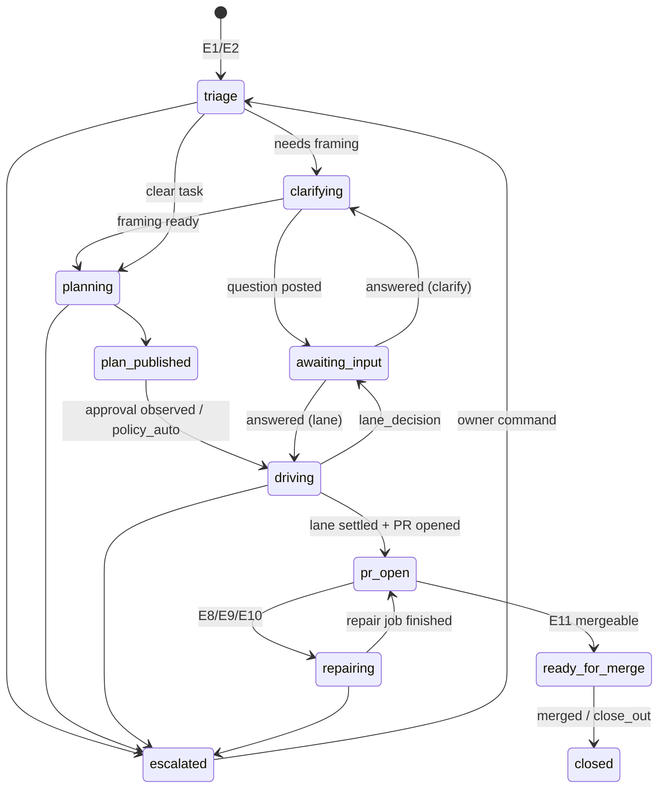

# Loop Agent Scheduling: Work Items, Role Configuration and Interaction Channels

**Initiative**: `loop-agent-scheduling` (short name `loop-sched`), follow-up to
#458 (`docs/specs/loop-daemon.spec.md`, closed).
**Output language**: English (repository default; the conversation ran in Chinese).
**Design risk**: High — the work changes a persisted orchestration state machine,
the configuration contract shared by every Host, the session permission
boundary of dispatched agents, and the channel through which literal-user
answers reach the daemon.
**Execution posture**: `characterization-first` for S9's E2 claim and S8's
conflict-path claims, which are inferred from code and not yet reproduced.

## Outcome

The Loop daemon schedules code agents by the state of each work item instead of
reacting to each event in isolation. Every agent role (Lane execution, Review,
loop judging, clarification, planning, repair) resolves its own Host profile
from one `agents` configuration, and runs with the permission its role allows.
Questions and approvals reach the owner through one Interaction protocol with a
`github` and a `local` channel. An Issue moves from triage to an open pull
request across ticks without re-approval, and long sessions no longer block the
tick.

## Sources

- Clarify session of 2026-11-14/15 (this conversation), decisions `BR-DEC-1` –
  `BR-DEC-11` and gaps `BR-GAP-*` below.
- [ADR 0039](../adr/0039-loop-daemon.md) Decisions 2, 4, 5, 9, 12.
- [ADR 0034](../adr/0034-layered-configuration.md) layered configuration.
- `plugins/immune-brain/runtime/role_prompt_bridge.ts:9-20` (`InternalRole`).

## Threat model and supported environment

External input is GitHub Issue, comment, review and check data read through the
daemon's own identity, and answers written by a local Host session. GitHub
content is untrusted: an attacker may comment on an Issue, edit a comment, or
reply on behalf of a non-allowlisted account. A local answer is trusted only
after the current Host's native confirmation. Configuration files are trusted
as written by their owner (user file) or committer (project file). Supported:
macOS and Linux, Git SHA-1 object format, UTF-8 text, Hosts `claude-code`, `pi`,
`antigravity`.

## User scenarios

| ID | Slice | Mode | Actor / Given / When / Then | Acceptance |
| --- | --- | --- | --- | --- |
| `BR-SCN-1` | S7 | automated | Repo owner. Given the loop needs a clarification on Issue #N and the channel is `github`, when the loop reaches #N, then the owner sees exactly one question comment on #N, and after replying sees the loop continue #N on a later tick. | `S7-AC1` |
| `BR-SCN-2` | S4 | automated | Local user. Given a Lane awaits a decision and the channel is `local`, when the user lists loop interactions in their local session, then they see the question, and after answering through the native confirmation they see the Lane continue. | `S4-AC1` |
| `BR-SCN-3` | S3 | automated | Repo owner. Given a `literal_user` decision that ADR 0039 does not let GitHub answer (for example a breaking Intent revision) and the channel is `github`, when the loop posts it, then the owner sees a notice directing them to answer locally, and a GitHub reply does not apply it. | `S3-AC2` |
| `BR-SCN-4` | S1 | automated | User. Given `agents` configuration with presets, when they run `imm-kernel config --json`, then they see every role's resolved host, model and effort and the preset and layer it came from. | `S1-AC1` |
| `BR-SCN-5` | S1 | automated | User. Given only legacy `lanes` profiles, when they run `imm-kernel config --json`, then they see the same executor, review and `max_parallel` as before plus a `deprecated_config_source` diagnostic. | `S1-AC2` |
| `BR-SCN-6` | S6 | automated | Repo owner. Given an Issue whose plan was approved, when its drive runs longer than one tick, then the owner later sees a pull request opened for it without approving again. | `S6-AC1` |

## Brainstorm Trace

| Item | Content | Mapping |
| --- | --- | --- |
| `BR-DEC-1` | Schedule by per-target work item state and run long work asynchronously, not per-event patches | D5, D6; S5, S6 |
| `BR-DEC-2` | Unified `agents.{profiles, presets, active}`; `default` preset implicitly inherited; role lookup order | D1; S1-AC1 |
| `BR-DEC-3` | The owner's `default` preset binds `code-review`, `review-verifier`, `plan`, `judging`, `clarify` to `opus-med`, `"*"` to `sonnet-high` | D1 reference example; S1-AC1 fixture. Editing the owner's personal file is a manual step after S1 lands (the repository cannot write it). |
| `BR-DEC-4` | Role permissions enforced by the runtime | D2; S2-AC1 |
| `BR-DEC-5` | Legacy `lanes` keys stay readable with `deprecated_config_source` | D1; S1-AC2 |
| `BR-DEC-6` | One Interaction protocol (`InteractionRequest`, `InteractionChannel` post/poll/withdraw); `local` and `github` channels | D3, D4; S3, S4 |
| `BR-DEC-7` | `local` means the user's own interactive Host session | D4; S4 |
| `BR-DEC-8` | GitHub answers only `advisory` requests, narrowed by `BR-DEC-10` | D3; S3-AC2 |
| `BR-DEC-9` | Configuration role names follow `InternalRole` (`code-review`, `review-verifier`, `advisory-reviewer`); `repair` covers `pr-fix` and `test-fixer` | D1 |
| `BR-DEC-10` | GitHub may answer exactly the literal-user decisions ADR 0039 Decisions 9 and 12 already grant (`/approve <hash>`, Lane decision) with today's checks; every other literal-user operation is notice-only | D3; S3-AC2 |
| `BR-DEC-11` | The nine-Slice decomposition, risks and dependencies | Slice table below |
| `BR-GAP-1` | `max_concurrent` ineffective: serial `for … await` (`dispatch.ts:552`), lease released in `finally` (`dispatch.ts:1091`) | D6; S6-AC3 |
| `BR-GAP-2` | Scope-overlap check reads a non-existent `scope_hint` (`dispatch.ts:515`) | D7; S9-AC1 |
| `BR-GAP-3` | `ready_buffer` hard-coded to `0` (`dispatch.ts:537`) | D7; S9-AC1 |
| `BR-GAP-4` | Level events are re-judged every tick | D5; S5-AC2 |
| `BR-GAP-5` | Drive waits 60 s (`agent_handlers.ts:1372`) and blocks the tick | D6; S6-AC1 |
| `BR-GAP-6` | E2 fires on every new comment (`events.ts:111`), inferred | D7; S9-AC2 (characterization first) |
| `BR-GAP-7` | E8 `event_id` lacks `head_sha` (`events.ts:309`) | D7; S9-AC2 |
| `BR-GAP-A1` | `ready-for-agent` jumps to `enroll_and_drive` without a plan (`judgement.ts:296`) | D5; S5-AC1 |
| `BR-GAP-A2` | a15 classifications mapped to the wrong handlers (`judgement.ts:419-430`) | D8; S7-AC2 |
| `BR-GAP-A3` | Analysis output is never consumed (`agent_handlers.ts:518,550,566`) | D8; S7-AC2 |
| `BR-GAP-A4` | Only `intents[0]` is driven | D8; S7-AC3 |
| `BR-GAP-B1` | Enroll, drive and PR in one synchronous call | D6; S6-AC1 |
| `BR-GAP-B2` | No "Lane settled" event | D6; S6-AC1 |
| `BR-GAP-B3` | Exit record digest is null (`agent_handlers.ts:1383-1384`, `:836`) | D6; S6-AC1 |
| `BR-GAP-B4` | Re-entry re-enrolls instead of resuming | D6; S6-AC2 |
| `BR-GAP-B5` | `open_pr` is never selected | D6; S6-AC1 |
| `BR-GAP-C1` | CI repair gets no log (`agent_handlers.ts:875`) | D9; S8-AC1 |
| `BR-GAP-C2` | Conflict repair never calls an agent | D9; S8-AC2 (characterization first) |
| `BR-GAP-C3` | One session and push per review comment | D9; S8-AC3 |
| `BR-GAP-C4` | PR worktree reused without fetch/reset (`agent_handlers.ts:1140`) | D9; S8-AC1 |
| `BR-GAP-D` | Sessions run inside the tick and block `owner_control` | D6; S6-AC3 |
| `BR-DEFER-1` | `policy_auto` publishing straight into drive (B6) | Deferred: approval still needs `/approve` or a label. |
| `BR-DEFER-2` | Loop planning through the plugin `draw-up` contract | Deferred: the daemon keeps its own plan prompt (ADR 0039 Decision 2 deviation kept). |
| `BR-DEFER-3` | Configurable per-role limits | Deferred: built-in limits only. |
| `BR-EXCL-1` | Slack and other channels | Excluded. |
| `BR-EXCL-2` | Folding `decision_models` into `agents` | Excluded: it calls scoring APIs, not sessions. |
| `BR-EXCL-3` | `qa`, `ui-review`, `arch-explorer`, `compounder`, `lane-steward` as configurable roles | Excluded: Parent-native or Host-owned. |

## Slices

| Slice | Task ID | Result when landed alone | Risk | Blocked by | Scenarios |
| --- | --- | --- | --- | --- | --- |
| S1 | `loop-sched-s1-agent-config` | `imm-kernel config` reports each role's resolved profile and source; legacy `lanes` still works with a deprecation diagnostic | material | — | `BR-SCN-4`, `BR-SCN-5` |
| S2 | `loop-sched-s2-role-sessions` | Loop sessions run with their own role profile, read-only roles start without write permission, built-in limits per role | material | S1 | no user-visible change: only session argv and decision records change |
| S3 | `loop-sched-s3-interaction-github` | Questions, `/approve`, Lane decisions and escalations go through one request contract on GitHub; stale requests are withdrawn | critical | — | `BR-SCN-3` |
| S4 | `loop-sched-s4-interaction-local` | A local session lists pending loop requests and answers them through native confirmation | critical | S3 | `BR-SCN-2` |
| S5 | `loop-sched-s5-work-items` | Each Issue has a persisted work item; `ready-for-agent` without a plan goes to planning; unchanged level facts are not re-judged | material | — | no user-visible change: state lives in `.imm/state/loop/` |
| S6 | `loop-sched-s6-async-drive` | Drive and sessions run in the background; Lane settlement opens the PR; re-entry resumes | material | S5 | `BR-SCN-6` |
| S7 | `loop-sched-s7-clarify-plan` | Clarify asks through Interaction and resumes on the answer; its framing feeds planning; every intent of a plan is driven | material | S2, S3, S5 | `BR-SCN-1` |
| S8 | `loop-sched-s8-pr-repair` | CI repair receives the log, conflicts call an agent, review comments are batched, worktrees sync first | material | S2 | no user-visible change: only the repair path differs; pushes look the same |
| S9 | `loop-sched-s9-scheduler` | Scope overlap, `ready_buffer`, E2 and E8 identity behave as specified | material | S5 | no user-visible change: scheduling internals |

S4 is `critical` (the review table showed `material`): it adds a privileged
Host tool, which is an authority surface. The Kernel would raise it regardless.

## Technical Design

**Design views**: architecture layers (configuration, daemon, Host adapters),
service/component interfaces (role resolver, `InteractionChannel`), data flow
(event → work item → job → completion event), state transitions (work item),
temporal sequence (tick versus background job). All five apply.
**Diagram decision**: required
**Diagram reason**: the work item lifecycle and the tick/job sequence cross six
states and two processes; prose alone hides the legal transitions.

### D1: Agent configuration (`S1`)

Source: `BR-DEC-2`, `BR-DEC-3`, `BR-DEC-5`, `BR-DEC-9`.

```ts
type Host = "claude-code" | "pi" | "antigravity";
type Role = "executor" | "code-review" | "review-verifier" | "advisory-reviewer"
          | "judging" | "clarify" | "plan" | "repair";
interface AgentsConfig {
  profiles?: Record<string, { host: Host; model?: string; effort?: string; transport?: "process" | "herdr" | "subagent" }>;
  presets?:  Record<string, { max_parallel?: number; roles?: Partial<Record<Role | "*", string>> }>;
  active?:   string;
}
```

- Layers: user file holds `profiles`, `presets`, `active`;
  `projects.<key>.agents` holds only `active`; the project file holds only
  `active`. Any other key in those places is `config_invalid`.
- `active` precedence: user per-project override > project > user > `default`.
- Lookup for role `r`, first present wins: active `roles[r]` → `default.roles[r]`
  → active `roles["*"]` → `default.roles["*"]`. `max_parallel`: active →
  `default` → project `lanes.max_parallel` → today's default.
- A resolved role carries one whole profile; host, model and effort never mix
  layers, which retires the "host must be set in the same layer" diagnostics
  (`config/layered_config.ts:223-227`).
- Errors (whole `agents` section falls back to legacy/built-in, as `failed.add("lanes")` does today): `unknown_profile`,
  `unknown_preset`, `preset_incomplete` (a `default` preset without `"*"`),
  `transport_invalid_for_role`, `review_verifier_host_mismatch`
  (`review-verifier` must share `code-review`'s host; `cli_review.ts:422` only
  swaps the model), `max_parallel` outside 1..8.
- Transports per role: `executor`, `code-review` → `process|herdr`;
  `review-verifier`, loop roles → `process`; `advisory-reviewer` →
  `subagent|herdr`. Absent → first listed.
- No `agents` and no legacy: every role is `unset` and each consumer keeps its
  current fallback (executor → Parent Host via `chooseExecutor`; review →
  `review_profile_required`; loop roles → `claude-code`).
- Legacy mapping: `lanes.profiles.<n>` → preset `<n>` with `executor_*` → `"*"`,
  `review_*` → `code-review`, `max_parallel` kept, `review_verifier_model` →
  `review-verifier` on the review host; `lanes.active` → `active`; project flat
  `executor_*`/`review_*` → preset `project`, the last fallback. Each legacy
  read reports `deprecated_config_source`; a layer holding both wins with
  `agents` and reports `legacy_source_ignored`.
- A request that names a Lane profile (`mcp_runtime.ts:168`, Pi
  `imm-unattended-batch.ts:338`) names a preset.
- Consumers switch to the resolver: `laneExecutorChoice`
  (`unattended/batch_runner.ts:228`), batch review freeze
  (`unattended/batch_state.ts`), Review transport and verifier
  (`assurance/cli_review.ts:307,353,360,422`), advisory transport, and
  `imm-kernel config --json` (`v4_runtime.ts:194`), which adds `agents.roles`
  with `{host, model, effort, transport, preset, layer}` per role.
- Documentation: `docs/reference/immune-brain-config.md` gains the example
  matching `BR-DEC-3`; ADR 0034 gains an amendment.

### D2: Role sessions (`S2`)

Source: `BR-DEC-4`, `BR-DEFER-3`.

- `agent_runner.ts` builds argv from `{role, profile, limits}`. Read-only roles
  (`judging`, `clarify`, `plan`) never receive `acceptEdits`
  (`agent_runner.ts:216-226`); they receive the Host's read-tool allow-list.
  The exact Host flags are **unverified** and confirmed by the Executor against
  each CLI's help; a Host with no verifiable read-only mode refuses a read-only
  role with `role_readonly_unsupported` rather than running it writable.
- `plan` is read-only: it returns the plan as structured output and the daemon
  writes the plan artifacts, so "writes only plan artifacts" is enforced by
  code.
- `repair` keeps write access confined to the PR worktree.
- Built-in limits live in one per-role table; every loop role starts at
  today's 40 turns / 900 s (`agent_handlers.ts:247-248`), as confirmed in
  clarify. Making them configurable is `BR-DEFER-3`.
- `cli.ts:1409-1419` and `agent_handlers.ts:1116-1120` stop reading
  `lanes.executor_*` and use the resolved role.

### D3: Interaction protocol and `github` channel (`S3`)

Source: `BR-DEC-6`, `BR-DEC-8`, `BR-DEC-10`.

```ts
interface InteractionRequest {
  contract: "immune_brain/interaction_request/v1";
  interaction_id: string;                 // idempotency key
  kind: "clarify_question" | "plan_approval" | "lane_decision" | "escalation" | "notice";
  subject: { issue?: number; pr?: number; task_id?: string; run_id?: string };
  binding: { plan_digest?: string; record_revision?: string; issue_revision?: string };
  prompt: string; options?: string[];
  answer: "none" | "choice" | "free_text" | "approve_digest";
  authority: "advisory" | "literal_user";
}
interface InteractionChannel {
  readonly id: "github" | "local";
  accepts(req: InteractionRequest): boolean;   // may this channel apply an answer
  post(req): Promise<"posted" | "already_posted" | "notice_only">;
  poll(id): Promise<{ state: "pending" } | { state: "answered"; value: string; actor: string; provenance: string }
                    | { state: "stale" } | { state: "withdrawn" }>;
  withdraw(id): Promise<void>;
}
```

- Authority: `clarify_question` advisory; `plan_approval` and `lane_decision`
  literal-user; `escalation`, `notice` carry no answer.
- `github.accepts`: `clarify_question`; `plan_approval` only as
  `/approve <digest>` with ADR 0039 Decision 9 checks (allowlisted author, not
  the daemon, created after publication, never edited, digest equal);
  `lane_decision` only with today's relay checks (`decision_relay.ts`,
  `events.ts:198`: allowlist, `run_id` and `record_revision` match). Every
  other literal-user operation (stop, breaking Intent revision, authorization,
  credentials, risk override) is posted as `notice_only` naming the local
  action.
- Posting is one marker comment per `interaction_id`; a changed binding marks
  the old request `stale` and withdraws it (comment edited to a stale notice).
- `decision_relay.ts`, the `/approve` marker (`events.ts:34`) and
  `escalation.ts` become `github` channel adapters of this one contract; their
  markers stay readable for requests posted before the change.
- ADR 0040 records the protocol and amends ADR 0039 Decision 12 ("only on
  GitHub"); `CONTEXT.md` gains Interaction request / channel.

### D4: `local` channel (`S4`)

Source: `BR-DEC-7`.

- The daemon writes requests to `.imm/state/loop/interactions/<id>.json`
  (`0600`) under the daemon's state directory and reads answers from
  `<id>.answer.json`.
- Host tools in `host-core/mcp_runtime.ts` (Claude Code, Antigravity) and the
  Pi extension: `loop_interactions` (non-privileged, lists pending requests)
  and `answer_loop_interaction` (privileged; the Host's native confirmation
  shows kind, subject, binding and the answer). Only an answer written after
  that confirmation is accepted, so every local answer is literal-user.
- `plan_approval` on `local` is answered by the user's own `drive` entry on the
  published TaskIntent (native Enrollment); the daemon observes the enrolled
  TaskRecord and resumes (D6). No new Enrollment confirmation source.
- `loop.interaction.channel: "github" | "local"` in the project file,
  default `github`.

### D5: Work items (`S5`)

Source: `BR-DEC-1`, `BR-GAP-4`, `BR-GAP-A1`.



- Store: `.imm/state/loop/work_items/<target>.json` with `state`, `revision`,
  `binding` (plan digest, task IDs, run ID, PR), `pending_interactions`,
  `jobs`, and `last_judged` fingerprints per event kind. Not authority (ADR 0039
  Decision 4); `rebuild.ts` reconstructs it from GitHub and the Kernel.
- A level event is judged only when its fact fingerprint differs from
  `last_judged`; edge events keep `event_id` deduplication.
- `ready-for-agent` with no published plan routes to `planning`; with a
  published plan it is the approval signal (`BR-GAP-A1`).
- Handlers move the work item; an illegal transition is recorded and refused.

### D6: Background jobs and drive re-entry (`S6`)

Source: `BR-DEC-1`, `BR-GAP-1`, `BR-GAP-5`, `BR-GAP-B1` – `B5`, `BR-GAP-D`.

```mermaid
sequenceDiagram
  participant T as tick
  participant J as job (background)
  participant K as Kernel / Lane
  T->>J: start (lease held, jobs/<id>.json)
  T-->>T: returns; owner_control runs next tick
  J->>K: enroll or resume, drive
  K-->>J: settled (exit record with commit + verification digest)
  J-->>T: job file terminal
  T->>T: E12 job_finished / E13 lane_settled → open_pr
```

- `.imm/state/loop/jobs/<id>.json`: kind, target, pid, started_at, expected
  output, outcome. The lease lives until the job is terminal; a dead pid with
  no outcome is `lost` and the work item retries once, then escalates.
- `max_concurrent` counts running jobs; owner-control handlers run inline.
- New events: `E12 job_finished`, `E13 lane_settled` (from the Kernel
  projection, never session prose).
- `enroll_and_drive` reads the TaskRecord first: enrolled and nonterminal →
  resume via `drive_dispatcher.ts`; absent → enroll. Re-entry never mints a new
  nonce for an enrolled task (`BR-GAP-B4`).
- The exit record takes `final_commit_sha` and the verification digest from
  the settled Kernel projection instead of `null`
  (`agent_handlers.ts:1383-1384`); `open_pr` is selected on `E13`
  (`BR-GAP-B5`).

### D7: Scheduler corrections (`S9`)

Source: `BR-GAP-2`, `BR-GAP-3`, `BR-GAP-6`, `BR-GAP-7`.

- Candidate `scope_hint` comes from the work item's TaskIntent scope or plan
  framing; `ready_buffer` counts work items in `plan_published`.
- E2 requires an Issue body or title change (compared against a stored body
  hash), not `updated_at !== created_at`; a characterization test first shows
  today's behavior on a comment-only update.
- E8 `event_id` includes `head_sha`.

### D8: Clarify and plan (`S7`)

Source: `BR-DEC-6`, `BR-GAP-A2` – `A4`.

- `clarify` (replaces analysis) returns either questions or a framing
  (`scopes`, `seams`, `risks`, `acceptance`). Questions post a
  `clarify_question` and move the work item to `awaiting_input`; an accepted
  answer re-runs `clarify` with the answer appended.
- a15: `clear_single_task` → `plan` (one intent); `needs_initiative_decomposition`
  → `plan` with a decomposition instruction; `needs_clarification` → `clarify`.
- `plan` receives the framing, not only the Issue body's first 4000 chars.
- A multi-intent plan is approved by its plan digest and driven as one batch;
  `intents[0]` is no longer special.

### D9: PR repair (`S8`)

Source: `BR-GAP-C1` – `C4`.

- CI repair fetches the failing check's log excerpt (bounded) and passes it
  with the details URL; reproduction uses the failing command when known,
  otherwise the agent runs with the log alone.
- Conflict repair rebases; on conflict it keeps the conflicted tree and runs a
  `repair` session to resolve it; it pushes with `--force-with-lease` only to a
  branch the daemon created (ADR 0039 Decision 10).
- Review comments of one PR head are batched into one session with path, line
  and diff hunk; one push per batch.
- Before any repair the PR worktree fetches and resets to the PR head.

### Trade-offs and false-compromise check

- Async jobs versus one tick per decision: jobs add a lost-job path; the
  `lost` state plus one retry bounds it.
- `local` answers always need native confirmation, even advisory ones. Accepted:
  one confirmation per answer is cheaper than a second authority class.
- No false compromise detected: the remaining trade-offs (GitHub answering
  only ADR-granted literal-user decisions) are Immune-Brain authority
  invariants, not contradictions.

## Verification and acceptance mapping

| Acceptance | Seam (test file) | Positive | Negative | Bound / fault |
| --- | --- | --- | --- | --- |
| `S1-AC1` | `tests/agent-roles-config.test.ts`, `tests/layered-config.test.ts` | `BR-DEC-3` fixture yields the D1 table per role with preset and layer | unknown profile, unknown preset, `default` without `"*"`, verifier host ≠ review host, project-layer `profiles` | `max_parallel` 0 and 9 rejected, 1 and 8 accepted |
| `S1-AC2` | same | legacy-only config resolves as before + `deprecated_config_source` | both in one layer → `legacy_source_ignored` | no config → every role `unset` |
| `S1-AC3` | `tests/agent-roles-config.test.ts`, `tests/cli-review-dispatch.test.ts` | Lane executor, Review profile/transport, verifier model read resolved roles | — | request naming a preset overrides `active` |
| `S2-AC1` | `tests/loop-sched-role-sessions.test.ts` | each loop role uses its bound profile and limits | read-only argv lacks `acceptEdits`; unsupported Host → `role_readonly_unsupported` | each role reads 40 turns / 900 s from the per-role table |
| `S2-AC2` | `tests/loop-sched-role-sessions.test.ts`, `tests/loop-daemon-agent-handlers.test.ts` | plan artifacts written by the daemon from structured output | plan session output that is not valid JSON writes nothing | — |
| `S3-AC1` | `tests/loop-sched-interaction-github.test.ts`, `tests/loop-daemon-decisions.test.ts` | one comment per `interaction_id`; reposting is `already_posted` | changed binding → stale and withdrawn | legacy markers still parsed |
| `S3-AC2` | `tests/loop-sched-interaction-github.test.ts` | `/approve` and Lane decision accepted with today's checks | breaking revision, stop, authorization posted `notice_only`; reply ignored; non-allowlisted, edited, daemon-authored replies ignored | — |
| `S4-AC1` | `tests/loop-sched-interaction-local.test.ts` | request listed; confirmed answer applied; Lane continues | unconfirmed answer file ignored; answer to a stale request refused | `channel` value other than `github`/`local` → `config_invalid` |
| `S5-AC1` | `tests/loop-sched-work-items.test.ts` | `ready-for-agent` without plan → planning; with plan → approval | illegal transition refused and recorded | rebuild from empty state dir |
| `S5-AC2` | `tests/loop-sched-work-items.test.ts`, `tests/loop-daemon-judge.test.ts` | changed level fact judged | unchanged level fact not judged across two ticks | edge events still dedup by id |
| `S6-AC1` | `tests/loop-sched-async-drive.test.ts`, `tests/loop-daemon-drive-pr.test.ts` | drive past one tick → E13 → PR opened, no re-approval | exit without commit digest opens no PR | — |
| `S6-AC2` | `tests/loop-sched-async-drive.test.ts` | enrolled task resumes | no second enrollment attempt for an enrolled task | lost job retried once then escalated |
| `S6-AC3` | `tests/loop-sched-async-drive.test.ts`, `tests/loop-daemon-dispatch.test.ts` | tick returns while a job runs; owner command handled next tick | `max_concurrent` + 1 candidate held | lease kept until job terminal |
| `S7-AC1` | `tests/loop-sched-clarify-plan.test.ts` | question posted once; answer resumes clarify then plan | non-allowlisted reply does not resume | second tick without answer posts nothing |
| `S7-AC2` | `tests/loop-sched-clarify-plan.test.ts`, `tests/loop-daemon-schedule-plan.test.ts` | a15 mapping per D8; plan prompt contains framing | — | — |
| `S7-AC3` | `tests/loop-sched-clarify-plan.test.ts` | two-intent plan enrolled as one batch by digest | digest mismatch enrolls nothing | — |
| `S8-AC1` | `tests/loop-sched-pr-repair.test.ts`, `tests/loop-daemon-repair.test.ts` | CI log reaches the prompt; worktree reset to PR head first | log fetch failure escalates, no session | log excerpt bounded |
| `S8-AC2` | `tests/loop-sched-pr-repair.test.ts` | conflicted rebase runs a repair session; push uses `--force-with-lease` on a daemon branch | non-daemon branch never force-pushed | two-attempt cap kept |
| `S8-AC3` | `tests/loop-sched-pr-repair.test.ts` | three comments on one head → one session, one push; prompt has path, line, hunk | out-of-scope path escalates | — |
| `S9-AC1` | `tests/loop-sched-scheduler.test.ts` | overlapping scopes held; `ready_buffer` counted | disjoint scopes both run | `max_ready_buffer` reached holds planning |
| `S9-AC2` | `tests/loop-sched-scheduler.test.ts`, `tests/loop-daemon-observe.test.ts` | body edit emits E2; E8 IDs differ by head | comment-only update emits no E2 | same head and signature share an ID |

## Devil's Advocate Audit

| Challenge | Resolution |
| --- | --- |
| Rollback resilience: a half-landed S1 breaks every Lane start | Legacy readers stay; the resolver only adds a source. Reverting S1 restores today's reads. Each later Slice depends on S1/S3/S5 by blocker, never on unmerged work. |
| Rollback resilience: work item store corrupt or deleted | It is rebuildable, not authority (D5); `rebuild.ts` reconstructs it before scheduling. |
| Rollback resilience: a background job dies with the daemon | The job record and lease survive; a dead pid becomes `lost`, retried once, then escalated (D6). |
| Verification vanity: argv tests pass while the Host still writes | `S2-AC1` asserts the absence of `acceptEdits` and the presence of the allow-list; Host flags are unverified and the Executor must confirm them, else the role refuses to start. |
| Verification vanity: async drive tested only with instant fakes | `S6-AC1` drives a fake Lane that settles after more than one tick. |
| Spec dilution: GitHub quietly gains authority | `S3-AC2` enumerates the literal-user operations that stay notice-only and the reply forms that are ignored. |
| Spec dilution: `local` answers bypass native confirmation | `S4-AC1` refuses an answer file written without the privileged tool's confirmation record. |
| Outcome conservation | Every `BR-*` item maps once above; deferrals are the user's (`BR-DEFER-*`). |
