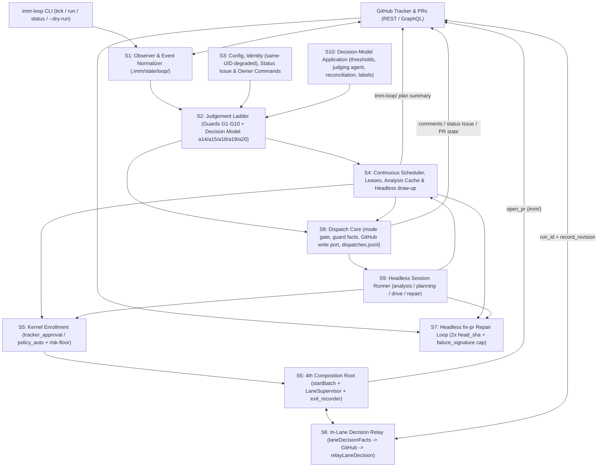

# Loop Daemon: Unattended Planning and Advancement of Issues

- **Status**: Draft
- **Initiative ID**: `loop-daemon`
- **Design risk**: High
- **Design views**: Architecture / Boundary view, State / Data view, Failure / Degraded-path view, Verification / Seam view
- **Diagram decision**: required
- **Diagram reason**: The initiative introduces a new unattended host boundary (4th composition root), multi-stage state transitions across GitHub tracker events, local `.imm/state/loop/` rebuildable persistence, Kernel Enrollment (`tracker_approval` and `policy_auto`), `LaneSupervisor` execution, and GitHub decision/PR repair loops.
- **Execution posture**: Standard
- **Document language**: English

## Outcome

| Task ID | Slice | Risk | Verification Seam | Done-Looks-Like |
| --- | --- | --- | --- | --- |
| `loop-daemon-s0-contracts` | `S0`: ADR 0039, proposal, and upstream contract amendments | `material` | `tests/loop-daemon-contracts.test.ts`, `tests/decision-model.test.ts` | `docs/adr/0039-loop-daemon.md` and `docs/proposals/loop-agent.md` are accepted on the branch; ADR 0005, 0006, 0019, 0025, `CONTEXT.md`, `BASELINE.md`, `fix-pr` skill, `decision_model/contract.ts`, and `decision-model-core.spec.md` carry the bounded loop-daemon amendments and pass mirror/contract checks. |
| `loop-daemon-s1-observe` | `S1`: Observation, event normalization, rebuildable state, and `imm-loop` CLI | `material` | `tests/loop-daemon-observe.test.ts` | `imm-loop tick`, `imm-loop status`, and `--dry-run` poll GitHub REST/GraphQL state, normalize events (`E1`–`E11`), maintain `.imm/state/loop/` (`state.json`, `events.jsonl`, `decisions.jsonl`, `daemon.lock`) with `0600` permissions, and rebuild cleanly after `.imm/state/loop/` deletion without re-dispatching active work. |
| `loop-daemon-s2-judge` | `S2`: Judgement ladder, 15-handler closed catalogue, and decision-model points | `material` | `tests/loop-daemon-judge.test.ts`, `tests/loop-daemon-boundary.test.ts` | Deterministic code guards (`G1`–`G10`), rule matchers, and `decision_model` points (`a14_ambiguous_user_intent`, `a15_task_granularity`, `a18_event_prefilter`, `a19_owner_comment_intent`, `a20_issue_duplicate_pair`) select exclusively from the 15-handler catalogue and emit `assurance_kernel/loop_decision_record/v1` entries (`BR-SCN-1`). |
| `loop-daemon-s3-config-comms` | `S3`: `.imm/config.json` `loop` schema, identity check, status Issue, escalation, and owner commands | `material` | `tests/loop-daemon-config-comms.test.ts` | `layered_config.ts` validates the `loop` block (`mode`, `interval_seconds`, `max_concurrent`, `auto_enroll_max_risk`, `allowed_actors`, `budget`); same-UID identity enters `degraded` (publishing plans/questions while blocking `policy_auto`); status Issue updates in place; escalations deduplicate by HTML marker; `@imm-loop` commands verify REST `user.login` and `author_association`. |
| `loop-daemon-s4-schedule-plan` | `S4`: Continuous scheduler, dispatch leases, cached analysis agent, and headless `draw-up` | `material` | `tests/loop-daemon-schedule-plan.test.ts` | Scheduler enforces `max_concurrent` slots, `max_ready_buffer`, `max_pr_buffer`, budget caps, and `scopesOverlap()`; acquires `.imm/state/loop/leases/<target>.lease.json`; runs read-only `analyze_codebase` cached under `.imm/state/loop/analysis/<tree-sha>.json`; runs headless `draw-up` on `imm-loop/<issue>` and posts plan summaries awaiting approval. |
| `loop-daemon-s5-drive-pr` | `S5`: Enrollment confirmation sources (`tracker_approval`, `policy_auto`), `LaneSupervisor` drive, and `open_pr` | `critical` | `tests/loop-daemon-drive-pr.test.ts` | Kernel Enrollment accepts `tracker_approval` (`record_approval` from verified, unedited, non-daemon owner comment) and `policy_auto` (strictly routine tasks only, capped by `loop.auto_enroll_max_risk: "routine"` and `.imm/risk-floor.json`, never `material` or `critical`); daemon acts as 4th composition root invoking `startBatch` and `LaneSupervisor`, records Executor exit via `exit_recorder.ts`, and opens draft/ready PRs on `imm/<slug>` (`BR-SCN-2`, `BR-SCN-3`). |
| `loop-daemon-s6-decisions` | `S6`: In-Lane literal-user decision relay over GitHub Issues | `material` | `tests/loop-daemon-decisions.test.ts` | When a supervised Lane pauses on `laneDecisionFacts` requiring a literal-user decision, the daemon parks the slot, posts a structured question bound to `run_id` and `record_revision`, and relays a verified owner reply back via `relayLaneDecision` (`BR-SCN-4`). |
| `loop-daemon-s7-repair` | `S7`: Headless `fix-pr` repair loop, review comment triage, `mark_ready`, and `close_out` | `material` | `tests/loop-daemon-repair.test.ts` | Daemon dispatches bounded `fix-pr` on `imm/*` and `imm-loop/*` PRs for failing checks (reproduced locally first), base-branch conflicts, and review comments; enforces a 2-attempt cap per `(head_sha, failure_signature)` before `escalate`; handles `mark_ready` and `close_out`. |
| `loop-daemon-s8-dispatch-core` | `S8`: Tick dispatch core: loop config, guard facts, scheduler, and deterministic handlers | `material` | `tests/loop-daemon-dispatch.test.ts` | `imm-loop tick` and `run` read the `loop` block, refuse a live run under `mode: "off"` or when the daemon identity equals a configured owner, populate `GuardFacts` from configuration, the authenticated GitHub identity, and local state, pass every judged handler through `scheduleLoopWork()` and lease acquisition, execute the deterministic handlers through one GitHub write port gated by `loop.mode`, update the status Issue in place, and append every dispatch outcome to `.imm/state/loop/dispatches.jsonl` (`SCN-5`). |
| `loop-daemon-s9-agent-handlers` | `S9`: Headless agent session runner and agent-backed handlers | `material` | `tests/loop-daemon-agent-handlers.test.ts` | A headless Host session runner starts bounded analysis, planning, execution, and repair sessions with only the daemon's credentials and reads their completion from files, Git, and the Kernel; the dispatch core executes `analyze_codebase`, `draft_plan`, `publish_plan_for_approval`, `enroll_and_drive` (verified `/approve <digest>` -> `tracker_approval`, or `policy_auto`, then `dispatchLoopDrive()` under the standing `run` process, then `open_pr`), `repair_pr_ci`, `repair_pr_conflict`, and `address_pr_review` (`SCN-6`). |
| `loop-daemon-s10-decision-model` | `S10`: Decision-model application under ADR 0039 Decisions 5-7 | `material` | `tests/loop-daemon-decision-model.test.ts` | Each daemon point carries a conservative hand-set threshold and acts only on its correctable direction; below-threshold, truncated, disabled, or unavailable answers go to a read-only judging agent that picks one catalogue handler (invalid output -> no side effect); the production classifier is wired with full envelope provenance; a periodic full reconciliation re-checks model-skipped events; every downstream correction lands in `.imm/state/loop/labels.jsonl` in `scripts/decision-eval` corpus form; `a20` candidates, PR review triage, and free-text Lane replies are bound (`SCN-7`). |

## Sources

- **Parent Issue**: GitHub Issue `#458` (`[Initiative] Loop daemon: unattended planning and advancement of Issues`) and slice Issues `#459` (`S0`) through `#466` (`S7`); `S8`-`S10` are added by the post-S7 amendment (see Post-S7 Gap Audit).
- **Design Branch Artifacts**: `origin/claude/loop-agent-design-0pg9mz` (`docs/adr/0038-loop-daemon.md`, renumbered to `docs/adr/0039-loop-daemon.md` per `BR-DEC-3`, and `docs/proposals/loop-agent.md`).
- **Upstream ADRs & Specs**:
  - `docs/adr/0005-unattended-initiative-batch-run.md` (Enrollment confirmation sources and risk floor).
  - `docs/adr/0006-unattended-review-dispatch-authority.md` (Composition roots and `LaneSupervisor` ownership).
  - `docs/adr/0019-explicit-run-entry-owns-enrollment.md` (Standing publication grant for `imm-loop`).
  - `docs/adr/0025-run-entry-decision-hosting.md` and `docs/specs/decision-model-core.spec.md` (Decision-model registry and points `a1`–`a20`).
  - `docs/adr/0038-supervised-session-port.md` (Collision source requiring ADR renumbering to `0039`).
- **Runtime Contracts Inspected**:
  - `plugins/immune-brain/runtime/kernel/enrollment.ts` and `enrollment_authority.ts`
  - `plugins/immune-brain/runtime/kernel/batch_authority.ts` and `actor_identity.ts`
  - `plugins/immune-brain/runtime/unattended/lane_supervisor.ts`, `batch_runner.ts`, and `lane_decision.ts`
  - `plugins/immune-brain/runtime/decision_model/contract.ts` and `thresholds.ts`
  - `plugins/immune-brain/runtime/layered_config.ts` and `github_issue_tracker.ts`
  - `.imm/risk-floor.json`
- **Post-S7 Design Source**: `docs/proposals/loop-agent.md` §7.4-§7.6 (decision-model tiering, per-point suitability table, and enablement rules) and ADR 0039 Decisions 5-7, 12-13.

## Threat model and supported environment

- **Trust Boundaries**:
  1. **Untrusted Public/Collaborator GitHub Surface**: Issue titles, Issue bodies, PR comments, review bodies, and commit messages may contain prompt injection or forged HTML markers (`<!-- immune-brain:... -->`). HTML markers are treated purely as routing/idempotency hints and never as authorization proofs.
  2. **Owner Verification Boundary**: Any command (`@imm-loop ...`), plan approval (`tracker_approval`), or in-Lane decision reply (`relayLaneDecision`) MUST be verified against GitHub REST API comment metadata: `comment.user.login` in `loop.allowed_actors`, `comment.user.login !== daemon_identity` (never daemon-authored), AND `comment.author_association` in `loop.allowed_associations` (`OWNER`, `MEMBER`, `COLLABORATOR`), plus `created_at` strictly after the daemon's prompt/summary comment, `updated_at === created_at` (the comment has never been edited by anyone), and matching `plan_digest` or `(run_id, record_revision)`.
  3. **Same-UID OS Boundary**: When the daemon process runs under the same OS UID as Executor worktrees, a compromised tool or test inside a worktree could reach daemon user-space credentials. Under same-UID execution, the daemon MUST enter `degraded` identity mode: it may observe, triage, and publish plans/questions, but MUST refuse `policy_auto` enrollment.
  4. **Human-Only Merge Boundary**: Merging pull requests remains exclusively with a human person (ADR 0039 Decision 11). The daemon has no merge authority under any posture or configuration; auto-merge is strictly prohibited.
  5. **Rebuildable Non-Authority State**: `.imm/state/loop/` is operational cache and scheduling state only. Kernel authority remains exclusively in `.imm/runs/<run-id>/` and Enrollment tokens. Deleting `.imm/state/loop/` must reconstruct state from GitHub tracker markers, open PRs on `imm/*` / `imm-loop/*`, and `.imm/runs/*`.

## User scenarios

### Scenario Matrix (`BR-SCN-1` – `BR-SCN-4`, `SCN-5` – `SCN-7`)

| Scenario ID | Owning Slice | User / Operator Action | Expected Observable Outcome | Verification Seam |
| --- | --- | --- | --- | --- |
| `BR-SCN-1` | `loop-daemon-s2-judge` (`S2`) | Operator runs `imm-loop tick --dry-run` against a repository with unlabelled Issues, blocked tasks, and active PRs. | Normalizes events, evaluates deterministic code guards (`G1`–`G10`) and `decision_model` points (`a14`, `a15`, `a18`, `a19`, `a20`), selects only from the 15-handler catalogue, writes `assurance_kernel/loop_decision_record/v1` in dry-run output, and performs zero GitHub or branch mutations. | `tests/loop-daemon-judge.test.ts`, `tests/loop-daemon-boundary.test.ts` |
| `BR-SCN-2` | `loop-daemon-s5-drive-pr` (`S5`) | Daemon plans an Issue via headless `draw-up` on `imm-loop/<issue>` and posts the plan summary; an authorized owner replies approving the matching `plan_digest`. | Daemon verifies `comment.user.login` (not daemon identity) + `author_association` + unedited status (`updated_at === created_at`) + `plan_digest`, records `record_approval` (`confirmation_source: "tracker_approval"`), enrolls the TaskIntent, drives the Lane via `LaneSupervisor` to `settled`, records Executor exit, and opens a PR on `imm/<slug>`. | `tests/loop-daemon-drive-pr.test.ts` |
| `BR-SCN-3` | `loop-daemon-s5-drive-pr` (`S5`) | An Issue with a staged routine TaskIntent is evaluated under `loop.auto_enroll_max_risk: "routine"`; a second TaskIntent touches a path matched by `.imm/risk-floor.json` (elevated to `material` or `critical`), or is declared `material`. | The genuine `routine`-risk TaskIntent auto-enrolls under `confirmation_source: "policy_auto"` (when not in same-UID `degraded` mode and not touching `no-touch.json`), while the `.imm/risk-floor.json`-elevated or declared `material`/`critical` TaskIntent is strictly rejected for `policy_auto` by the Enrollment membrane and requires `tracker_approval` or `user_session`. | `tests/loop-daemon-drive-pr.test.ts` |
| `BR-SCN-4` | `loop-daemon-s6-decisions` (`S6`) | During unattended Lane execution, `laneDecisionFacts` detects a `user_only` literal-user decision gate (e.g. `widen_scope` or breaking intent revision). | Daemon parks the Lane slot, posts a structured GitHub Issue comment carrying `run_id` and `record_revision`, waits for a verified owner reply referencing that revision, and invokes `relayLaneDecision` to resume the Lane (or parks/escalates on stale revision or non-owner reply). | `tests/loop-daemon-decisions.test.ts` |
| `SCN-5` | `loop-daemon-s8-dispatch-core` (`S8`) | Operator runs a live `imm-loop tick` under `loop.mode: "assist"` with fixtures carrying an escalation-worthy event, a parked Lane decision, and an existing status Issue; then repeats it under `loop.mode: "observe"`. | Under `assist`, the escalation comment is created once and updated in place for the same key, the Lane decision question is posted with `(run_id, record_revision)`, the status Issue body is edited in place, and each outcome appears in `dispatches.jsonl`; under `observe` the same input records decisions and `skipped_mode` dispatches with zero GitHub writes. | `tests/loop-daemon-dispatch.test.ts` |
| `SCN-6` | `loop-daemon-s9-agent-handlers` (`S9`) | A new Issue arrives; the daemon plans it; the verified owner replies `/approve <digest>`; `imm-loop run` continues on later ticks. | The analysis and planning sessions produce a validated candidate on `imm-loop/<issue>` and a plan summary comment; the approval is turned into a `tracker_approval_proof`, the task enrolls, `dispatchLoopDrive()` drives the Lane to settlement, the exit is recorded, and a PR opens on `imm/<slug>`, all driven by ticks against a fake session provider and GitHub fixtures. | `tests/loop-daemon-agent-handlers.test.ts` |
| `SCN-7` | `loop-daemon-s10-decision-model` (`S10`) | An `a18` answer below its threshold arrives; separately, an event `a18` judged `ignore` above threshold is later reconciled. | The low-confidence event is decided by the judging agent rather than escalated; at reconciliation the judging agent overrides the skipped event, its handler is dispatched through the normal guards and scheduler, and one correction label is appended to `labels.jsonl`. | `tests/loop-daemon-decision-model.test.ts` |

### Scenario Exemptions

- `loop-daemon-s0-contracts` (`S0`): Documentation, ADR (`0039`), and static `decision_model/contract.ts` registry slice; verified via contract and mirror tests (`tests/loop-daemon-contracts.test.ts`, `tests/decision-model.test.ts`).
- `loop-daemon-s1-observe` (`S1`): Foundational observation, lock, and state-rebuild slice supporting `BR-SCN-1`; verified directly via `tests/loop-daemon-observe.test.ts`.
- `loop-daemon-s3-config-comms` (`S3`): Configuration validation, same-UID `degraded` posture, status Issue, and owner command parsing supporting `BR-SCN-2`–`BR-SCN-4`; verified via `tests/loop-daemon-config-comms.test.ts`.
- `loop-daemon-s4-schedule-plan` (`S4`): Scheduler lease/buffer management, cached codebase analysis, and headless `draw-up` supporting `BR-SCN-2`; verified via `tests/loop-daemon-schedule-plan.test.ts`.
- `loop-daemon-s7-repair` (`S7`): Post-PR headless `fix-pr` repair loop, conflict rebase, and review triage; verified via `tests/loop-daemon-repair.test.ts`.

## Post-S7 Gap Audit

After `S7` was integrated (`b0dd519cd0`), a review of #458 against this Spec found that every slice met its own Done-Looks-Like while no slice owned connecting the judged handler to its module. Each row below is repository evidence at `b0dd519cd0` and is the sole source of the `S8`-`S10` design decisions that cite it.

| Gap ID | Evidence | Target Slice |
| --- | --- | --- |
| `GAP-1` | `runtime/loop_daemon/cli.ts` `tick` ends after `appendLoopDecision`; `scheduleLoopWork`, `analyzeCodebase`, `draftAndPublishPlan`, `dispatchLoopDrive`, `openLoopPullRequest`, `planStatusIssue`, `planEscalation`, and the `repair_agent.ts` entries have no caller outside their own file and tests. | `S8`, `S9` |
| `GAP-2` | `cli.ts` builds `GuardFacts` with only `paused`, `no_touch_paths`, `active_leases`, and `identity_posture`; `guards.ts` `isVerifiedActor()` treats an absent `allowed_actors` as an empty allowlist, so every live owner comment is refused at `G7`. | `S8` |
| `GAP-3` | `cli.ts` `run` takes `--interval` (default 60) and never reads `loop.mode` or `loop.interval_seconds`. | `S8` |
| `GAP-4` | ADR 0039 Decision 13 requires refusing to start when the daemon identity equals a configured owner; `identity.ts` checks only the OS UID. | `S8` |
| `GAP-5` | `drive_dispatcher.ts` keeps one `LaneSupervisor` per process and documents that a fresh one per tick reports a running generation as unobservable, so a one-shot `tick` cannot own a Lane. | `S9` |
| `GAP-6` | `analysis_agent.ts` (`CodebaseAnalysisProbe`), `plan_drafter.ts` (`PlanDraftDeps`), and `repair_agent.ts` (`RepairCiDeps`, `RepairConflictDeps`, `AddressReviewDeps`) take their agent work as injected functions with no production implementation. | `S9` |
| `GAP-7` | `judgement.ts` `MIN_CLASSIFIER_CONFIDENCE = 0.6` applies to every point while `decision_model/thresholds.ts` keeps `threshold_set.values: null` for `a18`-`a20`; ADR 0039 Decision 7 requires a conservative per-point hand-set threshold. | `S10` |
| `GAP-8` | Below-threshold answers escalate (`judgement.ts` `escalated(...)`); ADR 0039 Decision 6 and proposal §7.6 rule 1 route them, and truncated or unavailable answers, to a judging agent. | `S10` |
| `GAP-9` | No full reconciliation re-checks model-skipped events and no correction label is recorded (ADR 0039 Decision 7, proposal §7.6 rule 3). | `S10` |
| `GAP-10` | `createDecisionModelClassifier()` keeps only `choice` and `confidence` from the envelope, and `cli.ts` passes no classifier, so the live daemon never calls the decision model. | `S10` |
| `GAP-11` | `a19` `approve_plan` maps to `enroll_and_drive` (`judgement.ts` `classifyOwnerComment`); ADR 0039 Decisions 5 and 9 and proposal §7.5 say a model answer never constitutes approval. | `S10` |
| `GAP-12` | `facts.duplicate_candidate` is never supplied, so `a20_issue_duplicate_pair` is never called; `E10` uses `a14_ambiguous_user_intent` although proposal §7.5 binds PR review triage to `a14_pr_comment_triage`; `AddressReviewDeps.classifyComment` is optional and, when absent, every review comment is applied. | `S9`, `S10` |

## Brainstorm Trace

| Brainstorm ID | Summary | Target Slice(s) | Spec Section |
| --- | --- | --- | --- |
| `BR-REQ-1` | Loop daemon architecture (`Observe -> Judge -> Schedule -> Act -> Record`) and `imm-loop` CLI (`run`, `tick`, `status`, `pause`, `resume`, `retire-lease`, `--dry-run`) | `S0`, `S1`, `S2`, `S4` | Technical Design `D1`, `D2`, `D4` |
| `BR-REQ-2` | Closed 15-handler catalogue, deterministic code guards (`G1`–`G10`), and `decision_model` integration (`a14`, `a15`, `a18`, `a19`, `a20`) | `S0`, `S2` | Technical Design `D2` |
| `BR-REQ-3` | `.imm/config.json` `loop` configuration block, same-UID `degraded` identity check, standing publication grant, single status Issue, marker-keyed escalations, and verified `@imm-loop` owner commands | `S0`, `S3` | Technical Design `D3` |
| `BR-REQ-4` | Enrollment confirmation sources (`user_session`, `tracker_approval`, `policy_auto`) with `.imm/risk-floor.json` enforcement, 4th composition root (`startBatch` + `LaneSupervisor`), and `exit_recorder.ts` | `S0`, `S5` | Technical Design `D5`, `D6` |
| `BR-REQ-5` | GitHub-relayed in-Lane literal-user decisions (`laneDecisionFacts` + `relayLaneDecision`) and bounded headless `fix-pr` repair loop (2 attempts per `(head_sha, failure_signature)`) | `S6`, `S7` | Technical Design `D7`, `D8` |
| `BR-DEC-1` | Preserve 8-slice decomposition (`S0`–`S7`) matching Issues `#459`–`#466` with `S6` and `S7` parallel after `S5`; the post-S7 amendment appends `S8`–`S10` serially without changing `S0`–`S7` | `S0`–`S10` | Outcome, Technical Design `D9` |
| `BR-DEC-2` | Reuse existing design from `origin/claude/loop-agent-design-0pg9mz` (`docs/proposals/loop-agent.md` and loop daemon ADR) | `S0`–`S7` | Technical Design `D1`–`D8` |
| `BR-DEC-3` | Renumber loop daemon ADR from `0038` to `docs/adr/0039-loop-daemon.md` because `0038-supervised-session-port.md` already occupies `0038` on `HEAD` | `S0` | Technical Design `D1` |
| `BR-OUT-1` | External webhook receiver / multi-tenant hosted daemon service is out of scope (polling + local/cron/systemd CLI only) | — | Threat model and supported environment |
| `BR-OUT-2` | Cross-repository orchestration is out of scope (single repository per worktree/daemon instance) | — | Threat model and supported environment |
| `BR-OUT-3` | Unattended `policy_auto` enrollment of `material` or `critical` risk tasks is forbidden (routine-only auto-start under ADR 0039 Decision 8 and ADR 0019) | `S5` | Technical Design `D5` |
| `BR-DEFER-1` | Dedicated OS user / container privilege separation helper scripts deferred beyond `degraded` mode detection | `S3` | Technical Design `D3` |
| `BR-DEFER-2` | Rich web dashboard UI deferred (single pinned/labeled GitHub status Issue + `imm-loop status` CLI are canonical) | `S3` | Technical Design `D3` |
| `BR-SCN-1` | Dry-run observation and judgement ladder scenario | `S2` | User scenarios (`BR-SCN-1`) |
| `BR-SCN-2` | Headless `draw-up` plan publication, verified `tracker_approval`, and `LaneSupervisor` drive to PR scenario | `S5` | User scenarios (`BR-SCN-2`) |
| `BR-SCN-3` | `policy_auto` enrollment vs `.imm/risk-floor.json` and `critical` rejection scenario | `S5` | User scenarios (`BR-SCN-3`) |
| `BR-SCN-4` | In-Lane `user_only` decision parking and verified GitHub reply relay scenario | `S6` | User scenarios (`BR-SCN-4`) |
| `GAP-1`–`GAP-4` | Tick dispatch core (repository evidence, Post-S7 Gap Audit) | `S8` | Technical Design `D10` |
| `GAP-1`, `GAP-5`, `GAP-6` | Agent-backed handlers (repository evidence, Post-S7 Gap Audit) | `S9` | Technical Design `D11` |
| `GAP-7`–`GAP-12` | Decision-model application (repository evidence, Post-S7 Gap Audit) | `S10` | Technical Design `D12` |

## Technical Design

### Architecture Diagram



### D1: Upstream Contracts and ADR 0039 (`S0` — `loop-daemon-s0-contracts`)

1. **ADR Renumbering (`BR-DEC-3`)**: Materialize `docs/adr/0039-loop-daemon.md` (adapted from `origin/claude/loop-agent-design-0pg9mz:docs/adr/0038-loop-daemon.md` with all self-references updated to `0039` and cross-referencing `0038-supervised-session-port.md`) and `docs/proposals/loop-agent.md`.
2. **Upstream ADR Amendments**:
   - `docs/adr/0005-unattended-initiative-batch-run.md`: Add `confirmation_source: "user_session" | "tracker_approval" | "policy_auto"` and document `.imm/risk-floor.json` path-glob risk elevation before `policy_auto` evaluation.
   - `docs/adr/0006-unattended-review-dispatch-authority.md`: Register the loop daemon (`imm-loop`) as the 4th authorized composition root alongside interactive `drive`, `batch_runner`, and recovery tools.
   - `docs/adr/0019-explicit-run-entry-owns-enrollment.md`: Record the standing publication grant when `loop.mode === "autonomous"` or `"assist"`, allowing `imm-loop` to publish candidate plans, status Issue updates, and escalation comments without per-call interactive prompts.
   - `docs/adr/0025-run-entry-decision-hosting.md` and `docs/specs/decision-model-core.spec.md`: Register `a18_event_prefilter`, `a19_owner_comment_intent`, and `a20_issue_duplicate_pair` in `plugins/immune-brain/runtime/decision_model/contract.ts`.
3. **Architecture & Skill Sync**: Update `CONTEXT.md`, `BASELINE.md`, and `plugins/immune-brain/skills/fix-pr/SKILL.md` (documenting headless repair invocation constraints), then sync mirrors.

### D2: Observation, Rebuildable State (`S1`), and Judgement Ladder (`S2`)

1. **Observer & Local State (`S1` — `loop-daemon-s1-observe`)**:
   - Directory `.imm/state/loop/` stores `state.json` (`assurance_kernel/loop_daemon_state/v1`), `events.jsonl`, `decisions.jsonl`, `daemon.lock` (PID + start time + host token, mode `0600`), `leases/<target-id>.lease.json`, and `analysis/<tree-sha>.json`.
   - Poll GitHub Issues, Sub-issues, native `blocked_by` edges, Issue comments, PR status checks, review threads, and mergeability using `ETag` / `If-None-Match` and GraphQL `updatedAt` watermarks.
   - Normalize observations into typed events (`E1_NEW_ISSUE`, `E2_ISSUE_EDITED`, `E3_OWNER_COMMENT`, `E4_PLAN_APPROVED`, `E5_READY_TASK`, `E6_LANE_DECISION_NEEDED`, `E7_LANE_DECISION_REPLIED`, `E8_PR_CHECK_FAILED`, `E9_PR_CONFLICT`, `E10_PR_REVIEW_COMMENT`, `E11_PR_READY_OR_MERGED`).
   - **Rebuildability**: If `.imm/state/loop/state.json` is absent or corrupt, `rebuildLoopState()` scans open GitHub Issues/PRs carrying `<!-- immune-brain:... -->` markers, open `imm/*` and `imm-loop/*` branches, and `.imm/runs/*/run.json` + `batch.json` to reconstruct watermarks and active leases before dispatching any handler.
   - **CLI Surface**: `plugins/immune-brain/bin/imm-loop` and `plugins/immune-brain/runtime/loop_daemon/cli.ts` expose `tick`, `run`, `status`, `pause`, `resume`, `retire-lease`, and `--dry-run` (`--json`).
2. **Judgement Ladder & Closed 15-Handler Catalogue (`S2` — `loop-daemon-s2-judge`)**:
   - Every normalized event passes through a 4-tier ladder:
     1. **Tier 0 — Deterministic Code Guards (`G1`–`G10`)**: Pause/shutdown check (`G1`), budget exhaustion (`G2`), `no-touch.json` / authority path guard (`G3`), active lease dedup (`G4`), max retry / `(head_sha, failure_signature)` cap (`G5`), native `blocked_by` unresolved guard (`G6`), unverified actor rejection (`G7`), stale digest / revision guard (`G8`), worktree dirty / lock conflict guard (`G9`), and same-UID `degraded` capability guard (`G10`).
     2. **Tier 1 — Deterministic Rule Matchers**: Exact label/marker transitions (`ready-for-agent`, `blocked`, verified `@imm-loop` command tokens).
     3. **Tier 2 — Small Classifier / Decision Model Points**:
        - `a18_event_prefilter`: Classifies noisy edit/comment events as `actionable` vs `ignore`.
        - `a19_owner_comment_intent`: Classifies verified owner free-text comments into `approve_plan`, `request_plan_revision`, `answer_lane_decision`, `command`, or `discussion`.
        - `a20_issue_duplicate_pair`: Evaluates candidate duplicate Issue pairs before planning.
        - Reuses `a14_ambiguous_user_intent` and `a15_task_granularity` for triage (`clear_single_task`, `needs_initiative_decomposition`, `needs_clarification`).
     4. **Tier 3 — Escalation Fallback**: Any low-confidence or conflicting classification falls back to `escalate` or `noop_record`. *Superseded by `D12` (`S10`): below-threshold, truncated, disabled, or unavailable answers go to the judging agent first, and only an unavailable or invalid judging agent falls back to the point baseline or `escalate`.*
   - **Closed 15-Handler Catalogue**:
     1. `noop_record`
     2. `triage_issue`
     3. `analyze_codebase`
     4. `draft_plan`
     5. `publish_plan_for_approval`
     6. `enroll_and_drive`
     7. `relay_lane_decision_question`
     8. `apply_lane_decision_reply`
     9. `open_pr`
     10. `repair_pr_ci`
     11. `repair_pr_conflict`
     12. `address_pr_review`
     13. `mark_pr_ready`
     14. `close_out`
     15. `escalate`
   - Every tick writes `assurance_kernel/loop_decision_record/v1` records to `.imm/state/loop/decisions.jsonl` (or stdout in `--dry-run`).

### D3: Configuration, Identity Verification, Status Issue, and Escalation (`S3` — `loop-daemon-s3-config-comms`)

1. **`.imm/config.json` `loop` Section**:
   - Extend `plugins/immune-brain/runtime/layered_config.ts` to validate optional `loop`:
     - `mode`: `"off" | "observe" | "assist" | "autonomous"` (default `"off"`)
     - `interval_seconds`: integer `>= 15` (default `60`)
     - `max_concurrent`: integer `1..8` (default `2`)
     - `max_ready_buffer`: integer `1..20` (default `5`)
     - `max_pr_buffer`: integer `1..20` (default `5`)
     - `auto_enroll_max_risk`: `"none" | "routine"` (routine-only under ADR 0039 Decision 8, never `"material"` or `"critical"`, default `"none"`)
     - `allowed_actors`: `string[]` (GitHub logins)
     - `allowed_associations`: subset of `["OWNER", "MEMBER", "COLLABORATOR"]`
     - `budget`: `{ max_ticks_per_day?: number, max_dispatches_per_day?: number }`
2. **Same-UID Identity & `degraded` Mode**:
   - `identity.ts` inspects daemon UID vs worktree UID and token provenance. When running under the same OS UID without an isolated runner boundary, `identity_posture` becomes `"degraded"`, blocking `policy_auto` enrollment via guard `G10`.
3. **In-Place Status Issue & Marker-Keyed Escalations**:
   - `status_issue.ts` maintains a single Issue carrying `<!-- immune-brain:kind=loop-status -->`, edited in place when state changes (active leases, queue depth, degraded posture, recent escalations, budget usage).
   - `escalation.ts` posts escalation comments carrying `<!-- immune-brain:escalation-key=<hash> -->` and updates or skips duplicates for the same key.
4. **Verified Owner Commands (`@imm-loop`)**:
   - `owner_commands.ts` parses `@imm-loop pause`, `@imm-loop resume`, `@imm-loop replan`, `@imm-loop approve <plan-digest>`, `@imm-loop retry`, and `@imm-loop ignore`, verifying REST `comment.user.login` and `comment.author_association` before emitting command events.

### D4: Continuous Scheduler, Leases, Analysis Cache, and Headless `draw-up` (`S4` — `loop-daemon-s4-schedule-plan`)

1. **Continuous Scheduler & Leases (`scheduler.ts`)**:
   - Priority order: (1) verified owner commands & in-Lane decision replies, (2) PR repair (`repair_pr_ci`, `repair_pr_conflict`, `address_pr_review`), (3) approved/auto-enrollable ready tasks (`enroll_and_drive`), (4) headless planning (`analyze_codebase` -> `draft_plan` -> `publish_plan_for_approval`), (5) new Issue triage (`triage_issue`).
   - Enforces `max_concurrent` active worker slots, `max_ready_buffer` planned-awaiting-execution tasks, `max_pr_buffer` open daemon PRs, daily budget counters, and `scopesOverlap()` across all concurrently leased TaskIntents.
   - Acquires atomic lease files `.imm/state/loop/leases/<target-id>.lease.json` with heartbeat timestamps and worktree paths.
2. **Cached Read-Only Codebase Analysis (`analysis_agent.ts`)**:
   - Runs a read-only probe keyed by `(issue_number, issue_body_digest, base_tree_sha)` and caches structured scope/seam findings at `.imm/state/loop/analysis/<key>.json`.
3. **Headless `draw-up` (`plan_drafter.ts`)**:
   - Creates branch `imm-loop/<issue-number>` in an isolated worktree, drafts the Spec (if required) and canonical TaskIntent(s) via `imm-kernel intent author`, validates `enrollment_ready: true`, runs `imm-kernel intent overlap`, and posts a structured plan summary comment on the Issue with `<!-- immune-brain:plan-digest=<sha256> -->` requesting owner approval (unless eligible for `policy_auto`).

### D5 & D6: Kernel Enrollment Confirmation Sources, 4th Composition Root, and PR Opening (`S5` — `loop-daemon-s5-drive-pr`)

#### Settlement-Design Contract Enumeration (`S5` — `critical` risk)

1. **Authority & Schema Amendments (`enrollment.ts`, `enrollment_authority.ts`, `batch_authority.ts`, `actor_identity.ts`)**:
   - **Enrollment Confirmation Source**: Extend Enrollment request/record contract with `confirmation_source: "user_session" | "tracker_approval" | "policy_auto"`.
   - **`user_session`**: Existing interactive literal-user session approval (unchanged default for interactive `drive`).
   - **`tracker_approval`**: Requires `tracker_approval_proof`:
     ```ts
     {
       issue_number: number;
       comment_id: number;
       actor_login: string;
       author_association: string;
       created_at: string;
       updated_at: string;
       plan_digest: string;
     }
     ```
     Verification rules enforced deterministically by code in `enrollment_authority.ts` before `record_approval` and `enrollTaskIntent`:
     1. `actor_login` is in `loop.allowed_actors` and `actor_login !== daemon_identity` (rejects daemon-authored comments per ADR 0039 Decision 9).
     2. `author_association` is in `loop.allowed_associations` (`OWNER`, `MEMBER`, `COLLABORATOR`).
     3. `created_at` is strictly after the daemon's plan publication timestamp.
     4. `updated_at === created_at` (the comment has never been edited by anyone; an edited comment is strictly rejected per ADR 0039 Decision 9).
     5. `plan_digest` exactly matches the candidate TaskIntent/batch plan digest.
   - **`policy_auto`**: Permitted only when:
     1. `loop.mode === "autonomous"`,
     2. Daemon `identity_posture !== "degraded"` (guard `G10`),
     3. Effective task risk after evaluating `.imm/risk-floor.json` path globs against `scope_hint` is strictly `"routine"` (ADR 0039 Decision 8, amended ADR 0005/ADR 0019; `loop.auto_enroll_max_risk` can only be configured to `"none"` or `"routine"`). Any task with declared or elevated risk of `"material"` or `"critical"` is strictly rejected for `policy_auto` and requires `tracker_approval` or `user_session`.
     4. Zero paths in `scope_hint` match `docs/agents/no-touch.json`.
   - **Risk Floor Evaluation**: Load `.imm/risk-floor.json` inside the Enrollment membrane (`enrollment_authority.ts`); if any `scope_hint` path matches a rule pattern whose floor exceeds `"routine"`, reject `policy_auto` (and reject enrollment itself if declared `risk` is below the floor).
2. **4th Composition Root & `LaneSupervisor` (`drive_dispatcher.ts`, `exit_recorder.ts`)**:
   - Register `loop_daemon` in `actor_identity.ts` and `batch_authority.ts` as an authorized unattended host composition root calling `startBatch()` and `LaneSupervisor`.
   - When the Lane settles (`settled`), `exit_recorder.ts` writes the canonical Executor exit artifact (`assurance_kernel/executor_exit_record/v1`) binding the final commit SHA, verification evidence digest, and run ID.
3. **PR Opening (`pr_opener.ts`)**:
   - Pushes branch `imm/<task-id>` and opens (or updates) a GitHub Pull Request linking `Closes #<issue>` with marker `<!-- immune-brain:kind=loop-pr -->`, verification summary, and risk classification.

### D7: In-Lane Literal-User Decision Relay (`S6` — `loop-daemon-s6-decisions`)

1. **Detection & Parking (`decision_relay.ts`, `unattended/lane_decision.ts`)**:
   - When `LaneSupervisor` returns a paused state with `laneDecisionFacts` indicating a `user_only` gate (`widen_scope`, breaking intent revision, or ambiguity escalation), the daemon transitions the lease to `parked_for_decision` (releasing the active concurrency slot while preserving the worktree and ` scope_hint` reservation).
2. **Structured Question & Verified Relay**:
   - Posts a GitHub comment containing `<!-- immune-brain:kind=lane-decision -->`, `<!-- immune-brain:run-id=<run_id> -->`, and `<!-- immune-brain:record-revision=<record_revision> -->` with numbered options.
   - Upon `E7_LANE_DECISION_REPLIED`, verifies the comment author (`allowed_actors` + `allowed_associations`), checks that `(run_id, record_revision)` matches the current parked run revision, parses the chosen option (via deterministic token or `a19_owner_comment_intent`), and invokes `relayLaneDecision()` to resume the `LaneSupervisor`. Stale revisions or unauthorized actors are rejected and logged.

### D8: Headless `fix-pr` Repair Loop (`S7` — `loop-daemon-s7-repair`)

1. **Scope & Trigger (`repair_agent.ts`)**:
   - Operates only on daemon-managed PRs (`imm/*` or `imm-loop/*` branches carrying `<!-- immune-brain:kind=loop-pr -->`).
2. **Failure Modes & Bounded Retries**:
   - **CI Check Failure (`repair_pr_ci`)**: Computes `failure_signature = sha256(check_name + normalized_log_excerpt)`. Requires local reproduction via the task's verification seam before committing a fix. Enforces a hard limit of **2 repair attempts per `(head_sha, failure_signature)`**; a 3rd failure transitions to `escalate`.
   - **Merge Conflict (`repair_pr_conflict`)**: Rebases or merges base branch in the isolated worktree and re-runs verification; escalates on semantic conflict outside `scope_hint`.
   - **PR Review Comments (`address_pr_review`)**: Classifies review comments into actionable in-scope fixes vs scope-changing requests (which escalate to the owner).
   - **Lifecycle Completion (`mark_pr_ready`, `close_out`)**: Marks draft PRs ready when checks and review gates pass, leaving merge strictly to the human owner (ADR 0039 Decision 11: no auto-merge under any posture). When the human owner merges the PR, the daemon detects external merge via GitHub API / `E11_PR_READY_OR_MERGED`, and dispatches `close_out` to clean up isolated worktrees and close out leases.

### D9: Trade-off Resolution

- **Single-process polling loop vs webhook daemon**: Polling with `ETag`/GraphQL watermarks and `imm-loop tick` works identically in local worktrees, cron, launchd, and CI without inbound network exposure (`BR-OUT-1`).
- **Rebuildable `.imm/state/loop/` vs database**: Keeping `.imm/state/loop/` as disposable JSON/JSONL backed by GitHub markers and `.imm/runs/*` preserves single-source Kernel authority in `.imm/runs/`.
- **No false compromise detected**: Security invariants (owner API verification, `.imm/risk-floor.json` enforcement, same-UID `degraded` posture, and 2-attempt repair cap) are enforced deterministically in code guards and the Enrollment membrane rather than delegated to prompt instructions.

### D10: Tick Dispatch Core (`S8` — `loop-daemon-s8-dispatch-core`)

1. **Mode gate (`GAP-3`)**: `tick` and `run` read the validated `loop` block from the layered configuration. `--dry-run` and `status` work under every mode. A live `tick` or `run` under `mode: "off"` exits non-zero with `loop.mode is off`. `observe` judges and records but dispatches nothing (each would-be dispatch is recorded as `skipped_mode`). `assist` and `autonomous` may dispatch; `policy_auto` stays limited to `autonomous` by `D5`. `run` uses `loop.interval_seconds` unless `--interval` overrides it.
2. **Owner-identity refusal (`GAP-4`)**: Before any live work, the daemon reads its authenticated GitHub login once per process; when that login is in `loop.allowed_actors`, `tick` and `run` exit non-zero (ADR 0039 Decision 13). An unreadable identity also refuses a live run.
3. **Guard facts (`GAP-2`)**: `GuardFacts` carry `allowed_actors`, `allowed_associations`, `daemon_identity`, `budget_exhausted` (from `loop.budget` against `state.stats`), `retry_counts` (from `repair_agent.ts` retries), `unresolved_blockers` (from the observed native `blocked_by` edges), and `shutdown_requested` (from the signal handler), alongside the existing facts.
4. **Schedule and lease (`GAP-1`)**: Every decision whose handler is not `noop_record` becomes a `ScheduleCandidate`; only entries `scheduleLoopWork()` admits are dispatched, each under an acquired lease that is released when its handler finishes; held candidates are recorded as `held` with the scheduler's reason.
5. **Deterministic handlers**: One GitHub write port (built on the observer's `gh` invocation seam, with a fake in tests) backs `escalate` (`planEscalation()` -> create or edit by key), `relay_lane_decision_question` and `apply_lane_decision_reply` (`decision_relay.ts`), `open_pr` (`openLoopPullRequest()`), `mark_pr_ready` and `close_out` (`repair_agent.ts`), owner `pause`/`resume`/`retry`/`ignore` (state mutation), and the per-tick in-place status Issue (`planStatusIssue()`). `noop_record` records only. Agent-backed handlers (`triage_issue`, `analyze_codebase`, `draft_plan`, `publish_plan_for_approval`, `enroll_and_drive`, `repair_pr_ci`, `repair_pr_conflict`, `address_pr_review`) and owner `replan`/`approve` are recorded as `agent_port_unavailable` with no side effect until `S9` binds them.
6. **Dispatch record**: Each dispatch appends `assurance_kernel/loop_dispatch_record/v1` (`decision_id`, `handler`, `outcome` in `executed | skipped_mode | held | agent_port_unavailable | failed`, `detail`, `recorded_at`) to `.imm/state/loop/dispatches.jsonl` (`0600`). A failed handler is recorded and never retried within the same tick.

### D11: Headless Agent Session Runner and Agent-Backed Handlers (`S9` — `loop-daemon-s9-agent-handlers`)

1. **Session runner (`GAP-6`)**: `agent_runner.ts` starts one bounded headless Host session per agent dispatch from the configured Executor Host profile, reusing the CLI invocation pattern of `runtime/assurance/cli_review.ts`, with a turn budget and timeout, inside a worktree the daemon created, and with an environment that carries only the daemon's GitHub credential (ADR 0039 Decision 13). Completion is read from checkable evidence only: the expected output file and its schema, the Git head of the daemon branch, `imm-kernel intent validate`, or the Kernel projection; session prose is never parsed for an outcome (ADR 0039 Decision 2). Tests use a fake session provider.
2. **Planning chain**: `analyze_codebase` binds `CodebaseAnalysisProbe` to a read-only session; `draft_plan` binds `PlanDraftDeps` to a planning session that writes candidate TaskIntents through `imm-kernel intent author`; `publish_plan_for_approval` posts the summary through the `S8` write port. `triage_issue` dispatches `analyze_codebase` for an uncached key and `draft_plan` otherwise.
3. **Enrollment and drive (`GAP-5`)**: `enroll_and_drive` builds a `tracker_approval_proof` only from a REST-read `/approve <digest>` comment (or the `@imm-loop approve <digest>` command) whose digest equals the published plan digest, or selects `policy_auto` when `D5` admits it, then calls `enrollTask` with that source. Each published plan digest reaches guard `G8` as `expected_plan_digests[issue_number]`, so a stale approval is refused before the handler runs; a proof the membrane refuses is recorded and escalated once. Driving runs only inside the standing `imm-loop run` process, which owns `loopDaemonSupervisor`; a one-shot `tick` records `requires_standing_daemon`. After settlement the handler calls `open_pr` (`D10`).
4. **Repair**: `repair_pr_ci`, `repair_pr_conflict`, and `address_pr_review` bind `RepairCiDeps`, `RepairConflictDeps`, and `AddressReviewDeps` to repair sessions in the PR's worktree, keeping the `S7` attempt cap. Until `S10` binds review triage, `classifyComment` treats a comment as scope-changing (escalate) unless its `path` lies inside the TaskIntent `scope_hint` (`GAP-12`).
5. **Owner `replan` and `approve`**: `replan` re-dispatches `draft_plan` for the Issue; `approve` enters item 3 with the command's digest.

### D12: Decision-Model Application (`S10` — `loop-daemon-s10-decision-model`)

1. **Per-point threshold and correctable direction (`GAP-7`, `GAP-11`)**: The daemon points get hand-set values in `thresholds.ts` with versions bumped to `/v1`. Only the direction a later step can correct is acted on:
   | Point | Acted-on answer (threshold) | Handler | Other answers |
   | --- | --- | --- | --- |
   | `a18_event_prefilter` | `ignore` (>= 0.90) | `noop_record`, kept for reconciliation | `actionable` always proceeds |
   | `a15_task_granularity` | any (>= 0.75) | `clear_single_task` -> `triage_issue`; `needs_initiative_decomposition` -> `draft_plan`; `needs_clarification` -> `escalate` | — |
   | `a20_issue_duplicate_pair` | `duplicate` (>= 0.85) | `escalate` naming both Issues (never closes) | `related`/`unrelated` proceed |
   | `a19_owner_comment_intent` | any (>= 0.80) | `request_plan_revision` -> `draft_plan`; `answer_lane_decision` -> `apply_lane_decision_reply` (option still resolved by `decision_relay.ts`); `discussion` -> `noop_record`, kept for reconciliation; `approve_plan` and `command` -> one deduplicated format reminder (`escalate` keyed per comment) and never `enroll_and_drive` | — |
   | `a14_pr_comment_triage` (replaces `a14_ambiguous_user_intent` for `E10`) | any (>= 0.80) | `blocking`/`nit` -> `address_pr_review`; `out_of_scope` -> `escalate`; `duplicate` -> `noop_record`, kept for reconciliation | — |
2. **Judging agent (`GAP-8`)**: An answer below its threshold, with `truncation` other than `none`, from a point absent in `decision_models.enabled_points`, or `unavailable` goes to a read-only judging agent session (`S9` runner) given the event and recorded state; it returns one handler from the closed catalogue, which code validates. An invalid or unavailable judging agent falls back to the point baseline from proposal §7.5 (`a18` -> proceed as `actionable`; `a20` -> `unrelated`; `a14_pr_comment_triage` -> `address_pr_review`) and otherwise to `escalate`; nothing with a side effect runs on invalid output (ADR 0039 Decision 5). Judging-agent calls count against `loop.budget`.
3. **Production classifier and provenance (`GAP-10`)**: `cli.ts` passes `createDecisionModelClassifier(root)`; the classifier returns the whole envelope, and `loop_decision_record/v1` stores `probabilities`, `profile`, `model`, `model_version`, `threshold_set_version`, and `truncation` for every Tier-2 answer. Only non-sensitive input categories are sent; CI logs are never sent.
4. **Reconciliation and labels (`GAP-9`)**: `imm-loop reconcile` re-checks with the judging agent every decision kept for reconciliation since the last pass; `run` performs it at start and every 24 hours. A disagreement dispatches the judging agent's handler through the normal guards and scheduler and appends one row to `.imm/state/loop/labels.jsonl` (`0600`) with `id` (the decision id), `point`, `gold` (the corrected option in that point's option set), `model_choice`, `source`, and `recorded_at`, loadable by `scripts/decision-eval/harness.ts` `loadCorpus()`. A verified owner `retry` or `ignore` that reverses a model-decided event also appends a row with `source: "owner"`.
5. **Remaining points (`GAP-12`)**: `a20` candidates come from a deterministic lexical-similarity search over open Issues (best candidate above a fixed similarity floor); `AddressReviewDeps.classifyComment` reuses the recorded `a14_pr_comment_triage` answer; a Lane decision reply that `parseDecisionReplyText()` cannot resolve goes through `a19` and then the judging agent, and still binds the chosen option to the parked `(run_id, record_revision)`.

## Verification and acceptance mapping

| Task ID | Verification Seam Command | Positive Control | Negative Control | Boundary / Fault Control |
| --- | --- | --- | --- | --- |
| `loop-daemon-s0-contracts` | `bun test tests/loop-daemon-contracts.test.ts tests/decision-model.test.ts` | `docs/adr/0039-loop-daemon.md` and `docs/proposals/loop-agent.md` exist; `decision_model/contract.ts` includes `a18_event_prefilter`, `a19_owner_comment_intent`, `a20_issue_duplicate_pair`; ADR 0005/0006/0019/0025 amendments validate. | Rejects unknown decision-model point IDs or missing prompt/threshold bindings. | Verifies `0038-supervised-session-port.md` remains untouched and mirror check passes. |
| `loop-daemon-s1-observe` | `bun test tests/loop-daemon-observe.test.ts` | `imm-loop tick --dry-run` normalizes `E1`–`E11` events, writes `.imm/state/loop/state.json` (`0600`), and `imm-loop status --json` reports watermarks. | Rejects concurrent `imm-loop tick` when `daemon.lock` is held by a live PID. | Deleting `.imm/state/loop/` and running `rebuildLoopState()` reconstructs active leases and watermarks from GitHub fixtures + `.imm/runs/*` without re-dispatching active work. |
| `loop-daemon-s2-judge` | `bun test tests/loop-daemon-judge.test.ts tests/loop-daemon-boundary.test.ts` | Guards `G1`–`G10`, rule matchers, and `a14`/`a15`/`a18`/`a19`/`a20` select expected handlers from the 15-handler catalogue and emit `assurance_kernel/loop_decision_record/v1` (`BR-SCN-1`). | Handler outside the 15-handler catalogue or action targeting `docs/agents/no-touch.json` (`G3`) is rejected. | Forged HTML markers in an untrusted user comment are blocked by guard `G7` before reaching Tier 1/Tier 2. |
| `loop-daemon-s3-config-comms` | `bun test tests/loop-daemon-config-comms.test.ts` | `layered_config.ts` parses valid `loop` config; `status_issue.ts` updates status Issue in place; `@imm-loop` commands from verified owner succeed. | `auto_enroll_max_risk: "material"` or `"critical"` fails config validation (only `"none"` | `"routine"` admitted); `@imm-loop` from `NONE`/`CONTRIBUTOR` or non-allowlisted user is rejected. | Same-UID detection sets `identity_posture: "degraded"` and blocks `policy_auto`; duplicate escalation keys update in place rather than posting a second comment. |
| `loop-daemon-s4-schedule-plan` | `bun test tests/loop-daemon-schedule-plan.test.ts` | Scheduler respects `max_concurrent`, `max_ready_buffer`, `max_pr_buffer`, caches analysis under `.imm/state/loop/analysis/`, drafts plan on `imm-loop/<issue>`, and posts plan summary with `plan_digest`. | Task whose `scope_hint` overlaps an active lease via `scopesOverlap()` is held in queue. | Expired lease with dead PID is reclaimed cleanly; budget exhaustion halts new dispatches via `G2`. |
| `loop-daemon-s5-drive-pr` | `bun test tests/loop-daemon-drive-pr.test.ts` | Verified owner approval enrolls via `tracker_approval` and routine task enrolls via `policy_auto`; `LaneSupervisor` runs to `settled`, `exit_recorder.ts` writes exit record, and `pr_opener.ts` opens PR on `imm/<slug>` (`BR-SCN-2`, `BR-SCN-3`). | `policy_auto` is rejected when effective risk is `material` or `critical`, or when daemon is `degraded`. For `tracker_approval`, mismatched `plan_digest`, approval timestamp older than plan comment, daemon-authored comment (`actor_login === daemon_identity`), or edited comment (`updated_at !== created_at`) is strictly rejected by `enrollment_authority.ts`. | Negative control verifies non-routine `policy_auto` rejection and edited comment rejection. |
| `loop-daemon-s6-decisions` | `bun test tests/loop-daemon-decisions.test.ts` | `user_only` `laneDecisionFacts` parks the slot, posts question with `(run_id, record_revision)`, and verified owner reply invokes `relayLaneDecision` to resume (`BR-SCN-4`). | Reply from non-owner or without matching `run_id` is ignored. | Reply referencing a stale `record_revision` is rejected without mutating Lane state and posts a revision-mismatch notice. |
| `loop-daemon-s7-repair` | `bun test tests/loop-daemon-repair.test.ts` | Failing CI check on `imm/<slug>` is reproduced locally, fixed via headless `fix-pr`, and pushed; clean PR transitions via `mark_pr_ready` and waits for human owner merge; upon owner merge, `close_out` cleans up worktrees and leases. | PR not on `imm/*` or `imm-loop/*` (or lacking `loop-pr` marker) is ignored; auto-merge is prohibited (ADR 0039 Decision 11). | 3rd failure for the same `(head_sha, failure_signature)` stops repair and dispatches `escalate`. |
| `loop-daemon-s8-dispatch-core` | `bun test tests/loop-daemon-dispatch.test.ts` | Under `assist`, deterministic handlers execute through the write port, escalations and the status Issue update in place, and `dispatches.jsonl` records each outcome (`SCN-5`). | Live `tick` under `mode: "off"` or with the daemon login in `allowed_actors` exits non-zero with zero writes; `observe` performs zero writes. | A candidate overlapping an active lease is recorded `held`; an agent-backed handler is recorded `agent_port_unavailable` with no side effect; a configured allowlisted owner comment passes `G7`. |
| `loop-daemon-s9-agent-handlers` | `bun test tests/loop-daemon-agent-handlers.test.ts` | Fake-session ticks carry an Issue through analysis, plan publication, verified `/approve <digest>`, `tracker_approval` enrollment, Lane settlement, and `open_pr` (`SCN-6`). | An approval with a stale digest, an edited comment, or a daemon-authored comment does not enroll; a one-shot `tick` records `requires_standing_daemon` instead of driving. | A session that exits without its expected file or Git head is recorded `failed` regardless of its prose; a review comment outside `scope_hint` escalates. |
| `loop-daemon-s10-decision-model` | `bun test tests/loop-daemon-decision-model.test.ts` | Below-threshold `a18` goes to the judging agent; reconciliation overrides a skipped event, dispatches it, and appends a `labels.jsonl` row loadable by `loadCorpus()` (`SCN-7`). | `a19` `approve_plan` at any confidence never yields `enroll_and_drive`; an invalid judging-agent handler runs nothing. | A disabled point or `truncation` other than `none` routes to the judging agent; decision records carry the full envelope provenance. |

## Devil's Advocate Audit

| Challenge | Resolution in Spec |
| --- | --- |
| Could an allowlisted comment be edited after plan publication or spoofed by daemon to trigger execution? | Blocked by ADR 0039 Decision 9 and guard `G7`: `enrollment_authority.ts` checks REST `comment.user.login` in `loop.allowed_actors`, `comment.user.login !== daemon_identity` (rejects daemon author), `comment.author_association` in `loop.allowed_associations`, `comment.created_at > plan_published_at`, and `comment.updated_at === comment.created_at` (never edited). Edited comments and daemon comments are unconditionally rejected as approval evidence. |
| Could a `material` or under-classified TaskIntent start without owner approval under `policy_auto`? | Blocked by ADR 0039 Decision 8 and `enrollment_authority.ts`: `policy_auto` is routine-only; any `material` or `critical` task (declared or elevated by `.imm/risk-floor.json`) strictly requires `tracker_approval` from a verified owner. |
| What happens if `.imm/state/loop/` is wiped while a Lane is mid-run or a PR is open? | `rebuildLoopState()` (`S1`) reconstructs active leases and watermarks from `.imm/runs/*`, open `imm/*` / `imm-loop/*` branches, and GitHub tracker markers before scheduling any work. |
| Could a flaky or unfixable CI check cause an infinite repair loop burning tokens and actions minutes? | Guard `G5` and `repair_agent.ts` (`S7`) cap repair at 2 attempts per `(head_sha, failure_signature)` and escalate on the 3rd failure. |
| Could a confident model answer start execution without an owner act? | Blocked by `D12`: `a19` `approve_plan` only yields a format reminder; enrollment needs the code-verified `/approve <digest>` proof of `D11` or `policy_auto` under `D5`. |
| Could a wrong `ignore` silently drop owner work? | `D12` keeps every model-skipped event for the judging agent at the next reconciliation and records the disagreement as a label. |
