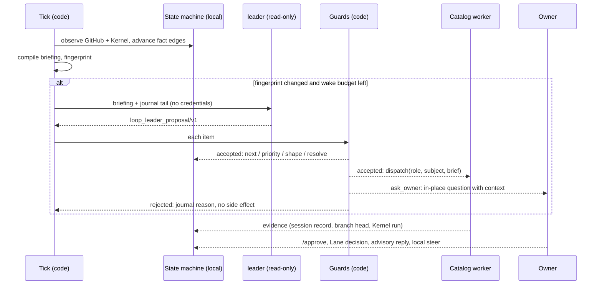

# Loop Leader: Resident Leader Agent, Project Role Catalog, and In-Context Human-in-the-Loop

- **Initiative**: `loop-leader` (short name `loop-leader`), follow-up to `loop-daemon` (`docs/specs/loop-daemon.spec.md`) and `loop-agent-scheduling` (`docs/specs/loop-agent-scheduling.spec.md`). Supersedes the unexecuted `loop-goal-leader` candidate (Issues #551–#556, closed as not planned).
- **Output language**: English (repository default; clarification ran in Chinese).
- **Design risk**: High — adds a persisted local leader journal and briefing, a typed cognitive proposal contract executed only through code guards, a project-level role catalog that changes how loop sessions resolve Host, model and limits (a user-visible configuration migration), retires the Tier-3 judging agent, extends the persisted `InteractionRequest` and `WorkItem` shapes, and adds one privileged Host tool on three Hosts.
- **Design views**: architecture layers, service/component interfaces, data flow, state transitions, temporal sequence. Data shapes (catalog, briefing, proposal, journal, interaction context) are fixed before the guard and dispatch logic that consumes them.
- **Diagram decision**: required
- **Diagram reason**: The split between the deterministic tick (observe, state machine, guards, dispatch, projection), the read-only leader that only proposes, and catalog workers spans several state owners and two interaction channels; a sequence diagram shows where authority sits at each step.
- **Execution posture**: Standard

## Outcome

`imm-loop` gains a logically resident, read-only `leader`. On every tick deterministic code compiles a local briefing from WorkItem, batch, interaction and journal state; when the briefing fingerprint changes and the wake budget allows, a fresh read-only leader session reads it and returns a typed `loop_leader_proposal/v1`. Code validates every proposal item against the work-item state machine, the project role catalog, Enrollment and publication authority, concurrency and budget before any side effect. Workers come only from the project role catalog (`loop.roles` in Git-tracked `.imm/config.json`), each bound to one closed capability base. When owner judgment is needed, the leader asks in place — on the Issue, PR, or Lane where the blocker lives — with a context pack; there is no unified inbox. The owner can steer with advisory focus and priority hints and with locally confirmed pause, resume, and abandon. There is no Goal entity: orchestration state stays in `WorkItem` and batch state, entirely local; GitHub is an observation input and a minimal projection target only.

| Slice | Task ID | Result when landed alone | Remaining gap | Risk | Blocked by | Scenarios |
| --- | --- | --- | --- | --- | --- | --- |
| `S1` | `loop-leader-s1-role-catalog` | `.imm/config.json` `loop.roles` resolves into a catalog with closed bases, limits and diagnostics shown by `imm-kernel config --json`; loop clarify, plan and repair sessions take Host, model, effort, limits and advisory instructions from the catalog; user-level bindings for those roles are ignored with `deprecated_config_source` | leader wake (`S2`), guarded dispatch (`S3`), replanning and in-context questions (`S4`), steering (`S5`) | `material` | — | exempt: configuration resolution only; the end-to-end effect is observed through `BR-SCN-2` in `S3` |
| `S2` | `loop-leader-s2-leader-briefing` | Each tick compiles a deterministic briefing; a read-only leader session runs only on a changed fingerprint within `loop.budget.max_leader_wakes_per_day`; proposals are strictly parsed and journaled under `.imm/state/loop/leader/` without executing anything | proposals have no effect until `S3` | `material` | `S1` | exempt: internal state only |
| `S3` | `loop-leader-s3-guarded-dispatch` | Proposal items `next`, `priority`, `shape` and `dispatch` execute after code guards; Initiative-shaped work runs as a local-carrier batch; the leader replaces the Tier-3 judging agent; ADR 0041 records the change | blocked-work replanning and in-context questions (`S4`), steering (`S5`) | `material` | `S2` | `BR-SCN-2` |
| `S4` | `loop-leader-s4-replan-context` | Escalated work items, batches in `needs_human`, Lane questions and repeated refusals are resolved by guarded `resolve` items or one in-context question carrying a context pack; replan rounds cap at 3; status lists where the owner is awaited, as links | steering (`S5`) | `material` | `S3` | `BR-SCN-1`, `BR-SCN-3` |
| `S5` | `loop-leader-s5-owner-steering` | Verified `@imm-loop focus` and `@imm-loop priority` comments become advisory journal hints; the privileged `steer_loop_work_item` Host tool pauses, resumes or abandons one work item under native confirmation on Claude Code, Pi and Antigravity; GitHub `pause`, `resume` and `abandon` comments get a notice and change nothing, including the retired daemon-wide comment pause (`BR-DEC-11`) | none — complete confirmed outcome | `material` | `S4` | `BR-SCN-4` |

## Sources and Discovery Evidence

- **Clarify manifest** (this session, 2026-11-17): `BR-REQ-1`–`BR-REQ-6`, `BR-DEC-1`–`BR-DEC-10`, `BR-OUT-1`–`BR-OUT-5`, `BR-DEFER-1`, `BR-SCN-1`–`BR-SCN-4`. Confirmed assumptions A1–A3 are recorded as `BR-DEC-7`, `BR-DEC-8`, `BR-DEC-9`. `BR-DEC-11` was decided by the owner on 2026-11-17 while resolving pre-enrollment review findings on this candidate set.
- **ADRs**: `docs/adr/0039-loop-daemon.md` (Decisions 2, 5, 6, 9, 10, 11, 13), `docs/adr/0040-loop-interaction-protocol.md` (Decisions 3, 4, 5), `docs/adr/0034-layered-configuration.md`, `docs/reference/layering-rules.md`.
- **Repository paths inspected**:
  - `plugins/immune-brain/runtime/config/agent_roles.ts:8-21` — closed `AgentRole` list including `judging`, `clarify`, `plan`, `repair`; `:112-124` preset bindings live at `agents.presets.<preset>.roles.<role>` (including the `"*"` wildcard) and a role key outside `AGENT_ROLES` is `config_invalid`, which drops the preset; `:192` `agentRole`; `:204` `resolveAgentRoles`.
  - `plugins/immune-brain/runtime/config/layered_config.ts:116-118` — `loop` is a project-only key; `:134-135,179-194` loop validation; `:347` `resolvedLoop`.
  - `plugins/immune-brain/runtime/loop_daemon/agent_runner.ts:28-45` — `AgentSessionKind`, `READ_ONLY_SESSION_ROLES`, fixed `ROLE_SESSION_LIMITS` (40 turns / 900 s); `:260` `loopRoleProfile` falls back to `claude-code`; read-only argv per Host near `:281`.
  - `plugins/immune-brain/runtime/loop_daemon/agent_handlers.ts:550` (limits lookup), `:1551` (executor profile from `agents`), `:1777` (`observeSingleTask`: every loop task runs as a single-task batch today).
  - `plugins/immune-brain/runtime/unattended/batch_plan.ts:66-69` — `observeInitiative` prefers the Local carrier `docs/initiatives/<slug>.md`.
  - `plugins/immune-brain/runtime/loop_daemon/judging_agent.ts:1-9,26,172` and `judgement.ts:13-15,237-272` — Tier-3 judging session picks one of the closed handlers; `cli.ts:1485-1488` wires it; `cli.ts:1058-1066` counts every judging invocation against `loop.budget.max_dispatches_per_day`; `reconcile.ts:23,231,242` reuses it to re-check model-skipped decisions (ADR 0039 Decision 7).
  - `plugins/immune-brain/runtime/loop_daemon/work_items.ts:33-60,92-111` — `WorkItemState`, `WORK_ITEM_TRANSITIONS`, `WorkItem` shape.
  - `plugins/immune-brain/runtime/loop_daemon/owner_commands.ts:13-27` — `pause`/`resume` map to `noop_record`, but `dispatch.ts:529-541` applies a verified `pause`/`resume` comment by setting or clearing the daemon-wide `state.paused`, which scheduler guard G1 honours; `dispatch.ts:551-574` turns every judged decision into a candidate without reading WorkItem state.
  - `plugins/immune-brain/runtime/loop_daemon/interaction/protocol.ts:19-55,73-74` — `InteractionRequest` v1 shape and binding; `clarify_question` and `escalation` are advisory, `plan_approval` and `lane_decision` are `literal_user`; `github_channel.ts:401-415` and `local_channel.ts:170-173` make `withdraw` final (comment rewritten as withdrawn, local request and answer deleted).
  - `plugins/immune-brain/runtime/loop_daemon/scheduler.ts:22-30,147` and `status_issue.ts:18,35` — priority classes and Status Issue rendering; `cli.ts:376` `status`.
  - `plugins/immune-brain/runtime/host-core/interaction.ts:19-27` — `PRIVILEGED_OPERATIONS` (with its Antigravity mirror) lists `answer_loop_interaction`; `host-core/mcp_runtime.ts:153` exposes it for Claude Code and Antigravity; Pi registers it in `plugins/immune-brain/.pi-extension/imm-canary-work.ts:1473`, and `tests/canary-command-retirement-contract.test.ts:39` pins the exact Pi tool list.
  - Generated mirrors: `plugins/immune-brain-antigravity/runtime/**` and both MCP bundles are outputs in `docs/agents/derived-files.json`; `plugins/immune-brain/dist/docs/reference/immune-brain-config.md` is synced by `scripts/sync-dist-docs.ts`.
- **Focused test prior art**: `tests/agent-roles-config.test.ts`, `tests/layered-config.test.ts`, `tests/loop-sched-role-sessions.test.ts`, `tests/loop-daemon-judge.test.ts`, `tests/loop-sched-interaction-github.test.ts`, `tests/loop-sched-interaction-local.test.ts`, `tests/loop-daemon-config-comms.test.ts`, `tests/loop-sched-scheduler.test.ts`, `tests/claude-host-authority.test.ts`, `tests/pi-canary-work-extension.test.ts`.

## Threat model and supported environment

- **Untrusted inputs**: Issue and PR text, comment bodies, CI logs, and leader output (which is model text derived from them). The leader is read-only, has no GitHub credential (`sessionEnvironment(null)`) and no shell tool, and reads only the local briefing copied into a disposable worktree. Every proposal item is typed data validated by code; no field is executed as a command.
- **Marker and mention injection**: leader-authored text rendered to GitHub (context packs, briefs quoted in comments) is sanitized — HTML comments are stripped so no `immune-brain:` marker can be forged, and `@name` mentions are neutralized so the daemon never notifies a third party.
- **Authority**: only the Kernel grants execution authority; `material`/`critical` Enrollment, breaking Intent revision, risk changes, merge, pause and abandon stay with the owner. GitHub replies still effect only `/approve` and Lane decisions (ADR 0040 Decision 4).
- **Supported environment**: macOS and Linux; Hosts `claude-code`, `pi`, `antigravity` as installed CLIs; one daemon per repository under the existing lock.

## User scenarios

| ID | Slice | Mode | Actor / Given / When / Then | Acceptance |
| --- | --- | --- | --- | --- |
| `BR-SCN-1` | `S4` | `automated` | **Actor**: Repository owner. **Given**: an Issue's work item is blocked on missing facts while `imm-loop` runs. **When**: the leader decides owner input is needed. **Then**: the owner sees one comment on that Issue stating what is blocked, what was tried, the options with consequences and evidence links, and `imm-loop status` lists that Issue as waiting with a link to the comment. | `S4-AC2` |
| `BR-SCN-2` | `S3` | `automated` | **Actor**: Repository owner. **Given**: `.imm/config.json` defines a `security-analyst` role with base `analyze`. **When**: the owner runs `imm-kernel config --json` and the leader later picks that role for an Issue touching auth. **Then**: the owner sees the role's resolved host, model and limits, and `imm-loop status --json` shows a read-only `security-analyst` session for that Issue; a role naming an unknown base shows a diagnostic and never appears as dispatched. | `S3-AC2` |
| `BR-SCN-3` | `S4` | `automated` | **Actor**: Repository owner. **Given**: a Lane escalates on a transient merge conflict. **When**: the leader evaluates the escalation. **Then**: the owner sees the work item resume in `imm-loop status` without being asked; for an approval-gated blocker the owner instead sees one in-context question. | `S4-AC1` |
| `BR-SCN-4` | `S5` | `automated` | **Actor**: Repository owner. **Given**: a work item is in progress. **When**: the owner pauses it from their local Host session and confirms the native prompt. **Then**: `imm-loop status` shows it paused and no new session starts for it; a `pause` comment on GitHub receives a notice naming the local action and changes nothing. | `S5-AC2` |

### Scenario Exemptions

- `S1`: no separate scenario — it changes configuration resolution and diagnostics only; the owner-observable result (catalog role dispatched and visible in status) needs `S3` and is covered by `BR-SCN-2`.
- `S2`: `no user-visible change` — briefing, wake and journal are internal; proposals execute nothing until `S3`.

## Brainstorm Trace

| Item | Summary | Mapping |
| --- | --- | --- |
| `BR-REQ-1` | Project-level role catalog `loop.roles` with closed bases, Host/model/effort, `when`, advisory `instructions`, `limits`; resolved output and diagnostics in `imm-kernel config --json` | `D1`; `S1-AC1`, `S1-AC2` |
| `BR-REQ-2` | Resident leader: read-only session woken on briefing fingerprint change within budget; rebuildable local journal; no GitHub access | `D2`; `S2-AC1`, `S2-AC2` |
| `BR-REQ-3` | Typed proposals executed only after code guards (role, base precondition, concurrency, budget); completion from evidence | `D3`; `S3-AC1`, `S3-AC2` |
| `BR-REQ-4` | Escalated/`needs_human` work resolved at orchestration level or handed to the owner; per-item replan cap | `D4`; `S4-AC1` |
| `BR-REQ-5` | Questions in place with a context pack; one pending question per subject and binding; status shows pointers only | `D4`, `D5`; `S4-AC2`, `S5-AC2` |
| `BR-REQ-6` | Owner steering: advisory `focus`/`priority`; local-only, natively confirmed `pause`/`resume`/`abandon` | `D5`; `S5-AC1`, `S5-AC2` |
| `BR-DEC-1` | Evolve `imm-loop` in place; no second daemon | Architecture layers; all Slices |
| `BR-DEC-2` | No Goal entity and no `GoalState` | `D3` (work-item shape); enforced by absence — no Goal store in any Slice |
| `BR-DEC-3` | All orchestration state local; GitHub is observation plus minimal projection; projection failure never blocks local progress; nothing restored from GitHub markers | `D2`, `D4`; `S2-AC2`, `S4-AC2` |
| `BR-DEC-4` | Leader replaces the judging agent; decision model unchanged; ADR 0041 amends ADR 0039 Decision 2 | `D3`; `S3-AC1` |
| `BR-DEC-5` | Loop-produced Initiatives are Local-carrier only; WorkItem records `initiative_slug` | `D3`; `S3-AC1` |
| `BR-DEC-6` | Projects may define new roles, each bound to one closed base that fixes entry, permission, output and approval preconditions | `D1`, `D3`; `S1-AC1`, `S3-AC2` |
| `BR-DEC-7` | Loop clarify/plan/repair/analyze roles resolve only from the project catalog; user-level bindings ignored with `deprecated_config_source`; `BR-DEFER-3` of loop-agent-scheduling withdrawn | `D1`; `S1-AC2` |
| `BR-DEC-8` | Catalog `execute` roles carry only leader-facing fields; Lane Host stays `agents.executor`; QA, code-review, review-verifier stay out | `D1`; `S1-AC1` |
| `BR-DEC-9` | A configured Host absent on the machine fails the role with a diagnostic, never a silent fallback; daemon identity only | `D1`; `S1-AC2` |
| `BR-DEC-10` | Authority unchanged: Kernel sole authority; owner keeps `material`/`critical` approval, merge, risk changes, breaking revisions; GitHub effects only `/approve` and Lane decisions; default channel `github` | `D3`, `D4`; `S3-AC1`, `S4-AC1` |
| `BR-DEC-11` | GitHub `@imm-loop pause`/`resume` lose their daemon-wide effect and only receive a notice; daemon-wide pause stays with local `imm-loop pause`/`resume` | `D5`; `S5-AC2` |
| `BR-OUT-1` | No second authority store, no Kernel bypass, no auto-merge | Out of scope; guarded in `D3`/`D4` |
| `BR-OUT-2` | No separate daemon, no IM or bot notifications | Out of scope |
| `BR-OUT-3` | No unified inbox | Out of scope; `D4` asks in place |
| `BR-OUT-4` | No `imm:goal:*` labels, no Parent body status block, no post-merge Goal verification | Out of scope; batch final verification and CI remain |
| `BR-OUT-5` | No user-level role catalog; no long-lived LLM session | Out of scope; `D1` project-only, `D2` wake-per-fingerprint |
| `BR-DEFER-1` | Local Web UI and Projects V2 sync | Deferred |
| `BR-SCN-1` | In-context question on the Issue plus status pointer | `S4` (`S4-AC2`) |
| `BR-SCN-2` | Custom `analyze` role resolved and dispatched; unknown base refused | `S3` (`S3-AC2`) |
| `BR-SCN-3` | Transient Lane blocker auto-resumed; approval-gated blocker asked in place | `S4` (`S4-AC1`) |
| `BR-SCN-4` | Local pause with native confirmation; GitHub pause gets a notice only | `S5` (`S5-AC2`) |

## Technical Design

### Architecture Layers and Dependency Direction

| Layer | Owner | Responsibility | May not |
| --- | --- | --- | --- |
| Observation | `observer.ts`, Kernel readers | One GitHub poll per tick; read `.imm/runs/*` and batch state | write anything |
| State machine | `work_items.ts`, `unattended/batch_state.ts` | WorkItem and batch transitions, refusals, replan rounds, pause flag | call models |
| Cognition | `leader` session (`leader_agent.ts`) | Read briefing and journal; emit `loop_leader_proposal/v1` | write files, reach GitHub, hold credentials |
| Guard and dispatch | `leader_dispatch.ts`, `guards.ts`, `dispatch.ts` | Validate each proposal item; run handlers and catalog workers | grant Enrollment or merge |
| Workers | catalog roles via `agent_runner.ts`, `drive` | clarify, plan, analyze, repair sessions; Lanes through `drive` | exceed their base's permission |
| Interaction and projection | `interaction/*`, `status_issue.ts` | In-place questions, Status Issue pointers | carry authority beyond ADR 0040 Decision 4 |

Dependency direction is top-down from the daemon composition root (`cli.ts`) into these modules; the leader module depends only on `agent_runner.ts` and its own contracts, never on `github_port.ts` (layering rule enforced by an import assertion in `tests/loop-leader-briefing.test.ts`).

### D1: Project Role Catalog (`S1`)

1. **Shape** — `loop.roles` in `.imm/config.json` is a map from role name (`^[a-z][a-z0-9-]{0,31}$`) to `{ base, host?, model?, effort?, when?, instructions?, limits? }`. `base` ∈ `leader | clarify | plan | execute | repair | analyze` (closed, code-owned). `host` ∈ `claude-code | pi | antigravity`. `when` is 1–500 characters. `instructions` is a repository-relative path to an existing file inside the repository root. `limits` = `{ turn_budget: 1–200, timeout_s: 60–3600, max_parallel: 1–8 }`, defaults 40 / 900 / 1. The key is project-only; a `loop` block in user configuration is already rejected (`layered_config.ts:117`).
2. **Base table** — fixed in code: `leader` (read-only, internal entry, proposal output, exactly one), `clarify` (read-only, framing JSON), `plan` (read-only; the daemon writes candidates from structured output), `execute` (Lane worktree write via `drive`; precondition Enrollment by `policy_auto` or `tracker_approval`), `repair` (writes only the daemon's own PR branch; precondition ADR 0039 Decision 10), `analyze` (read-only, analysis JSON per `LOOP_ANALYSIS_CONTRACT`). Configuration can never widen a base.
3. **Defaults** — when `loop.roles` is absent, or a base has no role, the catalog contains one built-in role named after the base with Host `claude-code` and default limits, preserving today's behaviour (`agent_runner.ts:260`).
4. **Diagnostics** (reported by `imm-kernel config --json`, role excluded from the catalog): `role_base_unknown`, `role_name_invalid`, `role_host_unknown`, `role_limit_out_of_range`, `role_instructions_outside_repo`, `role_instructions_missing`, `leader_role_duplicate`. `role_readonly_unsupported` keeps failing closed at spawn for a read-only base on a Host without verified read-only argv.
5. **Resolution output** — `loop.value.roles` lists each resolved role with `name`, `base`, `host`, `model`, `effort`, `when`, `instructions`, `limits`, `source` (`project` or `default`).
6. **Session use** — loop clarify, plan and repair sessions take Host, model, effort, `turn_budget` and `timeout_s` from the catalog role of their base instead of `agents` and `ROLE_SESSION_LIMITS`; `instructions` content is appended to the entry prompt under an "Advisory project instructions" heading and never changes tools, permission flags, or output contract.
7. **Migration** (`BR-DEC-7`) — bindings at `agents.presets.<preset>.roles.clarify|plan|repair` and the `"*"` wildcard no longer affect loop sessions. Whenever today's resolution for a loop role would have come from a preset binding (explicit role key or `"*"`), `imm-kernel config --json` reports one `deprecated_config_source` diagnostic per role naming the binding path and `loop.roles` in `.imm/config.json`; the session uses the catalog role (default `claude-code`). `agents.presets.*.roles.executor`, `code-review`, `review-verifier`, `advisory-reviewer` are unchanged (`BR-DEC-8`). `judging` stays as-is until `S3`.

   ADR 0041 retired presets before this Slice landed, so the bindings a loop role could still
   come from are the four agent roles: `agents.planner` fed `clarify` and `plan`, and
   `agents.executor` fed `repair`. A retired `agents.presets` key stays `config_invalid` and
   reaches no loop role, so the one notice per affected role names `agents.planner` or
   `agents.executor`; `agents.executor` keeps selecting the Lane Host (`BR-DEC-8`), and
   `agents.triage` keeps running `judging`.

8. **Host availability** (`BR-DEC-9`) — before spawn the runner resolves the Host binary on `PATH`; absence concludes the session `failed` with `role_host_unavailable` and starts no other Host.

### D2: Leader Briefing, Wake, and Journal (`S2`)

1. **Briefing** `loop_leader_briefing/v1` — a pure function of local state: open work items (target, state, revision, binding, refusals, replan rounds, paused flag), batch summaries for Initiative-shaped items, pending interactions (id, kind, subject), recent outcomes of handlers and workers (last 20), reconcile candidates (D3.4), catalog roles with `base` and `when`, owner hints, and budget availability. Serialized canonically; size cap 64 KiB (oldest outcomes dropped first, never work items). **Fingerprint** = sha256 over the briefing with timestamps and every field the wake itself changes removed: leader wake counts, journal entries about the leader's own proposals (`wake`, `proposal`, `rejected`, `accepted`), and exact budget counters. Budgets enter the fingerprint only as `available`/`exhausted`, so a wake with no new external or local fact cannot cause the next one.
2. **Wake rule** — after observe and fact transitions, the tick wakes the leader iff the fingerprint differs from the last journaled wake, `loop.budget.max_leader_wakes_per_day` (integer 0–500, default 48; 0 disables the leader) is not exhausted, `loop.budget.max_dispatches_per_day` is not exhausted, and no leader session is running. Each wake counts once against both budgets, as each Tier-3 judging invocation does today (`cli.ts:1058-1066`). `--dry-run` and `loop.mode: "observe"` compile and report the briefing but never wake.
3. **Session** — base `leader` from the catalog; read-only flags; disposable worktree containing only `.imm-loop/briefing.json` and `.imm-loop/journal-tail.jsonl` (last 50 entries); environment from `sessionEnvironment(null)`; output `.imm-loop/proposal.json`.
4. **Proposal** `loop_leader_proposal/v1` = `{ contract, briefing_fingerprint, items[≤20] }`; item = `{ target, action }` with action one of `next{handler}`, `priority{rank}`, `shape{plan: "task"|"initiative", reason}`, `dispatch{role, subject, brief}`, `resolve{kind: "resume"|"release"|"replan"|"ask_owner", context?}`, `note{text}`. Parser rejects the whole proposal on non-JSON output, wrong contract, or fingerprint mismatch; it rejects single items on unknown target, unknown handler, unknown role, `brief` over 16 KiB, or `ask_owner` without `context`.
5. **Journal** `.imm/state/loop/leader/journal.jsonl` (mode 0600), entries `loop_leader_journal/v1` `{ seq, at, kind: wake|proposal|rejected|accepted|owner_hint|outcome, fingerprint, payload }`; rotated at 2 MiB keeping one previous file. It is advisory memory, never authority.
6. **Rebuild** (`BR-DEC-3`) — losing `leader/` yields an empty journal; the next tick wakes once on the fresh fingerprint. Nothing is restored from GitHub. Daily wake counts live in the existing daemon budget state.

### D3: Guarded Dispatch, Initiative Shape, and Judging Retirement (`S3`)

1. **Guards per item** — `next`: handler in the closed catalogue and legal from the item's state per `WORK_ITEM_TRANSITIONS` plus existing `guards.ts` checks. `priority`: stored as `WorkItem.leader_rank`, used only as a tie-break inside one `SCHEDULE_PRIORITY` class. `shape`: only in `triage` or `planning` before plan publication. `dispatch`: role present in the catalog, base precondition met (`execute` only through `enroll_and_drive` with existing Enrollment authority; `repair` only on the daemon's PR branch), per-role running sessions below `max_parallel`, global `loop.max_concurrent` and `max_dispatches_per_day` respected. Any failed guard journals `rejected` with a reason code and causes zero side effects.
2. **Completion from evidence** — a dispatched session counts as done only from its session record outputs, branch head, or Kernel run projection (ADR 0039 Decision 2), never from its own claim.
3. **Initiative shape** (`BR-DEC-5`) — for `shape{plan:"initiative"}` the plan role returns slices; the daemon writes `docs/initiatives/<slug>.md` in the Local carrier shape (one `## <slice-id>: <result>` section, one Task under `Tasks:`, optional `Blocked by:`) plus one TaskIntent per slice through `imm-kernel intent author`. `WorkItem.binding.initiative_slug` is recorded; the plan digest covers the carrier and every TaskIntent; `driving` runs `observeInitiative` instead of `observeSingleTask`. Nothing is published to a GitHub tracker.
4. **Judging retirement** (`BR-DEC-4`) — `judging` leaves `READ_ONLY_SESSION_ROLES`, `ROLE_SESSION_LIMITS` and `AgentSessionKind`; `judging_agent.ts` is deleted. A Tier-2 `needs_judging` outcome no longer starts a session: it applies the point baseline as today's unavailable-judge path does, and records the event in the briefing so the next leader wake may propose a `next` for that target. **Reconcile** (`reconcile.ts`, manual and scheduled) no longer calls a judging agent: model-skipped decisions (`ignore`/`discussion`/`duplicate`) since the last pass become briefing reconcile candidates, and a leader `next` for such a target passes the same Tier-0 guards the judging override passes today. **Config tolerance**: a preset binding `roles.judging` stays parseable — it is ignored with one `deprecated_config_source` diagnostic and never makes the preset or the `agents` table `config_invalid`; executor, code-review and review-verifier resolve exactly as before. Decision-model Tier 2 is unchanged.
5. **Status** — `imm-loop status --json` lists running catalog sessions as `{ target, role, base, started_at }`.
6. **ADR 0041** records leader plus catalog replacing ADR 0039 Decision 2's fixed agent kinds, Decision 6's Tier 3, and Decision 7's judging re-check of model skips (now a leader briefing input).

### D4: Replanning and In-Context Questions (`S4`)

1. **Triggers** — WorkItem `escalated`; batch `needs_human` for Initiative-shaped items; Lane decision events; three refusals of the same transition. Each appears in the briefing as `blocked` with its evidence.
2. **Resolve guards** — `resume` (batch resume), `release` (`escalated -> triage`), `replan` (new plan session; for Initiatives a new digest and new plan approval) are allowed only for orchestration-level blockers. Authority-gated blockers — pending `material`/`critical` approval, breaking Intent revision, risk change, merge, a Lane decision whose authority is `literal_user` — accept only `ask_owner`; any other action is rejected.
3. **Replan cap** — `WorkItem.replan_rounds` increments per accepted `resume`, `release` or `replan`; at 3 the item is forced to `ask_owner` with reason `replan_cap_reached`, so a blocker that survives repeated resumes ends with the owner rather than looping until the daily wake budget resets.
4. **Context pack** — `InteractionRequest.context` (optional; contract stays v1 and older requests read unchanged) = `{ blocked_on, tried[], options[{id, label, consequence}], evidence[{label, ref}] }`, rendered at most 8 KiB, sanitized per the threat model. The GitHub channel posts it on the request's own subject Issue or PR; the local channel stores it and `loop_interactions` returns it. Context is explanation only; ADR 0040 Decision 4 still limits effective GitHub replies.
5. **One question per subject** — among advisory requests (`clarify_question`, `escalation`) a new request for the same subject and binding supersedes the pending one; a binding change retires it (ADR 0040 Decision 5). A pending `literal_user` request (`plan_approval`, `lane_decision`) is never withdrawn or superseded by the leader: `ask_owner` on its subject attaches the context pack to it through a new channel operation `annotate(interaction_id, context)` — the GitHub channel edits that request comment's context section in place and the local channel rewrites the stored request — keeping `interaction_id`, kind, binding and answer semantics unchanged.
6. **Pointers** — `imm-loop status --json` lists `waiting[]` `{ target, kind, channel, link }`; the Status Issue renders a "Waiting on owner" list of links without question text. Projection failures are logged and retried next tick without blocking local transitions.

### D5: Owner Steering and Status (`S5`)

1. **Advisory hints** — verified `@imm-loop focus <text>` and `@imm-loop priority <high|normal|low>` comments (existing `owner_commands.ts` verification) become `owner_hint` journal entries and briefing fields; they never move state directly.
2. **Local steering** — privileged Host tool `steer_loop_work_item` `{ target, action: pause|resume|abandon, reason? }` is added to `PRIVILEGED_OPERATIONS` (`host-core/interaction.ts`), exposed through the MCP runtime for Claude Code and Antigravity and registered in the Pi extension, always under native confirmation; it writes one request under `.imm/state/loop/steering/` and the daemon applies it next tick. `pause` sets `WorkItem.paused`; `resume` clears it; `abandon` moves the item to the new terminal state `abandoned` from any non-terminal state and does not stop a running Kernel run. **Dispatch gate**: before any candidate is built — event-driven Tier-1/2 decisions in `dispatch.ts`, leader items, and scheduler admission — a decision whose target is `paused` or `abandoned` yields no candidate and is recorded as `skipped` with reason `work_item_paused` or `work_item_abandoned`; fact transitions are still recorded.
3. **GitHub commands** (`BR-DEC-11`) — `@imm-loop pause|resume|abandon` post one `notice` naming the local action and change nothing, replacing both today's `noop_record` mapping and the daemon-wide effect in `dispatch.ts:529-541`. Daemon-wide pause and resume remain available only locally through `imm-loop pause|resume` (`cli.ts:313-314`), and the Status Issue keeps showing a locally set pause.
4. **Status** — `imm-loop status --json` adds `paused` items and `leader { last_wake_at, wakes_today, last_proposal_items }`.

### Compatibility, Interruption Recovery, and Rollback

- **Persisted shapes** — `WorkItem` gains optional `leader_rank`, `replan_rounds`, `paused`, `binding.initiative_slug`; readers default missing fields. `InteractionRequest.context` is optional. `abandoned` is additive to `WorkItemState`.
- **Configuration migration** — repositories without `loop.roles` keep today's Host, model and limits for loop sessions only when no preset binds `clarify`, `plan` or `repair` (explicitly or through `"*"`); where one does, loop sessions switch to the catalog default `claude-code` and the owner sees one `deprecated_config_source` diagnostic per affected role. Preset `judging` bindings are tolerated and reported, never invalidating the `agents` table.
- **Retired control** (`BR-DEC-11`) — the GitHub `@imm-loop pause`/`resume` daemon-wide effect documented in `docs/specs/loop-daemon.spec.md` D3.4 is retired; a remote owner gets a notice naming `imm-loop pause` instead.
- **Interruption** — the leader is idempotent per fingerprint; a crash mid-session leaves no journal `proposal` entry, so the next tick wakes again. Steering requests are applied once (request file removed after apply).
- **Rollback** — each Slice lands green alone: `S1` is configuration, `S2` journals only, `S3` adds execution behind guards (`max_leader_wakes_per_day: 0` disables it), `S4` and `S5` add triggers and tools. Reverting a later Slice leaves earlier ones working.

## Verification and Acceptance Mapping

| Acceptance | Slice | Agreed seam | Positive control | Enumerated negative cases | Bound / fault control |
| --- | --- | --- | --- | --- | --- |
| `S1-AC1` | `S1` | `tests/loop-role-catalog.test.ts` | `loop.roles` with `leader`, `planner` (base `plan`), `security-analyst` (base `analyze`) resolves with `source: project`; absent `loop.roles` yields one default role per base | unknown base → `role_base_unknown`; bad name → `role_name_invalid`; `instructions` `../x.md` → `role_instructions_outside_repo`; missing file → `role_instructions_missing`; two `leader` roles → `leader_role_duplicate`; `turn_budget: 0` → `role_limit_out_of_range` | `max_parallel: 9` and `timeout_s: 59` rejected; `max_parallel: 8` accepted |
| `S1-AC2` | `S1` | `tests/loop-sched-role-sessions.test.ts`, `tests/agent-roles-config.test.ts` | clarify, plan, repair sessions use catalog Host, model, `turn_budget`, timeout; instructions appended as advisory text | explicit `agents.presets.
.roles.plan` binding and a `"*"` wildcard binding to `pi` are ignored for loop sessions, each reported once as `deprecated_config_source`; Host binary absent → `role_host_unavailable` with no spawn of another Host; read-only argv never contains write-permission flags | `agents.executor` still selects the Lane Host |
| `S2-AC1` | `S2` | `tests/loop-leader-briefing.test.ts` | changed fingerprint wakes one read-only leader session, journals `wake` and `proposal`, and counts once against both budgets | unchanged fingerprint → zero sessions; two consecutive ticks with no new fact after a wake → zero further sessions; leader wake budget 0 or exhausted `max_dispatches_per_day` → zero sessions; `--dry-run` → zero sessions; leader module imports nothing from `github_port.ts`; session environment has no GitHub token | briefing over 64 KiB drops oldest outcomes, never work items |
| `S2-AC2` | `S2` | `tests/loop-leader-briefing.test.ts` | valid proposal parses into typed items and is journaled; no state, interaction or GitHub write occurs | prose output, wrong contract, fingerprint mismatch → whole proposal rejected; unknown role, unknown handler, oversize `brief`, `ask_owner` without context → item rejected | deleting `.imm/state/loop/leader/` rebuilds an empty journal and wakes once |
| `S3-AC1` | `S3` | `tests/loop-leader-dispatch.test.ts`, `tests/loop-daemon-judge.test.ts`, `tests/loop-daemon-decision-model.test.ts`, `tests/agent-roles-config.test.ts` | legal `next` runs its handler; `priority` reorders ties within a class; `shape: initiative` writes a Local carrier and TaskIntents, records `initiative_slug`, and drives via `observeInitiative`; reconcile lists model-skipped decisions as briefing candidates | illegal transition, `dispatch` of `execute` without Enrollment authority, `repair` on a non-daemon branch, `shape` after plan publication → rejected with zero side effects; `needs_judging` starts no session and applies the baseline; reconcile starts no judging session; a preset `roles.judging` binding → `deprecated_config_source` while `agents.valid` and the executor Host stay unchanged | `priority` never lifts an item above a higher class; no GitHub tracker write for loop Initiatives |
| `S3-AC2` | `S3` | `tests/loop-leader-dispatch.test.ts` | `dispatch` to `security-analyst` starts one read-only session and `imm-loop status --json` lists it with role and base | role absent from catalog (including one dropped for `role_base_unknown`) → rejected, never listed; `max_parallel` reached → rejected | daily dispatch budget exhausted → rejected |
| `S4-AC1` | `S4` | `tests/loop-leader-replan.test.ts` | `resume` on a transient Lane escalation resumes the batch without an owner question; `release` moves `escalated -> triage` | `resume`/`release`/`replan` on a `material` approval, breaking revision or `literal_user` Lane decision → rejected; only `ask_owner` accepted | three accepted `resume`s on a batch that keeps re-escalating force `ask_owner` with `replan_cap_reached` |
| `S4-AC2` | `S4` | `tests/loop-sched-interaction-github.test.ts`, `tests/loop-sched-interaction-local.test.ts` | `ask_owner` posts one comment on the subject Issue with blocked-on, tried, options and evidence; local requests and `loop_interactions` carry the same context; status lists a `waiting` pointer with link | HTML comments and `@` mentions in context are neutralized; a second advisory ask for the same subject and binding supersedes rather than duplicates; `ask_owner` on a subject with a pending `lane_decision` or `plan_approval` annotates it in place, never withdraws it, and the owner's answer is still accepted; a reply carrying context-only text effects nothing beyond ADR 0040 Decision 4 | context over 8 KiB truncated with a marker; failed GitHub post does not block local transitions |
| `S5-AC1` | `S5` | `tests/loop-daemon-config-comms.test.ts` | verified `@imm-loop focus`/`priority` comments become journal hints present in the next briefing | unverified author or edited comment → ignored; hint never changes WorkItem state | — |
| `S5-AC2` | `S5` | `tests/loop-leader-steering.test.ts`, `tests/loop-daemon-dispatch.test.ts`, `tests/claude-host-authority.test.ts`, `tests/pi-canary-work-extension.test.ts`, `tests/canary-command-retirement-contract.test.ts` | `steer_loop_work_item` pause, confirmed natively, marks the item paused and status shows it; resume clears it; abandon reaches `abandoned` | denied native confirmation writes nothing; a paused or abandoned item whose Issue keeps producing new facts (failing CI, `ready-for-agent`) gets no candidate from Tier-1/2 dispatch, scheduler or leader; GitHub `pause`/`resume` comments get one notice and leave both the item and daemon-wide `state.paused` unchanged; abandon leaves a running Kernel run untouched | tool listed in `PRIVILEGED_OPERATIONS` and registered on Claude Code, Pi and Antigravity; local `imm-loop pause` still holds all dispatch |

Derived-output checks (`scripts/sync-dist-docs.ts --check`, `scripts/build-claude-plugin.ts --check`, `scripts/build-antigravity-plugin.ts --check`) and `bun run typecheck` run with each Slice's first acceptance.

## Devil's Advocate Audit

| Challenge | Resolution |
| --- | --- |
| **Rollback resilience**: journal or work-item files are lost mid-run | Journal is advisory and rebuilds empty (`S2-AC2`); WorkItem state already rebuilds from GitHub and Kernel (`rebuild.ts`); nothing is restored from GitHub markers. |
| **Rollback resilience**: `S3` lands and the leader misbehaves | `loop.budget.max_leader_wakes_per_day: 0` disables wakes; Tier-2 baseline keeps the loop running as it does today without a judge (`S3-AC1`). |
| **Rollback resilience**: the leader wakes itself in a loop and burns the budget | The fingerprint excludes leader-mutated fields and quantizes budgets (`D2.1`); wakes count against `max_dispatches_per_day` (`D2.2`); `S2-AC1` asserts no further wake without a new fact. |
| **Verification vanity**: tests pass by exercising the parser only | `S3-AC1`/`S3-AC2` assert side effects (handler run, session listed, zero writes on rejection), and `S4-AC1` asserts authority-gated rejections — not just parsing. |
| **Verification vanity**: "read-only leader" is only a prompt instruction | Read-only is enforced by Host argv flags and a credential-free environment (`S1-AC2`, `S2-AC1`), and every effect passes code guards. |
| **Spec dilution**: the leader quietly approves or merges | No proposal action maps to Enrollment approval or merge; authority-gated blockers accept only `ask_owner` (`S4-AC1`); `execute` dispatch requires existing Enrollment authority (`S3-AC1`). |
| **Spec dilution**: in-context questions drift back into an inbox | Status lists pointers only (`S4-AC2`); question text lives only on its subject. |
| **Outcome conservation** | Every `BR-*` item maps once in the Brainstorm Trace; `S1`–`S5` together deliver catalog, resident leader, guarded dispatch, replanning with in-context questions, and steering. No phase is narrowed. |
