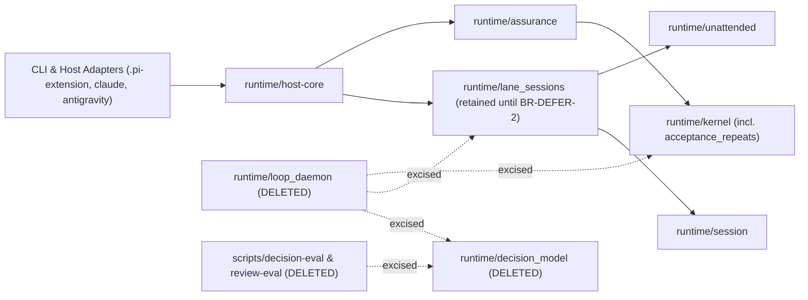

# Retire In-Repo Loop Daemon, Decision Model, and Offline Eval Suites (ADR 0043 Slice 1)

- **Status**: Candidate; no execution authority.
- **Task ID**: `retire-loop-daemon`
- **Design risk**: High — cross-module retirement spanning CLI entrypoints (`v4_runtime.ts`, `imm-kernel`), three Host tool surfaces (Claude MCP, Antigravity MCP, Pi extension), fail-closed `v2` layered configuration validation and migration, Kernel Enrollment confirmation membrane narrowing, offline evaluation suites (`scripts/decision-eval/`, `scripts/review-eval/`), packaged Host plugin bundles, and ADR supersession (`ADR 0043` accepted; `ADRs 0039/0040/0042` superseded).
- **Design views**: architecture layers, service/component interfaces, data flow. (`state transitions` and `temporal sequence` are omitted because Slice 1 introduces no new state machine or multi-step runtime protocol: it deletes the frozen `loop_daemon` state machine and narrows configuration and confirmation checks synchronously.)
- **Diagram decision**: required
- **Diagram reason**: clarifies which composition roots and cross-layer edges are excised in Slice 1 versus retained intact for interactive `drive` until `BR-DEFER-2`.
- **Threat model and supported environment**: Inputs come from local JSON configuration files (`~/.config/immune-brain/config.json` and `.imm/config.json`), CLI arguments (`v4_runtime.ts`, `imm-kernel`), and Host MCP/extension tool calls in a developer workstation; adversary is stale `v2` configuration files still carrying retired `loop` or `decision_models` keys or callers invoking retired Loop tools/commands or confirmation sources; supported environment is macOS and Linux with Bun, SQLite, and UTF-8 JSON in SHA-1 or SHA-256 Git repositories.
- **Document language**: English (following BASELINE Output Language Policy; user-facing chat replies remain Chinese).

---

## 1. Outcome and Slice Horizon

Slice 1 retires the frozen in-repository Loop daemon (`plugins/immune-brain/runtime/loop_daemon/`, `bin/imm-loop`, `skills/imm-loop/`), the hosted decision-model subsystem (`plugins/immune-brain/runtime/decision_model/`), both offline evaluation suites that depend on it (`scripts/decision-eval/` and `scripts/review-eval/`), the three Host Loop tools (`loop_interactions`, `answer_loop_interaction`, `steer_loop_work_item`), ADR 0039's unattended confirmation membrane (`tracker_approval` and `policy_auto`), and the `loop` / `decision_models` configuration keys (enforced fail-closed as `config_invalid`), while accepting `ADR 0043` and superseding `ADRs 0039`, `0040`, and `0042`. Interactive single-task and Initiative `drive` (`runtime/unattended/`, `runtime/lane_sessions/`, `start_unattended_batch`, `retire_stale_batch`) remain untouched so Slice 1 and Slice 2 self-host safely.

| Slice | Closable result when landed | Remaining gap after this Slice |
| --- | --- | --- |
| **Slice 1 (`retire-loop-daemon` — this TaskIntent)** | `loop_daemon/`, `imm-loop` CLI & Skill, `decision_model/`, `scripts/{decision-eval,review-eval}/`, active Loop/eval specs & sidecars, `loop_interactions`/`answer_loop_interaction`/`steer_loop_work_item` across Host adapters, `imm-kernel inspect --json` `loop` field, and live `tracker_approval`/`policy_auto` admission are deleted; `v2` config rejects `loop` and `decision_models` fail-closed (`config_invalid` blocking `batchConfigErrors` / `drive`) and `imm-kernel config migrate --write` strips them; `ADR 0043` is `accepted` and `ADRs 0039/0040/0042` are `superseded by ADR-0043`; Claude, Antigravity, and `dist/` artifacts are regenerated and release-clean | **Slice 2 (`BR-DEFER-1`)**: implement the `takt/gate/v1` (`stdin GateRequest -> stdout GateResponse`) CLI bridge in `immune-brain` consuming Ed25519 `ApprovalProof` from `takt <state-dir>/keys/approval_ed25519.pub`, relaying blocking decisions, returning `.imm/audit/<task-id>/` `proof_ref`, and verifying live via `.takt/local.json` and `takt tick`. **Slice 3 (`BR-DEFER-2`)**: decouple interactive single-task `/drive` from `BatchRunStateRecord` / Initiative orchestration into a pure single-task Kernel path, retire `runtime/unattended/`, and amend `ADR 0005`. |

---

## 2. Discovery Evidence

- **Reverse runtime edges into `loop_daemon/` and `decision_model/` (`HEAD b4ec48210a0`)**:
  - `plugins/immune-brain/runtime/v4_runtime.ts:299,407-416` routes `cli imm-loop` and advertises `imm-loop` examples.
  - `plugins/immune-brain/runtime/commands/kernel.ts:58,334` imports `inspectLoopDaemonState` and emits top-level `loop` in `imm-kernel inspect --json`.
  - `plugins/immune-brain/runtime/config/layered_config.ts:6-10,38-80,199-339` imports `resolveLoopRoles`, `parseProfiles`, `PROVIDER_KINDS`, `SENSITIVE_CATEGORIES`, and `POINT_REGISTRY`, resolves `loop` and `decision_models`, and filters `batchConfigErrors` (`:337-339`) only on `agents`, `batch`, `session_providers`, `$`, and `contract`.
  - `plugins/immune-brain/runtime/config/migrate.ts:15,154-201` imports `POINT_REGISTRY` from `../decision_model/thresholds.ts` and writes `decision_models` / `loop` while stripping retired `herdr`.
  - `plugins/immune-brain/runtime/host-core/loop_interactions.ts:1-46`, `runtime/host-core/runtime.ts:89-115`, `runtime/host-core/mcp_runtime.ts:154-158,215-260,507-560`, `runtime/host-core/interaction.ts:26-28`, and `plugins/immune-brain/.pi-extension/imm-canary-work.ts:1426-1545` register and execute `loop_interactions`, `answer_loop_interaction`, and `steer_loop_work_item` across Claude MCP, Antigravity MCP, and Pi.
  - `plugins/immune-brain/runtime/kernel/enrollment_confirmation.ts:1-180`, `runtime/kernel/types.ts:18`, `runtime/unattended/batch_agreement.ts:8,58`, and `runtime/unattended/batch_state.ts:906-907` encode ADR 0039's `tracker_approval` and `policy_auto` sources.
- **Offline eval and Kernel boundary**:
  - `tsconfig.json:24` includes `scripts/**/*.ts`; both `scripts/decision-eval/**` and `scripts/review-eval/{prescreen,report}.ts` import `plugins/immune-brain/runtime/decision_model/`.
  - `plugins/immune-brain/runtime/kernel/acceptance_repeats.ts:38` is imported by live Assurance Kernel code (`plugins/immune-brain/runtime/assurance/coordinator.ts:17,2122`) to compute `generalize_or_refute` streaks and MUST remain intact (`BR-DEC-2`), whereas `tests/acceptance-repeat-series.test.ts:105-140` has a cross-check against `scripts/review-eval/` that is trimmed to pure Kernel coverage.
- **Packaging, derived manifests, and Spec-binding note**:
  - `package.json:66,86,108`, `plugins/immune-brain/skills/registry.yaml`, `scripts/dist-sync-manifest.ts:179-184`, `docs/agents/derived-files.json:55,79,137-144,150,196-241,305`, `tests/claude-host-package.test.ts:353`, `tests/antigravity-host-package.test.ts:44`, and `tests/e2e/install.e2e.ts:20-28` enumerate `imm-loop`, `decision_model`, `loop_daemon`, and the three Loop tools.
  - Per `plugins/immune-brain/runtime/kernel/spec_binding.ts:84-95`, `TaskIntent.scope_hint` may list at most one `docs/specs/<name>.spec.md` path (`docs/specs/retire-loop-daemon.spec.md`); retired active specs (`docs/specs/{decision-model-core,a15-real-eval,review-verifier-eval,loop-daemon,loop-agent-scheduling,loop-leader,loop-leader-review-fixes,loop-leader-uls-alignment}.spec.md`) and unarchived Loop/eval `docs/plans/*.intent.json` sidecars are deleted per `D4` and disclosed as `beyond_estimate` in Review evidence (`ADR 0028`).

---

## 3. Technical Design

### 3.1 Architecture Layers

- **Layer responsibilities & dependency direction**: Preserves `kernel <- assurance <- host-core <- adapters (claude, antigravity, .pi-extension) <- CLI` (`docs/reference/layering-rules.md`). Excises the 4th composition root (`runtime/loop_daemon/`), `runtime/decision_model/`, `runtime/host-core/loop_interactions.ts`, and `scripts/{decision-eval,review-eval}/`.
- **Ownership & prohibited coupling**: `runtime/kernel/` owns Enrollment confirmation (`user_session` only in Slice 1) and `acceptance_repeats.ts`; `runtime/config/` owns `v2` config parsing/migration with zero imports from `loop_daemon` or `decision_model`; no file in `plugins/`, `scripts/`, or `tests/` may import `loop_daemon` or `decision_model`.

### 3.2 Service / Component Interfaces and Decisions

- **D1 — Retire CLI, Skill, Package, and Multi-Host Loop Tool Surfaces** *(Source: `BR-REQ-1`)*:
  - Delete `plugins/immune-brain/runtime/loop_daemon/`, `plugins/immune-brain/bin/imm-loop`, `plugins/immune-brain/skills/imm-loop/`, `plugins/immune-brain/dist/imm-loop.md`, `plugins/immune-brain/runtime/decision_model/`, and `plugins/immune-brain/runtime/host-core/loop_interactions.ts`.
  - Remove `"imm-loop"` from `package.json` (`bin` and `files` entries `runtime/decision_model`, `runtime/loop_daemon`), `plugins/immune-brain/runtime/v4_runtime.ts`, `plugins/immune-brain/skills/registry.yaml`, `scripts/dist-sync-manifest.ts`, and `docs/agents/derived-files.json`. Invoking `v4_runtime.ts cli imm-loop ...` returns the standard unknown-CLI-target non-zero error.
  - Remove `loop_interactions`, `answer_loop_interaction`, and `steer_loop_work_item` registrations, schemas, privileged-operation entries, and handlers from `runtime/host-core/{mcp_runtime,runtime,interaction}.ts` and `plugins/immune-brain/.pi-extension/imm-canary-work.ts`.
  - Regenerate `plugins/immune-brain/dist/` (`bun scripts/sync-dist-docs.ts`), `plugins/immune-brain/dist/claude/mcp-server.mjs` (`bun scripts/build-claude-plugin.ts`), and `plugins/immune-brain-antigravity/` (`bun scripts/build-antigravity-plugin.ts`, removing stale generated `imm-loop`, `loop_daemon`, `decision_model`, and `loop_interactions` outputs).
- **D2 — Narrow `imm-kernel inspect --json` and Live Enrollment Confirmation Membrane** *(Source: `BR-REQ-1`)*:
  - Remove `inspectLoopDaemonState` and the top-level `loop` property from `imm-kernel inspect --json` in `plugins/immune-brain/runtime/commands/kernel.ts:58,334`.
  - Narrow live Enrollment confirmation in `plugins/immune-brain/runtime/kernel/types.ts:18`, `runtime/kernel/enrollment_confirmation.ts`, and `runtime/unattended/batch_agreement.ts:8,58` to `"user_session"` (and `"native_gate"` for `BatchAgreement`): passing `"tracker_approval"` or `"policy_auto"` to `verifyEnrollmentConfirmation` or `authorizeBatch` fails closed (`unknown_confirmation_source` / invalid confirmation source). Historical `BatchRunStateRecord` / `TaskRecord` deserialization (`runtime/unattended/batch_state.ts`, `runtime/kernel/legacy_task_record.ts`) remains read-tolerant of already-settled archived records.
- **D3 — Fail-Closed `v2` Config Removal of `loop` & `decision_models` and Migration Cleanup** *(Source: `BR-DEC-3`)*:
  - Remove `"loop"` and `"decision_models"` from `FILE_KEYS` (`layered_config.ts:79`) and from the returned `EffectiveConfig` object (`layered_config.ts:318-331`), along with `LoopConfig`, `DEFAULT_LOOP_CONFIG`, `resolveLoopRoles`, `parseProfiles`, and the `loop.roles` / `agents.triage` / `preset_judging` `deprecated_config_source` warning blocks (`agent_roles.ts` / `layered_config.ts`).
  - Update `batchConfigErrors(config)` (`layered_config.ts:337-339`) so top-level `config_invalid` diagnostics (including unknown top-level keys `"loop"` and `"decision_models"` in either `~/.config/immune-brain/config.json` or `.imm/config.json`) are included in `batchConfigErrors`, causing `imm-kernel config --json` to exit `1` and `start_unattended_batch` (`drive`) to refuse with `lane_config_invalid` rather than silently ignoring them.
  - Update `plugins/immune-brain/runtime/config/migrate.ts` to drop `../decision_model/thresholds.ts`, stop synthesizing `decision_models` or `loop` from `v1`/legacy files, and strip top-level `loop` and `decision_models` keys (alongside `herdr`) from `v2` user and project files when `imm-kernel config migrate --write` runs.
- **D4 — Delete Offline Eval Suites, Active Loop/Eval Artifacts, and Coupled Tests** *(Source: `BR-DEC-2`)*:
  - Delete `scripts/decision-eval/`, `scripts/review-eval/`, `tests/fixtures/decision-eval/`, `tests/fixtures/review-eval/`, active candidate specs (`docs/specs/{decision-model-core,a15-real-eval,review-verifier-eval,loop-daemon,loop-agent-scheduling,loop-leader,loop-leader-review-fixes,loop-leader-uls-alignment}.spec.md`), unarchived Loop/decision-model/review-eval `docs/plans/*.intent.json` sidecars, and retired test files (`tests/{loop-daemon-*,loop-leader-*,loop-sched-*,loop-role-catalog,decision-model,decision-eval-*,review-eval-*}.test.ts`).
  - Retain `plugins/immune-brain/runtime/kernel/acceptance_repeats.ts` for `runtime/assurance/coordinator.ts:17,2122` and keep pure Kernel unit coverage in `tests/acceptance-repeat-series.test.ts` (removing only imports/assertions referencing `scripts/review-eval/`).
- **D5 — Accept ADR 0043, Supersede ADRs 0039/0040/0042, and Sync Active Contracts** *(Source: `BR-REQ-2`, `BR-OUT-1`)*:
  - Update `docs/adr/0043-loop-daemon-freeze-and-extraction.md` frontmatter and status line to `status: accepted`, aligning its cutover sequence note with Slice 1 (`retire-loop-daemon`) -> Slice 2 (`BR-DEFER-1`, `takt/gate/v1`) -> Slice 3 (`BR-DEFER-2`, single-task `/drive` decoupling & `runtime/unattended/` retirement).
  - Mark `docs/adr/0039-loop-daemon.md`, `docs/adr/0040-loop-interaction-protocol.md`, and `docs/adr/0042-loop-leader-role-catalog.md` as `status: superseded by ADR-0043` while keeping `docs/adr/0038-supervised-session-port.md` `status: accepted` and intact.
  - Amend `docs/adr/0041-simplified-configuration.md` (retiring `loop` and `decision_models` clauses), replace active ADR 0039 grant/source amendments in `docs/adr/{0005,0006,0019,0025}` with supersession notes (retaining ADR 0005's interactive batch architecture until `BR-DEFER-2`), and remove active `imm-loop`, `Loop daemon`, `Interaction Request`, `Interaction Channel`, and `Decision model` entries from `CONTEXT.md`, `plugins/immune-brain/BASELINE.md` (+ `skills/BASELINE.md`), `plugins/immune-brain/skills/fix-pr/SKILL.md`, `docs/reference/immune-brain-config.md`, `docs/reference/immune-brain-skills-guide.md`, `plugins/immune-brain/README.md`, and `docs/user_manual.md`. Historical `.imm/audit/` and `docs/*/archive/` files remain untouched (`BR-OUT-1`).

### 3.3 Data Flow

1. **CLI dispatch (`v4_runtime.ts` / `imm-kernel`)**: `argv` -> command table without `imm-loop` -> `imm-loop` exits non-zero with unknown-command stderr; `imm-kernel inspect --json` reads SQLite claim/projection/risk floor and writes JSON without `loop`.
2. **Configuration validation & migration (`layered_config.ts` / `migrate.ts`)**: `config.json` / `.imm/config.json` -> `read()` checks `FILE_KEYS` (without `loop` or `decision_models`) -> unknown key records `{ code: "config_invalid", severity: "error", key_path: "loop" | "decision_models" }` -> `imm-kernel config --json` exits `1` and `batchConfigErrors()` blocks `start_unattended_batch` with `lane_config_invalid`; `imm-kernel config migrate [--write]` strips `herdr`, `loop`, and `decision_models`.
3. **Host tool surface (`mcp_runtime.ts` / `imm-canary-work.ts`)**: MCP `tools/list` and Pi extension loader expose only Assurance Kernel and active batch tools; `tools/call` for `loop_interactions`, `answer_loop_interaction`, or `steer_loop_work_item` returns unknown-tool error.

**False-compromise check**: No false compromise detected — Slice ordering (`BR-DEC-1`) preserves interactive `drive` bootstrap safety without keeping any transitional `loop_daemon`, `decision_model`, or `retired_key` compatibility shim.

---

## 4. Retirement Completion Contract

Retirement is complete only when all of the following sources and active contract texts are physically deleted from the tree (not gated behind a runtime error wall):

1. `plugins/immune-brain/runtime/loop_daemon/**`, `plugins/immune-brain/bin/imm-loop`, `plugins/immune-brain/skills/imm-loop/**`, `plugins/immune-brain/dist/imm-loop.md`, and their generated mirrors under `plugins/immune-brain-antigravity/`.
2. `plugins/immune-brain/runtime/decision_model/**` and its generated mirrors under `plugins/immune-brain-antigravity/`.
3. `plugins/immune-brain/runtime/host-core/loop_interactions.ts` (and its Antigravity mirror) plus the `loop_interactions`, `answer_loop_interaction`, and `steer_loop_work_item` tool definitions in `host-core` and `.pi-extension/imm-canary-work.ts`.
4. `scripts/decision-eval/**`, `scripts/review-eval/**`, `tests/fixtures/decision-eval/**`, `tests/fixtures/review-eval/**`, active Loop/eval specs and unarchived sidecars, and all `loop-*`, `decision-model`, `decision-eval-*`, and `review-eval-*` test suites.
5. `loop` and `decision_models` parser branches in `layered_config.ts` and `migrate.ts`, `inspectLoopDaemonState` / `loop` output in `commands/kernel.ts`, live `tracker_approval` / `policy_auto` branches in `enrollment_confirmation.ts` and `batch_agreement.ts`, and active `imm-loop` / `Loop daemon` / `Decision model` prose in `CONTEXT.md`, `BASELINE.md`, `fix-pr`, and config/skill guides.

Absence assertions in surviving entrypoint tests (`v4-runtime-launchers.test.ts`, `packaged-contract-tool-surface.test.ts`, `kernel-inspect.test.ts`, `layered-config.test.ts`, `claude-host-package.test.ts`, `antigravity-host-package.test.ts`) guard already-deleted surfaces rather than standing in for owed deletions.

---

## 5. User Scenarios

| ID | Actor | Given | When | Then | Mode | Acceptance |
| --- | --- | --- | --- | --- | --- | --- |
| `BR-SCN-1` | Repository developer | Slice 1 is built and synced across `plugins/immune-brain/` and `plugins/immune-brain-antigravity/` | The developer runs `bun plugins/immune-brain/runtime/v4_runtime.ts cli imm-loop status --json` and inspects the MCP `tools/list` output and `imm-kernel inspect --json` | The CLI rejects `imm-loop` as an unknown command with a non-zero exit code, `tools/list` contains neither `loop_interactions`, `answer_loop_interaction`, nor `steer_loop_work_item`, and `imm-kernel inspect --json` contains no `loop` key | `automated` | `AC1` |
| `BR-SCN-2` | Repository developer | A `v2` `~/.config/immune-brain/config.json` or `.imm/config.json` file still contains a top-level `loop` or `decision_models` key | The developer runs `imm-kernel config --json` or attempts to start a `drive` run | `imm-kernel config --json` exits `1` reporting a `config_invalid` error on the retired key path, and `drive` refuses to start with `lane_config_invalid` until the key is removed | `automated` | `AC2` |
| `BR-SCN-3` | Repository maintainer | Slice 1 removals and ADR updates are applied in the workspace | The maintainer runs `bun run verify:release` | Plugin version validation, Claude and Antigravity bundle checks, `sync-dist-docs.ts --check`, `bun run typecheck`, `bun test`, and `npm pack --dry-run --ignore-scripts` all exit `0` with no `imm-loop`, `loop_daemon`, or `decision_model` files in the packed tarball | `manual` *(whole-repo `bun test` inside `verify:release` is prohibited in focused `verification_descriptor/v2` commands; `AC3` automates the focused bundle, sync, ADR, and `npm pack --dry-run` checks directly)* | `AC3` |

---

## 6. Acceptance, Agreed Seams, and Controls

- **AC1 — CLI, Host Tool Surface, Kernel `inspect`, and Confirmation Membrane Retirement** *(Source: `BR-REQ-1`, `BR-SCN-1`)*:
  - **Agreed seams**: `tests/v4-runtime-launchers.test.ts`, `tests/packaged-contract-tool-surface.test.ts`, `tests/kernel-inspect.test.ts`, `tests/batch-agreement.test.ts`, `tests/acceptance-repeat-series.test.ts`.
  - **Controls**:
    - *Positive*: `imm-kernel`, `imm-session`, `imm-tracker`, `imm-plan`, and `imm-pr-diag` CLI routes continue to dispatch; shared Kernel/batch MCP and Pi tools remain in parity; `imm-kernel inspect --json` returns valid `assurance_kernel/inspect/v1` without `loop`; `user_session` / `native_gate` confirmation succeeds; `acceptanceRepeatSeries` unit coverage passes without `scripts/review-eval/`.
    - *Negative*: `v4_runtime.ts cli imm-loop status --json` exits non-zero as an unknown command; MCP `tools/list` and Pi registered tools exclude `loop_interactions`, `answer_loop_interaction`, and `steer_loop_work_item` (and MCP `tools/call` on each returns unknown-tool error); `verifyEnrollmentConfirmation` and `authorizeBatch` reject `"tracker_approval"` and `"policy_auto"`.
    - *Bound*: `plugins/immune-brain/runtime/loop_daemon`, `plugins/immune-brain/runtime/decision_model`, `plugins/immune-brain/bin/imm-loop`, `plugins/immune-brain/skills/imm-loop`, and `plugins/immune-brain/runtime/host-core/loop_interactions.ts` do not exist on disk.
  - **Done looks like**: Running `AC1`'s focused `bun test` command exits `0` and directly asserts every clause of `BR-SCN-1`'s `Then`.

- **AC2 — Strict `v2` Config Rejection and Migration Cleanup for `loop` and `decision_models`** *(Source: `BR-DEC-3`, `BR-SCN-2`)*:
  - **Agreed seams**: `tests/layered-config.test.ts`, `tests/agent-roles-config.test.ts`, `tests/dual-host-assurance-conformance.test.ts`.
  - **Controls**:
    - *Positive*: Valid `v2` user and project configs without `loop` or `decision_models` resolve cleanly (`returncode === 0`, `batchConfigErrors` empty); `imm-kernel config migrate --write` removes top-level `loop` and `decision_models` (alongside `herdr`) from `v2` user and project files while preserving valid `agents`, `session_providers`, `batch`, `git_integration`, `initiative_carrier`, and `review_verifier` keys.
    - *Negative*: A `v2` `~/.config/immune-brain/config.json` containing `"decision_models": {}` and a `v2` `.imm/config.json` containing `"loop": { "mode": "off" }` each produce a `config_invalid` error diagnostic on that key path, cause `imm-kernel config --json` to exit `1`, and cause `batchConfigErrors` / `startUnattendedBatch` (`drive`) to refuse with `lane_config_invalid`.
    - *Bound*: `EffectiveConfig` carries neither `loop` nor `decision_models` properties, and `migrateConfig` writes neither key when migrating `v1` inputs.
  - **Done looks like**: Running `AC2`'s focused `bun test` command exits `0` and directly asserts every clause of `BR-SCN-2`'s `Then`.

- **AC3 — Eval Script Deletion, ADR 0043 Acceptance & Supersession, Active Doc Sync, and Package/Bundle Integrity** *(Source: `BR-REQ-2`, `BR-DEC-2`, `BR-OUT-1`)*:
  - **Agreed seams**: `tests/claude-host-package.test.ts`, `tests/antigravity-host-package.test.ts`, `tests/dist-docs-sync-contract.test.ts`, `tests/skill-dist-consistency.test.ts`, `plugins/immune-brain/tests/skill-registry-consistency.test.ts`, `tests/vocabulary-dead-reference-contract.test.ts`, `tests/pi-only-current-contracts.test.ts`.
  - **Controls**:
    - *Positive*: `ADR 0043` has `status: accepted`; `ADRs 0039`, `0040`, and `0042` are marked `superseded by ADR-0043`; `ADR 0038` (`0038-supervised-session-port.md`) remains `status: accepted` and intact; `validateManifests`, `checkClaudePlugin`, `build-antigravity-plugin.ts --check`, and `sync-dist-docs.ts --check` pass; `npm pack --dry-run --json --ignore-scripts` exits `0`.
    - *Negative*: `npm pack --dry-run` tarball file list, `docs/agents/derived-files.json`, `plugins/immune-brain-antigravity/`, and `plugins/immune-brain/skills/registry.yaml` contain zero `imm-loop`, `loop_daemon`, `decision_model`, or `loop_interactions` paths; `CONTEXT.md` and `BASELINE.md` carry no active `Loop daemon`, `Interaction Request`, `Interaction Channel`, `imm-loop`, or `Decision model` entries.
    - *Bound*: `scripts/decision-eval`, `scripts/review-eval`, `tests/fixtures/decision-eval`, and `tests/fixtures/review-eval` are absent, while historical `.imm/audit/` and `docs/*/archive/` files remain untouched.
  - **Done looks like**: Running `AC3`'s focused `bun test` command exits `0` with all bundle, mirror, tarball, and ADR checks green.

---

## 7. Devil's Advocate Audit

1. **Rollback resilience & interruption recovery**: All Slice 1 edits occur inside an isolated single-task Lane worktree (`imm/worktrees/retire-loop-daemon/retire-loop-daemon`) governed by `TaskRecord` in `.imm/state/kernel.sqlite`. A mid-run interruption leaves the coordinator checkout untouched and resumes via `drive retire-loop-daemon`; full rollback after integration is a single `git revert` restoring the deleted modules and regenerating `dist/` and `plugins/immune-brain-antigravity/`.
2. **Verification vanity**: Simply deleting tests could hide broken imports in `scripts/`, `host-core/`, `.pi-extension/`, or generated bundles. `AC1`–`AC3` exercise live CLI dispatch (`v4_runtime.ts`, `imm-kernel inspect/config`), real `HostRuntime.startUnattendedBatch` config refusal (`lane_config_invalid`), real MCP/Pi tool inventories, `checkClaudePlugin` / `build-antigravity-plugin.ts --check` / `sync-dist-docs.ts --check`, and `npm pack --dry-run` tarball inspection, plus `bun run typecheck` covers `scripts/**/*.ts` and `plugins/**`.
3. **Spec dilution detection**: Interactive `drive` (`runtime/unattended/` and `runtime/lane_sessions/`) is intentionally preserved per `BR-DEC-1`, while every `loop_daemon`, `decision_model`, `decision-eval`, `review-eval`, MCP tool, and `v2` config surface confirmed in `BR-REQ-1..2` and `BR-DEC-2..3` is deleted completely rather than deprecated or stubbed.

---

## 8. Brainstorm Trace

| Upstream ID | Disposition | Mapping in this Spec / TaskIntent |
| --- | --- | --- |
| `BR-REQ-1` | Covered | `D1`, `D2`; `AC1`, `AC3` |
| `BR-REQ-2` | Covered | `D5`; `AC3` |
| `BR-DEC-1` | Decisioned & Covered | Section 1 Slice Horizon — standalone Slice 1 authored here in `/Users/derek/.herdr/worktrees/immune-brain/refactor-loop` |
| `BR-DEC-2` | Covered | `D4`; `AC1` (`acceptance_repeats.ts` retained), `AC3` (`scripts/{decision-eval,review-eval}` & coupled specs/tests deleted) |
| `BR-DEC-3` | Covered | `D3`; `AC2` (strict `config_invalid` removal of `loop` & `decision_models` blocking `batchConfigErrors` / `drive` + `migrate --write` stripping) |
| `BR-OUT-1` | Excluded with reason | `D5`, `AC3` — historical `.imm/audit/` & `docs/*/archive/` untouched; `/Users/derek/workspaces/immune-brain` main checkout untouched; `start_unattended_batch` / `retire_stale_batch` orchestration unchanged in Slice 1 |
| `BR-DEFER-1` | Explicitly deferred | Section 1 Remaining gap — Slice 2 (`takt/gate/v1` CLI bridge + Ed25519 `ApprovalProof` + `.takt/local.json` live `takt tick` verification) |
| `BR-DEFER-2` | Explicitly deferred | Section 1 Remaining gap — Slice 3 (decouple interactive single-task `/drive` into pure single-task Kernel path, retire `runtime/unattended/`, and amend `ADR 0005`) |
| `BR-SCN-1` | Covered (`automated`) | Section 5 -> `AC1` |
| `BR-SCN-2` | Covered (`automated`) | Section 5 -> `AC2` |
| `BR-SCN-3` | Covered (`manual` + focused `AC3`) | Section 5 -> `AC3` (focused bundle/sync/tarball/ADR checks automated in `AC3`; full `bun run verify:release` run in final verification) |

---

## 9. Rollback

Revert the settled Slice 1 commit (or unstage in `manual` Git integration mode before committing); no `.imm/state/kernel.sqlite` schema migration or external service mutation occurs in Slice 1.
