# Spec: Retire Unattended Batch and Restore In-Place Single-Task Drive

- **Initiative**: `retire-unattended-batch` ([docs/initiatives/retire-unattended-batch.md](../initiatives/retire-unattended-batch.md))
- **Design risk**: `High` (modifies Kernel enrollment/authority seams, Host native confirmation gates across Claude, Antigravity, and Pi, `v2` configuration schema, and deletes the unattended batch / Lane runtime)
- **Design views**: Architecture layers, Service/component interfaces, Data flow, State transitions
- **Diagram decision**: `required` (multi-host authority lifecycle and cross-layer dependency cut)
- **Threat model and supported environment**: Single-machine local developer workstation with interactive Hosts (`claude-code`, `antigravity`, `pi`) operating on a local Git worktree. Kernel authority remains fail-closed under literal-user confirmation (`user_session`) or explicit opt-in `external_approval` (ADR 0043 Slice 2). Model output or ordinary prompts MUST NOT self-enroll, bypass the Host's native confirmation gate, or enroll a worktree with unrelated dirty files. Historical `.imm/audit/` records and archived planning artifacts remain immutable and read-tolerant.

---

## Outcome and Slice Horizon

| Slice / Item | Task ID | Risk | Dependencies | Scope & Verification Boundary |
| --- | --- | --- | --- | --- |
| `S1` (`BR-DEC-1`, `BR-REQ-1`, `BR-REQ-2`, `BR-DEC-2`, `BR-DEC-4`) | `single-task-inplace-drive` | `material` | Unblocked | Restores single-task in-place `enroll` across `HostRuntime`, Claude MCP, Antigravity MCP, and Pi `.pi-extension` under literal-user `drive` phase entry + single native confirmation gate; switches interactive single-task `/drive` to in-place execution; extracts pure helpers (`projectScopeOverlap`, `readActiveClaimTaskId`, `observeSettledParentCompletion`, inline terminal batch check in `sqlite_migration.ts`) out of `runtime/unattended/`. Independently verifiable without `S2`. |
| `S2` (`BR-DEC-1`, `BR-REQ-3`, `BR-REQ-4`, `BR-DEC-3`, `BR-DEC-5`, `BR-OUT-1`, `BR-OUT-2`) | `retire-unattended-batch` | `material` | Blocked by `single-task-inplace-drive` | Pure deletion-only retirement of `runtime/unattended/` (26 files), `runtime/lane_sessions/` (2 files), `runtime/kernel/batch_authority.ts`, `.pi-extension/imm-unattended-batch.ts`, `dist/drive-batch.md`, `start_unattended_batch` & `retire_stale_batch` tools/hooks, `imm-session --batch`, `batch` & `session_providers` keys in `v2` config, and coupled batch/lane tests; amends ADRs `0005`, `0041`, `0043`, supersedes ADRs `0008`, `0013`, `0016`, `0018`, `0027`, and syncs active docs and derived bundles. Dogfoods `S1`'s in-place `/drive`. |
| Remaining post-Initiative gap (`BR-DEFER-1`) | — | — | After `S2` settlement | Pushing local commits (`1d8a10064d5` + Slice 3 commits) to `origin/main`, opening PRs, and running `bun run release:promote` remain separate user-initiated release actions. |

---

## Architecture & Lifecycle Diagram

```mermaid
flowchart LR
    U["Literal '/drive <task-id>'"] --> P["PhaseEntryGate ('PreToolUse / Pi input')"]
    P --> N["Host Native Gate ('Claude elicitation / Antigravity force_ask / Pi dialog')"]
    N --> E["Kernel enrollTask ('singleTaskEnrollmentDirt')"]
    E --> W["In-Place Implementation ('Current Worktree')"]
    W --> A["advance_assurance"]
    A --> Q["Deterministic QA"]
    Q --> R["Herdr Authority Review ('imm-session / runtime/session')"]
    R --> S["Settlement ('.imm/audit/')"]
```

---

## Discovery Evidence

- `plugins/immune-brain/runtime/kernel/enrollment.ts:18-23,99-102,279-286`: `EnrollBatchContext` and `assertBatchLineageOrigin` import from `batch_authority`; the single-task non-batch path already enforces `singleTaskEnrollmentDirt`, refusing `workspace_not_clean` for any non-ignored dirty path outside the task's `TaskIntent` and bound `Spec`.
- `plugins/immune-brain/runtime/kernel/enrollment_authority.ts:25-53` and `plugins/immune-brain/runtime/kernel/enrollment_confirmation.ts:18-44`: `EnrollmentAuthorityRegistry` and `verifyEnrollmentConfirmation` already support `user_session` and opt-in `external_approval`.
- `plugins/immune-brain/runtime/host-core/runtime.ts:57,383-384,418,516-545`: `HostRuntime` already owns `enrollmentRegistry = createEnrollmentAuthorityRegistry()`, `ENTRY_TOKEN_OPERATIONS` (excluding Enrollment per ADR 0025), and `confirm()` / `gate()`.
- `plugins/immune-brain/runtime/host-core/mcp_runtime.ts:50-51,139-242` and `plugins/immune-brain/runtime/host-core/interaction.ts:19-25`: Currently expose 14 MCP tools including `start_unattended_batch` and `retire_stale_batch`, with no `enroll` tool.
- `plugins/immune-brain/runtime/assurance/phase_entry.ts:157-189`, `plugins/immune-brain/runtime/claude/lane_guard.ts:18-20,42-44,183-199`, `plugins/immune-brain/runtime/antigravity/lane_guard.ts:59-72,101-117,515-563`, and `plugins/immune-brain/.pi-extension/imm-canary-work.ts:78-87,119,250-285`: Phase-entry and native confirmation gates currently enumerate `start_unattended_batch | retire_stale_batch`.
- `plugins/immune-brain/runtime/unattended/` reverse dependencies outside batch/lane orchestration:
  - `plugins/immune-brain/runtime/commands/kernel.ts:12` -> `projectScopeOverlap` (`plugins/immune-brain/runtime/unattended/batch_schedule.ts:114`).
  - `plugins/immune-brain/runtime/assurance/active_task_notice.ts:7`, `plugins/immune-brain/runtime/claude/mcp_server.ts:18`, and `plugins/immune-brain/runtime/assurance/run_continuation.ts:10` -> `readActiveClaimTaskId` (`plugins/immune-brain/runtime/unattended/batch_preflight.ts:109`).
  - `plugins/immune-brain/runtime/github_issue_tracker.ts:1683` -> `observeParentCompletion` (`plugins/immune-brain/runtime/unattended/batch_git.ts:1059`).
  - `plugins/immune-brain/runtime/kernel/sqlite_migration.ts:59,286` -> `isTerminalBatchState`, `BatchRunState` (`plugins/immune-brain/runtime/unattended/batch_state.ts`).
  - `plugins/immune-brain/runtime/assurance/cli_review.ts:23,114-131` -> `laneBatchReviewProfile` (`batch_state.ts`); uses `bin/imm-session` + `plugins/immune-brain/runtime/session/` for Herdr Authority Review and Verification.
  - `plugins/immune-brain/runtime/assurance/coordinator.ts:37-39`, `plugins/immune-brain/runtime/assurance/workflow_autocommit.ts:14`, `plugins/immune-brain/runtime/assurance/run_continuation.ts:5-10,122`, and `plugins/immune-brain/runtime/host-core/run_continuation_session.ts`.
- `plugins/immune-brain/runtime/v4_runtime.ts:248-300`: `imm-session --batch` routes (`send` / `stop` / `await`) sit above `runSessionCli(args, process.env)` (`plugins/immune-brain/runtime/session/cli.ts`).
- `plugins/immune-brain/runtime/config/layered_config.ts:36-39,134-145,161-184` and `plugins/immune-brain/runtime/config/migrate.ts:21,145-152,165-179`: `FILE_KEYS` currently includes `session_providers` and `batch`; `RETIRED_KEYS` currently strips `herdr`, `loop`, `decision_models`.
- `plugins/immune-brain/skills/drive/SKILL.md:13-39`, `package.json:104,109`, `scripts/dist-sync-manifest.ts`, and `docs/agents/derived-files.json`: Drive entry contract, npm package `files` list, dist sync manifest, and Antigravity derived bundle manifest.

---

## Technical Design

### D1 (Source: `BR-REQ-1`, `BR-DEC-1`, `BR-DEC-2`) — In-Place Single-Task Enrollment Authority across `HostRuntime`, MCP, and Pi (`S1`)

- Add `"enroll"` to `PRIVILEGED_OPERATIONS` (`plugins/immune-brain/runtime/host-core/interaction.ts`), `PhaseOperation` (`plugins/immune-brain/runtime/assurance/phase_entry.ts`), and `GatedTool` (`plugins/immune-brain/runtime/host-core/mcp_runtime.ts`, `plugins/immune-brain/runtime/claude/lane_guard.ts`, `plugins/immune-brain/runtime/antigravity/lane_guard.ts`).
- Keep `"enroll"` OUT of `ENTRY_TOKEN_OPERATIONS` (`plugins/immune-brain/runtime/host-core/runtime.ts:384`) so ADR 0025 always opens one native Host confirmation gate for Enrollment.
- Implement `HostRuntime.enroll(taskId, meta)`:
  1. Run `preparePiCanary(root, taskId)` (which verifies TaskIntent validity, Spec binding, clean worktree via `singleTaskEnrollmentDirt` refusing `workspace_not_clean` before opening confirmation or writing Kernel state, and derives `intent_path`, `intent_revision`, `intent_content_hash`, `preparation_digest`, `git_base_notice`).
  2. Call `this.gate("enroll", meta, { risk, intentRevision, intentContentHash, bindingDigest: preparation_digest, gitBaseNotice })`.
  3. Issue a single-use capability from `this.enrollmentRegistry` with `enrollmentNonce()` and commit via `enrollTask(root, { task_id, intent_path, intent_revision, preparation_digest, capability, capability_binding, confirmation: { source: "user_session" } })`.
  4. On success, bind `RunContinuationState` (`kind: "task"`) and return the enrolled task/run projection.
- Expose MCP tool `enroll` in `plugins/immune-brain/runtime/host-core/mcp_runtime.ts` (`required: ["task_id"]`, `privileged: true`) and Pi `imm_kernel_canary` operation `enroll` in `plugins/immune-brain/.pi-extension/imm-canary-work.ts` (gated by `admitPhaseOperation({ kind: "tool", name: "enroll" }, ...)` and Pi's native `requestAuthorityDialog`).
- Update Claude `lane_guard.ts` (`GATED_MCP_TOOL`) and Antigravity `lane_guard.ts` (`PRIVILEGED_MCP_TOOL`, `LAZY_PRIVILEGED_TOOL`, `isGatedTool`, `formatAntigravityConfirmationReason`, and `PreToolUse` `force_ask` grant preparation via `preparePiCanary` binding `task_id`, `intent_revision`, `intent_content_hash`, `binding_digest`, and `workspace`).

### D2 (Source: `BR-REQ-2`, `BR-DEC-1`) — Interactive Single-Task `/drive` In-Place Contract (`S1`)

- Update `plugins/immune-brain/skills/drive/SKILL.md` and `plugins/immune-brain/dist/drive.md` so single-task `/drive <task-id>` inspects `status`, calls `enroll` directly in the current worktree when unenrolled, implements in place, and drives `advance_assurance` -> deterministic `QA` -> independent Herdr `Review` -> `.imm/audit/` `Settlement`.
- Rebuild and verify derived Host artifacts (`plugins/immune-brain/dist/claude/mcp-server.mjs`, `plugins/immune-brain-antigravity/**`, `docs/agents/derived-files.json`).

### D3 (Source: `BR-DEC-4`, `BR-DEC-1`, repo evidence: `docs/reference/layering-rules.md`) — Extract Minimal Pure Helpers out of `runtime/unattended/` (`S1`)

- Create `plugins/immune-brain/runtime/kernel/scope_overlap.ts` containing `projectScopeOverlap` and its pure types (`PlanScheduleChild`, `ScopeOverlapConflict`, `ScopeOverlapReport`), and rewire `plugins/immune-brain/runtime/commands/kernel.ts` to import from `../kernel/scope_overlap`.
- Move `readActiveClaimTaskId` into `plugins/immune-brain/runtime/kernel/backend_claim.ts` (reading `readWorkspaceStateRaw` + `readBackendClaim`) and rewire `plugins/immune-brain/runtime/assurance/active_task_notice.ts`, `plugins/immune-brain/runtime/claude/mcp_server.ts`, and `plugins/immune-brain/runtime/assurance/run_continuation.ts`.
- Create `plugins/immune-brain/runtime/assurance/parent_completion.ts` exporting `observeSettledParentCompletion(root, taskIds)` backed strictly by `readSettledTaskEvidence` (validating settled `.imm/audit/` evidence for every required child task without batch/lane git logic) and rewire `plugins/immune-brain/runtime/github_issue_tracker.ts:1683`.
- Inline the 4-state terminal batch predicate (`"completed" | "stopped" | "failed" | "superseded"`) in `plugins/immune-brain/runtime/kernel/sqlite_migration.ts` so `sqlite_migration.ts` has zero `runtime/unattended/` imports while preserving legacy store migration compatibility.
- Preserve the `Kernel <- Assurance <- Host-Core <- Adapter <- CLI` layering invariant enforced by `tests/runtime-layering-boundary.test.ts`.

### D4 (Source: `BR-REQ-3`, `BR-DEC-5`, `BR-OUT-1`, `BR-OUT-2`) — Physical Deletion of Unattended Batch, Lane Sessions, and Batch Host Surface (`S2`)

- Physically delete `plugins/immune-brain/runtime/unattended/` (all 26 files), `plugins/immune-brain/runtime/lane_sessions/` (both files), `plugins/immune-brain/runtime/kernel/batch_authority.ts`, `plugins/immune-brain/.pi-extension/imm-unattended-batch.ts`, `plugins/immune-brain/dist/drive-batch.md`, and `plugins/immune-brain/runtime/prompts/lane-steward.md` (along with `plugins/immune-brain/dist/role-prompts/lane-steward.md`).
- Remove `start_unattended_batch` and `retire_stale_batch` from `host-core/interaction.ts`, `host-core/mcp_runtime.ts`, `host-core/runtime.ts`, `assurance/phase_entry.ts`, `claude/lane_guard.ts`, `claude/mcp_server.ts`, `antigravity/lane_guard.ts`, `antigravity/mcp_server.ts`, and `.pi-extension/imm-canary-work.ts`.
- Remove `EnrollBatchContext`, `batch?:`, `disclosed_scope_paths`, and `assertBatchLineageOrigin` from `plugins/immune-brain/runtime/kernel/enrollment.ts` (keeping unconditional `singleTaskEnrollmentDirt` and read-tolerant historical `TaskRecord` parsing in `validation.ts` / `legacy_task_record.ts`).
- Remove batch/lane branches and imports from `runtime/assurance/coordinator.ts`, `runtime/assurance/run_continuation.ts`, `runtime/assurance/cli_review.ts`, `runtime/assurance/workflow_autocommit.ts`, and `runtime/host-core/run_continuation_session.ts`.
- Remove `--batch` handling in `plugins/immune-brain/runtime/v4_runtime.ts:250-297` so `imm-session ... --batch ...` exits non-zero as unsupported while keeping `bin/imm-session` and `plugins/immune-brain/runtime/session/` intact for Herdr Authority Review and findings Verification (`cli_review.ts`).
- Remove `plugins/immune-brain/runtime/unattended` and `plugins/immune-brain/runtime/lane_sessions` from `package.json` `files`; update `scripts/dist-sync-manifest.ts` and `docs/agents/derived-files.json`; regenerate Claude/Antigravity bundles and synced docs.
- Delete coupled batch/lane test files and update surviving shared contract tests.

### D5 (Source: `BR-DEC-3`, `BR-REQ-4`) — Strict Config Retirement for `batch` and `session_providers` (`S2`)

- Remove `"batch"` and `"session_providers"` from `FILE_KEYS`, `BATCH_MAX_PARALLEL`, `REGISTERED_SESSION_PROVIDERS`, `EffectiveConfig`, and `batchConfigErrors` in `plugins/immune-brain/runtime/config/layered_config.ts`. Presence of either key in `v2` user or project config yields `code: "config_invalid"` (unknown key) and `imm-kernel config --json` exits `1`.
- Add `"batch"` and `"session_providers"` to `RETIRED_KEYS` in `plugins/immune-brain/runtime/config/migrate.ts` (and stop migrating v1 `batch` fields into v2), so `imm-kernel config migrate --write` deletes both keys while preserving `agents`, `git_integration`, `external_approval`, `initiative_carrier`, and `review_verifier`.
- Keep `agents.executor` accepted-but-unused in `plugins/immune-brain/runtime/config/agent_roles.ts` alongside `planner` and `triage`.

### D6 (Source: `BR-REQ-4`) — ADR Amendments, Supersessions, and Active Documentation Sync (`S2`)

- Amend `docs/adr/0005-unattended-initiative-batch-run.md`, `docs/adr/0041-simplified-configuration.md`, and `docs/adr/0043-loop-daemon-freeze-and-extraction.md`.
- Mark `docs/adr/0008-batch-capability-rehydration.md`, `docs/adr/0013-optional-parallel-batch-lanes.md`, `docs/adr/0016-stale-batch-disposition.md`, `docs/adr/0018-delegated-in-lane-intent-revision.md`, and `docs/adr/0027-parent-branch-merge-queue.md` as `Superseded by ADR 0043`.
- Update `CONTEXT.md`, `plugins/immune-brain/BASELINE.md`, `docs/reference/immune-brain-config.md`, `plugins/immune-brain/skills/drive/SKILL.md`, and `plugins/immune-brain/dist/drive.md`, and run `bun scripts/sync-dist-docs.ts`.

---

## False-Compromise Check

- **No hybrid single-task lane fallback flag**: Interactive single-task `/drive` ALWAYS enrolls in place in the current worktree; no fallback flag or opt-in branch to single-task Lane execution is retained (`BR-OUT-1`).
- **No stubbed `start_unattended_batch` error-wall handler**: `start_unattended_batch` and `retire_stale_batch` are physically removed from `TOOLS`, Host adapters, `hooks.json`, and runtime code (`S2`) rather than kept as MCP tools that throw runtime errors (`BR-REQ-3`).
- **No silent ignoring of retired `batch` / `session_providers` keys**: Both keys are removed from `v2` `FILE_KEYS` and emit `config_invalid` (exit `1`) until `imm-kernel config migrate --write` strips them (`BR-DEC-3`).
- **No loosening of `singleTaskEnrollmentDirt` or native Host confirmation**: In-place `enroll` refuses dirty worktrees outside the task's `TaskIntent` and bound `Spec` before opening native confirmation or writing Kernel state (`BR-DEC-2`).

---

## Retirement Completion Contract (`S2`)

Upon completion of `S2` (`retire-unattended-batch`):

1. **Physically deleted directories and source files**:
   - `plugins/immune-brain/runtime/unattended/` (all 26 files)
   - `plugins/immune-brain/runtime/lane_sessions/` (`index.ts`, `session_port_adapter.ts`)
   - `plugins/immune-brain/runtime/kernel/batch_authority.ts`
   - `plugins/immune-brain/.pi-extension/imm-unattended-batch.ts`
   - `plugins/immune-brain/dist/drive-batch.md`
   - `plugins/immune-brain/runtime/prompts/lane-steward.md` and `plugins/immune-brain/dist/role-prompts/lane-steward.md`
   - Corresponding mirrored copies under `plugins/immune-brain-antigravity/` regenerated via build scripts.
2. **Retired tools, CLI routes, and config keys**:
   - `start_unattended_batch` and `retire_stale_batch` removed from `TOOLS`, `PRIVILEGED_OPERATIONS`, `PhaseOperation`, Claude/Antigravity guards, and Pi extension.
   - `imm-session ... --batch ...` route removed from `plugins/immune-brain/runtime/v4_runtime.ts`.
   - `batch` and `session_providers` removed from `v2` config `FILE_KEYS` / `EffectiveConfig` and added to `RETIRED_KEYS` in `config/migrate.ts`.
3. **Coupled batch/lane tests deleted & shared coverage preserved**:
   - Delete `tests/batch-*.test.ts`, `tests/unattended-*.test.ts`, `tests/lane-*.test.ts`, `tests/single-task-lane-*.test.ts`, `tests/single-task-checkout-delivery.test.ts`, `tests/single-task-clean-workspace.test.ts`, `tests/claude-batch-authority.test.ts`, `tests/pi-batch-*.test.ts`, `tests/kernel-batch-authority.test.ts`, `tests/goal-driven-batch-run.test.ts`, `tests/native-parent-decision.test.ts`, `tests/session-lane-cleanup.test.ts`, `tests/session-provider-registry.test.ts`, and `tests/unattended-contracts.test.ts`.
   - Preserve `projectScopeOverlap` coverage (relocated into `tests/kernel-scope-overlap.test.ts` or `tests/kernel-intent-validation.test.ts`), `imm-session` Herdr Review coverage (`tests/cli-review-dispatch.test.ts`, `tests/supervised-session-herdr.test.ts`), and `singleTaskEnrollmentDirt` coverage (`tests/enrollment-dirty-scope.test.ts`).
4. **Mechanical zero-reference invariant**:
   - Zero active runtime/bundle imports reference `runtime/unattended`, `runtime/lane_sessions`, `batch_authority`, `imm-unattended-batch`, `drive-batch.md`, `start_unattended_batch`, or `retire_stale_batch`, verified by `tests/vocabulary-dead-reference-contract.test.ts`, `tests/active-runtime-docs-contract.test.ts`, `tests/packaged-contract-tool-surface.test.ts`, `tests/runtime-layering-boundary.test.ts`, and `bun run typecheck`.

---

## User Scenarios

| Scenario ID | Slice Owner | Mode | Actor | Given | When | Then |
| --- | --- | --- | --- | --- | --- | --- |
| `BR-SCN-1` | `S1` (`single-task-inplace-drive`) | `automated` | Interactive developer in Claude Code, Antigravity, or Pi | A validated, Git-tracked `docs/plans/<task-id>.intent.json` in a clean worktree (apart from the task's own `TaskIntent` and bound `Spec`) | The developer runs `/drive <task-id>` and confirms the current Host's single native Enrollment gate | The Host enrolls `<task-id>` directly in the current worktree (`imm-kernel status --json` reports active claim for `<task-id>` with no Lane worktree or Herdr Executor tab created), and when an unrelated dirty file exists outside the `TaskIntent` and bound `Spec`, Enrollment refuses with `workspace_not_clean` before any Kernel write |
| `BR-SCN-2` | `S2` (`retire-unattended-batch`) | `automated` | Repository developer | Slice 3B is built and synced across `plugins/immune-brain/` and `plugins/immune-brain-antigravity/` | The developer inspects Host MCP/Pi tools, runs `imm-kernel config --json` with a `v2` config carrying `batch` or `session_providers`, runs `imm-kernel config migrate --write`, and runs `imm-kernel intent overlap` | Neither `start_unattended_batch` nor `retire_stale_batch` exists in Host tool inventories (`imm-session await --batch ...` exits non-zero as unsupported), `imm-kernel config --json` exits `1` reporting `config_invalid` on `batch`/`session_providers` until `imm-kernel config migrate --write` strips them, and `imm-kernel intent overlap` continues to exit `0` while Authority Review continues to run via `imm-session` in Herdr |

---

## Acceptance, Agreed Seams, and Controls

### `S1` (`single-task-inplace-drive`)
- **Positive**:
  - `enroll` commits directly in the current worktree across Claude MCP, Antigravity MCP (`call_mcp_tool` & direct form), and Pi (`imm_kernel_canary`) under a single literal-user confirmation gate with no Lane worktree or Herdr Executor tab created.
  - Interactive single-task `/drive` instructs the agent to inspect `status`, invoke `enroll` in place, implement, and drive `advance_assurance` -> QA -> Herdr `Review` -> `.imm/audit/` `Settlement`.
  - Extracted pure helpers (`projectScopeOverlap`, `readActiveClaimTaskId`, `observeSettledParentCompletion`, inline terminal batch predicate in `sqlite_migration.ts`) pass without importing `runtime/unattended/` and satisfy `tests/runtime-layering-boundary.test.ts`.
- **Negative (Enumerated)**:
  - Calling `enroll` without a live literal-user `drive` phase entry (e.g., after `/plan`, `/clarify`, or ordinary prose), or from a drifted workspace cwd, is denied by the phase-entry gate (`RUN_ENTRY_REQUIRED`).
  - Calling `enroll` when an unrelated staged, modified, or untracked non-ignored file exists outside the `TaskIntent` and bound `Spec` refuses with `workspace_not_clean` before opening native confirmation or writing Kernel state.
  - Cancelling or rejecting the Host's native confirmation gate leaves zero backend claim, zero `TaskRecord`, and zero working claim written.
  - Presenting an Antigravity confirmation grant whose `workspace`, `task_id`, `intent_revision`, `intent_content_hash`, or `binding_digest` mismatches the live `preparePiCanary` output fails closed (`workspace_changed`).
- **Bounds**:
  - `enroll` remains excluded from `ENTRY_TOKEN_OPERATIONS` (`host-core/runtime.ts`), enforcing explicit single-use native confirmation per enrollment.
  - `observeSettledParentCompletion` reads only committed `.imm/audit/` evidence via `readSettledTaskEvidence` without reading `runtime/unattended/` state.

### `S2` (`retire-unattended-batch`)
- **Positive**:
  - Physical deletion of all listed batch/lane files and removal of `start_unattended_batch` and `retire_stale_batch` across Claude, Antigravity, Pi, `hooks.json`, and `dist/`.
  - `imm-session` Herdr Authority Review and Verification (`bin/imm-session` + `plugins/immune-brain/runtime/session/`), `imm-kernel intent overlap`, `imm-tracker`, and single-task in-place `/drive` continue to pass.
  - `imm-kernel config migrate --write` cleanly strips `batch` and `session_providers` from `v2` user/project configs while preserving all active keys and keeping `agents.executor` accepted-but-unused.
- **Negative (Enumerated)**:
  - Presence of `batch` or `session_providers` in `v2` user or project `.imm/config.json` fails validation with `config_invalid` and `imm-kernel config --json` exits `1`.
  - Running `imm-session await --batch <id>` or `imm-session send --batch <id>` exits non-zero as unsupported.
  - Passing retired confirmation sources (`tracker_approval`, `policy_auto`) to `verifyEnrollmentConfirmation` fails closed (`unknown_confirmation_source`).
- **Bounds**:
  - Historical `.imm/audit/` records and archived `docs/*/archive/` files remain read-only and untouched; `TaskRecord` v3/v4 readers remain read-tolerant.
  - Derived artifact verification scripts (`build-claude-plugin.ts --check`, `build-antigravity-plugin.ts --check`, `sync-dist-docs.ts --check`) exit `0`.

---

## Devil's Advocate Audit

| Risk / Failure Mode | Concrete Impact | Architectural Control |
| --- | --- | --- |
| Phase-entry bypass on `enroll` | Model invokes `enroll` directly during `/plan`, `/clarify`, or ordinary chat | Add `"enroll"` to `PhaseOperation`, `GATED_MCP_TOOL`, Antigravity `LAZY_PRIVILEGED_TOOL`, and Pi `admitPhaseOperation` check (`S1`), AND keep `"enroll"` out of `ENTRY_TOKEN_OPERATIONS` so Host native confirmation always fires |
| Dirty worktree check runs too late | User confirms native dialog or capability is consumed before `workspace_not_clean` triggers | Call `preparePiCanary(root, taskId)` BEFORE `this.gate("enroll", ...)` and issue capability only after clean-worktree preflight passes (`S1`) |
| Antigravity `force_ask` grant replay / stale binding | A previously confirmed grant is reused after TaskIntent edits or across tasks | Bind `task_id`, `intent_revision`, `intent_content_hash`, `binding_digest` (`preparation_digest`), and `workspace` on `NativeConfirmationGrant` and drop `.confirm` file on first consumption and `PreInvocation` (`S1`) |
| Pi confirmation cancellation mutates store | Aborting Pi `requestAuthorityDialog` leaves partial claim/record | Run `preparePiCanary` read-only first; call `enrollTask` only on `"accept"` decision (`S1`) |
| `S2` deletion breaks `sqlite_migration`, `imm-tracker`, or `imm-kernel intent overlap` | Core CLI tools fail after deleting `runtime/unattended/` | `S1` extracts `scope_overlap.ts`, `readActiveClaimTaskId` (`backend_claim.ts`), `parent_completion.ts`, and inlines terminal batch check in `sqlite_migration.ts` BEFORE `S2` deletes `runtime/unattended/` (`S1 -> S2`) |
| Accidental deletion of Herdr Authority Review session port | `cli_review.ts` cannot dispatch deepseek/Claude/Antigravity Review in Herdr | Preserve `bin/imm-session` and `runtime/session/`; remove ONLY `--batch` routing in `v4_runtime.ts` and `runtime/lane_sessions/`, gated by `tests/cli-review-dispatch.test.ts` and `tests/supervised-session-herdr.test.ts` (`S2`) |
| Derived Claude/Antigravity bundle skew after `S1`/`S2` | Packaged host JS/docs diverge from TS source | Run `build-claude-plugin.ts --check`, `build-antigravity-plugin.ts --check`, and `sync-dist-docs.ts --check` as mandatory `verification_descriptor/v2` acceptances (`S1`, `S2`) |

---

## Brainstorm Trace

| Brainstorm ID | Category | Mapping in Spec & Slices |
| --- | --- | --- |
| `BR-REQ-1` | Requirement | `D1`; owned by `S1` (`single-task-inplace-drive`) — native-gated in-place `enroll` across `HostRuntime`, Claude MCP, Antigravity MCP, and Pi `.pi-extension` |
| `BR-REQ-2` | Requirement | `D2`; owned by `S1` (`single-task-inplace-drive`) — interactive single-task `/drive` (`skills/drive/SKILL.md`, `dist/drive.md`) in current worktree |
| `BR-REQ-3` | Requirement | `D4` & Retirement Completion Contract; owned by `S2` (`retire-unattended-batch`) — physical deletion of `runtime/unattended/`, `runtime/lane_sessions/`, `batch_authority.ts`, batch tools/hooks, `imm-session --batch`, `dist/drive-batch.md`, and coupled tests |
| `BR-REQ-4` | Requirement | `D5`, `D6`; owned by `S2` (`retire-unattended-batch`) — amend ADRs `0005`, `0041`, `0043`; supersede `0008`, `0013`, `0016`, `0018`, `0027`; sync `CONTEXT.md`, `BASELINE.md`, `immune-brain-config.md`, `dist/`, and Antigravity bundle |
| `BR-DEC-1` | Decision | Outcome & Slice Horizon — sequential `S1` (`single-task-inplace-drive`) -> `S2` (`retire-unattended-batch`) so `S2` dogfoods `S1`'s in-place `/drive` |
| `BR-DEC-2` | Decision | `D1` & `S1` Negative Controls — strict `singleTaskEnrollmentDirt` (`workspace_not_clean` outside `TaskIntent` and bound `Spec`) |
| `BR-DEC-3` | Decision | `D5`; owned by `S2` — strict retirement of `batch` and `session_providers` (`config_invalid`, stripped by `imm-kernel config migrate --write`); keep `agents.executor` accepted-but-unused |
| `BR-DEC-4` | Decision | `D3`; owned by `S1` — preserve `imm-kernel intent overlap` and `imm-tracker` via pure helper extraction before `runtime/unattended/` deletion |
| `BR-DEC-5` | Decision | `D4`; preserved across `S1` & `S2` — keep `bin/imm-session` and `runtime/session/` solely for Herdr Authority Review and findings Verification (`cli_review.ts`) |
| `BR-OUT-1` | Out of scope / retired | False-Compromise Check & `D4` — zero single-task Lane worktree isolation or Herdr Executor tab supervision retained after `S2` |
| `BR-OUT-2` | Out of scope | Threat model & `D4` (`S2` Bounds) — historical `.imm/audit/` records and `docs/*/archive/` remain read-only; historical `TaskRecord` deserialization stays read-tolerant |
| `BR-DEFER-1` | Deferred | Outcome & Slice Horizon — pushing `1d8a10064d5` + Slice 3 commits to `origin/main`, PR creation, and `bun run release:promote` remain separate user release actions |
| `BR-Q-NONE` | Open questions | None — all architectural and product ambiguities resolved prior to `/draw-up` |
| `BR-SCN-1` | User scenario | User Scenarios table; owned by `S1` (`single-task-inplace-drive`, `automated`) |
| `BR-SCN-2` | User scenario | User Scenarios table; owned by `S2` (`retire-unattended-batch`, `automated`) |
