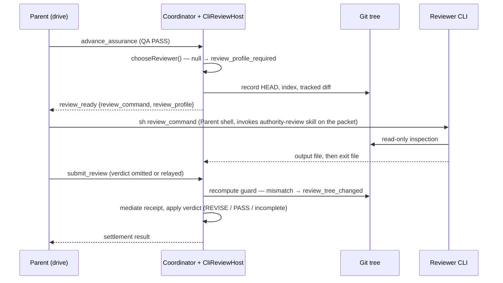

# Authority Review as a review-profile CLI stage

**Status**: Candidate; no execution authority.
**Initiative**: `review-cli-stage` (source issue #386), four Slices S1–S4.
**Design risk**: High — it changes how the Kernel-required Review verdict reaches settlement on all three Hosts (Pi, Claude Code, Antigravity), replaces the observed-subagent receipt of ADR 0017 for the primary Review, adds a fail-closed precondition for material and critical tasks, and retires a shipped dispatch path.
**Design views**: service/component interfaces (review profile resolver, `CliReviewHost`, coordinator results); temporal sequence (reserve → Parent runs CLI → submit); state transitions (Review reservation outcomes).
**Diagram decision**: required
**Diagram reason**: the reserve/launch/observe/submit sequence crosses the Kernel coordinator, the Host adapter, the Parent's shell and a separate reviewer process; the authority at each step is easier to check in one sequence.
**Document language**: English, following Planner's default document policy.

## Outcome

Authority Review — the Review that the Kernel requires for `material` and `critical` tasks — runs as a separate CLI process selected by a review profile in the layered lane configuration, on every Host acting as Parent. The reviewer process runs the packaged `authority-review` skill, which carries the review role and static rules, against a packet holding only the per-task facts. The Parent launches that process from its own shell in the drive's tree, serially after QA settles the delivery candidate, and submits the result through `submit_review`. In-process subagent dispatch for authority Review is retired on all three Hosts. Findings verification (`verification_ready` → `submit_verification`), advisory dispatch, `dispatch_role` UI review and QA are unchanged.

## Sources

- Issue #386 (Decisions, Design items 2–4, Retired, What changes, Acceptance) — with D1 and the verifier part of "Retired" item 3 superseded by the Brainstorm manifest below.
- Brainstorm manifest from `clarify` on 2026-11-08 (`BR-*` IDs, see Brainstorm Trace).
- Repository evidence listed under Discovery evidence.

## Threat model and supported environment

The reviewer process is a model the user configured; it is trusted to return a verdict, not trusted to stay read-only. The adversary is an accidental write by that process. Detection covers HEAD, the index and Git-tracked content (BR-DEC-5); untracked files and writes outside the repository are not detected and are not acceptance cases. Supported environment: macOS and Linux with POSIX `sh`, Git SHA-1 or SHA-256 repositories, and the `claude`, `pi` or `agy` executable on `PATH`. Windows is not supported.

## Discovery evidence

- Shared Review reservation: `plugins/immune-brain/runtime/assurance/coordinator.ts:1737` calls `host.prepareReview` and returns `agent_params` in `review_ready` (`:1766`); `submitReviewOnce` (`:1814`) checks the snapshot, parses the verdict, runs `options.validateReceipt`, then applies the verdict as `actorId: "parent-mediated-review"` with `reviewer_verdict_sha256` and `reviewer_model`.
- Host port: `plugins/immune-brain/runtime/assurance/host_port.ts:56` (`AssuranceHostPort`: `prepareReview`, optional `prepareVerification`/`inspectVerification`, `releaseReview`). `ReviewRequest.prompt` already carries the complete prompt (role contract, static rules, snapshot facts).
- Receipt mediation: `plugins/immune-brain/runtime/assurance/review_mediation.ts:64` (`submitMediatedReview`) accepts an omitted verdict (observed bytes become the submission) or a Parent-relayed verdict that must match the observed bytes. Its call sites are `runtime/claude/kernel_ports.ts:164` (also used by Antigravity through `AntigravityRuntime extends ClaudeRuntime`) and `.pi-extension/pi-canary-assurance-progression.ts:222`.
- Host review implementations: `.pi-extension/pi-canary-assurance-progression.ts:79` (`PiReviewHost`, review and verifier markers in `observeReviewDispatch`), `runtime/claude/review_host.ts` (752 lines, hook-observed `immune-brain-reviewer`), `runtime/antigravity/review_host.ts` (396 lines, `invoke_subagent`; per #414 its review observation never completes in production).
- Snapshot compare at submit: `compareReservationSnapshot` (`coordinator.ts:1225`) compares Kernel `workspace_revision` and the scoped `diff_hash`, not HEAD or the index.
- Configuration: `plugins/immune-brain/runtime/config/layered_config.ts:71` (`laneKeys`) and the same-layer rule for `executor_model`/`executor_effort` (`:154-160`); `runtime/unattended/lane_supervisor.ts:10` (`chooseExecutor`), `:23` (`executorArguments`), `:89` (binary resolution `claude`/`agy`/`pi`).
- CLI capabilities (local `--help`, 2026-11-08): `pi` has `--print`, `--no-session`, `--tools <allowlist>` (tool names only, no argument patterns), `--no-extensions`, `--no-skills`, `--no-mcp`, `--thinking`; `claude` has `--print`, `--tools`, `--allowedTools` (argument patterns), `--disallowedTools`, `--permission-mode`, `--no-session-persistence`, `--max-turns`; `agy --help` lists no tool-restriction or read-only flag.
- Contracts naming subagent Review dispatch: `plugins/immune-brain/dist/drive.md:161-166, 367-386`; `plugins/immune-brain/dist/drive-batch.md:117-124, 440`; `docs/reference/subagent-dispatch-protocol.md` (§Pi Agent Invocation, §Scheduling And Visibility item 6) and its mirror under `plugins/immune-brain/dist/docs/reference/`.
- Reviewer definition: `plugins/immune-brain/agents/immune-brain-reviewer.md` is generated by `generateReviewerDefinition` (`scripts/build-claude-plugin.ts:41`) from `runtime/prompts/code-review.md`, `STATIC_REVIEW_RULES` and the dispatch rules; the Antigravity copy is listed in `docs/agents/derived-files.json:53`, and `tests/antigravity-host-package.test.ts` checks the generated copy.
- Static/per-task split already exists: `ReviewRequest.snapshotPrompt` is the per-dispatch facts and a strict suffix of `prompt` (`runtime/assurance/host_port.ts:26`); `buildReviewSnapshotPrompt` (`coordinator.ts:720`) builds it. `currentReviewContractHash()` (`runtime/role_prompt_bridge.ts:160`) hashes the role prompt plus `STATIC_REVIEW_RULES`, and the coordinator records it as `review_contract_hash` with the verdict (`coordinator.ts:1866`).
- Skill packaging: Pi loads `plugins/immune-brain/skills` through `package.json:23`; Claude loads the plugin's `skills/`; `scripts/build-antigravity-plugin.ts:163` copies `skills/` into the Antigravity plugin. Skill invocation in print mode: `claude --help` documents slash/skill expansion in print mode (disabled only by `--disable-slash-commands`); `agy --help` states skills resolve via `/skill-name`; `pi --help` documents skill discovery and `--skill <path>` but not the print-mode invocation syntax (unverified).
- Risk floor: `.imm/risk-floor.json` floors `runtime/assurance`, `runtime/claude/{review_host,kernel_ports,mcp_server}.ts` and `.pi-extension` at `material`.
- ADRs touched: `docs/adr/0006-unattended-review-dispatch-authority.md` (Rejected Alternatives: runtime-invoked reviewer model), ADR 0017 (observed reviewer receipt), ADR 0030 (Agent-dispatch packet binding), ADR 0034 (layered configuration).

## Decisions and technical design

### D1 — Review profile keys (source: BR-REQ-3)

`lanes` gains `review_host` (`pi` | `claude-code` | `antigravity`), `review_model` and `review_effort` (non-empty strings), accepted in user `lanes.profiles.<name>` and in project `.imm/config.json` `lanes`, resolved with the existing active-profile → project precedence. `review_model` and `review_effort` apply only in the layer that sets `review_host`, with the same `not_applied` diagnostics as the executor keys. `imm-kernel config --json` reports each key with its source. A resolver `chooseReviewer(resolvedLanes)` exported from `runtime/config/layered_config.ts` returns `{ host, model?, effort? }` or `null` when no `review_host` resolves.

### D2 — No model-distinctness rule (source: BR-DEC-2)

The resolver never compares the review model with the executor model; a profile may set the same model for both. Issue #386 acceptance "different from the implement profile's model" is superseded.

### D3 — Parent launches, runtime prepares (source: BR-DEC-1; command shape is a delegated technical choice)

On `review_ready` the runtime writes the packet (`ReviewRequest.snapshotPrompt` plus a header line `review_contract_hash: <currentReviewContractHash()>`), a POSIX `sh` script that runs the reviewer CLI with the D5 skill invocation in the task's working directory, and the output paths. The result carries `review_command` (`sh <script path>`) and `review_profile` (`host`, `model`, `effort`) instead of `agent_params`. The Parent runs `review_command` from its own shell, in the background when its shell tool would otherwise time out, and calls `submit_review` once the process exits. The script writes stdout to `review-output-<operation>.txt` through a temporary name and writes the exit status to `review-exit-<operation>` last, so a present exit file marks a complete output.

### D4 — Verdict submission and receipt (source: BR-DEC-1; reuse of `submitMediatedReview` is a delegated technical choice)

`CliReviewHost.inspectReview(taskId)` is the `inspect` callback of `submitMediatedReview`:

| Observed state | Result |
| --- | --- |
| no exit file | `{ ok: false, release: false }` — reservation retained, "review process still running" |
| exit status ≠ 0, or empty output | `{ ok: false, release: true }`, reason `review_process_failed` |
| tree guard mismatch (D6) | `{ ok: false, release: true }`, reason `review_tree_changed` with changed paths |
| exit 0, output is the D12 mismatch line | `{ ok: false, release: true }`, reason `review_contract_mismatch` naming both hashes |
| exit 0 with output | `{ ok: true, receipt: { actorId: "cli:<host>:<operation id>", result: <output bytes>, model: <review_model or "host-default"> } }` |

With the verdict omitted, the output bytes are the submission; a Parent-relayed verdict must match them (existing fingerprint check). `reviewer_verdict_sha256` is the sha256 of the output bytes. An output that is not a valid verdict follows the existing "reviewer receipt is not a valid verdict" release. None of these failures records a Review round or consumes rework budget; a valid verdict follows existing REVISE/PASS, `review_incomplete` and round-budget mechanics unchanged (BR-REQ-2).

### D5 — Reviewer invocation per Host (source: BR-REQ-2 fresh context and read-only; flags are a delegated technical choice; Pi tools per D9)

| `review_host` | argv (model/effort only when set) | Fresh context | Read-only |
| --- | --- | --- | --- |
| `claude-code` | `claude --print --no-session-persistence --max-turns <budget> --tools Read,Grep,Glob,Bash --allowedTools "Bash(git show:*)" "Bash(git diff:*)" "Bash(git log:*)" "Bash(git cat-file:*)" "Bash(git rev-parse:*)" "Bash(git ls-tree:*)" --permission-mode dontAsk [--model m] [--effort e]` | new non-persisted session | tool allowlist + D6 guard |
| `pi` | `pi --print --no-session [--model m] [--thinking e]` | `--no-session` | Pi's own configuration + D6 guard (D9) |
| `antigravity` | `agy --print [--model m] [--effort e]` | new print session | D6 guard only (BR-DEC-5) |

No argv carries a `/drive` or `/immune-brain:drive` entry or `--plugin-dir`. The turn budget is also stated in the packet for Hosts without a turn-cap flag. Each argv ends with one prompt argument that invokes the D12 skill on the packet: `/immune-brain:authority-review <packet path>` for `claude-code`, `/skill:authority-review <packet path>` for `pi`, `/authority-review <packet path>` for `antigravity`. The `pi` and `antigravity` forms are unverified until S3's manual check; S2 keeps each form in one table entry so a correction touches one place. The binary is resolved from `PATH` as in `lane_supervisor.ts:89`; an absent binary fails at reservation with `review_host_unavailable`.

### D6 — Tree guard (source: BR-REQ-4)

At reservation `CliReviewHost` records `git rev-parse HEAD`, the sha256 of `git ls-files -s`, and the sha256 of `git diff --binary HEAD` for the task's working directory. `inspectReview` recomputes them before reading the output. Any mismatch releases the reservation with `review_tree_changed` and the paths from `git diff --name-only <recorded HEAD>` plus index changes. Recovery action: restore the listed paths to the reviewed state, then call `advance_assurance`. Untracked files are out of the guard (threat model).

### D7 — Missing profile fails closed (source: BR-REQ-5 / BR-DEC-3)

When the CLI dispatch is active and `chooseReviewer` returns `null`, Review preparation returns `review_preparation_failed` with `code: "review_profile_required"` and the single `recovery_action` "Set `lanes.review_host` in the active user lane profile or in `.imm/config.json`, then call `advance_assurance`". QA settlement is not undone. Routine tasks never reach Review and never consult the profile.

### D8 — Composition and migration switch (source: BR-REQ-1, BR-REQ-6; module placement is a delegated technical choice)

`CliReviewHost` lives in `plugins/immune-brain/runtime/assurance/cli_review.ts` (Host-neutral, as #414 requires for review runner code). It wraps a Host's `AssuranceHostPort`: `prepareReview`/`releaseReview` use the CLI path; `prepareVerification`/`inspectVerification` delegate to the wrapped Host unchanged (BR-DEC-4). The three composition roots (`runtime/claude/kernel_ports.ts`, `runtime/antigravity/kernel_ports.ts`, `.pi-extension/pi-canary-assurance-progression.ts`) wrap their Host and route `submitMediatedReview`'s `inspect` to it when the switch selects `cli`. The switch is one internal value read at the composition root from `IMMUNE_BRAIN_REVIEW_DISPATCH` (`subagent` | `cli`); it is not a user configuration key. S2 defaults it to `subagent`, S3 to `cli`, S4 deletes it.

### D9 — Pi reviewer tools follow Pi's own configuration (source: user decision 2026-11-08 during draw-up)

The runtime passes no tool, extension, skill or MCP restriction flag to `pi`; the tools available to a Pi reviewer are whatever the user's Pi configuration provides. Read-only is enforced only by the D6 guard, the same treatment as Antigravity under BR-DEC-5. Evidence that prompted the decision: `pi --tools` takes tool names only and cannot limit `bash` to read-only Git commands.

### D10 — Contracts and ADR (source: BR-REQ-7; ADR number is the next free one)

New `docs/adr/0037-authority-review-cli-stage.md` records D1–D9 and D12 and partially supersedes ADR 0006 (the rejected alternative "runtime invokes the reviewer model"), ADR 0017 (observed subagent receipt for the primary Review; the verifier keeps it) and ADR 0030 (Agent-dispatch packet binding for the primary Review). Each of those ADRs gains a status note pointing at 0037. `drive.md`, `drive-batch.md` (lane Review runs in the Lane's tree before integration; PASS gates integration, REVISE returns to the Lane executor), the authority Review parts of `subagent-dispatch-protocol.md` and the `authority-review` skill's dispatch wording describe D3–D7 and D12; advisory sections are unchanged.

### D11 — Retirement (source: BR-REQ-6)

S4 deletes the authority-Review half of `PiReviewHost` (review marker observation, `reservedAgentParams` for Review), the review observation in `runtime/claude/review_host.ts` and `runtime/antigravity/review_host.ts`, the generated `immune-brain-reviewer` agent definition on both plugins with `generateReviewerDefinition`, `REVIEWER_DISPATCH_RULES` and their `derived-files.json` entries, the switch, and the tests that protect only those paths. The verifier reservation and observation code on all three Hosts stays, and so does `immune-brain-review-verifier`.

### D12 — `authority-review` skill (source: user decision 2026-11-08 during draw-up, "1 B"; skill name and mismatch line are delegated technical choices)

A new skill `plugins/immune-brain/skills/authority-review/SKILL.md` is generated by the plugin build from `runtime/prompts/code-review.md` and `STATIC_REVIEW_RULES` — the inputs of `currentReviewContractHash()` — and stamps that hash into its body. It instructs the reviewer to read the packet path it was given and, when the packet's `review_contract_hash` differs from its own, to reply with exactly `REVIEW_CONTRACT_MISMATCH <own hash>` and stop. The generated file is a derived file with a sync check; Pi and Claude pick it up from their existing skill roots and the Antigravity build copies it. Its description states it is invoked by the drive Review stage. Consequence accepted with the decision: the Kernel binds the per-task packet hash and the runtime's `review_contract_hash`; the static rules the reviewer actually loaded are self-reported through the mismatch line, not proven. A reviewer Host without a matching immune-brain install produces either the mismatch line or an output that is not a valid verdict, and both release without a Review round.

### Sequence

## Slices

| Slice | Task ID | Result when it alone has landed | Blocked by |
| --- | --- | --- | --- |
| S1 | `review-cli-profile-config` | `imm-kernel config --json` reports `lanes.review_host/model/effort` with sources and diagnostics; `chooseReviewer` resolves them. No dispatch change. | — |
| S2 | `review-cli-dispatch` | The `authority-review` skill ships in all three Host packages; with `IMMUNE_BRAIN_REVIEW_DISPATCH=cli`, all three Hosts reserve, guard and submit authority Review through the CLI path; default behavior unchanged. | S1 |
| S3 | `review-cli-default` | CLI dispatch is the default; contracts, reviewer prompt wording and ADR 0037 describe it; BR-SCN-1/2 observable. | S2 |
| S4 | `review-subagent-retirement` | Subagent authority-Review code, agent definition and switch are gone; verifier dispatch unchanged. | S3 |

Remaining gap after S4: none for the confirmed outcome. #414 (Host-neutral core extraction) and #417 (canonical packet) remain separate Initiatives.

## User scenarios

- **BR-SCN-1** — automated, S3 `AC1`. Actor: project maintainer. Given: project defaults set `review_host: pi` and `review_model: <model-x>`, and a material task's drive reaches Review. When: the Parent runs the Review step. Then: the `review_ready` result in the drive output names review host `pi` and model `<model-x>` and gives one `review_command`.
- **BR-SCN-2** — automated, S3 `AC2`. Actor: project maintainer. Given: no review profile is configured, and a material task's drive reaches Review. When: the Parent requests Review. Then: the drive output stops with `review_profile_required` and names setting `lanes.review_host` as the single recovery action.

## Brainstorm Trace

| ID | Disposition |
| --- | --- |
| BR-REQ-1 | covered — D8; S2 AC2, S3 AC1 |
| BR-REQ-2 | covered — D4, D5; S2 AC1, AC3 |
| BR-REQ-3 | covered — D1; S1 AC1, AC2 |
| BR-REQ-4 | covered — D6; S2 AC4 |
| BR-REQ-5 | covered — D7; S2 AC5, S3 AC2 |
| BR-REQ-6 | covered — D8, D11; S2 AC6, S3 AC1, S4 AC1–AC3 |
| BR-REQ-7 | covered — D10; S3 AC4 |
| BR-DEC-1 | decisioned — D3, D4 |
| BR-DEC-2 | decisioned — D2; S1 AC2 |
| BR-DEC-3 | decisioned — D7 |
| BR-DEC-4 | decisioned — D8, D11; S2 AC7, S4 AC2 |
| BR-DEC-5 | decisioned — D5, D6 |
| BR-OUT-1 | out — advisory dispatch sections unchanged (D10) |
| BR-OUT-2 | out — `dispatch_role` `ui-review` untouched |
| BR-OUT-3 | out — QA untouched |
| BR-OUT-4 | out — #414 owns extraction; S2 only places new code in a Host-neutral module |
| BR-OUT-5 | out — verifier stays on Host subagent dispatch (D8) |
| BR-DEC-6 (draw-up: skill carries static rules) | decisioned — D3, D5, D12; S2 AC1, AC8 |
| BR-SCN-1 | S3 AC1 |
| BR-SCN-2 | S3 AC2 |

## Verification and acceptance mapping

| Slice / AC | Seam | Test file |
| --- | --- | --- |
| S1 AC1 | `resolveConfig` over isolated user/project files | `tests/layered-config.test.ts` |
| S1 AC2 | `chooseReviewer` over `resolveConfig` output | `tests/layered-config.test.ts` |
| S1 AC3 | reference doc text + mirror | `tests/dist-docs-sync-contract.test.ts` + grep |
| S2 AC1 | `reviewArguments` argv per Host | `tests/cli-review-dispatch.test.ts` (new) |
| S2 AC3–AC5, AC7 | coordinator + `CliReviewHost` against a temporary Git repo with a fake reviewer executable on `PATH` | `tests/cli-review-dispatch.test.ts` |
| S2 AC2 (Hosts) | each composition root under the switch | `tests/dual-host-assurance-conformance.test.ts` |
| S2 AC8 | generated skill equals a fresh generate and is packaged on each Host | `tests/antigravity-host-package.test.ts`, `tests/claude-host-package.test.ts` |
| S2 AC6 | existing subagent path | `tests/claude-review-host-async-agent.test.ts`, `tests/pi-canary-native-review.test.ts` |
| S3 AC1–AC2 | default composition without the switch | `tests/cli-review-dispatch.test.ts` |
| S3 AC3 | contract text | `tests/pi-subagent-dispatch-observability-contract.test.ts`, `tests/dist-docs-sync-contract.test.ts` |
| S3 AC4 | ADR text | grep |
| S4 AC1 | source inventory | grep |
| S4 AC2 | verifier reservation on each Host | `tests/host-neutral-assurance-coordinator.test.ts`, `tests/antigravity-assurance-conformance.test.ts` |
| S4 AC3 | packaged agents | `tests/claude-host-package.test.ts`, `tests/antigravity-host-package.test.ts` |

The fake reviewer is a small `sh` script placed first on `PATH` under the binary name of the configured Host; it writes a fixed verdict, writes the mismatch line, exits non-zero, or edits a tracked file, which gives the positive, failure, version-skew and guard controls without a model call.

## Devil's Advocate Audit

- **Rollback resilience**: S1 adds keys only. S2 is inert unless the switch is set. S3 can be reverted by flipping the default back to `subagent`, because S4 has not removed that path yet. S4 is the only irreversible slice and lands after S3 has run real Reviews. A Review interrupted mid-process leaves a retained reservation (no exit file); `advance_assurance` after a Host restart re-reserves, as today.
- **Verification vanity**: the guard tests edit a tracked file, move HEAD and stage a change through the fake reviewer, and assert `review_tree_changed` plus an unchanged TaskRecord history; a guard that never fires fails them. The argv test asserts the absence of `Edit`/`Write` and of a drive entry, not only presence of flags. Retirement is checked by a source grep that fails on any remaining reference.
- **Spec dilution**: the Brainstorm Trace maps every `BR-*` item; the Issue #386 acceptance on distinct models is superseded explicitly by BR-DEC-2, and "Retired" item 3 is narrowed to the primary Review by BR-DEC-4, not silently dropped.
- **Bootstrap risk**: after S3 is released, this repository's own material Reviews need `lanes.review_host`; set it before driving S4.
- **Skill version skew**: a reviewer Host with an older immune-brain install (the plugin-cache skew seen with Lanes) loads older rules. The mismatch line turns that into a release with both hashes, so the recovery is visible; a reviewer that ignores the instruction is not detected (accepted with BR-DEC-6).
- **Nested Host session risk**: a nested `claude --print` loads user-level plugins and hooks. The reviewer process is not a `drive` entry, so run continuation does not bind; S2's fake-reviewer tests do not cover real plugin interaction, and the first real S3 drive is the manual check.
