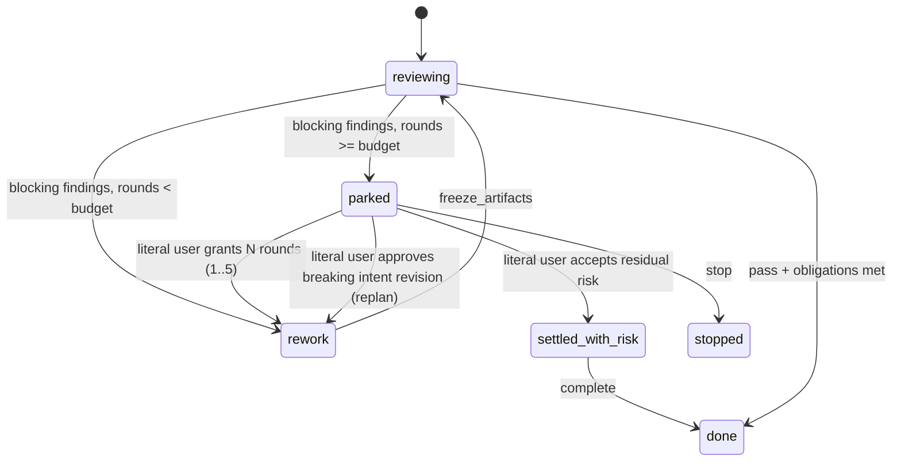

# Review convergence

**Status**: candidate; planning and GitHub projection only, not execution authority.
**Initiative**: Review 收敛与 QA 基线
**Immutable slug**: `review-convergence`
**Carrier**: GitHub, from the repository root `AGENTS.md`.
**Document language**: English; user-facing discussion remains Chinese.
**Design risk**: High — S1 and S2 add optional Kernel record fields and a new literal-user settlement path for residual Review risk; S0 tightens the shared Review verdict contract on both Hosts.
**Execution posture**: characterization-first — reproduce each observed failure mode (advisory-only rework, late-round full re-review, budget-exhaustion pass-through, unrelated pre-existing failure) in an existing behavioral seam before changing the contract.
**Design views**: component interfaces, state transitions, and data flow; they change how a Review round is admitted and how a parked task leaves the budget boundary.
**Diagram decision**: required
**Diagram reason**: the budget-exhaustion boundary gains two new exits; a state diagram is the only unambiguous statement of which exits need literal-user authority.
**Execution prerequisite**: the active Managed task `goal-driven-run` must be settled first. Every runtime slice regenerates `plugins/immune-brain/dist/claude/mcp-server.mjs`, and S2 edits `runtime/claude/{kernel_ports,interaction,mcp_server}.ts` and `.pi-extension/imm-canary-work.ts`, all inside that task's scope. Rebase these candidates onto its settled commit before Enrollment.

## Outcome and approved boundaries

Review stays a gate that blocks only on concrete defects, and a task converges in bounded rounds: advisory notes never drive rework, rounds from the third onward judge the latest rework delta instead of re-reviewing the whole change, an exhausted budget stops for one real user decision instead of continuing round by round, deterministic QA catches mechanical breakage before Review, and Planner stops emitting absolute acceptance that Review can only amplify.

Evidence behind this outcome (local audit, 70 tasks since the 5-round budget landed): 59% of tasks settle with no rework and their findings are overwhelmingly real defects, so preference fabrication is not the dominant cost here. The cost sits in a ~14% tail running 4–10 rounds: findings drift toward edge cases outside any declared threat model (for example SHA-256 repositories and malicious evidence in a read-only check script whose acceptance said "Missing, contradictory, malformed, unsafe or unstable evidence cannot succeed"), the budget boundary was resolved and passed three times in a single task, some rounds only caught Executor regressions such as a broken typecheck, and only one finding has ever been refuted.

The user approved the complete Initiative and its order. Slices are independently verifiable outcomes, not read/edit/test Steps.

| Slice | Task ID | Independently verifiable result | Prerequisite |
| --- | --- | --- | --- |
| S0 | `review-convergence-s0-verdict-contract` | A Review `rework` verdict carries only blocking findings; advisory notes appear only on `pass` and never become Executor work; every blocking `trigger` names an input and an observable wrong result; Reviewers may not exceed the declared threat model; a repository standards entry points generic review tools at the Code Quality Guard. | `goal-driven-run` settled |
| S1 | `review-convergence-s1-delta-review` | From the third Review round, a new blocking finding is admitted only when it touches the latest rework delta or violates a security, data-loss, or authority boundary; anything else must be submitted as advisory. | S0 |
| S2 | `review-convergence-s2-budget-exhaustion` | An exhausted rework budget presents one literal-user decision with three exits — grant N more rounds, accept the remaining findings as residual risk and allow completion, or replan — instead of a one-round pass-through. | S1 |
| S3 | `review-convergence-s3-qa-baseline` | Deterministic QA always runs a project-declared baseline (for this repository, `bun run typecheck`); a baseline check that fails identically at `base_head` is disclosed, not blocking. | `goal-driven-run` settled |
| S4 | `review-convergence-s4-planner-acceptance` | Planner Specs declare the threat model and supported environment; acceptance lists concrete negative cases instead of absolute "any malformed input" clauses, and descriptors stay focused. | None |

S0 → S1 → S2 is serial. S3 and S4 are independent of that chain and of each other.

### Out of scope

- Changes to the external `code-review` skill (Matt Pocock); it is constrained only through the repository standards entry it already prefers.
- The pre-report Review verifier (see *Deferred: blocking verifier*). Its design is retained but no candidate is published until S0–S3 produce false-positive data.
- Raising or lowering `REVIEW_REWORK_ROUND_BUDGET`, Review severity taxonomy beyond `blocking | advisory`, reviewer model choice, or Executor prompt changes.
- `CONTEXT.md`, README files, or any other path in the active `goal-driven-run` scope beyond what the execution prerequisite names.
- Migration of historical records; every new field is optional and absent on old records.

## Discovery evidence and reference closure

| Fact | Source |
| --- | --- |
| A `rework` verdict validates with only advisory findings; the parser checks only that findings are non-empty. | `runtime/assurance/coordinator.ts` verdict parse (`rework` branch) |
| Advisory findings from a `rework` verdict become open TaskFindings handed to the Executor. | `runtime/assurance/coordinator.ts` `reviewReworkFindings` |
| The Guard says "A passing Review has no findings"; the Reviewer prompt and parser allow advisory findings on `pass`. | `docs/reference/code-quality-guard.md`, `runtime/prompts/code-review.md`, coordinator `pass` shape |
| `evidence.violated.kind` is already `acceptance \| security_boundary`; the anchor hashes `violated` + `caller_chain`. | coordinator evidence parser; `runtime/kernel/types.ts` |
| Budget exhaustion parks the task with one open `replan_required`; `authorize_rework` (literal-user only) resolves it, and the very next blocking round parks again, so each extra round costs one gate. | `runtime/kernel/reducer.ts` (`parkForReplan`, `authorize_rework`), `REVIEW_REWORK_ROUND_BUDGET = 5` |
| Review approvals persist `review_revision`; review-authored `request_rework` does not, so no durable fact identifies the previously reviewed tree. | `runtime/kernel/reducer.ts` approval path; `TaskApprovalV2.review_revision` |
| Deterministic QA runs only per-acceptance descriptors; there is no project-level fixed check. | `runtime/assurance/qa.ts` `runDeterministicQa` |
| Completion counts only open blocking findings, so existing open advisory findings are unaffected. | `runtime/kernel/completion.ts` |
| The external `code-review` skill applies its Fowler smell baseline unless repository standards documents (for example `CODING_STANDARDS.md`) say otherwise. | `~/.claude/skills/code-review` |

Related contracts: `docs/specs/review-round-replan-boundary.spec.md` (the boundary S2 extends), ADR 0017 (receipt-bound verdict; unchanged — S0/S1 reject a non-conforming verdict for resubmission rather than editing it).

## Technical Design

### Architecture and authority invariants

- The Reviewer's verdict bytes stay the Reviewer's. Coordinator validation may **reject** a verdict with a diagnostic so the Reviewer resubmits; it never demotes, drops, or synthesizes findings, and never synthesizes a `pass`. `reviewer_verdict_sha256` continues to bind exactly what was submitted.
- Every rule that gates admission is deterministic over recorded facts (round number, persisted review revisions, Git trees, `violated.kind`, `caller_chain` paths). No rule asks the coordinator to judge semantics.
- Literal-user authority remains the only way past an exhausted budget. No path lets Review, QA, or the Parent accept residual risk.
- New Kernel fields are optional and additive; records without them parse unchanged and keep current behavior.

### S0: verdict contract

1. **Rework carries only blocking.** The coordinator rejects a `rework` verdict whose findings contain any `advisory` item or no `blocking` item, with a diagnostic telling the Reviewer to submit `pass` (with `inspected_paths`) when nothing blocks. Advisory findings are legal only on `pass`, stay in `advisory_findings` on the attestation, and are never projected as Executor work. `reviewReworkFindings` therefore receives only blocking items; delete its advisory branch rather than filtering.
2. **Guard and prompt agree.** Replace "A passing Review has no findings" with: a `pass` may carry advisory notes, which are archived and never require action; a `rework` contains only blocking findings.
3. **Trigger states a failure.** The Reviewer prompt requires `evidence.trigger` to read "concrete input or state → observable wrong result". A finding that cannot name the wrong result is not blocking. Prompt-only; no schema change; anchors are unaffected because `trigger` is not hashed.
4. **No invented threat model.** Reviewers judge against the threat model and supported environment declared in the Spec or TaskIntent goal. A defect that requires an attacker, input source, repository format, encoding, or platform outside that declaration is advisory. When nothing is declared, assume inputs come from the repository's own tooling and the user's trusted workspace. `security_boundary` is defined as security, data-loss, or authority boundaries the change actually crosses.
5. **Standards entry.** Add a thin root `CODING_STANDARDS.md` that points to `docs/reference/code-quality-guard.md` and states the repository rule verbatim: a code smell or maintainability heuristic is reported only when it creates a concrete correctness, regression, security, or significant maintenance risk in the reviewed change. It contains no other rules (single source of truth).
6. Regenerate `dist/role-prompts/code-review.md`, `dist/docs/reference/code-quality-guard.md`, and `dist/claude/mcp-server.mjs`.

### S1: delta review from round three

1. **Persist the reviewed revision on rework.** A review-authored `request_rework` action carries the same `ReviewRevisionIdentityV1` an approval does, stored on that round's history entry (optional field; QA/user rework never carries it). The reducer validates `base_head` against `git_base_head` exactly as for approvals.
2. **Delta manifest.** When the coordinator opens Review round `r ≥ 3`, it reads the revision persisted for round `r − 1`, computes `delta_paths` = paths whose tree entries differ between that `review_tree` and the current `review_tree`, and adds `prior_review_commit` and `delta_paths` to the review manifest and prompt. If the prior revision is absent (legacy record) or unresolvable, the rule is skipped for that round and the manifest says so; it never blocks.
3. **Admission rule.** For `r ≥ 3`, every blocking finding must satisfy at least one of: `violated.kind === "security_boundary"`, or at least one `caller_chain` entry whose path component is in `delta_paths`. Otherwise the verdict is rejected with a diagnostic naming the finding ids and the two legal remedies (resubmit as advisory, or justify under `security_boundary`). Rounds 1 and 2 are unchanged.
4. Reviewer prompt: from round 3, review the rework delta and its direct interactions; edge cases that already existed in round 1 are advisory unless they cross a security, data-loss, or authority boundary.

### S2: budget exhaustion decision

1. **Grant N rounds.** `authorize_rework` takes an optional `rounds` (integer 1–5, default 1 for existing callers). The reducer persists the cumulative grant on the record (`review_round_budget_extension`, optional, default 0) and parks again only when effective blocking rounds reach `REVIEW_REWORK_ROUND_BUDGET + extension`.
2. **Accept residual risk.** New literal-user action `accept_residual_risk` with a non-empty `reason`. Legal only with an open `replan_required` caused by budget exhaustion (not the repeated-security-boundary dispute, which stays replan/stop only). It resolves that boundary and moves every open blocking Review finding to new status `accepted_risk` with the reason and actor in history. Completion treats `accepted_risk` like `resolved`; QA blocking findings and acceptance obligations are unaffected and still gate completion.
3. **Replan** is the existing `approve_breaking_intent_revision` path; no change.
4. **Presentation.** The authorization readiness projection exposes the three exits with the open finding summaries; Claude and Pi gates present the same three options and map each to exactly one Kernel action. An unattended batch child that reaches this boundary parks the batch (existing stop-on-exhaustion behavior) and never auto-selects an exit.

### S3: project QA baseline

1. **Declaration.** An optional tracked file `docs/agents/qa-baseline.json` (`contract: "assurance_kernel/qa_baseline/v1"`, `checks: [{ id, verification }]`, each `verification` a strict v2 descriptor). QA reads it from the **Enrollment `base_head` tree**, never from the delivery, so a task cannot weaken its own baseline; edits take effect for later tasks. Absent file → no baseline checks (other repositories unaffected). This repository declares `bun run typecheck`.
2. **Execution.** Deterministic QA runs baseline checks after acceptance descriptors with the same isolation, budgets, and diagnostics. A failure produces a blocking QA finding with `acceptance_id: null`.
3. **Pre-existing failure.** When a baseline check fails on the delivery, QA reruns only that check against the materialized `base_head` tree. If it also fails there, the finding is advisory with summary prefix `pre-existing baseline failure:` and is disclosed in the QA report and Review manifest. Acceptance descriptors never get this tolerance — a new acceptance test failing at `base_head` is the normal test-first signal.
   The rerun uses the check's own descriptor in a disposable materialization with no worktree `node_modules`, so a check that needs installed dependencies declares `environment.prepare`; an identical failure means the same exit code and the same timeout and output-limit flags, and a materialization or prepare failure keeps the finding blocking. Disclosure travels as the advisory finding on the QA pass verdict and in the QA approval summary.
4. Known trade-off (accepted): while the baseline is already red, new errors of the same check are masked. The disclosure repeats on every task until the baseline is fixed, keeping the debt visible.

### S4: planner acceptance

Planner contract changes in `skills/imm-planner/SKILL.md` (and its `dist/imm-planner.md` mirror):

- Every Spec with external input states a **Threat model and supported environment** line: input trust, adversary (if any), supported Git object formats, encodings, platforms. "None beyond the repository's own tooling" is a valid declaration.
- Acceptance names concrete negative cases. Absolute clauses such as "any missing, malformed, or unsafe input cannot succeed" are replaced by the enumerated cases the slice must reject.
- Verification descriptors target focused test files, not whole suites, so unrelated failures cannot fail an acceptance.

### Deferred: blocking verifier

Retained design, not a candidate: a coordinator-dispatched read-only `review-verifier` role receives each blocking finding (summary + evidence), the immutable revision, and acceptance text — never the Reviewer's reasoning. Verdicts are two-valued: `refuted` (with a concrete counter-path) or kept. It can only weaken, never add. If every blocking finding is refuted, the Reviewer is re-dispatched once with the counter-evidence and must return `pass` with coverage or a new `rework` (verified again); non-convergence stops for the user. Verifier failure or timeout keeps the finding. Review records would carry optional `verifier` counts and refutation reasons for `imm-retro`. Revisit after S0–S3 ship, using refuted-finding and round-count data.

Finding disposition (adopted 2026-10-27 from google/elephant-goldfish-model
`egm-resolve`): a finding the executor believes is wrong gets exactly one of four
dispositions, decided by where the refuting evidence lives. `CONTEST` — the finding
is wrong and the evidence is readable to the Reviewer (a file, a symbol, or a
decision recorded in the Spec or TaskIntent); the verifier refute is the instrument.
`ESCALATE` — the finding is wrong but the evidence is outside everything the
Reviewer can read (a team convention, a verbal user decision); do not force a
refute and do not fix the code — route it to the literal user as an
`unresolved_user_decision`. `PROPOSE FIX` — the finding is right; the executor
reworks it. `DECLINE` — an advisory note; record it, do no work. Two rules bind the
disposition: a contest must be checkable from the frozen snapshot and the Spec —
"this is intentional" is not evidence, and without reviewer-readable evidence the
disposition is ESCALATE or PROPOSE FIX, never CONTEST; and a comprehension gap is
never contested — a fresh Reviewer who cannot understand the diff from the frozen
snapshot alone has found missing context in the work, not made a reviewer error.
Do not add context to the Spec or acceptance merely to satisfy a Reviewer; add it
only when a human reader needs it, otherwise ESCALATE.

### Alternatives and compatibility

- *Coordinator demotes non-conforming blocking to advisory* — rejected: rewrites Reviewer output and breaks the verdict receipt chain.
- *Keep advisory on rework but archive only* — rejected: needs a new storage location for no gain; the note resurfaces on the passing round.
- *Hard stop with no "grant N"* — rejected: the user explicitly wanted the three-way decision.
- *Baseline declared in `AGENTS.md` prose* — rejected: descriptors must be strict machine contracts.
- Compatibility: S0 rejects advisory-on-rework verdicts that were legal before; this is intended and affects only in-flight Reviews, which resubmit. All Kernel additions are optional fields/actions; a downgraded runtime reading a record with `accepted_risk` fails closed (unknown status rejected) rather than misreading it — acceptable because downgrade is not a supported path.

## Verification and acceptance mapping

All checks are post-implementation obligations; Planner ran none of them.

| Acceptance | Focused seams | Required regression evidence |
| --- | --- | --- |
| S0 / `RC-S0-A1` | `tests/host-neutral-assurance-coordinator.test.ts`, `tests/code-quality-guard-contract.test.ts` | Advisory-only `rework` and mixed `rework` are rejected with the resubmission diagnostic; blocking-only `rework` projects only blocking Executor findings; `pass` with advisory persists them on the attestation and opens no Executor work; Guard, prompt, dist mirrors and `CODING_STANDARDS.md` state one consistent rule. |
| S1 / `RC-S1-A1` | `tests/kernel-canary-rework-authority.test.ts`, `tests/host-neutral-assurance-coordinator.test.ts` | Review rework persists its revision; round 3 manifest carries `prior_review_commit`/`delta_paths`; an out-of-delta non-security blocking finding is rejected, an in-delta or `security_boundary` one is admitted; rounds 1–2 and legacy records without a prior revision are unchanged. |
| S2 / `RC-S2-A1` | `tests/kernel-canary-rework-authority.test.ts`, `tests/claude-host-authority.test.ts`, `tests/pi-canary-user-authority.test.ts` | From a real parked record: grant 3 rounds parks again only after the third further blocking round; accept-residual-risk with literal-user authority sets `accepted_risk` and allows completion when QA is green; the same action from review/qa/parent authority, without a reason, or on a security-dispute boundary is rejected with zero writes; both Hosts present the same three exits. |
| S3 / `RC-S3-A1` | `tests/shared-deterministic-qa.test.ts` | Baseline read from `base_head`, not delivery; failing baseline → blocking `acceptance_id: null`; same check failing at `base_head` → advisory disclosure; failing acceptance descriptor at `base_head` stays blocking; absent file → no baseline checks. |
| S4 / `RC-S4-A1` | `tests/explicit-phase-entry-planner-contract.test.ts`, `tests/skill-dist-consistency.test.ts` | Planner contract requires the threat-model line and enumerated negative cases, forbids absolute malformed-input clauses, and its dist mirror matches. |

### Descriptor execution provenance

- Executables: `bun` and the fixtures' `git` from the QA host; no network or dependency installation.
- Setup: none (`environment.prepare` absent); repository writable paths: none; fixtures create and clean their own temporary repositories.
- Limits: 180 s / 192 KiB per descriptor over explicit file arguments; adjust only through an accepted Intent revision.
- Regenerating bundles and mirrors, `bun run typecheck`, and `scripts/sync-dist-docs.ts --check` are Executor/CI regression work, not acceptance descriptors (until S3 makes typecheck a baseline check).

## Interruption recovery and rollback

No slice hand-writes a TaskRecord or rewrites audit history. S0 rollback restores the prior parser and texts; no persisted data changes. S1 rollback stops emitting the new history field; existing values remain valid optional data. S2 rollback must keep parsing `accepted_risk` and the budget extension for any record that already used them — remove only the actions, not the parser support. S3 rollback deletes the baseline file or ignores it; no state. S4 is text-only.

## Devil's Advocate Audit

- **Rollback resilience**: S2 is the only slice that writes a new status; its parser support outlives its action on rollback.
- **Verification vanity**: S0/S1 tests must submit real verdict payloads through the coordinator, not assert prompt text alone. S2 starts from a genuinely parked record produced by five blocking rounds, not a hand-built one. S3 uses a real failing check at both trees.
- **Spec dilution detection**: keep the "reject, never rewrite" invariant, literal-user-only exits, base-tree baseline source, and the no-tolerance rule for acceptance descriptors. A shortcut that lets the coordinator demote findings, lets Parent accept risk, or reads the baseline from the delivery violates this Spec.
- **Gaming risk**: a Reviewer could label everything `security_boundary` to bypass S1. Mitigation is S0's definition plus audit visibility; if `imm-retro` shows abuse, the deferred verifier is the escalation.

## Brainstorm Trace and planning handoff

Direct Planner entry after a grilling session (Q1–Q20, all recommendations accepted by the user). No upstream Brainstorm manifest; no unresolved `BR-Q-*` items.

Canonical candidates:

- [S0 TaskIntent](../plans/review-convergence-s0-verdict-contract.intent.json)
- [S1 TaskIntent](../plans/review-convergence-s1-delta-review.intent.json)
- [S2 TaskIntent](../plans/review-convergence-s2-budget-exhaustion.intent.json)
- [S3 TaskIntent](../plans/review-convergence-s3-qa-baseline.intent.json)
- [S4 TaskIntent](../plans/review-convergence-s4-planner-acceptance.intent.json)

Author through `imm-kernel intent author`; every candidate must report `valid: true`. Enrollment readiness additionally requires the execution prerequisite. GitHub projection happens only on explicit request; this draft stops before publishing.
