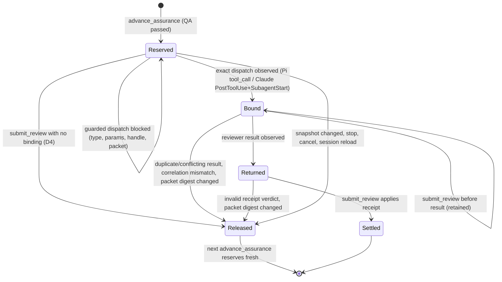

# Review dispatch handle

**Status**: candidate decomposition; Initiative name, slug and decomposition await one user confirmation in the review table. This document grants no execution authority.
**Initiative name**: Review dispatch handle
**Immutable slug**: `review-dispatch-handle`
**Carrier**: GitHub, selected by root `CLAUDE.md` (`Initiative carrier default: github`).
**Planning baseline**: `93bcbe2`; recheck affected paths if HEAD changes before Enrollment.
**Document language**: English; user discussion remains Chinese.
**Design risk**: High — Review dispatch binding and reservation release change on both Hosts, a new hook decision gates `Agent` calls on Claude, the Review prompt transport changes from inline bytes to a file handle, and ADR 0017's verbatim-prompt rule is superseded. These are authority and state-machine owners.
**Execution posture**: characterization-first for S1: pin today's "not observed" outcomes on both Hosts at the dual-host seam before flipping them to a release.
**Design views**: component interfaces, state transitions, temporal sequence.
**Diagram decision**: required
**Diagram reason**: the reservation lifecycle crosses the coordinator, two Host observers and a separate Claude hook process; the state diagram fixes which transitions release and which retain.
**Threat model and supported environment**: the adversary is the dispatching model (Parent or Lane Executor), which may retype or alter the reserved prompt, dispatch it under another `subagent_type` or with other Agent parameters, edit the review packet file, or redispatch a reviewer to shop for a verdict. The user, the Host processes, the loaded plugin build and the Kernel store are trusted. Supported: Claude Code with the plugin hooks (PreToolUse `Agent` matcher in `plugins/immune-brain/hooks/hooks.json`), Pi with the bundled extension and the user's pi-subagents `Agent` tool, macOS and Linux, UTF-8 paths, Bun 1.4.

## Outcome

A Review dispatch no longer depends on a model copying a large prompt byte for byte, and both Hosts apply one rule set:

- A dispatch aimed at a pending reservation but carrying the wrong reviewer type or Agent parameters is blocked before the reviewer runs, on Pi and on Claude.
- A reservation that never bound a reviewer is released on `submit_review` with the `advance_assurance` recovery, instead of an indefinite wait.
- The reserved prompt is a short handle (marker, packet path, packet digest); the review instructions live in a runtime-written packet file.
- An edited packet or an edited handle cannot produce a settled verdict.

## Sources

No Brainstorm manifest exists. Sources are Issue #302, its origin #287, and the user's answers in the grilling session of 2026-10-26 (G1–G9).

| Source | Evidence or decision |
| --- | --- |
| I302 | `PiReviewHost.observeReviewDispatch` returns early unless `subagent_type === "Review"` (`.pi-extension/pi-canary-assurance-progression.ts:98`); a reserved prompt dispatched as `general-purpose` runs unobserved, and `inspectReview` returns `release: false` "not observed" (`:127-128`), the wait loop of #287. |
| I287 | Claude remaining gap 2: `runtime/claude/review_host.ts:503,506,556` return "reserved foreground Agent was not observed" with `release: false`. A reserved prompt under another agent type binds `PostToolUse` (no type check, `:462-479`) but never `SubagentStart` (`:437`), so it waits forever; a retyped prompt fails `bindsPrompt` (`:319-321`) with the same result. `submitMediatedReview` maps `release: false` to "wait for the dispatched reviewer" (`assurance/review_mediation.ts:51-52,77`). |
| G1 | Both Hosts change together (answer to Q4). |
| G2 | Root fix (C): marker-keyed dispatch-time check plus a short handle prompt pointing at a packet file (answer "采用建议" to round 2 Q1). This activates `review-settlement-hardening` BR-DEFER-1 ("prompt by reference … revisit only if retyping remains a measured problem"); #287 and the repeated Pi drift are that measurement. |
| G3 | A reservation with no bound reviewer is released on submit, with no count cap (round 2 Q2). |
| G4 | New ADR 0030 supersedes ADR 0017's verbatim reserved-prompt rule; ADR 0017 becomes partially superseded (Q3). |
| G5 | One packet file per operation in the evidence directory; the manifest is unchanged (Q4). |
| G6 | The Host verifies the packet digest at dispatch and at submit; the reviewer verifies it too (Q5). |
| G7 | GitHub Initiative, serial managed Lanes, one patch changeset per Slice; `/reload` after the first runtime Slice integrates (Q6). |
| G8 | Pi enforces `subagent_type`, prompt, `run_in_background`, `inherit_context`, `isolated` and `max_turns`; Claude enforces the reviewer agent type and prompt only, because AN-2 removed the other fields from its envelope (`review_host.ts:353-361`) (conflict-check corrections 6–8, confirmed). |
| G9 | Pi `max_turns` must equal the reserved value (Q7). |

## User scenarios

| ID | Actor | Given | When | Then | Mode | Slice |
| --- | --- | --- | --- | --- | --- | --- |
| SCN-1 | Parent or Lane Executor | a pending Review reservation on Pi or Claude | it dispatches the reserved prompt under a non-reviewer agent type | the dispatch is blocked before any reviewer runs, with a reason naming `subagent_type` | automated | S1 |
| SCN-2 | Parent or Lane Executor | a reservation whose reviewer was never bound (nothing dispatched, or an unobservable dispatch ran) | it calls `submit_review` | the reservation is released with the `advance_assurance` recovery, and the next `advance_assurance` returns a fresh reservation | automated | S1 |
| SCN-3 | Parent or Lane Executor | QA passed | `advance_assurance` returns `review_ready` | the Agent envelope's prompt is a four-line handle naming a packet file that carries the review instructions | automated | S2 |
| SCN-4 | Parent or Lane Executor | a reservation whose packet file or handle was edited | it dispatches the reviewer or submits its result | the dispatch is blocked, or the submission releases the reservation; no verdict settles | automated | S3 |

## Decisions

| ID | Decision | Source |
| --- | --- | --- |
| D1 | Both Hosts key a Review dispatch to its reservation by the marker line `<!-- immune-brain:operation_id=<op> task_id=<task> -->` at the start of the dispatched prompt. Pi prefixes the same marker to its reserved prompt. The marker only identifies which reservation a dispatch aims at; acceptance still requires the exact reserved prompt, so the marker never becomes an alternative acceptance path (`review-settlement-hardening` BR-DEC-2 stands). | G2 |
| D2 | Pi, in `tool_call`: an `Agent` dispatch whose prompt carries a marker is blocked, binding nothing, when the marker names no pending operation (reason says to call `advance_assurance`), or when any enforced field differs from the reservation: `subagent_type` (`Review`), `prompt` (exact), `run_in_background` (`false`), `isolated` (`true`), `max_turns` (the reserved value), `inherit_context` (`false`). The reason names each differing field. The reserved `description` is still generated but not enforced. A `subagent_type: "Review"` dispatch without a marker while a reservation is pending stays blocked; a marker-less non-Review dispatch is unaffected. A second dispatch for a bound reservation is blocked without poisoning the first binding. | G2, G8, G9 |
| D3 | Claude, in `PreToolUse` for `Agent`: a dispatch whose `tool_input.prompt` carries the marker and whose `tool_input.subagent_type` is not `immune-brain:immune-brain-reviewer` or `immune-brain-reviewer` is denied with a reason naming `subagent_type`. This hook decision is a fail-fast guard, not authority: binding stays in the MCP process and still requires the exact reserved prompt. | G1, G2, G8 |
| D4 | Release on no binding: `submit_review` on a reservation with no bound reviewer returns `release: true`, so the coordinator releases it and returns `RELEASED_REVIEW_RECOVERY`. Pi: no bound tool call id. Claude: no host state for the reservation (`review_host.ts:503`), no bound `SubagentStart` (`:506`), or no reservation for the task (`:556`). There is no count cap. A bound reviewer whose result has not returned keeps `release: false` and `RETAINED_REVIEW_RECOVERY`. A release is not an incomplete round and changes no turn budget. | G3 |
| D5 | The reserved prompt becomes a handle of exactly four lines: the marker, `Review packet: <absolute path>`, `Packet sha256: <hex>`, and one fixed instruction to verify the digest before reading and to reply exactly `review packet digest mismatch` on a difference. The runtime writes `review-packet-<operation>.md` into the reservation's evidence directory. Its content is the prompt each Host dispatches today: Pi's full prompt including the semantic-neighborhood rules; Claude's per-dispatch snapshot facts only, because its reviewer definition already carries the static rules (`host-native-subagent-definitions` AN-5). The evidence manifest and the user-level Pi `Review.md` are unchanged. | G2, G5 |
| D6 | Packet integrity: each Host records the packet digest at reservation. Pi blocks a dispatch whose packet digest no longer matches. Claude's `PreToolUse` guard denies a marker-bearing dispatch whose handle differs from the canonical handle for its marker, whose packet is missing (reservation released or unknown; reason says to call `advance_assurance`), or whose packet digest differs. At submit, both Hosts recompute the digest; a difference returns `release: true`. | G6 |
| D7 | ADR 0030 records D1–D6, supersedes ADR 0017's verbatim reserved-prompt rule (`docs/adr/0017-receipt-bound-review-verdict-submission.md:96-98`) and the released `branch-boundary-r2-followups` D2/T2 description binding, and marks ADR 0017 `partially superseded`. The Loop contract replaces "Any edit to it forfeits the reservation" with the dispatch-time block and the release rule. | G4 |
| D8 | Claude `run_continuation` keeps persisting `reviewer_prompt` as the sha256 of the dispatched prompt; with a handle the field keeps its meaning, so no contract bump (ADR 0029). | Repository evidence: `runtime/claude/run_continuation.ts:220-221,244` |

Delegated technical choices:

| ID | Choice | Reason |
| --- | --- | --- |
| T1 | Claude binds at `PostToolUse` plus `SubagentStart`, as today, not at `PreToolUse`. | `PreToolUse` runs in the separate hook process and is not appended to the MCP event log (`mcp_server.ts:853-857`); the async launch fires `SubagentStart` and `PostToolUse` before the Parent's next call (`tests/claude-review-host-async-agent.test.ts:24-31`), so binding timing is unchanged and the reviewer type is already checked on `SubagentStart`. |
| T2 | The Claude guard needs no MCP state: it reconstructs the canonical handle from the marker and reads the packet the handle names. | A forged handle plus forged packet passes the guard but never binds, because the MCP host compares the exact handle held in memory; no verdict can settle from it. |
| T3 | Pi's `inherit_context` may be absent; `run_in_background`, `isolated` and `max_turns` must be present. | pi-subagents defaults: `inherit_context` false, `run_in_background` background, `isolated` false, `max_turns` unlimited (`~/.pi/agent/git/github.com/dereknex/pi-subagents/src/index.ts:3293-3301`). |
| T4 | Pi conflicting result bytes for one bound call return `release: true`. | Matches Claude's duplicate-result release (`review_host.ts:475,510`); retaining would deadlock as today's duplicate-dispatch error does (`pi-canary-assurance-progression.ts:104-106,125`). |
| T5 | The evidence handle gains a `writePacket(name, content)` that writes beside `evidence.json` and returns path and digest; the packet is removed with the evidence directory. | Keeps file lifecycle with the evidence owner (`assurance/review_evidence.ts:632-650`, `coordinator.ts:1646-1655`); Hosts choose only the content. |
| T6 | Three Slices instead of the discussed S3 "docs and cleanup" Slice: each Slice carries its own docs and removes the code it replaces. | A docs-only Slice has no observable result alone (Planner vertical-slice rule); the integrity checks form an independently verifiable result instead. |
| T7 | The superseded followups Spec D2 is recorded in ADR 0030 rather than edited in place. | Delivered Specs are bound to their TaskIntents by content identity. |

## Technical Design

### Component interfaces

- **Marker** (S1): one builder and one parser for the marker line in `runtime/claude/review_host.ts` (`reservedDispatchPrompt`), reused by the Pi reserved prompt in `.pi-extension/pi-canary-native-review.ts`.
- **Pi observer** (S1): `PiReviewHost.observeReviewDispatch(input, toolCallId)` keys by marker, returns `{ block: true, reason }` naming every differing field; consumed by the `tool_call` handler in `.pi-extension/imm-canary-work.ts:491-498`. `inspectReview` returns `release: true` when no tool call id is bound.
- **Claude guard** (S1, extended in S3): an exported `reviewDispatchHookOutput(payload)` in `runtime/claude/review_host.ts`, chained in `mcp_server.ts` `runHook` after the lane guard and phase gate and before run continuation. Input: the `PreToolUse` payload. Output: a deny decision with reason, or nothing.
- **Claude observer** (S1): `inspectReview` and `inspectReviewForTask` return `release: true` for the three unbound cases.
- **Packet** (S2): `runtime/assurance/review_packet.ts` builds and parses the handle and hashes a packet. `ReviewRequest` (`assurance/host_port.ts`) carries `writePacket`; `writeNativeReviewEvidence` implements it. Both Hosts' `prepareReview` write their packet content and return the handle as the dispatched prompt.
- **Integrity** (S3): both observers recompute the packet digest at dispatch (Pi) and at inspect (both); the Claude guard checks handle form, packet presence and digest.
- **Mediation** (`assurance/review_mediation.ts`) and the coordinator's single release owner (`releaseReviewReservation`, `coordinator.ts:1646`) keep their interfaces; they are listed for same-state-machine coverage.

Every runtime Slice regenerates `plugins/immune-brain/dist/claude/mcp-server.mjs` (declared derived output) and adds a changeset.

### State transitions

- **Trigger sources**: `advance_assurance`; `Agent` dispatch (Pi `tool_call`, Claude `PreToolUse`); reviewer observation (Pi `tool_result`, Claude `PostToolUse`, `SubagentStart`, `SubagentStop`, transcript); `submit_review`; `stop` and cancel (`releaseStoppedReview`, `coordinator.ts:1640`); snapshot change (`coordinator.ts:1150-1161,1525-1530`); Claude `SessionEnd` (`review_host.ts:383-386`); MCP restart or Pi `/reload` (in-memory state lost); packet edit.
- **Terminal ownership**: only the coordinator releases (`releaseReviewReservation`) and only Kernel `submit_review` settles. A Host observation's `release` flag is the sole release trigger from observation. The Claude `PreToolUse` decision, the reviewer's own digest check, Pi child-session extension instances and `run_continuation` metadata are non-authoritative.
- **Invariants**: a verdict settles only from a bound reviewer whose packet digest is unchanged; an unbound reservation never waits; a blocked dispatch binds nothing and never poisons an existing binding.

### Temporal sequence

1. `advance_assurance`: coordinator writes evidence, Host writes the packet (S2) and returns the handle.
2. Parent dispatches. Pi `tool_call` (authoritative, in-process) or Claude `PreToolUse` (fail-fast, hook process) checks the dispatch before the reviewer starts.
3. Claude only: the MCP host binds `PostToolUse` and `SubagentStart` from the hook event log on its next drain. Pi binds the tool call id in step 2.
4. `submit_review`: the Host inspects; unbound → release (D4); packet changed → release (D6); result pending → retain; otherwise the receipt settles.

Interruption: a lost in-memory reservation (restart, reload) inspects as unbound and releases; the evidence directory, packet included, is removed with the reservation, so a stale handle points at nothing and the Claude guard denies it.

## Devil's Advocate Audit

- **Rollback resilience**: no persisted record changes shape or meaning (D8), so each Slice reverts as one commit. Reverting S1 restores the wait loop but not stale state; reverting S2 restores inline prompts while S3 checks would have nothing to read, so S3 reverts first. A partial S1 that flips only one Host fails the shared dual-host invariant.
- **Verification vanity**: every acceptance names its negative cases: a `general-purpose` dispatch, a one-character prompt edit, an omitted `run_in_background` or `isolated`, a different `max_turns`, a released marker, a marker-less unrelated dispatch that must pass (S1); handle length and packet content against today's prompt text, and packet removal on release (S2); a packet edited before dispatch, after binding, and a handle pointing at a forged packet (S3). The release acceptance also asserts the next reservation has a new operation id and an unchanged turn budget, so a release that merely reports success is caught.
- **Spec dilution**: "both Hosts" must not shrink to Pi plus a Claude follow-up; "exact acceptance" must not regress to marker-only acceptance; "release" must not keep a cap or a manual step; the handle must not keep the full prompt inline as a fallback.

## Slices and acceptance mapping

| Slice | Task | Result when landed alone | Acceptance seams | Risk | Blocked by |
| --- | --- | --- | --- | --- | --- |
| S1 | `review-dispatch-marker-guard` | A marker-bearing dispatch with the wrong reviewer type or Pi parameters is blocked on both Hosts, and an unbound reservation releases with the `advance_assurance` recovery | `tests/pi-canary-review-dispatch-resilience.test.ts`, `tests/pi-canary-work-extension.test.ts`, `tests/claude-host-authority.test.ts`, `tests/claude-review-host-async-agent.test.ts`, `tests/dual-host-assurance-conformance.test.ts`, `tests/managed-authority-failure-contract.test.ts` | critical | — |
| S2 | `review-dispatch-packet-handle` | The Review envelope prompt is a four-line handle and the reviewer instructions are in the packet file | `tests/pi-canary-native-review.test.ts`, `tests/pi-canary-review-neighborhood.test.ts`, `tests/claude-review-host-async-agent.test.ts`, `tests/host-neutral-assurance-coordinator.test.ts`, `tests/pi-canary-review-bundle.test.ts`, `tests/managed-authority-failure-contract.test.ts` | critical | S1 |
| S3 | `review-dispatch-packet-integrity` | An edited packet or handle is blocked at dispatch or released at submit, on both Hosts | `tests/pi-canary-review-dispatch-resilience.test.ts`, `tests/claude-host-authority.test.ts`, `tests/dual-host-assurance-conformance.test.ts` | critical | S2 |

The Slices run serially: each edits both Hosts' review observers. After S1 integrates, the D9 reload gate pauses the next Lane with `runtime_reload_required`; `/reload` lets S2 and S3 be reviewed through the new dispatch path.

## Discovery evidence

- Pi binding: `.pi-extension/pi-canary-assurance-progression.ts:62-134`; `.pi-extension/pi-canary-native-review.ts:19-63`; `.pi-extension/imm-canary-work.ts:491-519`.
- Claude binding and hooks: `runtime/claude/review_host.ts:295-560,565-662`; `runtime/claude/mcp_server.ts:847-887`; `plugins/immune-brain/hooks/hooks.json`; recorded agent types in the local hook log show `immune-brain:immune-brain-reviewer` on real `SubagentStart` events.
- Mediation and release: `runtime/assurance/review_mediation.ts:49-109`; `runtime/assurance/coordinator.ts:1403-1460,1505-1530,1626-1670`.
- Prompt sources: `buildReviewPrompt`/`buildReviewSnapshotPrompt` (`coordinator.ts:667-746`); `STATIC_REVIEW_RULES` and `REVIEWER_DISPATCH_RULES` (`runtime/role_prompt_bridge.ts:219-245`); generated reviewer definition (`scripts/build-claude-plugin.ts:25-47`).
- Evidence transport: `runtime/assurance/review_evidence.ts:632-670`; `runtime/claude/kernel_ports.ts:367`; `.pi-extension/imm-canary-work.ts:259-260`.
- Contract text: `plugins/immune-brain/dist/imm-run.md:330-339`; `docs/reference/subagent-dispatch-protocol.md:112-155` and its byte-identical mirror under `plugins/immune-brain/dist/docs/reference/`.
- Prior decisions: ADR 0006 (Parent owns dispatch), ADR 0017, ADR 0029; `docs/specs/review-settlement-hardening.spec.md` BR-DEC-2, BR-DEFER-1; `docs/specs/host-native-subagent-definitions.spec.md` AN-2, AN-5; `docs/specs/branch-boundary-r2-followups.spec.md` D2, D3, D9.

## Out of scope

The reviewer submitting its own verdict (Claude cannot attribute a tool call to a subagent; no recorded payload proves it); a runtime-invoked reviewer (ADR 0006); editing the user-level Pi `Review.md`; changing the evidence manifest; push, PR and release.
