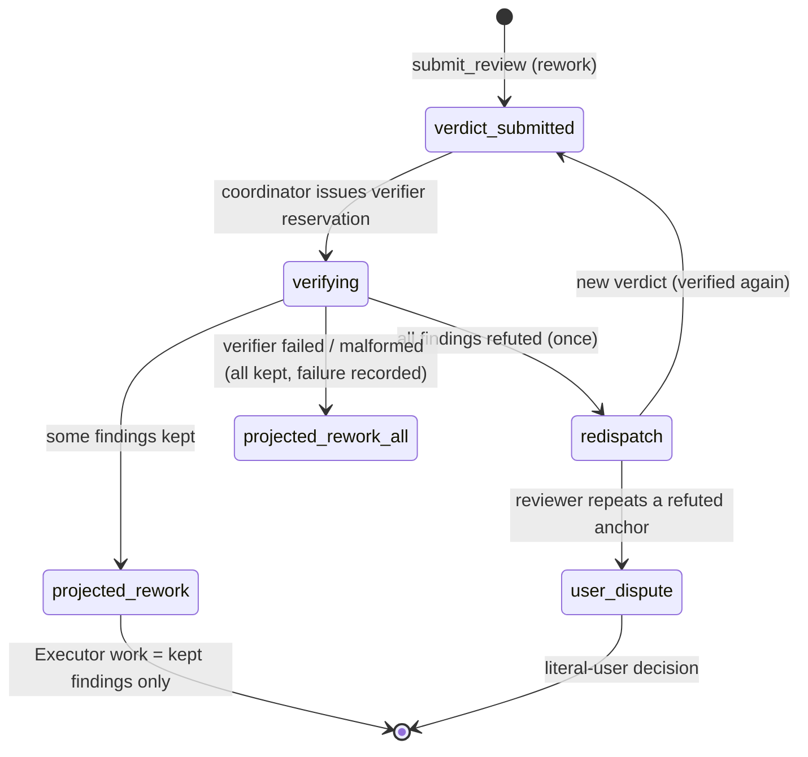

# Review verifier and reviewer eval

**Status**: candidate; planning and GitHub projection only, not execution
authority. Prepared 2026-10-20 at Derek's request, from the analysis of
Anthropic's "How the Claude Code team does code review" (claude.dev,
published 2026-10-15). Derek adopted the recommended answers to decision
points D1–D6 on 2026-10-20; the decisions are recorded in issue #284 and in
the "Decisions" section below. A Jev supplement (three items, following
issue #204's advisory-only / escalation-only pattern) was adopted by Derek
on 2026-10-20 and is folded into S0 item 7, S1 item 6, and S3 item 7.
**Initiative**: Review 验证与评测 (Review verification and eval)
**Immutable slug**: `review-verifier-eval`
**Carrier**: GitHub issue #284, which carries the full text of this spec;
this file is its repository copy.
**Document language**: English; user-facing discussion remains Chinese.
**Design risk**: High — S2/S3 change the assurance coordinator's verdict path
and add optional Kernel record fields. Both touch paths the project risk floor
names as material (`plugins/immune-brain/runtime/kernel`,
`plugins/immune-brain/runtime/assurance` in `.imm/risk-floor.json`), so every
runtime slice requires fresh independent Review, not QA alone.
**Execution posture**: measurement-first — build the eval corpus and record a
baseline of the current single-reviewer pipeline (S0, S1) before any verdict
path change (S2, S3). A verifier launched without a baseline cannot be shown
to help, and cannot be rolled back on evidence.
**Design views**: component interfaces (verifier role contract, coordinator
mediation states), state transitions (rework verdict lifecycle with a
verification step), and data flow (audit records → corpus → eval scores →
retro/report surfaces).
**Diagram decision**: required
**Diagram reason**: S2 inserts a new pending state between verdict submission
and rework projection, with three exits (project kept findings, redispatch
once, stop for the user); a state diagram is the only unambiguous statement of
which exits exist and who may take them.
**Execution prerequisite**: none outstanding. The deferred verifier design in
`docs/specs/review-convergence.spec.md` was explicitly parked "until S0–S3
produce false-positive data". Verified on current `main` (2026-10-20): S0
verdict contract is in `runtime/prompts/code-review.md` (advisory only on
pass, trigger form, threat-model bound), S1 delta admission is in the same
prompt and in `coordinator.ts` (`review_delta`), S2 budget exits are in
`runtime/kernel/reducer.ts` (`REVIEW_REWORK_ROUND_BUDGET = 5`,
`authorize_rework` with cumulative `review_round_budget_extension`,
`accept_residual_risk`), and S3's baseline file `docs/agents/qa-baseline.json`
exists. The revisit condition is met; the false-positive data it asked for is
exactly what S0/S1 of this spec collect.

## Outcome and approved boundaries

Review gains a second, independent check on its blocking claims and a durable
way to prove whether that check — or any future change to the reviewer — is
making things better or worse:

1. Every blocking finding in a `rework` verdict is verified by a fresh-context,
   read-only verifier that sees the finding and the immutable revision, never
   the reviewer's reasoning. It can only weaken a verdict (refute a finding
   with a concrete counter-path); it can never add a finding, approve, or
   synthesize a pass.
2. Past review outcomes become a labelled eval corpus. The reviewer (and later
   the verifier) is scored against it on every prompt, model, or coordinator
   change: recall on confirmed-real bugs first, false positives on clean tasks
   second, rounds-to-pass third — that priority order is part of the contract.
3. Review-quality metrics become routinely visible (rounds-to-pass
   distribution, disposition mix, `security_boundary` share of blocking
   findings) instead of requiring a one-off manual audit like the 70-task
   audit behind the review-convergence spec.

Evidence behind this outcome:

- The review-convergence spec's own audit (70 tasks): 59% of tasks settle with
  no rework, so a verifier that runs only on `rework` verdicts touches a
  minority of tasks; the cost sits in a ~14% tail running 4–10 rounds; only
  one finding has ever been refuted through the Executor's
  evidence-bound `refute_finding` path. Blocking claims are therefore
  effectively unchallenged today: the Executor's cheapest move is to fix a
  possibly-false finding and pay another review round.
- Anthropic's published loop (source article): findings are verified by other
  agents voting before a human sees them; incidents and reverts become an
  eval set re-run daily; noise is measured by how each comment was disposed
  (fixed / wrong / intentional / didn't matter) and by running the reviewer
  on known-clean PRs. Their stated reason noise matters more here than in
  human review: an agent author cannot wave off a nit — it fixes it, which
  costs another commit and another review round. That is exactly the
  immune-brain Executor's position.
- Committed audit data is sufficient to build the corpus: 250
  `task-record.json` files under `.imm/audit/` on current `main`, carrying
  `findings[]` (kind, status, `review_round`, and on v4 records `anchor` +
  `evidence`), `attestations[]` (review attestations carry
  `advisory_findings`), and `history[]` (`request_rework`,
  `authorize_rework`, `resolve_finding`, `accept_residual_risk` events).

Slices are independently verifiable outcomes, not read/edit/test Steps.

| Slice | Task ID | Independently verifiable result | Prerequisite |
| --- | --- | --- | --- |
| S0 | `review-verifier-eval-s0-corpus` | A versioned eval corpus exists (fixtures, not a runtime change): eligible historical cases extracted from committed audit records, each with revision identity, finding anchor/evidence, acceptance text, disposition, and a gold label state (`confirmed_true` / `confirmed_false` / `unlabeled`); clean cases included; a documented labelling protocol states that `resolved` is a silver label only. | None |
| S1 | `review-verifier-eval-s1-metrics` | An offline eval runner scores a reviewer configuration against the corpus (recall on `confirmed_true`, false-positive rate on clean cases, new-anchor rate) and a baseline report for the current single-reviewer pipeline is recorded; session-visible quality metrics (blocking by `violated.kind`, disposition counts where visible in session logs) are added to the `imm-retro` analyzer under its existing counting rules. | S0 |
| S2 | `review-verifier-eval-s2-verifier-role` | A read-only `review-verifier` role exists (source prompt + dist mirrors) with a two-valued per-finding contract (`kept` / `refuted` + concrete counter-path), receiving finding + evidence + acceptance + immutable revision and never reviewer reasoning; coordinator mediation dispatches it on `rework` verdicts only, with prompt-verbatim, receipt-bound dispatch mirroring the Review reservation. | S0 (baseline from S1 preferred but not blocking) |
| S3 | `review-verifier-eval-s3-projection` | Coordinator projection consumes the verifier attestation: partially refuted verdicts project rework with kept findings only and archive refuted claims with their counter-paths on the record (optional additive fields); an all-refuted verdict triggers exactly one reviewer redispatch carrying the counter-evidence, and a repeated refuted anchor stops for a literal-user dispute decision; verifier failure, timeout, or malformed output keeps every finding. | S2 |

S0 → S1 is serial. S2 depends on S0 only. S3 depends on S2. S1 and S2/S3 are
independent of each other once S0 lands.

### Out of scope

- Multi-agent voting ensembles. Anthropic votes with several agents; v1 is a
  single verifier. Revisit only if S1 scores show a single verifier's
  refutation precision is too low to trust (see Devil's Advocate).
- Verifying `pass` verdicts or advisory findings. Pass verification is D6;
  default is no.
- Changing `REVIEW_REWORK_ROUND_BUDGET`, the `blocking | advisory` taxonomy,
  the Executor's `refute_finding` path, or the delta-admission rule.
- A separate security reviewer, `REVIEW.md`-style per-area review slices, and
  diff-based risk re-tiering. Those were P1 items in the source analysis and
  belong to a separate initiative; this spec does not smuggle them in.
- The external `code-review` skill (Matt Pocock); it is not part of the
  Managed assurance path.
- Any change to `imm-retro`'s boundary (see D2). S1 works inside the current
  boundary or not at all.
- Migration of historical records; every new field is optional and absent on
  old records.

## Discovery evidence and reference closure

| Fact | Source |
| --- | --- |
| The verifier design already exists and was deliberately deferred pending S0–S3 data. | `docs/specs/review-convergence.spec.md`, section "Deferred: blocking verifier" |
| Review submission is a single foreground reviewer dispatch; `submit_review` consumes one verdict and projects rework in one step; the Parent cannot issue its own pass. | `plugins/immune-brain/dist/imm-run.md` Execution Loop steps 3–4; `runtime/assurance/coordinator.ts` |
| Verdict bytes are receipt-bound; mediation compares Parent-relayed bytes to the host-observed reviewer receipt and blocks on mismatch. | `runtime/assurance/review_mediation.ts`; ADR 0017 |
| The coordinator already rejects non-conforming verdicts for resubmission and never demotes, drops, or synthesizes findings or a pass. | `docs/specs/review-convergence.spec.md` S0 invariants; `coordinator.ts` `reviewReworkFindings` throws on any non-blocking finding in a rework verdict |
| Finding identity is the anchor: sha256 over `{violated, caller_chain}`, derived Kernel-side; a refuted Executor finding binds counterevidence to a fresh QA attestation and its liveness is derived, never stored. | `runtime/kernel/refutation.ts` (`anchorForEvidence`, `refutationIsLive`); `runtime/kernel/types.ts` `TaskFinding` |
| Finding dispositions already exist as statuses: `open / resolved / refuted / accepted_risk`. | `runtime/kernel/types.ts` `FindingStatus` |
| Older records lack `evidence`/`anchor` on findings (additive v4 fields normalised to null); sampled records from Aug–Sep 2026 show both shapes. Corpus eligibility must handle both. | `runtime/kernel/types.ts` `TaskFinding` comment; sampled `.imm/audit/**/task-record.json` (e.g. `wire-task-tier-review-gate` findings carry `review_round` but null evidence; `mws-assurance-review` findings carry `violated`) |
| `imm-retro` reads pi session JSONL only; its Boundary explicitly blocks `.imm/audit/` lifecycle statistics and scanning live `.imm/` directories; its analyzer already parses `submit_review` verdict findings, blocking/advisory counts, and rounds/task. | `plugins/immune-brain/dist/imm-retro.md` Boundary + Counting rules; `plugins/immune-brain/skills/imm-retro/scripts/review_retro.ts` header |
| Review workload is already classified (quick / standard / heavy) with timing profiles in the coordinator — a precedent for cost-scaling a second dispatch. | `runtime/assurance/coordinator.ts` `classifyReviewWorkload`, `REVIEW_TIMING_PROFILES` |
| Paths `runtime/kernel` and `runtime/assurance` are material in the risk floor; `critical.paths` is currently empty. | `.imm/risk-floor.json` |

Related contracts: ADR 0017 (receipt-bound verdict; extended by analogy to
the verifier receipt, not modified), `docs/specs/review-convergence.spec.md`
(the initiative whose deferred section this spec activates; its "reject,
never rewrite" invariant is preserved — see Architecture invariants).

## Technical Design

### Architecture and authority invariants

- **The reviewer's verdict bytes stay the reviewer's.** The verifier produces
  a separate attestation, bound to the verdict's `reviewer_verdict_sha256`
  and the snapshot digest. The coordinator never edits, demotes, or drops a
  finding inside the verdict, and never synthesizes a pass. What changes is
  *projection*: which findings become Executor work. Projection already
  depends on more than the verdict alone (fresh QA gates completion); the
  verifier attestation becomes one more recorded input to projection, fully
  visible on the record. If this reconciliation is not accepted in review,
  the fallback is the weaker redispatch-only model (verifier output is shown
  to the reviewer on redispatch and only the reviewer may change the
  verdict) — S3 must then be re-planned, not silently degraded.
- **The verifier can only weaken.** Its output is per-finding `kept` or
  `refuted`. It has no verdict of its own, no approval, no finding-creation
  path, and no state-mutation path. A malformed, timed-out, or failed
  verifier run keeps every finding (fail toward review, never toward pass).
- **Deterministic admission, recorded judgment.** Everything the coordinator
  decides from the verifier attestation is a deterministic function of
  recorded facts (anchor set, snapshot digest, round). The verifier's
  semantic judgment is recorded as an attestation with its counter-paths, so
  any projection can be audited back to the exact claim and counter-claim.
- **One redispatch, then a human.** An all-refuted verdict buys exactly one
  reviewer redispatch. A reviewer that repeats an anchor the verifier
  refuted for the same snapshot creates a dispute the machine does not
  resolve: the task stops for a literal-user decision presenting claim and
  counter-path side by side. No component may loop redispatches.
- **Literal-user authority is unchanged.** The verifier cannot accept
  residual risk, grant rounds, or approve a successor; budget-exhaustion
  exits stay exactly as S2 of review-convergence defined them.
- **Additive records only.** New fields are optional; records without them
  parse and behave exactly as today. A downgraded runtime reading a record
  with verifier fields ignores them and projects from the verdict alone
  (the pre-verifier behaviour) — acceptable because projection-from-verdict
  is the current shipped semantics, unlike an unknown finding *status*,
  which must keep failing closed.

### S0: eval corpus

1. **Extraction.** An offline script (bun, `scripts/review-eval/extract.ts`)
   reads committed `.imm/audit/**/task-record.json` files at a named commit
   and emits candidate cases. A case is one (task, review round, blocking
   review finding) triple. Eligibility for the gold pool requires all of:
   finding `source = review`, non-null `evidence` and `anchor`,
   `review_round` present, the round's review revision identity recoverable
   (from the review attestation/approval or history), and both git objects
   (`base_head`, `review_commit`) reachable in the repository.
2. **Disposition is a silver label.** Each case records its final disposition
   (`resolved` / `refuted` / `accepted_risk`) and the history events behind
   it. The corpus README states in its first paragraph: `resolved` means the
   Executor changed code, not that the finding was true — with a historical
   refutation count of one, treating `resolved` as ground truth would bake
   the current pipeline's bias into the eval. Gold labels come only from
   step 3.
3. **Gold labelling protocol.** A labeler who knows the code (in practice
   Derek, or a reviewer he names) confirms each selected case
   `confirmed_true` (the bug was real; label records where it lived — path
   and symbol) or `confirmed_false` (no wrong result was reachable, with the
   counter-path), following the article's protocol of having engineers who
   know the code confirm each bug and its location. Unreviewed cases stay
   `unlabeled` and are excluded from recall/precision denominators.
   First gold set target: 30 cases — at least 10 `confirmed_false` or clean
   (step 4), the rest `confirmed_true`, weighted toward budget-exhaustion,
   multi-round, and `accepted_risk` tasks. This is D5: without it, S1 reports
   silver-only numbers and the S2 launch decision stays data-poor.
4. **Clean cases.** Tasks with `lifecycle = done`, no `request_rework` in
   history, and no later fix task whose intent references them contribute
   their reviewed revisions as clean cases: any blocking finding a scored
   reviewer raises on them counts as a false positive. At least 10 clean
   revisions in the first corpus version.
5. **Holdout split.** Cases are split by task recency: the newest 20% of
   gold cases form a validation split that prompt/verifier tuning may not
   inspect case-by-case; headline scores report both splits. (Gaming risk,
   see Devil's Advocate.)
6. **Corpus format.** `tests/fixtures/review-eval/corpus.jsonl`, one JSON
   object per case: `task_id`, `round`, `base_head`, `review_commit`,
   `review_tree`, `anchor`, `evidence`, `acceptance_id`, `acceptance_text`,
   `disposition`, `gold` (`confirmed_true | confirmed_false | unlabeled`),
   `gold_location` (path/symbol, true cases), `gold_counter_path` (false
   cases), `labeler`, `labelled_at`, `split` (`tuning | validation`).
   Plus `tests/fixtures/review-eval/README.md` carrying the labelling
   protocol and the silver-label warning. Corpus regeneration is a rerun of
   the extractor at a new commit plus a labelling pass; the committed
   corpus, not the extractor output, is the eval input.
7. **Gold-case selection pre-screen (Jev supplement, 2026-10-20).** Before
   labelling, an offline Jev-style decision model pre-screens every
   extracted finding into {likely_true, likely_false, uncertain} from its
   `trigger`, `caller_chain`, and `violated` fields. Selection of the 30
   gold cases is uncertainty-first: cases the classifier is least
   confident about, and cases where its lean disagrees with the silver
   disposition, are labelled first; the item 3 weight rule breaks the
   remaining ties. The classifier's output is never a label and never
   enters the corpus as gold; it is recorded only in a selection log
   (case id, probabilities, selected or not, reason). The pre-screen is a
   disposable offline tool (`scripts/review-eval/prescreen.ts`); if it is
   unavailable, or a spot-check against the first labelled cases is poor,
   selection falls back to the item 3 weight rule with no other change.

### S1: eval runner and quality metrics

1. **Runner.** `scripts/review-eval/run.ts` takes a reviewer configuration
   (role prompt source + model identifier, as data — it does not read live
   workflow state) and, per gold case, dispatches the existing review prompt
   construction (`buildReviewSnapshotPrompt` in `coordinator.ts`) against
   the case's frozen revision in an isolated checkout, collects the verdict,
   and scores:
   - **Recall**: fraction of `confirmed_true` cases whose bug the run
     reproduces as a blocking finding. A reproduction is an anchor match
     **or** a blocking finding whose `violated.ref` and first `caller_chain`
     path match the gold location — anchor-only matching would mark a
     correct bug found via a different call chain as a miss; disputed
     matches are adjudicated by the labeler, recorded in the run report.
   - **False-positive rate**: blocking findings on clean cases per case,
     plus blocking findings matching a `confirmed_false` anchor.
   - **New-anchor rate**: blocking findings matching neither, reported
     separately (they are candidates for labelling, not automatically
     errors).
   - **Rounds proxy**: the runner is single-pass; rounds-to-pass is a
     record metric (item 3), not a runner output.
   The runner writes a report (JSON + short markdown summary) under
   `benchmark-results/review-eval/<date>-<config>.{json,md}`. It creates no
   TaskRecord, dispatches no Managed role, and is never invoked by the Loop.
   Model dispatch is an outbound effect: it runs only under the project's
   existing research/model channel authorization, stated in the run report.
2. **Baseline before change.** The first committed run scores the current
   pipeline (current `code-review.md`, current reviewer model) and its
   numbers are copied into the corpus README. S2/S3 acceptance compares
   against this baseline; a later run that cannot be compared (corpus or
   scoring changed) must say so instead of presenting a delta.
3. **Record-based quality report.** The same script family gains a
   `report` mode over committed audit records (never live `.imm/`): per
   period — rounds-to-pass distribution (from `request_rework` history per
   task, median and p95), disposition mix of review findings
   (resolved / refuted / accepted_risk shares), `security_boundary` share
   of blocking findings (the S1-gaming detector the convergence spec
   assigned to retro), and advisory count per pass. This report is the
   rounds/FP trend surface; it lives with the eval tooling because of D2.
4. **Session-visible retro metrics.** Inside `imm-retro`'s existing counting
   rules (session JSONL only, no boundary change), the analyzer additionally
   reports, per author model: blocking findings split by `violated.kind`
   (`acceptance` vs `security_boundary`) parsed from the `submit_review`
   verdict findings it already reads, and the count of `refute_finding` /
   `resolve_finding` / `accept_residual_risk` tool events where they appear
   in session logs. Any metric whose source event is not demonstrably
   present in the committed fixtures (`tests/fixtures/review-retro/`) is
   dropped from this item rather than claimed — a characterization fixture
   proving visibility is part of the slice's tests.
5. **Gate rule (written down, per the article's priority).** A change to the
   reviewer prompt, reviewer model, verifier, or admission rules is
   merge-ready only with an eval run showing, against the baseline on the
   same corpus version: recall not lower, clean-case FP rate not higher,
   rounds-to-pass p95 (record report) not higher. When recall and FP trade
   against each other, **recall wins**; the trade must be named in the run
   report, not hidden in an average.
6. **`security_boundary` mislabel rate (Jev supplement, 2026-10-20).** The
   record report (item 3) additionally runs an offline Jev-style
   classification of each blocking finding's `violated.kind` from its
   trigger and caller chain, independent of the reviewer's declared kind,
   and reports the mismatch rate beside the raw `security_boundary` share:
   the share shows volume, the mismatch rate shows mislabelling — the
   gaming signal the review-convergence spec assigned to observation. The
   classifier is itself evaluated against the S0 gold cases before its
   numbers are reported as anything but experimental. Its output never
   changes a finding, a record, or an admission decision.
7. **Per-acceptance repeat counts (convergence data, added 2026-10-20).**
   The record report (item 3) also carries, per acceptance ID, the count
   of that acceptance's rework findings across rounds and the number of
   rounds since its last finding, derived from committed records only.
   This is the data half of #204 S1: that proposal asked the runtime to
   surface a per-acceptance repeat count so imm-run's generalize-or-refute
   rule and coordinator-correction behaviour fire on a deterministic
   count instead of a coordinator remembering to count. Building the
   series once, here, means the batch convergence trigger and the review
   quality report read the same numbers. The report decides nothing by
   itself; wiring a trigger into imm-run remains #204 S1's own follow-up.
8. **Review timing instrumentation (added 2026-10-20).** Item 3's
   rounds-to-pass numbers say how many rounds a task took, never how long
   a round's review took: no TaskRecord version timestamps the review
   itself (the v4 history has no review event and attestations carry no
   timestamps; the v2/v3 `submit_review` event records submission of an
   already-obtained verdict, not a dispatch bracket — verified by the
   2026-10-20 measurement over the 145 committed records, which could
   not recover any review-duration share). So that "how much of a task
   is review" is measurable from records at all, the coordinator records
   two timestamps per review round on the task record: when the Review
   reservation is created (QA pass → `review_ready`) and when the verdict
   is submitted. The record report (item 3) additionally publishes the
   dispatch→verdict duration distribution (median and p95) over rounds
   that carry both timestamps. Records written before this change are
   treated as unmeasured and excluded from the duration series, never
   counted as zero. The timestamps are observations only: no gate,
   budget, or admission reads them. When S3 lands, verifier rounds get
   the same pair on the verification history event.

### S2: verifier role

1. **Role prompt.** New source prompt `runtime/prompts/review-verifier.md`,
   regenerated into `dist/role-prompts/review-verifier.md` and the Claude
   reviewer definitions by the existing build path. The role is read-only,
   is not a public Skill, has no stable review gate (it is not
   `imm-code-review` and must never be dispatched as one), and is dispatched
   only by the coordinator path in S3.
2. **Input packet** (built by the coordinator, byte-identical dispatch like
   the reviewer reservation): snapshot digest; immutable revision identity
   (`base_head`, `review_commit`, `review_tree`, `manifest_digest`); for
   each blocking finding — `id`, `summary`, `evidence` (`trigger`,
   `caller_chain`, `violated`), and the acceptance text for its
   `acceptance_id` from the enrolled TaskIntent (for `security_boundary`,
   the boundary name and the Spec's threat-model line). The packet never
   contains: reviewer prose beyond the finding fields, the reviewer's
   approval summary or `inspected_paths`, Parent commentary, or any prior
   round's verifier output.
3. **Output contract.** Exactly one JSON object:
   `{contract: "assurance_kernel/review_verification/v1", task_id,
   snapshot_digest, verdict_sha256, results: [{finding_id, anchor,
   verdict: "kept" | "refuted", counter_path?: string}]}`.
   `counter_path` is required for `refuted` and must read as a concrete
   counter-argument in the same shape as a trigger: the input or state the
   finding claims, and why the observable wrong result cannot occur, citing
   a repository path or symbol read from the immutable revision. A
   `refuted` without a counter-path, a result naming an unknown anchor, a
   missing result for any blocking finding, or any extra finding is a
   malformed verification: the whole verification is discarded and every
   finding is kept.
4. **Evidence rules mirror the reviewer's.** Read only the immutable
   revision with read-only git commands; never read live worktree bytes;
   an unchanged path may be read only when the finding's caller chain or the
   acceptance directly requires it, cited in the counter-path.
5. **Model choice is D1.** Default in this draft: a fresh-context dispatch
   on a *different* model from the reviewer's when the host offers one,
   recorded in the attestation either way; same-model verification is
   labelled as such in every report, because correlated errors are its
   known weakness.

### S3: coordinator projection and convergence

1. **New pending state.** After `parseAssuranceVerdict` validates a
   `rework` verdict and before any Kernel `request_rework` action is
   projected, the coordinator returns a `verification_ready` result
   carrying the verifier `agent_params` (the same shape discipline as
   `review_ready`: one exact foreground dispatch, prompt verbatim,
   receipt-bound submission via a new `submit_verification` operation).
   The artifacts stay frozen; QA freshness is unaffected; the reservation
   is single-use and expires like the review reservation. `pass` verdicts
   skip verification entirely (D6 default).
2. **Projection.** On a valid verification: kept findings project to
   Executor work exactly as today. Refuted findings are **not** projected;
   each is recorded on the review attestation as an optional
   `verifier_refutations[]` entry `{anchor, finding_id, counter_path,
   verifier_actor}` and in the task history as a `verification` event with
   checked/refuted counts (the deferred design's "optional verifier counts
   and refutation reasons" on the record).
3. **All-refuted.** No findings project and no pass is synthesized. The
   coordinator issues one new Review reservation whose prompt (built by
   `buildReviewSnapshotPrompt`, never edited by the Parent) includes the
   counter-evidence block: refuted anchors with their counter-paths, and
   the instruction to return `pass` with full coverage or a `rework`
   whose findings survive the same verification. The new verdict goes
   through verification again. If it repeats any anchor refuted for this
   snapshot, submission is blocked with a dispute result and the task
   parks for a literal-user decision (claim vs counter-path presented);
   neither reviewer nor verifier can override the user, and the user
   exit is an existing authority action (accept the finding as rework, or
   dismiss it and let the task proceed to a fresh review) — the exact
   action mapping is fixed in the slice's tests, not improvised.
4. **Failure handling.** Verifier timeout (reuse the review dispatch
   timeout profile for the workload class), dispatch failure, malformed
   output, or receipt mismatch: verification is recorded as failed with
   its reason, all findings are kept, and projection proceeds. Failure
   never blocks the task and never retries automatically within the round.
5. **Retro/eval visibility.** Verification events and counts land in the
   record (item 2), so the S1 record report gains two series from the
   first verified task onward: refutation rate per round and dispute
   count. Session-log visibility of verification dispatches is a
   characterization question for the retro fixtures, not an assumption.
6. **Rollout flag.** A project config switch (`review_verifier: off | on`,
   default `off` until S1's baseline and one shadow period exist) gates
   dispatch. Shadow mode, if the host supports it cheaply, runs the
   verifier and records its attestation without changing projection; if
   shadow mode cannot be built without a second projection path, it is
   dropped and rollout is off → on with the eval gate as the only guard.
   (No silent third semantics.)
7. **Refutation escalation check (Jev supplement, 2026-10-20).** Before a
   refuted finding is archived under item 2, a Host-side Jev-style
   classifier — invoked by the Host, never by the runtime (ADR 0006) —
   scores the probability that the finding is a true positive, from its
   trigger, caller chain, and the verifier's counter-path. The score and
   the threshold version are recorded in the verification history event.
   If the probability meets a code-owned threshold, the refutation does
   not archive: the finding escalates to the same literal-user dispute
   stop as item 3's repeated anchor, presenting claim, counter-path, and
   the classifier's disagreement. The classifier can never refute or keep
   a finding by itself, never affects kept findings, and never lowers a
   dispute back to an archive. Its threshold is set from S1 baseline data
   and changed only through the S1 eval gate (D4). If the classifier is
   unavailable or fails, behaviour is exactly items 1–6 as written (the
   archive proceeds): the check is additive strictness, and its absence
   restores the pre-supplement semantics rather than blocking the task.

### Decisions (adopted 2026-10-20, Derek; recorded in issue #284)

- **D1 — Verifier model.** **Adopted (2026-10-20): different model whenever the host offers one; same-model runs are labelled as such.** Different model than the reviewer whenever the
  host offers one (recommended; independence is the point), or same model,
  fresh context (cheaper, correlated-error risk accepted and labelled)?
- **D2 — imm-retro boundary.** **Adopted (2026-10-20): keep the current boundary; S1 items 3–4 stand as written.** Keep the current boundary (record-based
  quality metrics live in the eval tooling, S1 items 3–4 as written;
  recommended), or amend `imm-retro` to also read *committed* audit
  snapshots (never live `.imm/`)? The boundary was deliberate; this spec
  does not quietly reverse it.
- **D3 — Partial refutation.** **Adopted (2026-10-20): project kept-only rework, refuted claims archived on the record (S3 as written).** Project kept-only rework with refuted claims
  archived on the record (as designed above), or redispatch the reviewer
  on any refutation? The latter preserves a stricter reading of "never
  drop a finding" at the cost of a full extra review round per refutation.
- **D4 — Eval cadence.** **Adopted (2026-10-20): on-change gate only; no scheduled run.** On-change gate only (any reviewer/verifier change
  requires a run; recommended for a solo repo), or additionally a scheduled
  weekly run against new audit records (model cost per run, fresher
  trend)?
- **D5 — Gold labelling.** **Adopted (2026-10-20): Derek labels the first 30 gold cases; the estimated effort is accepted as S0's prerequisite.** Who labels the first 30 gold cases, and is the
  effort (est. 1–2 hours against the code) accepted as S0's prerequisite?
  Without gold labels S1 is silver-only and S2's launch has no evidence
  bar to clear.
- **D6 — Pass verification.** **Adopted (2026-10-20): `rework` verdicts only.** Verifier on `rework` verdicts only
  (recommended), or also on `pass` verdicts for `critical` tasks (catches
  missed bugs, doubles verifier cost on the highest-stakes path, and has
  no `refuted` semantics — a verifier cannot create a finding, so a
  suspicious pass can only be flagged for the user)?

## Verification and acceptance mapping

All checks are post-implementation obligations; Planner ran none of them.

| Acceptance | Focused seams | Required regression evidence |
| --- | --- | --- |
| S0 / `RVE-S0-A1` | `tests/review-eval-corpus.test.ts` (new) | Extractor run at a pinned commit yields a deterministic corpus (same input commit → byte-identical jsonl); ineligible records (null evidence, unrecoverable revision, unreachable git objects) are excluded with counts by reason; corpus validates against its schema; README states the silver-label rule; gold/validation split is by recency and stable across regeneration. Pre-screen: the selection log records probabilities and a reason for every candidate, selected cases are uncertainty- and disagreement-first, classifier output appears nowhere in the corpus as a label, and disabling the pre-screen reproduces the item 3 weight-rule selection exactly. |
| S1 / `RVE-S1-A1` | `tests/review-eval-runner.test.ts` (new, model dispatch faked), `tests/review-retro-analyzer.test.ts` | Scoring: a faked verdict reproducing a gold bug by anchor and one by location both count as recall hits; a blocking finding on a clean case counts FP; unknown anchors count as new-anchor, never silently as FP or TP. Record report: rounds/dispositions/`security_boundary` shares computed from committed fixture records match hand-checked values. Retro: new metrics appear only for events present in fixtures; a fixture without `violated.kind` in verdict findings yields the pre-change report unchanged. Baseline report committed and referenced from the corpus README. Mislabel rate: classifier-kind versus declared-kind mismatch over fixture records matches hand-checked values and is labelled experimental until scored against gold. |
| S2 / `RVE-S2-A1` | `tests/host-neutral-assurance-coordinator.test.ts`, `tests/skill-dist-consistency.test.ts` | Verifier packet contains finding + acceptance + revision and demonstrably excludes reviewer prose/Parent text (packet snapshot assertions); output contract rejects missing results, unknown anchors, refuted-without-counter-path, and extra findings as malformed-kept-all; source prompt and all dist mirrors agree; the role has no review gate and cannot be dispatched as `imm-code-review`. |
| S3 / `RVE-S3-A1` | `tests/host-neutral-assurance-coordinator.test.ts`, `tests/kernel-canary-rework-authority.test.ts`, host conformance (`tests/claude-host-authority.test.ts`, `tests/pi-canary-user-authority.test.ts` as applicable) | From real submitted verdicts through the coordinator (not prompt-text assertions): partial refutation projects kept findings only and records `verifier_refutations` with counter-paths; all-refuted issues exactly one redispatch whose prompt carries the counter-evidence; a repeated refuted anchor parks for the user with zero Executor work projected; verifier timeout/malformed/receipt-mismatch projects all findings and records the failure; `pass` verdicts never dispatch a verifier (default config); config `off` reproduces today's projection exactly; records without verifier fields parse and settle unchanged on both hosts. Escalation check: a refuted finding whose recorded classifier probability meets the threshold parks for the literal user instead of archiving, a below-threshold score archives, and classifier failure archives with the failure recorded in the verification event. |

### Descriptor execution provenance

- Executables: `bun` and the fixtures' `git` from the QA host; the eval
  runner's model dispatch is the only network/model effect and is **not**
  part of any acceptance descriptor — descriptors use faked dispatch.
- Setup: none (`environment.prepare` absent); fixtures create and clean
  their own temporary repositories; corpus fixtures are small hand-checked
  excerpts of real audit records, not the full 250-record tree.
- Limits: 180 s / 192 KiB per descriptor over explicit file arguments;
  adjust only through an accepted Intent revision.
- Regenerating bundles and mirrors (`dist/role-prompts/*`,
  `dist/claude/mcp-server.mjs`), `bun run typecheck`, and
  `scripts/sync-dist-docs.ts --check` are Executor/CI regression work, not
  acceptance descriptors.

## Interruption recovery and rollback

- A `verification_ready` reservation interrupted mid-dispatch recovers
  exactly like a review reservation: `advance_assurance` reconciles the
  projection; an uncertain submission is never replayed blindly; a stale
  or released reservation is abandoned and re-issued, with all findings
  kept in the interim.
- S0/S1 rollback is deletion of fixtures, scripts, and reports; no
  workflow state exists to unwind.
- S2/S3 rollback is the config switch: `review_verifier: off` restores
  today's projection path. Parser support for `verifier_refutations` and
  verification history events must outlive the switch (records written
  while it was on remain readable), mirroring the review-convergence S2
  rollback rule for `accepted_risk`.
- No slice hand-writes a TaskRecord or rewrites audit history.

## Devil's Advocate Audit

- **Correlated blindness**: S3 item 7's escalation check is the heterogeneous second signal for this risk (a decision-model classifier, structurally different from the verifier's generative judgment, advisory-to-stricter only). A same-family verifier may share the reviewer's
  blind spots, refuting real bugs confidently. Mitigations: D1's
  different-model default, counter-path must cite the revision, and S1's
  gate can score the verifier itself (refutations later contradicted by a
  fix task are countable in the record report). If measured refutation
  precision is poor, the honest outcome is to keep the verifier in shadow
  or drop it — the eval exists to make that call possible.
- **Reviewer gaming**: a reviewer could write triggers too vague to
  refute, or lean on `security_boundary` (which the verifier may judge
  more leniently). The kept-by-default rule and the S1
  `security_boundary`-share series are the detectors; a rising share after
  S3 ships is itself a finding about the system.
- **Silver-label leakage**: if `resolved` is ever treated as ground truth
  in a headline number, the eval certifies the status quo. The corpus
  schema keeps `disposition` and `gold` as separate fields and the runner
  refuses to compute recall/precision over `unlabeled` cases.
- **Overfitting the corpus**: tuning prompts against the same historical
  cases that score them inflates both metrics. The recency holdout split
  (S0 item 5) is the guard; validation-split scores are the headline.
- **Cost creep**: verification adds one model dispatch per rework round.
  Bounded by construction: passes (the majority path) pay nothing, and
  the workload classifier already in the coordinator is the precedent if
  verifier timing needs profiles. If rounds-to-pass does not fall, S1's
  gate rule says the verifier has not earned its cost.
- **Authority creep**: a verifier that can make findings disappear is one
  prompt revision away from a verifier that can make tasks pass. The
  invariants (no pass synthesis, one redispatch, user-resolved disputes,
  attestation on the record) are the containment; any slice that weakens
  one must re-plan, not amend quietly.

## Brainstorm Trace and planning handoff

No upstream Brainstorm manifest and no `BR-*` items. Upstream decisions this
draft rests on: the deferred verifier design in
`docs/specs/review-convergence.spec.md` (retained design, activated here),
Derek's 2026-10-20 direction to draft the two P0 items from the Anthropic
code-review analysis (blocking-finding verification; incident/eval loop with
retro metrics), and the article's published priority (recall first, rounds
second). Decisions D1–D6 were adopted as recommended by Derek on 2026-10-20 and
are recorded in issue #284, so no decision gate remains on any slice.

Canonical candidates (to be authored through `imm-kernel intent author` on
approval; every candidate must report `valid: true`):

- [S0 TaskIntent](../plans/review-verifier-eval-s0-corpus.intent.json)
- [S1 TaskIntent](../plans/review-verifier-eval-s1-metrics.intent.json)
- [S2 TaskIntent](../plans/review-verifier-eval-s2-verifier-role.intent.json)
- [S3 TaskIntent](../plans/review-verifier-eval-s3-projection.intent.json)

Publication record: GitHub projection is issue #284 (2026-10-20, at
Derek's direction, spec attached in full). The four canonical candidates
below were authored through `imm-kernel intent author` on 2026-10-20
after Derek adopted D1–D6.
