# Single-task batch finalization recovery

**Status**: Candidate; planning only.
**Design risk**: High — this repairs persisted batch lifecycle and the boundary between successful verification, checkout delivery and completion.
**Output language**: English.
**Execution posture**: test-first at the existing public `startBatch` seam.
**Threat model and supported environment**: Repository-owned batch records, Git refs and local user edits; trusted local Bun/Node/Git on macOS/Linux and UTF-8 paths. Invalid persisted reports, stale commit identities and overlapping user files are concrete negative inputs. No remote provider, credential or Kernel database migration is introduced.

## Outcome

Make a verified single-task batch finish or park with a readable, truthful report instead of throwing during finalization. Preserve the settled child, its integrated commit, native authorization boundaries and every checkout overlap protection. Recover the existing interrupted `antigravity-plugin-isolation-recovery` batch through normal same-Host runtime operations once the repaired build is available.

The runtime repair is one independently verifiable Slice, `single-task-batch-finalization`. Its completion proves the software behavior and recovery fixtures. The original package is delivered only when its own batch reports a successful checkout delivery; a repair task passing tests does not prove that delivery. A real remaining overlap must be surfaced to the user, not silently resolved or hidden behind `completed`.

## Evidence and call closure

| ID | Concrete source |
| --- | --- |
| E1 | Observed `start_unattended_batch` failed with `final verification requires a completed lane batch`. The following status projection retained child `integrated`, commit `9a113f6e735e11cfdd0f76e17247c683060e7a0c`, batch `running`, final report with successful `bun test` and `bun run typecheck`, and coordinator return `blocked/return_pending`. Batch id: `batch-antigravity-plugin-isolation-recovery-5019dbdf-b011-4efc-b5d9-7d2a793dbb0f`. |
| E2 | `plugins/immune-brain/runtime/unattended/batch_lanes.ts:1354` verifies the integrated tip, persists a final report, attempts single-task delivery, then at `:1371` parks the batch and also assigns `final_verification_result`. `batch_state.ts:752` accepts that top-level field only for `completed`. This is the incompatible producer/validator pair. |
| E3 | `runtime/unattended/checkout_delivery.ts:15` refuses every dirty overlap before applying the patch. The coordinator has staged `docs/plans/antigravity-plugin-isolation-recovery.intent.json` and its Spec, both also present in the integrated delivery. A read-only intersection of the recorded delta and coordinator status establishes these likely blocking paths; no delivery write is needed to diagnose them. |
| E4 | `tests/single-task-lane-batch.test.ts:337` tests an overlapping file without `final_verification`; `:279` tests interactive completion without those commands. Thus neither exercises successful verification followed by a blocked checkout. `tests/single-task-checkout-delivery.test.ts:53` already protects staged, unstaged, untracked, deletion and rename overlaps in manual/auto modes. |
| E5 | `runtime/unattended/batch_lanes.ts:838` resumes a delivery-parked child as integrated after fresh authorization. `batch_state.ts:828` recognizes a parked delivery by its existing commit and matching report/child reason. `batch_runner.ts:27` exposes completed evidence only for a completed record with successful top-level verification. These consumers must retain their existing meanings. |
| E6 | `runtime/unattended/batch_final_verification.ts:53` parses command results; `:140` runs verification at a detached Parent tip using the declaration HEAD. `batch_final_report.ts:98` stores a nested verification observation and starts return status as `blocked/return_pending`. `batch_worktrees.ts` owns temporary Parent worktree cleanup. |
| E7 | `runtime/unattended/batch_state.ts:1000` parks Executor interruptions; `batch_disposition.ts:248` owns supersession; `batch_lanes.ts:1443` owns other parked transitions. Pi `plugins/immune-brain/.pi-extension/imm-unattended-batch.ts:406` calls `startBatch`; Claude `runtime/claude/mcp_server.ts:920` reads the persisted record. There is no new host-specific finalization owner. |
| E8 | `docs/agents/derived-files.json:6` declares the Claude bundle as a generated runtime consumer. `scripts/build-claude-plugin.ts:142` regenerates it. Existing batch and checkout tests are the regression seams; no second state store, shim or new schema version is necessary. |
| E9 | `tests/explicit-phase-entry-run-contract.test.ts:26` still expects the removed phrase `that the runtime spawns`; canonical `plugins/immune-brain/dist/drive.md:40` omits it. The user already approved the exact single-line assertion repair in this conversation. Include that same repair if the new Lane baseline still needs it, rather than weakening or skipping the full suite. |
| E10 | Pi's installed `docs/packages.md:9` supports `pi install <local-path>`; `:17` documents `pi list` and `pi remove <source>`; `:21` identifies the settings writes; `:44` confirms local directories load without copying. `batch_lanes.ts:1448` names Pi `/reload` as the existing same-Host reload operation. |

`runtime/` in the table abbreviates `plugins/immune-brain/runtime/`. The live recovery commit and the original terminal audit pair are evidence inputs, not editable implementation paths.

## Decisions

| ID | Decision | Exactly one source |
| --- | --- | --- |
| D1 | Keep `final_verification_result` as a completed-only top-level field. Store an interrupted or parked finalization attempt in the existing `final_report.final_verification` observation instead. Do not loosen the reader to accept illegal top-level combinations. | E2. |
| D2 | Preserve existing `checkout_delivery_overlap` behavior for all files, including planning files. Return the exact overlap and a durable `needs_human` report; never overwrite or exempt a path because it looks task-owned or already staged. | E3. |
| D3 | Resume from validated child settlement, integrated commit and final report through the existing batch owner. Reuse recorded verification only when its actual head, ordered commands, derived-check declaration and relevant inputs still match; otherwise rerun required checks. Reuse never creates a QA or Review approval. | Delegated technical choice: preserve valid work while refusing stale success. |
| D4 | Make single-task checkout delivery conditional on successful final verification for that tip. A failed, timed-out or missing required check preserves the integration and records the failure without checkout or cleanup effects. | Delegated technical choice: a verification failure cannot authorize delivery. |
| D5 | Persist only valid existing lifecycle shapes, retain the nested report before return, and promote the top-level result with completion after successful delivery. Resume must reconcile an already-applied delivery without applying it twice or claiming a fresh integration. | Delegated technical choice: one state owner and replay-safe side effects. |
| D6 | Use the shared runtime implementation for both current Hosts and rebuild declared generated consumers. Do not hot-patch the installed plugin, edit the live batch record, reset branches, or switch to an unmanaged execution path. | E7. |
| D7 | Carry the previously approved single-line stale contract assertion repair only if still absent from the new baseline; keep its isolation assertion and leave the canonical drive contract unchanged. | E9. |

## User scenarios

Source: the user's request to plan repair of the observed finalization blocker, following E1.

| Scenario | Observable result | Mapping |
| --- | --- | --- |
| SCN-1 | A settled, integrated single task with passing final commands delivers and reports completion. | automated: AC1 |
| SCN-2 | The same task encounters a dirty checkout path and reports the exact conflict while preserving user bytes and prior passing evidence. | automated: AC2 |
| SCN-3 | After an authorized conflict resolution or interruption, the existing batch resumes without a new child, duplicate integration or duplicate delivery. | automated: AC3 |
| SCN-4 | A failed or stale final verification never causes checkout delivery or a false success report. | automated: AC4 |

## Technical Design

**Design views**: persisted evidence shape and the finalization state/sequence. No new field, schema version, public command or Kernel lifecycle is required.
**Diagram decision**: required
**Diagram reason**: verification, parking and completion currently use incompatible persisted shapes; their legal ordering is the core invariant.

```mermaid
stateDiagram-v2
    [*] --> running
    running --> running: child integrated; persist nested final report
    running --> needs_human: verification fails or checkout blocks
    needs_human --> running: existing native resume authorization
    running --> completed: verification passes and delivery recorded
    completed --> completed: terminal replay
```

### Evidence shape and validation

The nested `final_report` is an observation for the recorded integrated tip, usable before completion. The top-level `final_verification_result` is the existing completed-batch proof consumed by `completedParentReport`. Do not persist it in `running` or `needs_human`, and retain rejection tests for that illegal combination. Validate nested evidence before considering reuse: reject contradictory results, changed command lists, mismatched report/head identities and unresolvable integration refs. An invalid observation cannot authorize delivery; rerun legitimate verification or return the specific invalid-state error without manufacturing a pass.

Do not add a parallel cache, dual-write bridge, migration command or compatibility adapter. The interrupted real record already has the permitted shape: `running`, an integrated child and a nested final report. Its normal resume is the recovery input. Unknown/newer record versions keep the existing refusal behavior.

### Finalization sequence and side effects

1. Verify existing child/run settlement, audit ownership, recorded integration/ref lineage and current command declaration. No finalization signal may manufacture child settlement.
2. Obtain current final verification, reusing a validated matching observation only when its relevant inputs are unchanged. A changed tip, command, derived declaration or relevant execution input requires new verification. Missing evidence is not a pass. Include normal exit, nonzero exit and timeout results with their recorded durations.
3. Build and persist the nested final report in a legal running shape before checkout. If required verification did not pass, return a readable failed finalization report and retain the child commit. Do not invoke delivery, cleanup or completed-only evidence consumers.
4. On passed verification, invoke existing checkout delivery. Dirty overlaps, conflicting apply, detached/diverged auto HEAD and unreadable Git state remain normal blocked outcomes. Persist the real reason as `needs_human`, preserving user index/worktree/HEAD and keeping top-level completed proof absent. This must not throw the old completed-only error.
5. Record a successful checkout outcome before cleanup; then atomically persist an existing valid completed shape with its top-level verification result. Cleanup still requires its existing observed normal-exit proof and clean Lane. Failure or interruption leaves resources retained. No interactive `done` signal grants exit proof.
6. On replay, verify whether the exact delivery is already applied before any repeat apply. Identity comparison must cover the delivery delta, index/worktree content and modes in manual mode, plus HEAD/ref lineage in auto mode; no broad reset, staging or overwrite is allowed. A changed path parks, a proven already-applied delta is reconciled, and a retained commit is never integrated again. Existing fresh native authorization remains necessary for a parked batch.

Preserve every emitted reason and committed effect. If interrupted before report persistence, resume verification from available durable facts; if interrupted after report persistence but before delivery, reuse only validated evidence; if interrupted after checkout but before completion, reconcile delivery identity. Never roll back the integrated commit or user changes to make a retry convenient.

### Settlement enumeration and owners

| Trigger | Legal transition and owner | Non-authoritative signals |
| --- | --- | --- |
| Child completion | Kernel terminal/audit evidence permits the existing batch driver to integrate. | Herdr idle/done, reviewer prose, elapsed time. |
| Final verification normal success | Batch driver records nested result; passed identity permits delivery. | A resolved promise without its validated report. |
| Nonzero exit, spawn failure or timeout | Existing verifier supplies failure/duration; driver preserves integration, refuses delivery and records failure. | Quiet output or partial test counts. |
| Checkout overlap/apply refusal | Driver persists `needs_human` plus exact delivery reason; no checkout overwrite. | A desire to finish or a planning filename. |
| Cancel/session shutdown/exception | Already persisted state survives; resume uses the existing task/run/ref identities. | Assumed process exit or a stale summary. |
| Fresh user resume after conflict resolution | Existing Host native gate authorizes returning the parked batch to running. | An advisor or coordinator inventing authorization. |
| Successful checkout and valid final proof | Batch driver owns batch completion; Kernel child remains its already-settled owner. | Child completion alone or an unapplied patch. |
| Stop, retirement or cleanup | Existing stop/disposition/exit-proof owners and gates remain unchanged. | This repair task or its regression fixtures. |

Same-state-machine coverage includes `batch_lanes.ts`, `batch_state.ts`, `batch_runner.ts`, `batch_preflight.ts`, `batch_final_report.ts`, `batch_final_verification.ts`, `checkout_delivery.ts`, `batch_disposition.ts`, `lane_decision.ts` and `lane_cleanup.ts`. Their callers and existing schemas retain the same version gates. Prefer producer ordering fixes; only change readers if necessary to validate an already-supported observation, never to normalize invalid authority into completion.

## Acceptance and verification

All checks are local project-owned Bun tests with installed repository dependencies and QA-host Git/Bun/Node. They use disposable repositories, recorded trivial verification commands and isolated process fixtures, never a real model, plugin installation, remote write or production state. No descriptor installs prerequisites. Required tests must execute; skips or zero matched checks do not pass. Extend existing fixtures rather than duplicate them in a new framework.

| ID | Exactly one source | Observable seam and controls |
| --- | --- | --- |
| AC1 | E2 | `tests/single-task-lane-batch.test.ts`: `startBatch` with explicit final commands reaches legal completion on a clean manual and auto checkout, with commands passing, correct delivered content and persisted completed-only proof. Re-read through `readAnyBatchRunState`; malformed top-level proof in running/parked shapes still fails. |
| AC2 | E3 | Same driver seam plus `tests/single-task-checkout-delivery.test.ts`: passing commands followed by a dirty overlap return `needs_human` and the exact path without throwing. Include staged canonical planning input as the reported path, plus existing staged/unstaged/untracked/deletion/rename and manual/auto protections. Index/worktree/HEAD and the integrated commit remain unchanged; nested pass survives; top-level completed proof stays absent. |
| AC3 | E5 | `tests/single-task-lane-batch.test.ts` and `tests/batch-final-report.test.ts`: restore the observed running/integrated/nested-pass interruption shape and resume; also resume a legal delivery park with fresh authorization after fixture-owned conflict removal. Reuse unchanged valid evidence, reject stale head/changed commands/contradictory results, never duplicate child enrollment or integration. Interrupt after delivery before completion and reconcile only an equal full delivery identity; changed delivered bytes or modes park without overwrite. Terminal replay is idempotent. |
| AC4 | D4 | `tests/single-task-lane-batch.test.ts` and `tests/batch-final-verification-required.test.ts`: nonzero, missing required verification and bounded timeout produce explicit failed outcomes and duration evidence; no checkout delivery or cleanup occurs. Successful verification against a different tip cannot be promoted. Keep integrated refs/audit evidence and readable reports. |
| AC5 | E7 | `tests/batch-merge-queue.test.ts`, `tests/unattended-batch-lanes.test.ts` and `tests/single-task-lane-cleanup.test.ts`: Initiative completion, native parking/resume and retained/removed Lane exit-proof behavior remain supported; real user files and unknown/newer records remain protected. |
| AC6 | E9 | `tests/explicit-phase-entry-run-contract.test.ts`: the approved stale sentence matches the canonical Lane isolation wording; all five checks execute, the canonical contract is unchanged, and no assertion is deleted or skipped. |

Completion diagnostics additionally require regenerated declared bundles, the corresponding builder `--check`, docs/contract checks if touched, `bun run typecheck` and full `bun test`. These are completion requirements, not whole-suite acceptance descriptors. Reuse prior results only when the task's actual inputs are unchanged.

## Execution and original-delivery recovery

One Slice delivers the runtime fix and its fixture-proven replay behavior. Retain the original batch id, settled child run `run-c8995e0b-3b1d-4787-8e6c-244527979fff`, integration `9a113f6e735e11cfdd0f76e17247c683060e7a0c`, terminal audit and recorded command results. Do not import that child into the new task or rerun its implementation.

The loaded Parent plugin currently comes from `/Users/derek/.pi/agent/git/github.com/dereknex/immune-brain/plugins/immune-brain`, whereas the proposed source fix is in this workspace. A source edit is not runtime activation. After the new repair Lane is assured, use `pi list` to identify the exact existing package source and resource selection, then prepare a same-Host local-source switch to that verified Lane package using the supported `pi remove <recorded-source>` / `pi install <absolute-repair-Lane-root>` operations and `/reload` (E10). Before any settings write, obtain explicit current-Host confirmation for those exact sources, settings target and rollback; never guess or remove another package. Keep the same coordinator workspace and task identities. Confirm the loaded build identity before retrying finalization. Planner performs none of these writes. If the Host cannot apply that source switch safely, report the precise activation blocker rather than use a different Host, manual state edit or unmanaged bootstrap. The native batch tool remains foreground-only.

This temporary local-source selection has an exit plan: owner user/Host operator; remove it only after the fixed runtime is available from the user's normal package source and loaded identity is verified, then restore the recorded original package selection. Keep the repair Lane while it is a configured loader source; its cleanup is blocked until that restoration. No software compatibility layer is introduced. Installation or source switching is a distinct protected effect, not authority inherited from approving this candidate.

After activation, enter the original task through its normal same-Host `drive` route. Validate preserved proof before reusing it. A real planning-file overlap is expected to park with a readable report after this repair; report exact path/content identities and prepare the smallest conflict resolution that preserves the user's edits. Only an explicitly authorized reconciliation may change those user-owned files. Resume again under its existing native authorization rules and verify actual checkout delivery before calling the package goal complete. No plan promises that fixing the state error alone removes the overlap.

This is a required recovery phase, not a waived item: if build activation, conflict reconciliation or original checkout delivery remains blocked, report that phase incomplete while retaining the independently verified runtime result. Do not claim the original batch completed from fixture success. The repair's own finalization also needs the repaired loaded runtime; acknowledge this bootstrap condition before execution instead of planning an unmanaged bootstrap fallback.

## Completeness and remaining gap

No Brainstorm manifest was supplied. Required mappings: the producer/validator mismatch maps to AC1; masked overlap to AC2; durable evidence and interrupted replay to AC3; failed verification boundary to AC4; sibling owners/cleanup to AC5; the already-approved baseline test correction to AC6; real original checkout delivery to the required recovery phase above. No second task, weakened parser or manual store mutation substitutes for the original delivery.

Remaining gaps at planning handoff: implementation and all future checks are pending; same-Host build activation and the exact user-file reconciliation are execution prerequisites, not granted effects. Both will require concrete evidence before a protected action. No live batch state or installed plugin has been altered in this planning entry.

## Devil's Advocate Audit

- **Rollback resilience**: preserve existing record versions and completed-only proof meaning; the old interrupted shape remains readable. Revert code and generated bundle together without changing terminal audit data. Resources and the integration are retained on failure; cleanup uses existing proof.
- **Verification vanity**: test the entire `startBatch` path with actual final commands and persistence, not only `deliverSingleTask`; existing overlap tests omit the triggering top-level proof. Require negative stale-result, failure, timeout and post-delivery interruption cases.
- **Spec dilution detection**: removing the validator, ignoring final failure, exempting staged planning paths, forcing a completed state, importing old QA as new authority, or declaring source code active without loading it fails this contract. A readable blocked delivery is honest progress, not a claim that the original user outcome has shipped.
