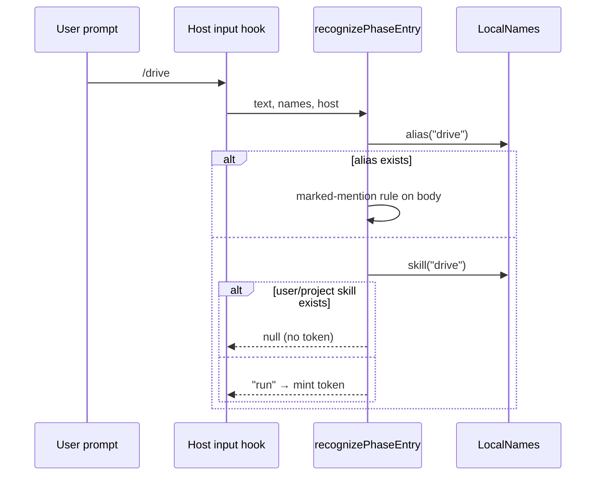

# Skill rename round 2 — bare verbs

**Status**: Candidate; no execution authority.
**Design risk**: High — the rename changes the run-entry gate that mints the entry token admitting privileged MCP operations, on both Hosts, and the packaged contract surface of every skill.
**Execution posture**: characterization-first for the run-entry gate: pin the new recognition rules in the existing gate tests before changing `phase_entry.ts`; the mechanical rename follows.
**Design views**: service/component interfaces (gate recognition and the Host local-name readers), temporal sequence (literal prompt → recognition → token mint).
**Document language**: English, following Planner's default document policy.

## Outcome

Rename the eight packaged skills to the bare verbs of #318 and make the run-entry gate recognize only the new names, under the recognition rules decided on 2026-10-28, with the current documentation surface, release note and decision record aligned. Dated history stays unedited.

| Old | New |
|---|---|
| `imm-brainstorm` | `clarify` |
| `imm-planner` | `draw-up` |
| `imm-run` | `drive` |
| `imm-retro` | `revisit` |
| `imm-doc-slim` | `slim` |
| `imm-doc-prune` | `prune-docs` |
| `imm-test-prune` | `prune-tests` |
| `imm-pr-fix` | `fix-pr` |

`dist/imm-run-batch.md` becomes `dist/drive-batch.md`.

## Sources

- **#318** — mapping, style principles, execution scope, "Decisions (grilling 2026-10-28)" and "Verification (revised)" (https://github.com/dereknex/immune-brain/issues/318).
- **G-D1** — Planner delta, confirmed 2026-10-28: the zero-old-name scan excludes tests; tests keep old names only as retired-name negative cases. Evidence: `tests/phase-entry.test.ts:77,94` and `tests/canary-command-retirement-contract.test.ts:68` must spell old names to assert their retirement.
- **G-D2** — Planner delta, confirmed 2026-10-28: on Pi, `skill:<name>` is treated like the bare name when a same-named user or project skill exists. Evidence: Pi 1.4.0 `core/skills.js:354-356` loads `~/.pi/agent/skills` then `.pi/skills` before package skills, and the first loaded name wins, so `skill:drive` resolves to the user's skill.
- Repository evidence: `plugins/immune-brain/runtime/assurance/phase_entry.ts:21-29,54-65` (packaged names, prefixes, alias mention regex, packaged-before-alias order); `runtime/claude/lane_guard.ts:111-119,205` (Claude alias reader, `imm-run` Skill gate); `.pi-extension/imm-canary-work.ts:332-341` (Pi alias reader); `scripts/dist-sync-manifest.ts:112-160` (dist ↔ skill pairs); `scripts/stale-reference-baseline.json:10` (the round-1 ratchet precedent).

## Threat model and supported environment

Input is the user's own literal prompt and files under the user's and project's command and skill directories. No adversary beyond an accidental name collision is modelled: the gate exists so a model cannot self-authorize, and these files are user-owned. Supported Hosts: Claude Code (plugin namespace `immune-brain:`) and Pi 1.4.x. Local skill detection checks `<dir>/<name>/SKILL.md` only; a skill whose directory name differs from its frontmatter name is out of scope.

## Decisions and technical design

### D1 — Rename scope (source: #318 Decisions)

Rename skill directories, `SKILL.md` frontmatter `name:`, dist file names and every cross-reference, registry `next_actions` and `title`, and H1s. Every SKILL.md and dist H1 becomes `Immune-Brain: <Verb>` — `Clarify`, `Draw Up`, `Drive`, `Revisit`, `Slim`, `Prune Docs`, `Prune Tests`, `Fix PR` (title casing: delegated technical choice); registry `title` equals that verb. `dist/drive-batch.md` keeps its H1 `Immune-Brain: Batch, Lane and Herdr Contract`, since it is not a skill. Unchanged: registry `role`, `PhaseEntry` `"plan" | "run"`, artifact names (`brainstorm_framing`, `validated_plan`), domain terms Planner and Loop, `bin/imm-kernel`, `bin/imm-plan`, `.pi-extension` file names, `.imm/`. Every skill description keeps its "Immune-Brain" mention.

### D2 — Run-entry recognition (source: #318 Decisions; G-D2)

`phase_entry.ts` interface change: the Host supplies one local-name reader in place of `AliasReader`:

```ts
export interface LocalNames {
	/** Body of a same-named user or project command alias, or null. */
	alias(name: string): string | null | undefined;
	/** Whether a same-named user or project skill exists. */
	skill(name: string): boolean;
}
```

`recognizePhaseEntry(text, names, host)` resolves a leading slash command:

1. `immune-brain:<new>` → the packaged phase.
2. `skill:<new>` → the packaged phase, except on Pi when `names.skill(<new>)` is true → null.
3. Bare `<new>`: when `names.alias(<new>)` returns a body, alias rules apply (step 4); otherwise when `names.skill(<new>)` is true → null; otherwise the packaged phase.
4. Any other alias-shaped name: read the alias body; it enters a phase only when it contains exactly one distinct marked mention — `/<new>`, `immune-brain:<new>` or `skill:<new>` — of a phase skill (`clarify`, `draw-up`, `drive`). A bare word such as `drive the build` is not a mention.
5. Old names, including `imm-loop`, are recognized by none of these steps.

A reader that throws yields null (fails closed), as today. `packagedPhaseSkill` (the Skill-tool gate) recognizes the new names only; the shadow rule applies to literal prompt recognition only. The recovery text for `run_entry_required` names `/drive` and, as the shadow-proof form, `/immune-brain:drive` on Claude Code.

Host readers: Claude Code — commands `.claude/commands`, `~/.claude/commands` (existing); skills `.claude/skills/<name>/SKILL.md`, `~/.claude/skills/<name>/SKILL.md`. Pi — prompts `$PI_CODING_AGENT_DIR/prompts`, `.pi/prompts` (existing); skills `$PI_CODING_AGENT_DIR/skills/<name>/SKILL.md`, `.pi/skills/<name>/SKILL.md`. A read error counts as "exists" for skills (fail closed: no token from the bare form).



**Diagram decision**: required
**Diagram reason**: the precedence between alias, local skill and packaged name decides whether a token is minted; the sequence makes the order explicit.

### D3 — Records (source: #318 Decisions)

New `docs/adr/0031-bare-verb-skill-names.md` records the mapping, the scheme (no prefix, no aliases), D2's recognition rules including G-D2, and states that it amends ADR 0025's recognition part. Accepted ADRs are not edited. `docs/reference/immune-brain-skills-guide.md` gains the naming checklist with five checks (the four of #318 plus: no same-named local user skill or command). `CONTEXT.md` gains an old → new mapping table.

### D4 — Documentation surface (source: #318 Verification (revised); G-D1)

Current surface is renamed. A scan in `tests/skill-dist-consistency.test.ts` asserts zero matches of `imm-(brainstorm|planner|run|retro|doc-slim|doc-prune|test-prune|pr-fix|loop)` (word-bounded, so `imm-runtime` style tokens and `imm-plan`/`imm-kernel` do not match) in `plugins/immune-brain/**` excluding `plugins/immune-brain/tests/**`, root `README.md`/`CONTEXT.md`/`AGENTS.md`/`CLAUDE.md`, `docs/agents/**`, `docs/reference/**`, `docs/user_manual.md`, and `scripts/**` excluding `scripts/stale-reference-baseline.json` (its note is history). The one permitted occurrence inside scanned files is the `CONTEXT.md` mapping table, delimited by `<!-- skill-rename-map:start -->` and `<!-- skill-rename-map:end -->`, which the scan skips; no other "formerly" mention is allowed. Adding `scripts/**` is a delegated technical choice: `scripts/dist-sync-manifest.ts` is live tooling that must move with the rename. Tests are renamed where they mirror current skills: `tests/imm-{doc-prune,doc-slim,planner-kernel-intent,test-prune}-contract.test.ts` and `tests/fixtures/workflow-decision-closure-sources/imm-{brainstorm,planner}.md` take the new names (frontmatter included); benchmark/evidence JSON fixtures recording history stay. `scripts/stale-reference-baseline.json` is raised only by the measured count the rename adds in historical docs, with a note, as in round 1.

### D5 — Release (source: #318 Decisions)

`.changeset/skill-rename-bare-verbs.md` declares `"immune-brain": major` with a breaking note: the old → new table; user aliases or commands naming old skills must be edited by hand; refresh the Claude Code plugin cache and run `/reload` on Pi; the prefixed forms `/immune-brain:drive` and `/skill:drive` and when the bare form does not enter (a same-named local skill).

## User scenarios

- **SCN-1** (source: #318 Decisions) — A user types `/drive`; the run entry is recognized and a token minted. `automated` → AC1.
- **SCN-2** (source: #318 Decisions) — A user types `/imm-run` or has an alias whose body names `imm-run` or `imm-loop`; nothing is entered. `automated` → AC1.
- **SCN-3** (source: #318 Decisions; G-D2) — A user with their own `drive` skill types `/drive`: no token; `/immune-brain:drive` on Claude Code enters; on Pi `/skill:drive` does not enter either. `automated` → AC1.
- **SCN-4** (source: #318 Decisions) — An upgrading user reads the 6.0.0 breaking note and finds the mapping and migration steps. `automated` → AC5.
- **SCN-5** (source: #318 Decisions) — The first post-merge `/drive` run on a refreshed install enters normally. `manual` — needs a live Host on the merged release.

## Verification and acceptance mapping

| AC | Seam | Controls |
|---|---|---|
| AC1 gate | `tests/phase-entry.test.ts`, `tests/claude-phase-entry-gate.test.ts`, `tests/claude-phase-entry-skill-gate.test.ts`, `tests/pi-phase-entry-gate.test.ts` | Positive: `/drive`, `/immune-brain:drive`, `/skill:drive`, `/clarify`, `/draw-up`, an alias body with `/drive`. Negative: `/imm-run`, `/imm-loop`, alias bodies naming `imm-run`/`imm-loop`, alias body `drive the build`, `/driver`, alias body with two distinct marked phase mentions, a same-named user skill for bare `/drive` (both Hosts) and for `/skill:drive` on Pi, a throwing skill reader. Bound: same-named command takes alias rules; `/immune-brain:drive` mints on Claude Code with a same-named user skill. |
| AC2 rename structure | `plugins/immune-brain/tests/skill-registry-consistency.test.ts`, `tests/skill-registry-metadata-contract.test.ts`, `tests/skill-dist-consistency.test.ts`, `bun scripts/sync-dist-docs.ts --check` | Positive: eight new dirs, frontmatter, H1s, titles, `next_actions`, dist pairs. Negative: an old directory or dist file still present, a mismatched H1. |
| AC3 surface scan | `tests/skill-dist-consistency.test.ts`, `tests/stale-reference-ratchet.test.ts` | Positive: scan over the D4 paths finds zero. Negative: the scan helper reports a seeded `imm-run` in a sample. Bound: `imm-plan`, `imm-kernel`, `imm-canary-work` are not matches; ratchet total does not exceed the raised baseline. |
| AC4 packaging | `bun scripts/build-claude-plugin.ts --check`, `tests/claude-host-package.test.ts`, `tests/pi-canary-packed-loader.test.ts` | Bundle matches a fresh generate; packed Pi loader finds the renamed skills. |
| AC5 records | shell checks over `docs/adr/0031-*.md`, `.changeset/skill-rename-bare-verbs.md`, `CONTEXT.md`, skills guide | Negative: a missing ADR, a non-major changeset, a note lacking `/immune-brain:drive` or `/reload`. |
| AC6 history | `git diff --quiet 5a0d9a1` over history paths | Negative: any edit under accepted ADRs, `docs/plans` (except this intent), `docs/specs` (except this Spec), `docs/reports`, `docs/solutions`, `docs/brainstorms`, `docs/evidence`, `docs/archives`, `docs/proposals`, `benchmark-results`, `CHANGELOG.md` or existing changesets fails. |

## Reference closure and scope

Gate owners: `runtime/assurance/phase_entry.ts`, `runtime/claude/lane_guard.ts`, `.pi-extension/imm-canary-work.ts`; other runtime names: `runtime/loop_contract.ts`, `runtime/claude/{mcp_server,run_continuation}.ts`, `runtime/assurance/active_task_notice.ts`, `runtime/commands/kernel.ts`, `runtime/unattended/{batch_disposition,batch_git}.ts`, `runtime/prompts/{executor,pr-fix}.md`, `.pi-extension/{imm-canary-enroll,imm-unattended-batch,pi-run-continuation}.ts`, `hooks/hooks.json`. Generated: `dist/claude/mcp-server.mjs` (`docs/agents/derived-files.json`). Packaged docs: `skills/**`, `skills/registry.yaml`, `dist/*.md`, `BASELINE.md`, `README.md`, `USER_GUIDE.md`, `EVALUATION.md`. Tooling: `scripts/dist-sync-manifest.ts`, `scripts/stale-reference-baseline.json`. Root and reference docs per D4. Tests: about 90 files under `tests/` and 2 under `plugins/immune-brain/tests/` name old skills (measured with `git grep -c` on 2026-10-28).

## Devil's Advocate Audit

- **Rollback resilience**: one branch, one PR; nothing persisted under `.imm/` names a skill (grep: no hits), so reverting the merge restores old names with no state migration. A partial rename leaves `sync-dist-docs --check` and the registry test red, so it cannot settle silently.
- **Verification vanity**: AC1 asserts token minting through the Host input hooks, not just the pure function, and pins every negative case of D2; AC3 includes a seeded-match control so an empty or mis-rooted scan cannot pass vacuously; AC5 diffs history against a pinned commit instead of trusting prose.
- **Spec dilution**: all #318 Decisions bullets map to D1–D5; the two Planner deltas G-D1 and G-D2 narrow only the scan's test exclusion and widen Pi's shadow rule, both confirmed by the user.

## Handoff completeness

| Source item | Mapping |
|---|---|
| #318 mapping table and `dist/imm-run-batch.md` | D1, AC2 |
| #318 H1 / leftover `Loop` title | D1, AC2 |
| #318 README table, registry test, runtime refs, skills guide | D1, D4, AC2, AC3 |
| #318 naming checklist (+ check 5) | D3, AC5 |
| Decisions: gate recognition rules, both Hosts | D2, AC1 |
| Decisions: ADR 0031 amending 0025 | D3, AC5 |
| Decisions: major changeset and breaking note | D5, AC5 |
| Decisions: one Managed task, settle before merge, `/drive` smoke | TaskIntent (single task, no Lanes); SCN-5 manual |
| Verification (revised): allowlist scan, history unedited, sync check, typecheck, tests | D4, AC2–AC4, AC6; `bun run typecheck` and the full suite remain the Executor's regression run |
| G-D1, G-D2 | D4, D2, AC3, AC1 |

Remaining gap: SCN-5 is manual and happens after merge.
