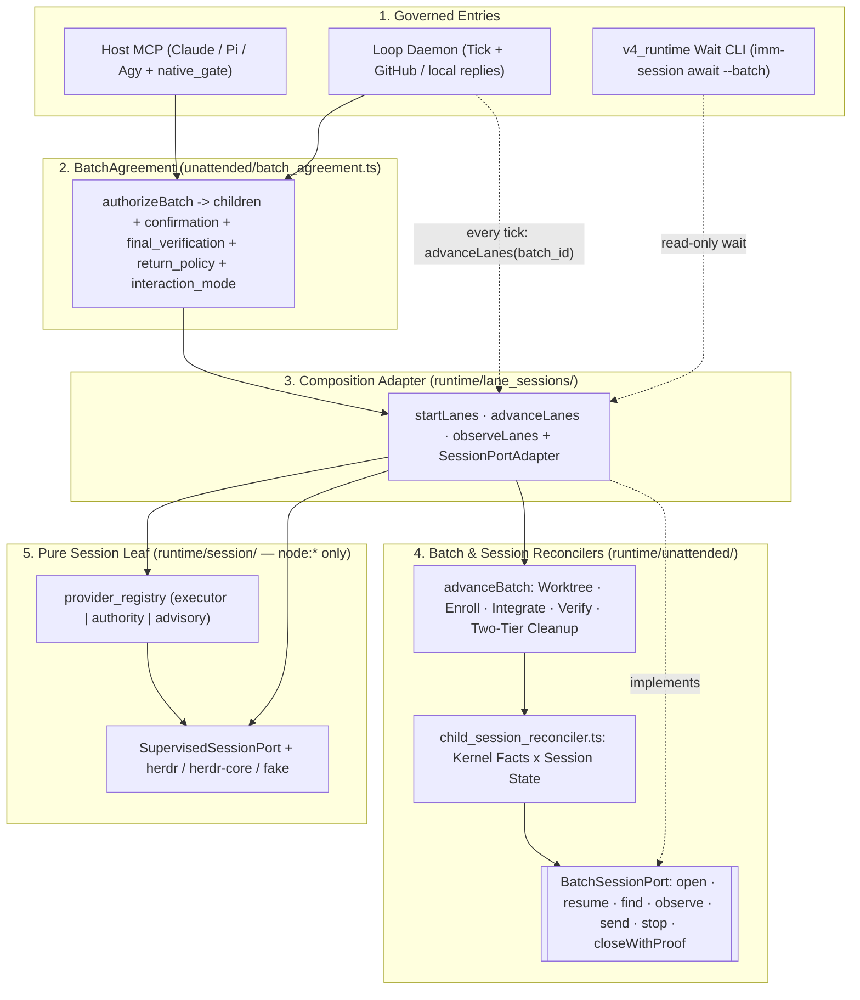
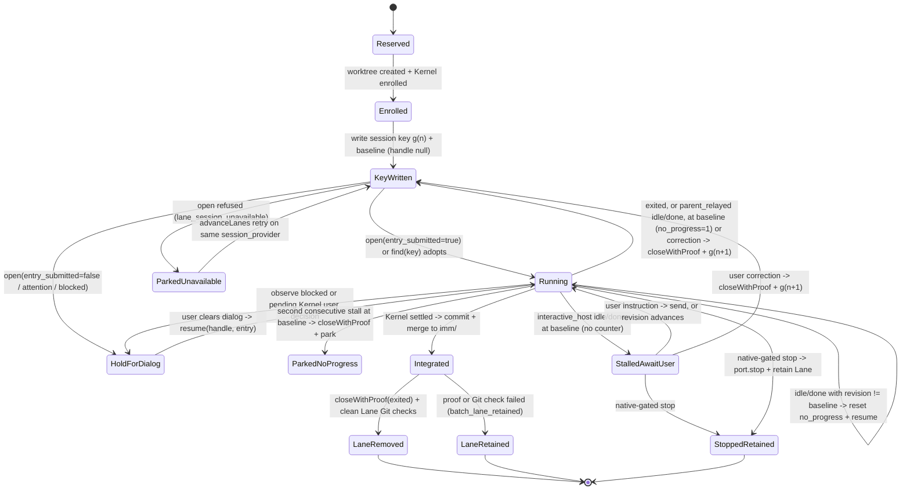

# Unified Lane Sessions (#570)

- **Initiative**: `unified-lane-sessions` (Local carrier `docs/initiatives/unified-lane-sessions.md`)
- **Source**: GitHub Issue #570; Brainstorm manifest of the `clarify` v4.1 handoff of 2026-11-18 (`BR-REQ-1..7`, `BR-DEC-1..5`, `BR-Q-1..5`, `BR-OUT-1..3`, `BR-DEFER-1`, `BR-SCN-1..7`); owner decisions recorded as `OD-1..OD-15`. Version 4.1 upgrades v4 (`OD-9..OD-15`) into a single-writer declarative session reconciliation model (`startLanes` / `advanceLanes` + `child_session_reconciler.ts`), completes `BatchAgreement` with `return_policy` and `interaction_mode`, indexes `provider_registry.ts` by role, bounds `laneSessionKey` with a trailing hash slice, aligns `closeWithProof` with `herdr tab list`, adds child-task batch lookup and audit-backed daemon PR gating, and serializes S1–S3 to eliminate derived-bundle conflicts. The review amendment of 2026-11-18 splits the former S3 into `batch-agreement-v3` (S3, which first proves Initiative `lane_rebinds` before any later Slice relies on the `v3` shape) and `batch-session-port` (S4), makes an `interactive_host` stall hold for the user instead of rotating the session, defines the observation vocabulary and the `await --batch` wake set (D20), records the daemon regression outside Herdr as accepted (D18), and drops the "Lane Session Coordinator" term for the `runtime/lane_sessions/` composition root.
- **Design risk**: High — cross-module change to a state-machine owner (`runtime/unattended/` batch state and per-child session reconciliation), an authority-path change (per-child `lane_rebinds` in `runtime/assurance/run_continuation.ts`), a new batch record contract (`assurance_kernel/batch_run_state/v3`), a role-indexed session-provider registry and Port contract extension (`session_key`, `findSession`, `closeWithProof`), a new composition module (`runtime/lane_sessions/`), five ADRs, and packaged `drive` contracts.
- **Threat model and supported environment**: None beyond the repository's own tooling. Inputs are the user's own `.imm/config.json` and `~/.config/immune-brain/config.json` files, the environment of the Parent process (`HERDR_ENV`, `HERDR_WORKSPACE_ID`), owner confirmations already verified by existing authority gates (`native_gate`, `tracker_approval`, `policy_auto`), and session handles/states returned by local registered CLI adapters; no new external adversary. Supported Git object format is SHA-1 40-hex commits in UTF-8 repositories on macOS and Linux.
- **Design views**: architecture layers; service/component interfaces; data flow; state transitions; temporal sequence. Explanatory architecture design (non-normative): [`docs/proposals/unified-lane-sessions.md`](../proposals/unified-lane-sessions.md).
- **Diagram decision**: required
- **Diagram reason**: Clarifies the acyclic dependency and control boundary across governed entries, `BatchAgreement`, `runtime/lane_sessions/`, `runtime/unattended/child_session_reconciler.ts`, and the `node:*`-only `runtime/session/` leaf, plus the declarative per-child session state transitions.
- **Execution posture**: test-first on each Slice's named test files.
- **Output language**: English.

## 1. Problem and evidence

A Pi user in Herdr with no `herdr` key gets `lane_executor_requires_tui` for every single-task `drive`, while an Initiative on the same machine opens Herdr tabs (#570). The cause is two execution paths and split orchestration rules chosen by plan shape and a legacy switch:

- `c54ff124af` (#564) gated single-task interactive mode on `resolveConfig(cwd).herdr.value === true` (`plugins/immune-brain/runtime/host-core/runtime.ts:1438`); the default is `false` (`plugins/immune-brain/runtime/config/layered_config.ts:162`). Initiative batches never read the key.
- Without it the Host passes `supervision`, and `superviseSingle` (`runtime/unattended/batch_runner.ts:231-283`) spawns `--print` through `LaneSupervisor` (`unattended/lane_supervisor.ts:70,106`), refusing Pi with `lane_executor_requires_tui` (`lane_supervisor.ts:224`).
- Executor supervision, relay, rebinds, cleanup and checkout delivery split on `plan_source`: `startBatch` (`batch_runner.ts:285-355`) records generations in `.imm/state/lane-supervisors/<batch_id>.json` (`batch_state.ts:1245-1270`); `findLaneRelayTarget` (`lane_decision.ts:72-78`) queries `findExistingActiveBatch(root, taskId)` (`batch_preflight.ts:148-169`), which matches `initiative_slug === taskId` and always returns `null` for Initiative children; `lane_rebinds` (`batch_state.ts:458-461`, `rebindSingleTaskIdentity` at `:1204-1213`, `assurance/run_continuation.ts:99-106`) and `lane_removed` (`batch_state.ts:939-945`) reject non-`single_task` records; `cleanupSingleTaskLane` (`lane_cleanup.ts:74-79`) deletes `input.parentRef` (`refs/heads/imm/<slug>`), which would destroy a shared Initiative Parent branch; and `batch_lanes.ts:1495-1517` branches on `plan_source` between `deliverSingleTask` (`checkout_delivery.ts:60-90`) and `returnBatchToCoordinator` (`batch_final_report.ts:42-56`), while `batch_git.ts:1056-1062` branches on `plan_source` for completion without final verification.
- Interactive TUI sessions in Herdr (`session/herdr_provider.ts:77,279-295,326-330`) end a turn in `idle` or `done` without exiting the pane, return `entry_submitted: false` with `blocked` or `attention` on startup dialogs (#496), derive agent names from `token.slice(0, 12)` (`herdr_provider.ts:59-66`), and lose tab-label ownership verification if `tab close` runs before exit proof (`herdr_provider.ts:236-241,416-427`). Local `herdr tab list --workspace <ws>` is available on Herdr 0.9.x to enumerate workspace tabs without guessing IDs.
- The Loop daemon (`loop_daemon/drive_dispatcher.ts:116-166`, `agent_handlers.ts:1750-1835`) duplicates batch authorization, mints a fresh `batch_id` per call (`:1765`), relies on `LANE_EXECUTOR_ENV=headless` (`host-core/runtime.ts:799-800,848-851`) so unattended privileged requests do not hang on local TUI prompts, and gates PR creation in `loop_daemon/dispatch.ts:1090-1148` on `exit_recorder.ts` (`exit_code === 0`, `verification_evidence_digest`, `final_commit_sha`).
- `runtime/session/cli.ts:106-120` currently peeks into `.imm/state/batches/<id>.json` (`closeRecordUnproven`), while `tests/supervised-session-boundary.test.ts:44-67` pins `runtime/session/` to `node:*` imports only.

## 2. Decisions

### Layers, agreement and declarative control

- **D1 — Declarative single-writer session reconciliation across four layers** *(Source: BR-DEC-1)*. (1) **Governed entries**: Host MCP tools (`start_unattended_batch`, `request_authorization`, `approve_breaking_intent_revision`, `stop`) and the Loop daemon (`drive` dispatch, periodic tick, verified GitHub/local decision replies) produce or resume a batch; neither entry creates, closes, or proves a session directly, and no session handle passes through a Parent model. (2) **Lane sessions composition root** (`runtime/lane_sessions/`; deliberately not a domain term and unrelated to the batch coordinator of ADR 0018 or `AssuranceCoordinator`, because it owns no state transition): exposes `startLanes(agreement, deps)` for new batches, `advanceLanes(root, batch_id, deps)` for idempotent re-entry (used by Host continuation, post-decision relay, and every `loop_daemon` tick without waiting for Kernel settlement), and read-only `observeLanes(root, batch_id, { wait, timeoutMs, signal })` (wake set and `next_action` in D20). Side-door imperative `steerLane` and ungated CLI `imm-session send|stop --batch` are not introduced, preserving the Host native gate on `stop` (`BASELINE.md`). `v4_runtime.ts` routes `imm-session await --batch <batch_id>` directly to `runtime/lane_sessions/`, keeping `runtime/session/` a pure `node:*` leaf. (3) **Batch state machine and child session reconciler** (`runtime/unattended/`): `advanceBatch` and `child_session_reconciler.ts` alone mutate Lane and session orchestration state through an injected `BatchSessionPort`. (4) **Session providers** (`runtime/session/`): role-indexed registry, Port, and provider adapters.
- **D2 — `startBatch` is retired; the state machine stays** *(Source: BR-REQ-1)*. `runLaneBatch` (`batch_lanes.ts:882`) becomes the exported `advanceBatch(agreementOrRecord, { sessions, kernel, git, tracker })`. `startBatch`, `batch_runner.ts`, `LaneSupervisor`, `StartBatchInput.supervision`, `executor_mode`, `lane_executor_requires_tui`, `.imm/state/lane-supervisors/`, and `loop_daemon/exit_recorder.ts` are deleted in S8 (`completedParentReport` and `batchQaFailureFacts` move to `batch_final_report.ts` / `batch_state.ts`). Transitional until S8: `startBatch` adapts existing callers to `advanceBatch`, and `advanceBatch`'s `sessions` port is optional (returning `executor` handoffs when absent) until S8 makes it required.
- **D3 — Self-contained `BatchAgreement`** *(Source: BR-DEC-2)*. `BatchAgreement` in `runtime/unattended/batch_agreement.ts` wraps the validated `BatchAuthorizationBinding` and Kernel capability plus: ordered `children` from `projectBatchPlan` (`plan_digest` computed from them), `plan_source: "initiative" | "single_task"` (how the plan was read), `confirmation: { source: "native_gate" | "tracker_approval" | "policy_auto", ref }`, `final_verification: { required: boolean, commands: string[] }` (Host single-task default `{ required: false, commands: [] }`; Host Initiative default `{ required: true, commands }`, authorized once by the agreement's confirmation), `return_policy: "checkout_delivery" | "retain_branch"` (Host single-task default `"checkout_delivery"`; Host Initiative and `loop_daemon` default `"retain_branch"`), and `interaction_mode: "interactive_host" | "parent_relayed"` (Host default `"interactive_host"`; `loop_daemon` default `"parent_relayed"`). One builder `authorizeBatch` validates and issues it for both entries, refusing unknown `confirmation.source`, `return_policy`, `interaction_mode`, or malformed `final_verification` with `batch_agreement_invalid` before writing any state.
- **D4 — Per-child execution and strict `plan_source` confinement** *(Source: BR-REQ-2)*. A single task is an agreement with one child. Session state, generations, `baseline`, `no_progress`, exit proof, decision relay, `lane_rebinds`, and per-child Lane cleanup apply uniformly to every child of any agreement. Completion is decided by `final_verification` and coordinator return by `return_policy`, never by `plan_source` or `children.length`. `plan_source` may appear only in plan reading (`batch_preflight.ts`, `batch_plan.ts`), agreement/record identity (`batch_agreement.ts`, `batch_state.ts`), and entry selection (`host-core/`, `loop_daemon/`); `batch_lanes.ts`, `batch_git.ts`, `lane_decision.ts`, `lane_cleanup.ts`, `batch_session_port.ts`, `child_session_reconciler.ts`, `assurance/run_continuation.ts`, and `runtime/lane_sessions/` never mention `plan_source`, enforced by `tests/runtime-layering-boundary.test.ts`, which adds each file in the Slice that rewrites it: S3 `batch_lanes.ts`, `batch_git.ts`, `lane_cleanup.ts`, `assurance/run_continuation.ts`; S4 `batch_session_port.ts`, `child_session_reconciler.ts`; S5 `runtime/lane_sessions/`; S7 `lane_decision.ts`.

### Session providers and port contract

- **D5 — Role-indexed provider capability registry** *(Source: BR-DEC-3)*. `runtime/session/provider_registry.ts` registers one descriptor per provider: `name`, pure environment check (`herdr` requires `env.HERDR_ENV === "1" && Boolean(env.HERDR_WORKSPACE_ID)`), `recovery` text, adapter `factory`, and `roles: { executor?: { hosts, workspace: "local_path", find_by_key: boolean, exit_proof: boolean }, authority?: { hosts }, advisory?: { hosts } }`. `herdr` admits `claude-code`, `pi`, and `antigravity` on `executor` with `workspace: "local_path"`, `find_by_key: true`, and `exit_proof: true` (plus `authority` and `advisory` hosts); `herdr-core` admits `hosts: []` and `exit_proof: false` on `executor` until #495; `fake` is test-only and excluded from config registration. Code outside `runtime/session/` never compares a provider name literal (`tests/supervised-session-boundary.test.ts`).
- **D6 — Provider conformance suite** *(Source: BR-REQ-3)*. `tests/supervised-session-conformance.test.ts` runs every registered descriptor (under its fake CLI) and `fake` against one shared contract: `createSession` with `session_key` binds the key into session identity; `findSession(session_key)` returns that handle or `"not_found"`; `closeWithProof(handle, session_key)` is idempotent, rejects a mismatched `session_key` as `not_owned` without closing, and returns an `exited` proof bound to `(handle, session_key)`; any declared role capability that the adapter omits or violates fails the suite.
- **D7 — Bounded caller `session_key`, collision-safe agent names, `findSession`, and `closeWithProof`** *(Source: BR-DEC-3)*. `CreateSessionInput` gains optional `session_key` (`^[a-z0-9-]{1,64}$`) bound into session identity (`herdr`: tab label suffix `[imm:<session_key>]`; omitting `session_key` keeps random 12-hex token behavior for non-batch callers). `herdrAgentName(label, token)` (`herdr_provider.ts:59-66`) takes the trailing 12 `[a-z0-9_-]` characters (`slice(-12)`) rather than `slice(0, 12)` so sibling keys sharing a prefix never collide on `herdr agent start`. `SupervisedSessionPort` gains `findSession(session_key)` (on `herdr`, backed by `herdr tab list --workspace <ws>` and `pane get`) and `closeWithProof(handle, session_key)` (verifies live `[imm:<session_key>]` ownership before `pane close` + `pane get -> pane_not_found` + `tab close`; on crash re-entry after tab removal, proves exit when `pane_not_found` holds and `findSession(session_key) === "not_found"` in the Parent's workspace, requiring no `CloseRecord`).
- **D8 — `BatchSessionPort` and `child_session_reconciler.ts`** *(Source: BR-DEC-1)*. `runtime/unattended/batch_session_port.ts` defines `BatchSessionPort { readonly provider: string; open(input); resume(handle, entry); find(key); observe(handle); send(handle, text); stop(handle); closeWithProof(handle, key) }`, importing nothing from `runtime/session/` or `runtime/lane_sessions/`. `runtime/unattended/child_session_reconciler.ts` reconciles each child's session from Kernel facts and `observe`:
  - Batch start records batch-level `session_provider: port.provider` (`OD-15`); a port with a different `provider` on re-entry refuses `lane_session_unavailable`.
  - Write-ahead key: before opening generation `n`, writes `session: { key, generation: n, baseline, handle: null, entry_submitted: false, attention: null, no_progress, exit_proof: null }` where `key = laneSessionKey(batch_id, task_id, n)` is `imm-<folded_task_16>-g<n>-<sha256(batch_id + "\0" + task_id + "\0" + n).slice(0, 12)>` (`<= 36` chars `[a-z0-9-]`), stored on write and never recomputed on read (`OD-15`), and `baseline` is the child's Kernel `record_revision`.
  - Crash recovery: `handle === null` calls `find(key)` first and adopts a found session before calling `open` (which injects `LANE_EXECUTOR_ENV=headless` when `interaction_mode === "parent_relayed"`).
  - Startup dialog hold: `entry_submitted === false` or observed `blocked` holds the session open (`HoldForDialog`) without incrementing `no_progress`; once observed `idle` or `done`, calls `resume(handle, entry)` and updates `entry_submitted`.
  - Observation vocabulary: `batch_session_port.ts` defines its own `SessionObservation = "working" | "blocked" | "idle" | "done" | "exited" | "unknown"` and a structural `SessionExitProof`, importing nothing from `runtime/session/`. The `runtime/lane_sessions/` adapter maps provider states one-to-one, maps a provider's `pane_not_found` or recorded exit event for the handle to `exited`, and maps every other provider failure to `unknown`. Observed `working`, observed `unknown`, or an `observe` `PortRefusal` holds the child: no change to `no_progress`, `baseline`, or generation and no `send`, `open`, or `closeWithProof`; the next entry observes again.
  - Progress: when observed `idle | done | exited`, Kernel is not settled, and no user decision / `replan_required` waits, `current_record_revision !== baseline` resets `no_progress` to `0` and updates `baseline`; `idle | done` then calls `resume(handle, entry)`, while `exited` closes with proof and opens `g(n+1)`.
  - Stall at unchanged `baseline` depends on who supervises the session. Observed `exited` under either `interaction_mode`, and `idle | done` under `parent_relayed`, call `closeWithProof`, record `exit_proof`, and increment `no_progress`, opening `g(n+1)` on `1` and parking `lane_executor_no_progress` on `2`. Under `interactive_host`, `idle | done` at `baseline` is `StalledAwaitUser`: the reconciler calls no `send`, `closeWithProof`, or `open`, leaves `no_progress` unchanged, and reports the child `stalled_idle`, because the user may be conversing in that tab (an Executor clarifying question ends a turn without a Kernel revision). The Parent asks the user (D20), whose answer arrives as a recorded `instruction` (`send`), a `correction` (rotation), or a native-gated `stop`.
  - Recorded interventions: pending `instruction` calls `send(handle, text)` when `idle | done`; pending `correction` (`coordinator: correct`) closes the current generation via `closeWithProof` and opens `g(n+1)` delivering the correction.
- **D9 — Explicit, ordered `session_providers` configuration** *(Source: BR-REQ-3)*. Top-level `session_providers` in user/project `.imm/config.json` holds a non-empty ordered list of distinct registered provider names (`herdr`, `herdr-core`), default `["herdr"]`, with project replacing user. Empty arrays, unknown or test-only names (`fake`, `process`), duplicates, or non-arrays produce a blocking `config_invalid` error diagnostic (`batchConfigErrors`).
- **D10 — Single resolution at `startLanes`; fixed per batch** *(Source: BR-REQ-4)*. Pure `resolveSessionProvider({ role: "executor", providers, host, env, registry })` selects the first configured provider whose env check holds and whose `roles.executor` admits `host` with `find_by_key: true` and `workspace: "local_path"`, or returns `lane_session_unavailable` listing per-provider reasons and recoveries. `startLanes` resolves before creating any record or worktree; `advanceLanes` re-validates the recorded `session_provider` env requirement and refuses `lane_session_unavailable` with its recovery rather than switching providers. An `open` refusal parks the child `lane_session_unavailable` for retry on the same provider.

### Lifecycle, decisions and records

- **D11 — Two-tier proof-based cleanup** *(Source: BR-DEC-2)*. Supersedes ADR 0027's retained-Lane rule for session Lanes:
  1. *Per-child Lane cleanup*: For every integrated child (single-task or Initiative, Host or daemon), `advanceBatch` calls `closeWithProof(handle, key)`. Only when `closeWithProof` returns a proven `exited` bound to `(handle, key)` and per-child Git conditions hold (clean Lane worktree with no tracked modifications or untracked files, `refs/heads/imm-lane/<slug>/<task_id>` ancestor of `record.branch`) does cleanup remove that child's Lane worktree and `refs/heads/imm-lane/<slug>/<task_id>`, recording `lane_removed` with the proof while leaving sibling Lanes and `record.branch` untouched.
  2. *Batch branch cleanup*: Only when the whole batch completes under `return_policy === "checkout_delivery"` and `deliverSingleTask` succeeds (with `record.branch` not checked out in any worktree) is `refs/heads/imm/<slug>` deleted. Under `return_policy === "retain_branch"` (Host Initiative and `loop_daemon`), `refs/heads/imm/<slug>` is kept.
  3. Any failed proof (`no exit_proof`, `unknown`/`timeout`/`events_lost`, foreign/superseded handle/key) or failed Git condition retains the child's Lane and reports `batch_lane_retained` naming the condition, with no time-based relaxation. Parked, stopped, and redo children never have their Lanes removed. `session_closes` and `closeRecordUnproven` retire once `closeWithProof` owns closure.
- **D12 — Per-child decisions, active-batch lookup by `task_id`, and `lane_rebinds`** *(Source: BR-DEC-4)*. `findActiveLaneBatchForTask(root, taskId)` scans non-terminal `v3` batch records by child `task_id` (failing closed on corrupt records or ambiguous multi-batch matches), replacing `findExistingActiveBatch(root, taskId)` inside `findLaneRelayTarget` (`lane_decision.ts`) and `rebindBatchChildIdentity` (`batch_state.ts`). Literal-user decisions (`request_authorization`), breaking revisions (`approve_breaking_intent_revision`), and native-gated `stop` relay to the matching child of any single-task or Initiative batch, then invoke `advanceLanes(root, batch_id)`: revisions append `lane_rebinds` and advance `plan_digest` along a contiguous chain accepted by `hasContiguousLaneRebind` (`assurance/run_continuation.ts`) alongside `Revision Delegation` `reseals`; `stop` invokes `BatchSessionPort.stop`, parks only that child `lane_executor_stopped`, and retains its Lane while siblings continue. S3 (`batch-agreement-v3`) proves first, before any later Slice relies on the `v3` `lane_rebinds` shape, that record-level `rebindBatchChildIdentity` and `hasContiguousLaneRebind` preserve on an Initiative fixture the Parent identity required by `batch_git.ts` final verification and Run continuation, stopping for re-planning if they cannot; S7 wires lookup, relay, `stop`, and breaking-revision approval onto that proven record operation.
- **D13 — Audit-backed daemon PR gate and recorded exit facts** *(Source: BR-DEC-4)*. Proven session exits live on the `v3` batch record (`session.exit_proof` / `lane_removed`). `loop_daemon/exit_recorder.ts` is deleted in S8, and `loop_daemon/dispatch.ts` PR creation gates on the settled `v3` Batch Record for `taskId` (integrated child `commit` as `final_commit_sha` on retained `refs/heads/imm/<task_id>`) plus `verification_evidence_digest` computed from the tracked `.imm/audit/<task_id>/` pair reachable at that commit, removing any dependency on child-process `exit_code === 0`.
- **D14 — Host entries** *(Source: BR-DEC-1)*. `start_unattended_batch` (`host-core/runtime.ts`) calls `advanceLanes` when resuming an active `v3` batch, and otherwise runs preflight + native gate + `authorizeBatch` (`source: "native_gate"`, `interaction_mode: "interactive_host"`, `return_policy: "checkout_delivery"` for single-task and `"retain_branch"` for Initiative) + `startLanes`. `drive-batch.md` drops `--print` rows and Parent `imm-session create`/`close` steps; the Parent waits via `imm-session await --batch <batch_id>`, relays `entry_submitted: false` / `blocked` dialogs to the user, and triggers governed changes through Host MCP tools followed by `start_unattended_batch` continuation.
- **D15 — Loop daemon entry** *(Source: BR-DEC-1, BR-DEC-2)*. Daemon `drive` dispatch calls `authorizeBatch` (`tracker_approval` or `policy_auto`, `actor: LOOP_DAEMON_ACTOR_ID`, `return_policy: "retain_branch"`, `interaction_mode: "parent_relayed"`, `final_verification: { required: false, commands: [] }`) and `startLanes` on first entry, and calls `advanceLanes(root, batch_id)` on every subsequent tick; if an active child reports `entry_submitted: false` or `blocked`, the daemon posts an Issue escalation via `planEscalation`. Verified GitHub/local decision replies apply through `relayLaneDecision` and call `advanceLanes(root, batch_id)`. Non-`drive` daemon agents (`judging`, `clarify`, `plan`, `repair`) keep `agent_runner`.
- **D16 — Retire the `herdr` key** *(Source: BR-REQ-5)*. `herdr` in user or project config produces one non-blocking `warning` diagnostic (`retired_key` at `herdr`), is omitted from resolved config, and is never written by `imm-kernel config migrate` (`--write` deletes it).
- **D17 — Batch record contract `v3`** *(Source: BR-DEC-5, OD-15)*. Lane batch records use `assurance_kernel/batch_run_state/v3` carrying `BatchAgreement` fields (`confirmation`, `final_verification`, `return_policy`, `interaction_mode`), batch-level `session_provider`, per-child `session { key, generation, baseline, handle, entry_submitted, attention, no_progress, exit_proof }`, and per-child `lane_removed` / `lane_retained` / `lane_rebinds`. Stored `v2` Lane records are refused on read with `batch_record_retired` and recovery `retire_stale_batch`; `v1` records remain read-and-retire as today; no `v2 -> v3` migration is written.
- **D18 — Transitional availability outside Herdr** *(Source: BR-DEC-5, OD-6)*. Until #495 admits an Executor Host on `herdr-core`, both Host and daemon `drive` outside Herdr fail closed with `lane_session_unavailable`. This is an accepted regression for the Loop daemon, which today runs `--print` Executors outside Herdr; the owner confirmed it on 2026-11-18 (`OD-6`) instead of holding S8 behind #495.
- **D19 — Documentation, ADRs and derived bundles** *(Source: BR-REQ-6)*. ADR 0005 Decision 4, ADR 0027, ADR 0038 Decisions 2, 4 and 6, ADR 0039 Decisions 2 and 14, ADR 0041 Decision 4, `docs/reference/immune-brain-config.md`, `docs/reference/supervised-session-port.md`, `plugins/immune-brain/dist/drive-batch.md`, `plugins/immune-brain/dist/drive.md`, `CONTEXT.md`, `dist/docs/reference/*` mirrors, Claude bundle (`mcp-server.mjs`), Antigravity plugin artifact, and per-Slice `.changeset/<task-id>.md` stay synchronized.
- **D20 — Read-only waiting and Parent re-entry** *(Source: BR-DEC-1; review amendment 2026-11-18)*. `observeLanes(root, batch_id, { wait: true })`, which backs `imm-session await --batch`, returns at the first of: any child's observation changing to `idle`, `done`, `blocked`, or `exited`; a child reporting `entry_submitted: false`; a child's Kernel record settling or gaining a pending user decision or `replan_required`; `timeoutMs`; or `signal` abort. It returns `LaneBatchObservation { children[], next_action }`, where `next_action` is `advance` (call `start_unattended_batch`, which runs `advanceLanes`), `relay_dialog` (relay a startup or mid-run dialog to the user), `ask_user` (an `interactive_host` child is `stalled_idle`), `wait` (timeout with nothing to do; re-arm the wait), or `complete` (batch terminal). The Parent model follows `next_action` instead of deciding re-entry itself, and `drive-batch.md` documents the table. `loop_daemon` does not wait; it calls `advanceLanes` every tick.

## 3. Technical design

### Architecture layers

| Layer | Responsibility & Ownership | Dependency Direction & Prohibited Coupling |
| --- | --- | --- |
| `host-core/`, `loop_daemon/` | Plan projection, confirmation (`native_gate` vs `tracker_approval`/`policy_auto`), `authorizeBatch`, `startLanes` / `advanceLanes`, decision relay | May import `lane_sessions/` and `unattended/batch_agreement.ts` (`lane_decision.ts`); must never import `runtime/session/` or `unattended/batch_lanes.ts` |
| `v4_runtime.ts` | CLI dispatch: handle-scoped verbs to `runtime/session/cli.ts`; `imm-session await --batch` to `runtime/lane_sessions/` | Must not allow ungated `send` or `stop` `--batch` mutations |
| `runtime/lane_sessions/` | Composition root: `startLanes`, `advanceLanes`, `observeLanes`, `SessionPortAdapter` binding `session_provider` and mapping provider states to `SessionObservation` | Only runtime module importing both `runtime/session/` and `runtime/unattended/`; owns zero Lane state transitions and never mentions `plan_source` |
| `runtime/unattended/` | `BatchAgreement`, `advanceBatch`, `child_session_reconciler.ts`, `BatchSessionPort`, `batch_run_state/v3` persistence, two-tier cleanup, `lane_rebinds` | May import `kernel/`, `assurance/`, `config/`; must never import `runtime/session/` or `runtime/lane_sessions/`; execution modules never mention `plan_source` |
| `runtime/session/` | `SupervisedSessionPort`, `provider_registry.ts`, `resolveSessionProvider`, `herdr` / `herdr-core` / `fake` adapters, handle-scoped `cli.ts` | Imports only its own modules and `node:*`; retires `closeRecordUnproven` file peek into `.imm/state/batches/` |
| `runtime/config/` | Parses `session_providers` and `retired_key` diagnostic for `herdr` | Knows registered provider names, never provider capabilities |

**False-compromise check**: No false compromise detected. Keeping `imm-session await --batch` as a separate read-only CLI command rather than blocking inside `start_unattended_batch` respects MCP client tool-call timeouts while preserving single-writer state ownership inside `advanceBatch` via Segmentation (read-only wait separated from idempotent state reconciliation, with zero duplicate state stores).

### Service/component interfaces

- `resolveSessionProvider({ role, providers, host, env, registry }) -> { ok: true, provider, descriptor } | { ok: false, code: "lane_session_unavailable", reasons: ProviderUnavailableReason[] }` (pure, zero I/O).
- `authorizeBatch({ projection, confirmation, final_verification, return_policy, interaction_mode, actor, registry, now }) -> BatchAgreement | { ok: false, code: "batch_agreement_invalid", reason: string }`.
- `BatchSessionPort` (`runtime/unattended/batch_session_port.ts`):
  - `readonly provider: string`
  - `open(input: { key: string; cwd: string; label: string; entry: string; env?: Record<string, string> }): Promise<OpenedSession | PortRefusal>` (`OpenedSession` carries `handle`, `entry_submitted`, `state`, `provenance`, `attention?`)
  - `resume(handle: string, entry: string): Promise<OpenedSession | PortRefusal>`
  - `find(key: string): Promise<{ handle: string } | "not_found" | PortRefusal>`
  - `observe(handle: string): Promise<{ state: SessionState; provenance: string } | PortRefusal>`
  - `send(handle: string, text: string): Promise<{ state: SessionState } | PortRefusal>`
  - `stop(handle: string): Promise<{ ok: true } | PortRefusal>`
  - `closeWithProof(handle: string, key: string): Promise<SessionExitProof | { ok: false; condition: string }>`
- `runtime/lane_sessions/index.ts`:
  - `startLanes(agreement: BatchAgreement, deps): Promise<BatchLaneRunReport | LaneSessionRefusal>`
  - `advanceLanes(root: string, batchId: string, deps): Promise<BatchLaneRunReport | LaneSessionRefusal>`
  - `observeLanes(root: string, batchId: string, options?: { wait?: boolean; timeoutMs?: number; signal?: AbortSignal }): Promise<LaneBatchObservation | LaneSessionRefusal>`

### Data flow

1. **Configuration & provider resolution**: `.imm/config.json` + user `config.json` → `resolveConfig` validates `session_providers` (`string[]`) and warns on `herdr` → `startLanes` passes `session_providers`, resolved `ExecutorHost`, and `env` (`HERDR_ENV`, `HERDR_WORKSPACE_ID`) into `resolveSessionProvider({ role: "executor", ... })` → selected provider name is frozen on `batch_run_state/v3.session_provider`.
2. **Agreement & write-ahead session state**: Entry validates plan (`projectBatchPlan`) and confirmation (`native_gate` / `tracker_approval` / `policy_auto`) → `authorizeBatch` seals `BatchAgreement` → `advanceBatch` creates Lane worktree, enrolls task in `.imm/state/kernel.sqlite`, writes `session { key, generation, baseline, handle: null, ... }` atomically to `.imm/state/batches/<batch_id>.json`, then calls `BatchSessionPort.open` and writes `handle` + `entry_submitted` + `attention`.
3. **Completion, cleanup & PR publication**: Child settles in Lane `kernel.sqlite` → `advanceBatch` commits Lane, integrates onto `refs/heads/imm/<slug>` (copying `.imm/audit/<task_id>/`), calls `closeWithProof(handle, key)`, removes child worktree + `imm-lane/<slug>/<task_id>`, and records `lane_removed`. Once all children integrate, `advanceBatch` runs `final_verification` (if `required` or derived files exist) and applies `return_policy` (`checkout_delivery` stages to checkout and deletes `refs/heads/imm/<slug>`; `retain_branch` keeps `refs/heads/imm/<slug>`, from which `loop_daemon/dispatch.ts` reads `commit` and `.imm/audit/<task_id>/` verification digest to open a PR).

### State transitions and temporal sequence

- **Temporal sequence & interruption idempotency**:
  1. Host `drive` (`start_unattended_batch`) opens the current Host's native gate (authority point 1), calls `authorizeBatch` → `startLanes` → `advanceBatch`, and returns immediately once active children are `Running` or `HoldForDialog`. Host Parent runs `imm-session await --batch <id>` in background/bounded foreground and follows the returned `next_action` (D20), re-entering via `start_unattended_batch` (`advanceLanes`) on `advance`.
  2. `loop_daemon` validates `tracker_approval` or `policy_auto` (authority point 1), calls `authorizeBatch` → `startLanes`, and on every subsequent tick calls `advanceLanes(root, batch_id)` directly (escalating `HoldForDialog` on the Issue).
  3. Interruption between writing `key` (`handle: null`) and recording `open`'s returned handle is recovered on the next `advanceLanes` by `find(key)` before `open`, guaranteeing at most one tab per generation key. Interruption after `tab close` and before writing `lane_removed` is recovered by `closeWithProof` observing `pane_not_found` and `findSession(key) === "not_found"`.

### Settlement-design enumeration

- **Trigger sources**: (a) Kernel child `done` settlement inside Lane; (b) literal-user `stop` through Host native gate or verified owner command; (c) caller `AbortSignal` cancellation before execution or during `await`; (d) `await` timeout; (e) provider admission/open refusal (`lane_session_unavailable`, `start_failed`); (f) startup or mid-run TUI dialog (`entry_submitted: false`, `blocked`); (g) session turn idle/exit without Kernel settlement; (h) `coordinator: correct` intervention after `qa_failure_limit`.
- **State inventory**: Batch states (`prepared`, `running`, `needs_human`, `completed`, `budget_stopped`, `failed`, `rejected`, `superseded`); Child states (`pending`, `lane_admitted`, `enrolled`, `settled`, `lane_committed`, `integrated`, `needs_human`, `skipped_blocked`, `released`); Reconciliation sub-states derived from `child.session` (`KeyWritten` when `handle === null`, `HoldForDialog` when `entry_submitted === false` or `blocked`, `Running`, `StalledAwaitUser` (derived from observation and `interaction_mode`, never stored), `ClosedProven` when `exit_proof !== null`, `LaneRemoved` / `LaneRetained`).
- **Terminal ownership**: Kernel `.imm/state/kernel.sqlite` (`TaskRecord` + immutable tombstone) is the sole authority for task `done` or `stopped` settlement; literal-user confirmation (or bounded `LOOP_DAEMON_ACTOR_ID` standing/tracker approval) is the sole authority for enrollment, breaking intent revision, and stop; `BatchSessionPort.closeWithProof` bound to `(handle, key)` is the sole authority for session-exit proof. Session observations (`idle`, `done`, `unknown`, `timeout`, `events_lost`), promise resolution/rejection, and elapsed wall-clock time are strictly non-authoritative.
- **Same-state-machine coverage**: Every owner of batch/Lane continuation and transition is enumerated across S3–S8 `scope_hint`s: `unattended/batch_agreement.ts`, `unattended/batch_session_port.ts`, `unattended/child_session_reconciler.ts`, `unattended/batch_lanes.ts`, `unattended/batch_git.ts`, `unattended/batch_state.ts`, `unattended/lane_cleanup.ts`, `unattended/lane_decision.ts`, `lane_sessions/index.ts`, `assurance/run_continuation.ts`, `host-core/runtime.ts`, and `loop_daemon/{agent_handlers,drive_dispatcher,dispatch}.ts`.

### Retirement completion contract

S8 is complete only when `plugins/immune-brain/runtime/unattended/lane_supervisor.ts`, `plugins/immune-brain/runtime/unattended/batch_runner.ts`, `plugins/immune-brain/runtime/loop_daemon/exit_recorder.ts`, and `tests/lane-supervisor.test.ts` are deleted from the tree, `closeRecordUnproven` and `session_closes` are removed, and zero runtime references remain to `LaneSupervisor`, `startBatch`, `executor_mode`, or `lane_executor_requires_tui` (`LDP-A4` guards actual deletion, never a retirement wall).

## 4. Slices

| Slice | Task | Closable result when it alone lands | Remaining gap after Slice | Blocked by |
| --- | --- | --- | --- | --- |
| S1 | `session-provider-config` | `herdr` is a non-blocking `retired_key` warning removed by `config migrate --write`; `session_providers` parses and validates; Host single-task entries inside Herdr return Herdr-tab handoffs without `lane_executor_requires_tui` | Providers still lack registry/lookup/proof, Parent still runs `imm-session`, daemon still uses `LaneSupervisor` | — |
| S2 | `session-provider-registry` | Role-indexed `provider_registry.ts`, `resolveSessionProvider`, `session_key`, collision-safe `herdrAgentName`, `findSession` (`herdr tab list`), `closeWithProof`, and conformance suite pass for registered providers | Batch state machine and entries do not call the registry or new Port verbs yet | `session-provider-config` |
| S3 | `batch-agreement-v3` | `authorizeBatch` issues `BatchAgreement` (`confirmation`, `final_verification`, `return_policy`, `interaction_mode`); Lane records are `batch_run_state/v3` (session fields present, null until S4) and refuse `v2`; completion and checkout delivery follow agreement policies with `plan_source` removed from `batch_lanes.ts`, `batch_git.ts`, `lane_cleanup.ts`, and `assurance/run_continuation.ts`; record-level `rebindBatchChildIdentity` and `hasContiguousLaneRebind` are proven for Initiative children | No session port or reconciler; entries still use transitional `startBatch` | `session-provider-registry` |
| S4 | `batch-session-port` | `BatchSessionPort`, `child_session_reconciler.ts`, and `advanceBatch` reconcile sessions with write-ahead `laneSessionKey`, `baseline` progress, the observation vocabulary, and `interaction_mode`-dependent stall handling; `startBatch` adapts existing entries | Host and daemon entries still enter via transitional `startBatch` | `batch-agreement-v3` |
| S5 | `host-entries-via-lane-sessions` | `runtime/lane_sessions/` (`startLanes`, `advanceLanes`, `observeLanes`) lands; Host entries switch to `authorizeBatch` + `runtime/lane_sessions/`; `v4_runtime.ts` routes read-only `imm-session await --batch`; Parent no longer runs `imm-session create/close` or `--print` | Integrated Lanes are not yet auto-removed on `closeWithProof`; Initiative decisions/rebinds and daemon remain on S6–S8 | `batch-session-port` |
| S6 | `session-lane-cleanup` | Two-tier cleanup removes each integrated child's worktree + `imm-lane/` on `closeWithProof`, deletes `imm/<slug>` only after `checkout_delivery`, retains dirty/unproven Lanes with `batch_lane_retained`, and retires `closeRecordUnproven` / `session_closes` | Initiative child decision relay/`lane_rebinds` and daemon cutover remain | `host-entries-via-lane-sessions` |
| S7 | `per-child-lane-decisions` | `findActiveLaneBatchForTask` relays decisions, native-gated `stop`, `coordinator: correct` generation rotation, and breaking-revision approval through the S3 `rebindBatchChildIdentity` for any single-task or Initiative child | `loop_daemon` still uses transitional `startBatch` + `LaneSupervisor` + `exit_recorder.ts` | `session-lane-cleanup` |
| S8 | `loop-daemon-drives-via-port` | `loop_daemon` drives via `authorizeBatch` + `startLanes`/`advanceLanes`, escalates blocked startup dialogs, gates PRs on `v3` Batch Record `commit` + `.imm/audit/` digest, and deletes `startBatch`, `batch_runner.ts`, `LaneSupervisor`, and `exit_recorder.ts` | None within confirmed `#570` scope (`BR-DEFER-1` tracked separately); accepted regression: daemon `drive` outside Herdr refuses `lane_session_unavailable` until #495 (D18) | `per-child-lane-decisions` |

## 5. User scenarios

| ID | Slice | Actor | Given | When | Then | Mode | Acceptance |
| --- | --- | --- | --- | --- | --- | --- | --- |
| `BR-SCN-4` | S1 | User whose `.imm/config.json` still contains `"herdr": true` or `"herdr": false` | A batch starts inside Herdr, or the user runs `imm-kernel config migrate --write` | Configuration is resolved or migrated | Config resolution reports one `retired_key` warning without blocking or disabling Herdr tabs, and `imm-kernel config migrate --write` removes the `herdr` key while preserving all other settings | automated | `SPC-A1`, `SPC-A2` |
| `BR-SCN-3` | S5 | User or `loop_daemon` outside Herdr | Default `session_providers` (`["herdr"]`) and `HERDR_ENV` unset | A single-task or Initiative `drive` attempts to start | Execution refuses immediately with `lane_session_unavailable` listing each configured provider's reason and recovery action, and no Lane worktree, branch, tab, or Executor process is created | automated | `HLS-A2` |
| `BR-SCN-1` | S6 | User with a Pi Executor inside Herdr | No `herdr` key is configured in user or project `.imm/config.json` | The user launches a single-task `drive` and approves the Host native gate | A Herdr tab opens running the Pi Executor in the Lane without `lane_executor_requires_tui`; once settled, the delivered changes are staged in the user's checkout (under `git_integration: manual`), the Herdr tab closes, and the Lane worktree, `imm-lane/` branch, and `imm/<task_id>` branch are all removed | automated | `SLC-A1` |
| `BR-SCN-2` | S6 | User running a two-child Initiative `drive` inside Herdr | Both children become runnable in Herdr | Child 1 settles and integrates while Child 2 is still working | Each child runs in its own Herdr tab without the Parent invoking `imm-session create`, `imm-session close`, or `claude --print`; Child 1's Herdr tab closes and its Lane worktree and `imm-lane/<initiative_slug>/<child_1>` branch are removed, while Child 2's tab keeps running and the shared `imm/<initiative_slug>` branch remains intact with Child 1's commit | automated | `SLC-A1`, `SLC-A3` |
| `BR-SCN-5` | S6 | User running a Host `drive` or `loop_daemon` inside Herdr | A child Lane finishes integration, but an untracked file remains inside the Lane worktree | `advanceLanes` reconciles cleanup for that child | The Executor tab closes, the Lane worktree and branches are retained, and the batch report surfaces `batch_lane_retained` naming the untracked file | automated | `SLC-A2` |
| `BR-SCN-6` | S7 | User running an Initiative `drive` inside Herdr | One child Lane pauses on a literal-user decision or breaking intent revision, or the user requests stopping that child | The user answers or approves via the Host native gate, or confirms stopping that child | Answered decisions or approved revisions rebind `plan_digest` and resume that child's execution without `retire_stale_batch` or `no_progress` penalty, stopping requires the native gate and parks only that child while closing its session, and no ungated `imm-session stop --batch` CLI exists | automated | `PLD-A1`, `PLD-A2` |
| `BR-SCN-7` | S8 | Repository owner running `loop_daemon` inside Herdr | An Issue task is approved via `tracker_approval` or `policy_auto` | `loop_daemon` drives the task across ticks to settlement (or encounters a startup dialog / in-Lane decision) | In-Lane decisions and blocked startup dialogs post to the Issue channel instead of hanging silently in an unattended TUI prompt; upon settlement, the tab, Lane worktree, and `imm-lane/` branch are removed, `imm/<task_id>` is retained, and `loop_daemon` opens the pull request citing the integrated commit SHA and audit verification digest | automated | `LDP-A1`, `LDP-A3` |

*Scenario exemptions*: S2 (`session-provider-registry`), S3 (`batch-agreement-v3`), and S4 (`batch-session-port`) introduce internal registry, record, and state-machine seams whose user-observable outcomes surface once wired in S5–S8.

## 6. Acceptance, agreed seams, and done-looks-like

- **S1 (`session-provider-config`)** — Seam: `tests/layered-config.test.ts`, `tests/pi-batch-authority.test.ts`, `tests/claude-batch-authority.test.ts`.
  - `SPC-A1..A3` *(Source: BR-REQ-5, D9, D16)*: Done-looks-like: `resolveConfig` emits `retired_key` warning on `herdr` without blocking batches, `config migrate --write` strips `herdr`, `session_providers` defaults to `["herdr"]` and rejects `[]`, `["process"]`, `["fake"]`, duplicates, and non-arrays with `config_invalid`.
  - `SPC-A4` *(Source: BR-REQ-1, D16)*: Done-looks-like: Pi and Claude single-task `start_unattended_batch` with `HERDR_ENV=1` return interactive `executor` handoffs with or without `herdr: false`.
  - `SPC-A5` *(Source: BR-REQ-6, D19)*: Done-looks-like: `immune-brain-config.md`, `ADR 0041`, mirrors, bundles, and `bun run typecheck` pass.
- **S2 (`session-provider-registry`)** — Seam: `tests/session-provider-registry.test.ts`, `tests/supervised-session-conformance.test.ts`, `tests/supervised-session-herdr.test.ts`, `tests/supervised-session-boundary.test.ts`.
  - `SPR-A1..A2` *(Source: BR-DEC-3, D5, D10)*: Done-looks-like: role-indexed registry lists `herdr` (requiring `HERDR_ENV=1` and `HERDR_WORKSPACE_ID`) and `herdr-core`; `resolveSessionProvider` selects or fails closed with `lane_session_unavailable` without I/O.
  - `SPR-A3..A4` *(Source: BR-DEC-3, D6, D7)*: Done-looks-like: conformance suite and fake-`herdr` tests prove `session_key` binding, trailing-12-char `herdrAgentName` non-collision for shared-prefix sibling keys, `findSession` via `herdr tab list --workspace`, and idempotent `closeWithProof` rejecting foreign keys as `not_owned` while succeeding across crash re-entry.
  - `SPR-A5..A7` *(Source: BR-REQ-6, D5, D19)*: Done-looks-like: boundary test proves `runtime/session/` stays `node:*`-only and no external file compares provider literals; docs, mirrors, bundles, and `typecheck` pass.
- **S3 (`batch-agreement-v3`)** — Seam: `tests/batch-agreement.test.ts`, `tests/batch-completion-verifier.test.ts`, `tests/claude-run-continuation.test.ts`, `tests/unattended-batch-lanes.test.ts`, `tests/single-task-lane-batch.test.ts`, `tests/runtime-layering-boundary.test.ts`.
  - `AGR-A1..A2` *(Source: BR-DEC-4, D12, D17)*: Done-looks-like: first, on a two-child Initiative `v3` record, `rebindBatchChildIdentity` appends a contiguous `lane_rebinds` entry and advances `plan_digest`, Parent final verification passes under the pre-rebind Parent identity, and `hasContiguousLaneRebind` accepts Initiative and single-task chains while refusing gaps, foreign `task_id`s, and off-chain digests; if this cannot hold, the Slice stops for re-planning before the `v3` shape is relied on.
  - `AGR-A3..A6` *(Source: BR-DEC-2, D3, D4, D17)*: Done-looks-like: `authorizeBatch` validates `confirmation`, `return_policy`, `final_verification { required, commands }`, and `interaction_mode`; new Lane records are `v3` with `session_provider` and `children[].session` null until S4, and `v2` is refused as `batch_record_retired`; completion and checkout delivery follow `final_verification` and `return_policy` for 1- and 2-child agreements with zero `plan_source` references in `batch_lanes.ts`, `batch_git.ts`, `lane_cleanup.ts`, and `assurance/run_continuation.ts`.
  - `AGR-A7..A8` *(Source: D2, D19)*: Done-looks-like: transitional `startBatch` suites pass with only their stored-record contract assertions migrated from `v2` to `v3` (`tests/claude-batch-authority.test.ts:160,528`, `tests/batch-stale-disposition.test.ts:45,207,461`, and any further `v2` Lane fixture in the named suites) and no other assertion weakened; bundles, mirrors, and `typecheck` pass.
- **S4 (`batch-session-port`)** — Seam: `tests/batch-session-port.test.ts`, `tests/runtime-layering-boundary.test.ts`.
  - `BSP-A1..A2` *(Source: BR-DEC-1, D8, OD-15)*: Done-looks-like: `advanceBatch` + `child_session_reconciler.ts` writes `session_provider` and write-ahead `laneSessionKey` (`<= 36` chars) + `baseline` before `open`, and recovers an interrupted `open` via `find(key)`.
  - `BSP-A3..A4` *(Source: BR-DEC-1, D8)*: Done-looks-like: dialog holds and revision progress behave identically for 1- and 2-child agreements; stalls at `baseline` close with proof, rotate, and park under `parent_relayed` and on `exited` in either mode, but hold as `stalled_idle` with no `send`, `closeWithProof`, or `open` under `interactive_host`; observed `unknown` and `observe` refusals hold without touching counters.
  - `BSP-A5..A7` *(Source: D2, D4, D19)*: Done-looks-like: `batch_session_port.ts` and `child_session_reconciler.ts` never mention `plan_source` or import `runtime/session/`; transitional `startBatch` suites pass unchanged; bundles, mirrors, and `typecheck` pass.
- **S5 (`host-entries-via-lane-sessions`)** — Seam: `tests/lane-sessions.test.ts`, `tests/claude-batch-authority.test.ts`, `tests/pi-batch-authority.test.ts`, `tests/runtime-layering-boundary.test.ts`.
  - `HLS-A1..A4` *(Source: BR-DEC-1, BR-SCN-3, D1, D10, D14)*: Done-looks-like: Host single-task and Initiative entries run through `authorizeBatch` + `startLanes`/`advanceLanes`; outside Herdr refuses `lane_session_unavailable` creating nothing; re-entry never switches providers; `v4_runtime.ts` routes `imm-session await --batch <id>` (returning on the D20 wake set with `next_action`) while rejecting ungated `send|stop --batch` flags, the `SessionPortAdapter` maps `pane_not_found` to `exited` and other provider failures to `unknown`, keeping `runtime/session/` free of batch imports.
  - `HLS-A5..A7` *(Source: BR-REQ-6, D14, D19)*: Done-looks-like: `host-core/runtime.ts` has no `startBatch` or `executor_mode`; `drive-batch.md`, `ADR 0005`, `ADR 0038`, `CONTEXT.md`, bundles, and `typecheck` pass.
- **S6 (`session-lane-cleanup`)** — Seam: `tests/session-lane-cleanup.test.ts`, `tests/single-task-lane-cleanup.test.ts`, `tests/unattended-batch-lanes.test.ts`.
  - `SLC-A1..A3` *(Source: BR-DEC-2, BR-SCN-1, BR-SCN-2, BR-SCN-5, D11)*: Done-looks-like: integrated Initiative child removes its tab, worktree, and `imm-lane/` branch while keeping sibling Lanes and `refs/heads/imm/<initiative_slug>`; integrated Host single-task under `checkout_delivery` stages to checkout and deletes worktree, `imm-lane/`, and `refs/heads/imm/<task_id>`; failed proofs or dirty worktrees keep Lanes with named `batch_lane_retained`; `closeRecordUnproven` and `session_closes` are retired.
  - `SLC-A4..A5` *(Source: BR-REQ-6, D19)*: Done-looks-like: `ADR 0027`, `ADR 0038`, `drive-batch.md`, boundary tests, bundles, and `typecheck` pass.
- **S7 (`per-child-lane-decisions`)** — Seam: `tests/single-task-lane-decision.test.ts`, `tests/unattended-contracts.test.ts`.
  - `PLD-A1..A2` *(Source: BR-DEC-4, BR-SCN-6, D12)*: Done-looks-like: `findActiveLaneBatchForTask` relays decisions, native-gated `stop` (closing only that child's session and retaining its Lane), `coordinator: correct` generation rotation, and breaking-revision approval through the S3 `rebindBatchChildIdentity` to any child of a multi-child Initiative, refusing stale digests and ambiguous multi-batch matches.
  - `PLD-A3` *(Source: BR-REQ-6, D19)*: Done-looks-like: `drive-batch.md`, `drive.md`, bundles, mirrors, and `typecheck` pass.
- **S8 (`loop-daemon-drives-via-port`)** — Seam: `tests/loop-daemon-drive-pr.test.ts`, `tests/loop-daemon-decisions.test.ts`, `tests/loop-daemon-dispatch.test.ts`, `tests/loop-daemon-boundary.test.ts`.
  - `LDP-A1..A3` *(Source: BR-DEC-4, BR-SCN-7, D13, D15, D18)*: Done-looks-like: daemon starts via `authorizeBatch` (`parent_relayed`, `retain_branch`) + `startLanes`, calls `advanceLanes(root, batch_id)` on every tick (rotating stalled generations and escalating `HoldForDialog`), applies GitHub decision/stop replies via `relayLaneDecision` + `advanceLanes`, refuses outside Herdr with `lane_session_unavailable`, removes child worktree + `imm-lane/` while keeping `imm/<task_id>`, and opens PRs from `v3` Batch Record `commit` + `.imm/audit/<task_id>/` verification digest.
  - `LDP-A4..A6` *(Source: BR-REQ-1, BR-REQ-6, D2, D19)*: Done-looks-like: `lane_supervisor.ts`, `batch_runner.ts`, `exit_recorder.ts`, and `tests/lane-supervisor.test.ts` are deleted with zero surviving runtime references; `ADR 0039`, `ADR 0041`, boundary tests, bundles, and `typecheck` pass.

## 7. Discovery evidence

`host-core/runtime.ts:798-852,1113-1475`; `host-core/mcp_runtime.ts:148-195,315,455-485`; `unattended/batch_runner.ts:25-30,191-355`; `unattended/batch_lanes.ts:258-265,335-337,517-535,612-631,882-960,1354-1565`; `unattended/batch_state.ts:61-66,185-240,458-481,631,939-947,1048,1138-1150,1204-1280`; `unattended/batch_git.ts:1056-1068,1142-1165`; `unattended/checkout_delivery.ts:52-90`; `unattended/batch_final_report.ts:42-56`; `unattended/batch_preflight.ts:148-185,1068`; `unattended/batch_plan.ts:163-262`; `unattended/lane_decision.ts:61-181`; `unattended/lane_supervisor.ts:29-77,193-235`; `unattended/lane_cleanup.ts:14-80`; `assurance/run_continuation.ts:40-107`; `assurance/cli_review.ts:118-132,205-246`; `kernel/batch_authority.ts:213-255`; `kernel/spec_binding.ts:31-36,84-106`; `kernel/intent_readiness.ts:5-17`; `config/layered_config.ts:72-74,158-177`; `session/supervised_session_port.ts:11-240`; `session/herdr_provider.ts:59-93,228-352,404-427`; `session/herdr_core_provider.ts:45-55`; `session/cli.ts:33-55,106-160`; `v4_runtime.ts:246`; `loop_daemon/drive_dispatcher.ts:1-166`; `loop_daemon/agent_handlers.ts:1750-1835`; `loop_daemon/decision_relay.ts:557-635`; `loop_daemon/dispatch.ts:181-238,680-765,850-1010,1071-1150`; `loop_daemon/exit_recorder.ts:1-119`; local Herdr probe (`HERDR_ENV=1`, `HERDR_WORKSPACE_ID` present; `herdr tab list --workspace <WORKSPACE_ID>` verified); `docs/adr/{0005,0027,0035,0038,0039,0041}`.

## 8. Devil's Advocate Audit

- *Rollback resilience*: Serializing S1 → S2 → … → S8 eliminates parallel `mcp-server.mjs` bundle collisions (`batch_lane_redo_retained`). S1 and S2 add config and session primitives without switching callers. S3 fixes the `v3` record shape only after proving Initiative `lane_rebinds` on it, migrates the stored-record fixtures, and keeps transitional `startBatch` working; its `v3` record is forward-only and recoverable via `retire_stale_batch`. S4 adds session reconciliation behind the optional `sessions` port without changing the record contract. S5 switches Host entries while keeping `startBatch` for the daemon until S8. S6 and S7 extend cleanup and decision relay on top of S5. Only S8 deletes `startBatch`, `batch_runner.ts`, `LaneSupervisor`, and `exit_recorder.ts`, landing last.
- *Verification vanity*: `SPR-A4` tests shared-prefix sibling keys to prove `herdrAgentName` trailing-hash uniqueness and tests `closeWithProof` both before and after simulated crash post-`tab close`; `AGR-A1` proves Initiative rebinds before the `v3` shape is relied on; `BSP-A2/A3` inject crashes between write-ahead key and handle persistence, test `entry_submitted: false` dialog hold vs `resume`, and contrast answered-decision revision advances (`no_progress` reset) against unchanged-`baseline` stalls; `SLC-A1/A2` verify `refs/heads/imm/<initiative_slug>` survives Child 1 cleanup in a two-child Initiative while `refs/heads/imm/<task_id>` is deleted after single-task `checkout_delivery`; `HLS-A4` proves ungated `imm-session send|stop --batch` is rejected; `LDP-A1/A3` exercise full PR creation from `.imm/audit/` without `exit_recorder.ts`.
- *Spec dilution*: Every item from the `clarify` v4.1 manifest (`BR-REQ-1..7`, `BR-DEC-1..5`, `BR-Q-1..5`, `BR-OUT-1..3`, `BR-DEFER-1`, `BR-SCN-1..7`, `OD-1..OD-15`) maps in §9 with zero narrowed deliverables; role-indexed `provider_registry.ts` and `BatchAgreement`'s `return_policy` + `final_verification { required, commands }` + `interaction_mode` preserve clean extension seams for #495, Review/Advisory provider selection, and follow-up daemon Initiatives (`BR-DEFER-1`).

## 9. Brainstorm Trace

| ID | Disposition |
| --- | --- |
| `BR-REQ-1` | Covered by D2, D14, D15 → `SPC-A4`, `HLS-A1`, `LDP-A4` |
| `BR-REQ-2` | Covered by D1, D3, D4 → `AGR-A3`, `AGR-A4`, `AGR-A6`, `HLS-A1`, `LDP-A1` |
| `BR-REQ-3` | Covered by D5, D6, D9 → `SPC-A3`, `SPR-A1..A3` |
| `BR-REQ-4` | Covered by D5, D10 → `SPR-A2`, `HLS-A2`, `HLS-A3`, `LDP-A2` |
| `BR-REQ-5` | Covered by D16 → `SPC-A1`, `SPC-A2`, `SPC-A5` |
| `BR-REQ-6` | Covered by D19 → `SPC-A5`, `SPR-A5..A7`, `AGR-A8`, `BSP-A7`, `HLS-A5..A7`, `SLC-A4..A5`, `PLD-A3`, `LDP-A5..A6` |
| `BR-REQ-7` | Planner scope-update comment on GitHub Issue #570 (external write held for explicit user confirmation; not a TaskIntent runtime check) |
| `BR-DEC-1` / `BR-Q-1` | Resolved & covered by D1, D8, D14, D15 (`startLanes`/`advanceLanes`, `child_session_reconciler.ts`, no `steerLane` or `send\|stop --batch`, `v4_runtime` wait routing, D20 wake set and `next_action`) → `BSP-A1..A4`, `HLS-A1`, `HLS-A4`, `LDP-A1` |
| `BR-DEC-2` / `BR-Q-2` | Resolved & covered by D3, D11, D15 (`return_policy`, `final_verification { required, commands }`, `interaction_mode`, two-tier cleanup, daemon dialog escalation) → `AGR-A3`, `AGR-A4`, `SLC-A1..A3`, `LDP-A1`, `LDP-A3` |
| `BR-DEC-3` / `BR-Q-3` | Resolved & covered by D5, D6, D7, D8 (role-indexed `provider_registry.ts`, bounded `laneSessionKey` `<= 36` chars, trailing-12 `herdrAgentName`, `herdr tab list` `findSession`, idempotent `closeWithProof`) → `SPR-A1..A4`, `BSP-A1`, `SLC-A1..A2` |
| `BR-DEC-4` / `BR-Q-4` | Resolved & covered by D8, D12, D13 (`findActiveLaneBatchForTask`, `rebindBatchChildIdentity`, `coordinator: correct` rotation, audit-backed PR gate in `dispatch.ts`) → `AGR-A1`, `AGR-A2`, `BSP-A3`, `PLD-A1..A2`, `LDP-A1`, `LDP-A3` |
| `BR-DEC-5` / `BR-Q-5` | Resolved & covered by D5, D17, D18, §4 (`HERDR_ENV` + `HERDR_WORKSPACE_ID` check, serialized S1→…→S8 topology, `v3` record cutover, accepted daemon regression outside Herdr) → `SPR-A1`, `AGR-A5`, `HLS-A2`, `LDP-A2` |
| `BR-SCN-1..7` | Covered one-way in §5 (`BR-SCN-4` → S1; `BR-SCN-3` → S5; `BR-SCN-1`, `BR-SCN-2`, `BR-SCN-5` → S6; `BR-SCN-6` → S7; `BR-SCN-7` → S8) |
| `OD-1..OD-15` | Preserved and refined through `BR-DEC-1..5` across D1–D20 (`OD-15` batch-level `session_provider`, `baseline`, and stored `laneSessionKey` in D8, D10, D17) |
| `BR-OUT-1` | Excluded: `herdr-core` Executor Host admission (#495) and `herdr` sign-in `blocked` detection (#496) |
| `BR-OUT-2` | Excluded: headless Pi execution and `v2 -> v3` batch record migration (D17 refuses `v2` with `retire_stale_batch`) |
| `BR-OUT-3` | Excluded: switching Authority Review (`cli_review.ts`) and Advisory runtime callers off `herdr` in this Initiative (`provider_registry.ts` reserves their role slots in D5) |
| `BR-DEFER-1` | Deferred: `loop_daemon` upstream Initiative carrier drafting, parent-Issue `/approve <digest>`, and multi-task batch PR publication (follow-up Issue; `BatchAgreement` and execution engine already support them via D3/D4) |
