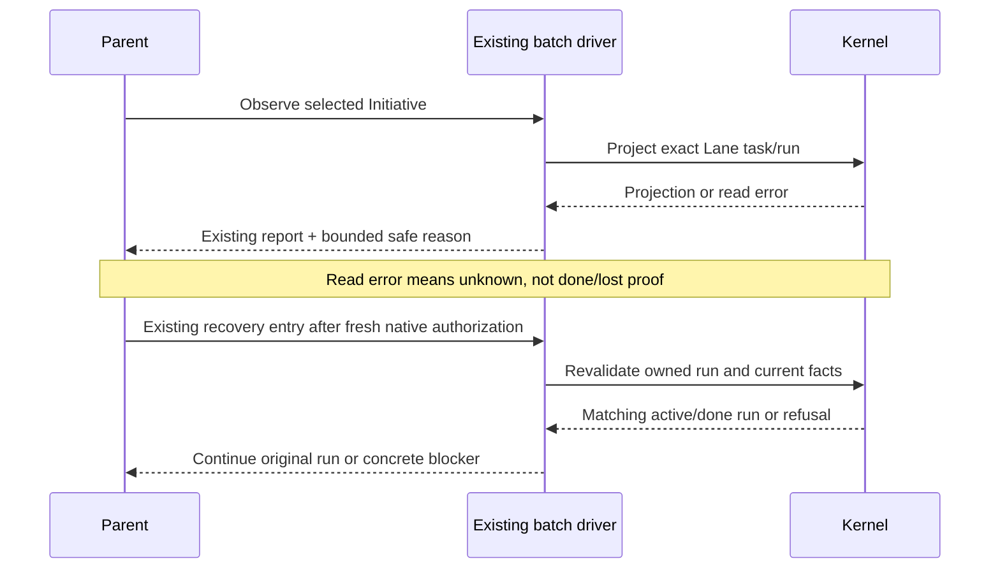

# Workflow execution reliability

**Status**: confirmed decomposition; all four canonical candidates authored, staged and structurally validated. The user approved the complete four-Slice proposal in this planning session. Validation is not execution or QA evidence, and this document grants no execution authority.
**Initiative name**: 执行可靠性收敛
**Immutable slug**: `workflow-execution-reliability`
**Carrier**: GitHub, selected by root `AGENTS.md`; the user confirmed the name, slug and complete decomposition before publication.
**Planning baseline**: `c0954ab`; recheck affected paths before authoring candidates if HEAD changes.
**Document language**: English; user discussion remains Chinese.
**Design risk**: Medium — bounded batch error reporting and execution contracts change across report consumers; Kernel authority, lifecycle and persisted schemas do not change.
**Execution posture**: characterization-first. First reproduce the observed defect at an existing public seam; for a new check, observe the intended assertion fail before fixing the behavior. This does not add RED/GREEN authority steps.
**Design views**: component interfaces, diagnostic data flow and recovery sequence. Existing batch/Kernel state transitions are unchanged.

## Outcome and provenance

An explicit Parent entry keeps the whole Initiative as its goal; verification reflects the command's actual exit and the original tested bytes; a parked Lane has an actionable, safe diagnostic and is recovered through its existing owned run when eligible. Review interruptions use existing reservation recovery. Installed-host observations, fixture tests and historical evidence are reported separately.

Each decision and acceptance below names exactly one source ID. No Brainstorm manifest exists; direct Planner entry conserves the request without inventing BR IDs.

| Source | Evidence or delegated choice |
| --- | --- |
| E1 | `tests/claude-host-package.test.ts:97–103` calls `buildClaudePlugin(ROOT)` after the drift check; `scripts/build-claude-plugin.ts` writes manifests, bundle and agent definitions. |
| E2 | `docs/reports/claude-session-c4928277-retro-2026-10-15.md`, section 2: a failing `bun test ... | tail` returned shell success. |
| E3 | `runtime/unattended/batch_lanes.ts:236–240,785–808,1030–1067`: most projection errors become `batch_lane_lost`; fresh literal-user authorization can already recover an identity-matching active/done run. |
| E4 | `runtime/unattended/batch_git.ts:543–555,580–585,641–645`: index flags and distinct scope failures share a bare `dirty_outside_scope` error. |
| E5 | `dist/imm-run-batch.md:8–22,34–45,60–76` and `runtime/unattended/batch_git.ts:880–912`: Parent batch entry, critical exceptions and whole-plan completion already exist. |
| E6 | `dist/imm-planner.md:180–185,474–476`: source/generated scope closure and explicit execution posture already exist. |
| E7 | `dist/imm-run.md:289–322`: interrupted Review retains a reservation only if the Host validates it and must use the returned recovery action; a dispatched reviewer is not continued through SendMessage. |
| E8 | `runtime/kernel/reducer.ts:465–479` and `.imm/audit/review-convergence-s1-delta-review/run-83ee3c4e-f47f-4ebb-a0ec-fdc8c7222054/task-record.json`: pass advisories already persist in `attestations[].advisory_findings`. |
| E9 | The c4928277 report's Parent-entry correction records older Claude cache 5.4.0 missing the new Parent contract; repository source alone does not establish what an installed process loads. |
| T1 | Delegated technical choice: four independently closable outcomes, no new scheduler, generic command runner, policy layer or authority schema. |
| T2 | Delegated technical choice: reuse existing reason strings for bounded diagnostic metadata; do not add fields to historical TaskRecord or batch-state schemas. |
| T3 | Delegated technical choice: integration combines focused automated regression with a separately labelled actual-installed-Claude observation; no fabricated live evidence or rewriting historical captures. |

Paths abbreviated as `runtime/` or `dist/` above are under `plugins/immune-brain/`.

## Boundaries and non-goals

- Keep Kernel core, risk taxonomy, native authorization, scope enforcement, run identity, receipt binding and reviewed-delivery checks unchanged.
- Do not rebuild Parent routing, the rolling ready set, critical Enrollment, whole-plan completion or advisory persistence.
- Do not mandate parallel execution. Resolve the existing project capacity and supervision settings; never silently change a confirmed mode.
- Do not install/restart a plugin, consume a new external model channel, deploy, publish packages, push, delete a Lane, edit user shell settings or weaken checks under planning authority.
- No permanent compatibility layer, dual-writing, migrations, session heartbeat store or repository-wide shell lint.
- Do not fix botline product code or rewrite historical audit/capture bytes.
- S0's original out-of-scope item and S3's original projection error from the first Session remain unknown. Improve diagnosis; do not claim to have repaired an unproven race.

**Threat model and supported environment**: diagnostic inputs come from trusted local Git/Kernel tooling, but error text and repository path bytes must not be copied into durable evidence indiscriminately. Cover ordinary read failures, contract mismatches, index flags and scoped path violations, including newline/tab-containing filenames. Use the repository's current macOS/Linux CI and existing Git format support; this work adds no new Git format, encoding, sandbox or actively hostile-process containment guarantee. Raw verifier output, environment variables, file contents, credentials and arbitrary exception stacks are excluded from persisted diagnostic details.

## Confirmed Parent and complete Child decomposition

| Slice | Task ID | Independently verifiable result | Risk | Blockers | Scenario | Agreed seam |
| --- | --- | --- | --- | --- | --- | --- |
| S1 | `workflow-execution-reliability-s1-package-isolation` | Package build/smoke tests run against a disposable copy and do not repair or rewrite real repository inputs. Drift remains detectable in either test order. | routine | None | SCN-1 | `tests/claude-host-package.test.ts` |
| S2 | `workflow-execution-reliability-s2-lane-diagnostics` | Projection read failures are distinguished from missing ownership, scope refusals explain their concrete cause, and existing same-run authorized recovery stays intact. | material | None | SCN-2 | `tests/unattended-batch-lanes.test.ts`, `tests/unattended-batch-commit.test.ts` |
| S3 | `workflow-execution-reliability-s3-execution-evidence` | Executor/Parent handoffs preserve validation exit status, honour specified test-first work, use returned Review recovery and inspect the correct advisory storage. | routine | S2 | SCN-3 | `tests/code-quality-guard-contract.test.ts`, `tests/pi-subagent-dispatch-observability-contract.test.ts`, `tests/claude-review-host-async-agent.test.ts` |
| S4 | `workflow-execution-reliability-s4-integration-proof` | Integrated source and package pass focused whole-plan regression; an accurately labelled evidence report closes or explicitly blocks installed-Claude validation. | material | S1, S2, S3 | SCN-4, SCN-5 | Existing `tests/goal-driven-run-{contract,recovery}.test.ts` and `tests/goal-driven-batch-run.test.ts`; separate actual-host observation |

Why split: S1 is test-input isolation, S2 is batch diagnostics/recovery, S3 is role execution instruction delivery, and S4 is cross-Slice installed-host validation. Each has its own observable result and can be rolled back without a new state migration. These are outcomes, not read/edit/run authorization steps. S3 follows S2 because both can regenerate the shared MCP bundle and the handoff must name the final S2 diagnostic semantics.

**Verified scheduling recommendation**: S1 → S2 → S3 → S4, with singleton parallel groups `[S1]`, `[S2]`, `[S3]`, `[S4]`. `imm-kernel intent overlap` over all four authored candidates with the confirmed dependency edges reports shared Spec scope on every pair, a shared bundle on S2/S3, and S4's explicit cross-Slice repair overlap. S1/S2 are dependency-ready but overlap and must not run concurrently. The declared blockers remain unchanged; overlap is a scheduling constraint, not a new semantic dependency. S4 is the integration owner, not an optional follow-up.

## User scenarios (confirmed with the complete decomposition)

| ID | Owner | Given / When / Then | Mode / mapping |
| --- | --- | --- | --- |
| SCN-1 | S1 | Given a drifted packaged output, when the build test and parity check run in either order, then the real input bytes remain unchanged and the drift check fails. | automated: S1-AC1; source E1 |
| SCN-2 | S2 | Given an unreadable Lane or a scoped commit refusal, when Parent observes it, then it receives the safe cause rather than a false completion/death assertion; an eligible original run remains recoverable with fresh authorization. | automated: S2-AC1, S2-AC2; source E3 |
| SCN-3 | S3 | Given a failing check, an explicitly test-first task or an interrupted Review, when execution hands back, then it preserves the real result and follows the already-owned recovery boundary rather than claiming success or continuing an old reviewer. | automated contract/protocol coverage: S3-AC1, S3-AC2; source E7; text coverage alone does not prove model obedience |
| SCN-4 | S4 | Given a Parent with ordinary and critical children, when current integrated code handles Parent/Child entries and final failure, then isolated Child scope and whole-plan success rules are preserved. | automated: S4-AC1; source E5 |
| SCN-5 | S4 | Given the installed Claude plugin in a fresh session, when a Parent is explicitly selected, then the actual loaded build is identified and the host enters native batch authorization without a child-selection chat question; final failure is not presented as Parent success. | manual; no acceptance mapping. Source E9. Requires real interactive host/native gates, supported plugin update permission if needed, and model availability; a fixture or a source hash alone cannot establish this behavior. |

## Technical Design

### S1 — test-input isolation (source E1)

Use a disposable root containing the actual manifest, source/import closure and prompt inputs needed by the existing `buildClaudePlugin(root)` API. Reuse existing fixture practices in the package suite; copy inputs, never symlink writable outputs back to ROOT. No production build API change is required by this design.

Keep the real-root `checkClaudePlugin(ROOT)` read-only. Build and Node initialize/malformed-JSON smoke cases consume the temporary bundle. Clean up this Slice's disposable tree in `finally`/test teardown on success and failure. Preserve existing package assertions, including agent definition parity.

Take byte/status controls before and after the tested operation, relative to the starting state, not an assumption that the user's tree is clean. A deliberately drifted *temporary* fixture must remain drifted after building a distinct fixture. Never create deliberate drift in the real repository as a test prerequisite.

### S2 — bounded error reporting without new authority (sources E3, E4, T2)

Projection failure and missing owned claim are separate observations. Use a read-failure reason for the former; retain contract-mismatch classification and the existing lost-ownership category for the latter. Kernel projection and matching terminal evidence remain the only basis for lifecycle/completion. Herdr idle/done and an absent active claim are not terminal proof.

Keep existing reason strings as the transport. Scope errors retain the `dirty_outside_scope` category followed by compact JSON metadata with a cause (`unsupported_index_flags`, `changed_path_outside_scope`, `staged_path_outside_scope`, or `committed_path_outside_scope`), escaped repository-relative paths and applicable flags. Read failures carry a safe classification/stage and recorded task/run identity, not arbitrary raw exception messages. Reuse data already inspected; do not dump environment, file contents or verifier output. Bound path detail by count and total encoded bytes, report omitted counts, and preserve the complete scope rejection regardless of display truncation.

Do not add batch-state fields or alter storage contract versions. Inventory callers of `commitBatchChild` and `projectTask`, check direct exception handling, report rendering and persisted `reason` roundtrips, and update corresponding tests without weakening denial behavior. Existing historical reason strings remain plain strings, not a new dual-format parser.

Recovery sequence remains: observe the exact task/run → explain the stop → validate plan digest, Lane identity, claim/terminal evidence and user decisions → invoke the existing fresh native authorization when eligible → resume the original active/done run. Reject changed plan identity, wrong run, unresolved decisions and terminal retired batches. No automatic native-gate retry, enrollment or retire is added.

### S3 — minimal contract changes, not new machinery (sources E2, E6, E7, E8)

Add a compact validation-evidence rule to the existing Executor prompt: direct checks are preferred; a display pipeline uses an explicit shell with `pipefail`, retains the check's exit status and a task-owned full log, and never changes global shell configuration. Add a small local shell regression demonstrating a failing producer remains nonzero and a passing producer stays zero; do not scan all repository shell strings or add a generic runner.

Where a Spec requires test-first, require a business-assertion red followed by the corresponding green, not merely creating a test file first. Reuse existing scope/generated-mirror checks; a known omitted generated output blocks handoff or triggers the existing Intent revision path. No additional Planner policy or per-test ledger is introduced.

Refine only the relevant existing recovery handoff: provider quota/interruption is distinct from Review budget exhaustion; preserve fresh QA, use the Host's returned reservation recovery, and never SendMessage a dispatched reviewer. Use existing async-host protocol tests for receipt identity. Pass advisories are inspected in `attestations[].advisory_findings`; do not create a second archive. Check generated prompt parity and regenerate the inlined bundle when prompt composition changes it.

### S4 — integration and installed-host proof (sources E5, E9, T3)

Reuse Parent completion and run-continuation implementations. Extend existing regression tests only for uncovered combinations: Parent versus isolated Child; ordinary/critical dependencies; final verification failure on the integrated HEAD; settled repair integration followed by final verification. Do not replace their state machine.

Write a new, bounded report under `docs/evidence/workflow-execution-reliability-host-check.md`. Record tested revision, installed plugin root, host version, hashes of loaded Skill/dist/MCP/Hook content, session identifier, actual observations and explicit gaps. Read only the named new test session, never scan unrelated sessions. Historical `goal-driven-run-host-smoke.json` is not rewritten or rehashed to claim a new run occurred.

If installed contents differ, identify the mismatch. Updating installation/restarting the host is a separately authorized operational step using supported commands; never patch cache files manually. Repeat the actual-host observation only after a relevant input changed. A new external model/API channel still needs its own authorization. Use an explicitly designated disposable test fixture for native gates, not a production Initiative. Respect host launch-directory and worktree rules; do not create/switch/delete worktrees as part of this plan.

The automated S4 descriptor proves focused regression only. SCN-5 is a required manual closure observation, outside the descriptor: if no real host session/model/native confirmation is available, S4 is not declared fully delivered and the Initiative stays incomplete in the user-facing outcome. Do not manufacture a passed observation or confuse structural candidate validation with execution. A genuine code defect discovered by smoke is repaired within the exact approved integration scope below; anything beyond it requires an Intent revision, not a silent expansion.

## Candidate scope boundaries

The implementation paths below are confirmed exact boundaries, not execution authority. Every candidate also includes its own canonical `docs/plans/<task-id>.intent.json` and the shared `docs/specs/workflow-execution-reliability.spec.md` for artifact binding. Machine overlap and risk-floor checks refine scheduling without silently widening implementation scope.

- **S1**: `tests/claude-host-package.test.ts`; `.changeset/workflow-execution-reliability-package.md`. Keep fixture helpers local unless reference closure proves a shared helper necessary before candidate authoring. Do not change the production build API or dependency manifests.
- **S2**: `plugins/immune-brain/runtime/unattended/batch_lanes.ts`; `plugins/immune-brain/runtime/unattended/batch_git.ts`; `tests/unattended-batch-lanes.test.ts`; `tests/unattended-batch-commit.test.ts`; `plugins/immune-brain/dist/claude/mcp-server.mjs`; `.changeset/workflow-execution-reliability-diagnostics.md`. No TaskRecord/batch-state schema edits.
- **S3**: `plugins/immune-brain/runtime/prompts/executor.md`; `plugins/immune-brain/dist/role-prompts/executor.md`; `plugins/immune-brain/dist/imm-run.md`; `plugins/immune-brain/dist/imm-run-batch.md`; `plugins/immune-brain/dist/claude/mcp-server.mjs`; `tests/code-quality-guard-contract.test.ts`; `tests/pi-subagent-dispatch-observability-contract.test.ts`; `tests/claude-review-host-async-agent.test.ts`; `.changeset/workflow-execution-reliability-handoff.md`. No reviewer engine or Kernel change.
- **S4**: `tests/goal-driven-run-contract.test.ts`; `tests/goal-driven-run-recovery.test.ts`; `tests/goal-driven-batch-run.test.ts`; `tests/claude-host-package.test.ts`; `tests/code-quality-guard-contract.test.ts`; `tests/pi-subagent-dispatch-observability-contract.test.ts`; `tests/claude-review-host-async-agent.test.ts`; `tests/unattended-batch-lanes.test.ts`; `tests/unattended-batch-commit.test.ts`; `plugins/immune-brain/runtime/unattended/batch_lanes.ts`; `plugins/immune-brain/runtime/unattended/batch_git.ts`; `plugins/immune-brain/runtime/prompts/executor.md`; `plugins/immune-brain/dist/role-prompts/executor.md`; `plugins/immune-brain/dist/imm-run.md`; `plugins/immune-brain/dist/imm-run-batch.md`; `plugins/immune-brain/dist/claude/mcp-server.mjs`; `docs/evidence/workflow-execution-reliability-host-check.md`; `.changeset/workflow-execution-reliability-integration.md`. This is the cross-Slice repair envelope, not permission to redesign routing/authority or modify installer/user settings. Already-settled Slice evidence stays immutable.

The shared Spec binds each complex candidate by the existing mechanism; executing Slices do not edit this baseline silently. A discovered design delta returns to Planner.

## Acceptance and verification mapping

Commands are proposed focused descriptors, not checks already run for this plan. Use v2 descriptors with host-provided `bun`/`bash` and tracked test inputs, explicit time/output limits, and no network or hidden dependency install. Existing dev dependencies must be present from the documented authorized preparation. No full-suite/build command is an acceptance descriptor. Do not use a skip or zero-test match as success.

| Acceptance | Observable invariant and enumerated controls | Agreed focused command | Single source |
| --- | --- | --- | --- |
| S1-AC1 | Temporary package build still answers initialize and rejects malformed JSON; real tracked source/manifests/generated bytes and index remain unchanged relative to their starting bytes. Drifted temporary reviewer/bundle output is rejected before and after an independent build; success/failure teardown removes only its fixture and preserves unrelated inputs. | `bun test tests/claude-host-package.test.ts` | E1 |
| S2-AC1 | Injected ordinary projection read error is reported as unreadable, known contract mismatch stays distinct, and a missing owned claim stays parked; none is represented as task completion. Matching active and done runs resume through existing fresh authorization; absent new authorization, mismatched run, changed plan and retired batch do not enroll/commit another run. | `bun test tests/unattended-batch-lanes.test.ts` | E3 |
| S2-AC2 | Actual out-of-scope path and unsupported-index-flag refusals preserve fail-closed behavior and expose bounded escaped cause/path metadata; newline/tab path and over-limit lists remain safe and explicitly truncated. | `bun test tests/unattended-batch-commit.test.ts` | E4 |
| S3-AC1 | Published Executor source/mirror carries the exit-preservation and requested-test-first rules; the executable shell control returns nonzero for a failing producer after truncation, zero for a passing producer. Text presence proves contract delivery only. | `bun test tests/code-quality-guard-contract.test.ts` | E2 |
| S3-AC2 | Published recovery handoff distinguishes interruption from budget exhaustion; invalid/old dispatch cannot be rescued by a second start and the existing valid new reservation path remains accepted. Pass advisory lookup names the existing attestation field. | `bun test tests/pi-subagent-dispatch-observability-contract.test.ts tests/claude-review-host-async-agent.test.ts` | E7 |
| S4-AC1 | Integrated automated Parent/Child, critical successor and final-failure/repair scenarios retain native boundaries; incomplete delivery and failed final verification do not satisfy whole-plan proof. | `bun test tests/goal-driven-run-contract.test.ts tests/goal-driven-run-recovery.test.ts tests/goal-driven-batch-run.test.ts` | E5 |

Canonical authoring groups S1's two package invariants into S1-AC1 and S2's observation/recovery invariants into S2-AC1; every original control is retained without repeating the same expensive descriptor. Automated descriptors cannot establish that a model actually followed the prompt: SCN-5 supplies the real-host observation. S4's evidence report is not accepted as self-authenticating proof merely because it says `passed`.

## Integration, rollback and cleanup

1. After S1, run package tests without modifying ROOT. After runtime/prompt changes, regenerate the relevant bundle/mirrors before focused checks; stage only scoped outputs.
2. Run affected focused tests and applicable typecheck. The existing QA baseline stays unchanged; it does not replace drift/parity or acceptance-specific checks.
3. S4 runs `bun run verify:release` as final integration verification, not as a Kernel descriptor. It includes parity, typecheck, full tests and pack dry-run. Do not install dependencies or modify a lockfile implicitly.
4. Record final commands and exact integrated HEAD through existing Parent facilities. Complete actual-host SCN-5 with the accurately identified installed artifact; if blocked, report the concrete missing capability/authorization and do not declare full closure.
5. Each Slice can be reverted locally by its own approved change; no migration or backwards reader is introduced. Normal Git/Kernel settlement authority is unchanged. Never retire a healthy original run to simplify rollback.
6. Disposable fixture/log cleanup belongs to S1/S3/S4's test teardown. No temporary shim is shipped. Installed-host restart/update is not an automated cleanup action. Do not delete unrelated logs, audit evidence or Lane directories.

## Devil's Advocate Audit

- **Rollback resilience**: changes are fixture isolation, safe reason text and instructions. Partial deployment changes no authority schema. Diagnostics can be reverted without rewriting stored historical strings; an active batch must still pass its normal identity checks. An old installed host is reported, not silently repaired.
- **Verification vanity**: prompt substring checks do not prove obedience; a pipeline sample alone does not audit arbitrary commands; existing source evidence is not proof of current installed behavior. Keep these limits explicit and require actual-host observation for the installed-Parent claim. Build tests must fail when the original drift is restored in a disposable fixture.
- **Spec dilution**: no reduction to 'batch completed', core-only tests, a manifest version or a historical smoke capture. S4 owns all cross-Slice regression and the actual-host gap. No optional follow-up is used to hide the confirmed installed-host outcome.
- **Privacy**: arbitrary exceptions/path lists can leak data or grow without bound. Persist only enumerated safe classifications, escaped relative paths, flags and recorded identities with explicit truncation; never stdout/stderr or a denylist-sanitized stack.

## Handoff completeness and current gate

| Required outcome | Sole delivery owner | Remaining gap before closure |
| --- | --- | --- |
| Real-input isolation | S1 | Implement and verify package fixture isolation. |
| Read/scope diagnostics and original-run recovery | S2 | Implement diagnostics; regress existing authorization/identity limits. |
| Exit preservation, requested test-first, correct Review recovery | S3 | Deliver compact contracts and executable/protocol controls. |
| Parent whole-plan and installed-host consistency | S4 | Integrated regression plus real fresh-session SCN-5; source-only proof is insufficient. |
| Generated scope closure | S3 | Reuse existing Planner rules; verify its own source/mirror/bundle closure and retain S4 integration checks. |
| Advisory persistence | No new implementation | Already present (E8); S3 corrects the handoff's lookup, not the storage. |

**Current gate**: all four candidates returned `valid: true` and `enrollment_ready: true` at `c0954ab`; exact Planner-owned artifacts are staged. Publish the complete approved set with the verified serial groups. Until full publication succeeds, no execution handoff is granted.

Author every TaskIntent through the canonical `imm-kernel intent author`, stage only Planner-owned artifacts, validate `valid: true` and `enrollment_ready: true`, compute overlap/dependency groups and publish the entire approved set once through `imm-tracker publish-initiative --stdin --json`. Publication/validation failure blocks execution handoff. Record the returned carrier outcome in the planning handoff, not by altering this shared baseline after publication. Planning never invokes Enrollment; execution requires a later literal-user `imm-run` entry.
