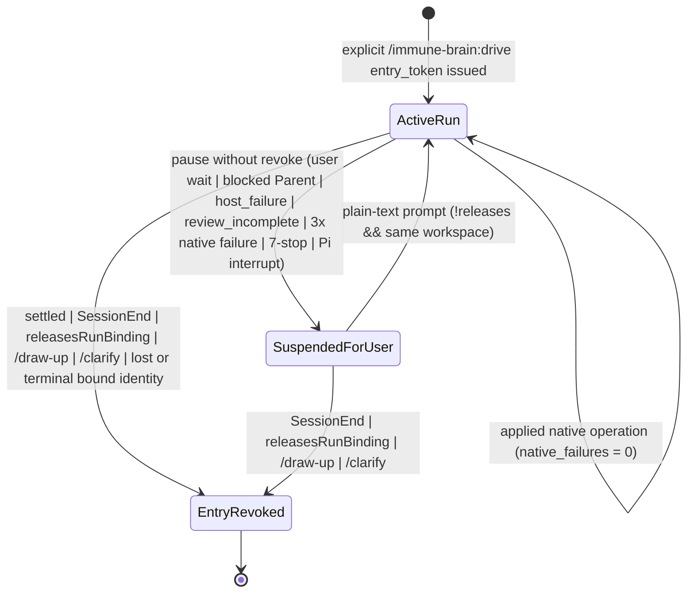

# Workflow Continuation and Delivery Simplification

**Initiative**: `workflow-friction-simplification` (`Workflow Continuation and Delivery Simplification` / 工作流续跑与交付精简)
**Carrier**: `local` (`docs/initiatives/workflow-friction-simplification.md`), selected via `imm-kernel config --json` (`initiative_carrier.value = "local"`, `source = "project"`) and `BR-DEC-4`; user confirmed Initiative name, immutable slug, and complete S1–S4 decomposition in this planning session.
**Planning baseline**: `a349df1baf7980b33f87d05961eb375061975bfc`
**Output language**: English (repository default; user discussion remains Chinese).
**Design risk**: High — amends the run-entry token lifecycle (ADR 0025 §3/§6) across `assurance/`, `host-core/`, and all three Host adapters (`claude/`, `antigravity/`, `.pi-extension/`), updates single-task `checkout_delivery` Git index/worktree satisfaction and multi-Slice Lane Spec provisioning, widens `SupervisedSessionPort` / `BatchSessionPort` with `"error"` observation for bounded per-revision Lane recovery, and changes default non-`critical` `single_task` `final_verification` inheritance in `host-core/runtime.ts`.
**Design views**: architecture layers, service/component interfaces, state transitions, temporal sequence. (Data flow view omitted: no external pipeline or persisted storage schema version migration is introduced; optional session fields read with backward-compatible defaults.)
**Diagram decision**: required
**Diagram reason**: clarifies the separation between non-spending user-wait suspension (`yield_for_user`) and token-spending entry revocation across Host prompt/stop hooks and MCP `PreToolUse` guards.
**Execution posture**: characterization-first — reproduce the existing refusal, overwrite, or misclassification at each Slice's agreed test seam before applying the behavioral change.

## Outcome

Conserves the full confirmed outcome (`BR-REQ-1..4`, `BR-DEC-1..4`, `BR-SCN-1..4`) without weakening independent QA/Review gates, Host Native Gates, or `drive-always-lanes` worktree isolation:
1. Active `/immune-brain:drive` sessions only suspend at a non-terminal pause and keep their `entry_token` on the same `(workspace, batch_id | run_id)` binding; a plain reply resumes them, and any applied native operation resets `native_failures` (`S1`).
2. Single-task `checkout_delivery` accepts staged and untracked (`??`) coordinator regular files matching the target commit's blob and executable mode byte-for-byte in both `manual` and `auto` modes while failing closed on mismatches/deletions, and `copyLanePlanningInput` preserves a newer shared Spec committed on `imm/<slug>` when the coordinator checkout copy matches `base_head` (`S2`).
3. Non-`critical` standalone `single_task` runs skip inheriting project-wide `batch.final_verification` unless explicitly passed or configured via `batch.single_task_final_verification`, and supervised Lane Executors that stop on `error` recover in a fresh generation at most twice per Kernel revision when no decision, replan or settlement is open (`S3`).
4. `/immune-brain:revisit` marks Claude synthetic hook/bash/interrupt frames `synthetic: true` and excludes non-error `CliReviewHost` `submit_review` completions from `review_without_verdict` (`S4`).

| Slice | Task ID | Result when landed alone | Remaining gap | Risk | Blocked by | Scenarios | Agreed seam |
| --- | --- | --- | --- | --- | --- | --- | --- |
| `S1` | `workflow-friction-simplification-s1-session-continuation` | Every pause except a lost or terminal bound identity only suspends the run and keeps `entry_token`; a plain non-cancelling/non-planning reply clears the suspension and the retry counters across Claude/Pi/Antigravity; any applied native operation resets `native_failures = 0`; ADR 0025 §3/§6 reflects the rule | Single-task checkout delivery & shared Spec safety (`S2`), single-task verification default & transient Lane recovery (`S3`), `revisit` parser accuracy (`S4`) | `material` | — | `BR-SCN-1` | `tests/run-continuation.test.ts`, `tests/claude-run-continuation.test.ts`, `tests/pi-run-continuation.test.ts`, `tests/antigravity-assurance-conformance.test.ts` |
| `S2` | `workflow-friction-simplification-s2-checkout-spec-safety` | Single-task `checkout_delivery` treats staged and untracked (`??`) regular files matching the target commit's blob and executable mode byte-for-byte as satisfied in both `manual` and `auto` modes (aligning the index for satisfied paths before `git merge --ff-only` in `auto` mode) while keeping all mismatches/deletions fail-closed with `checkout_delivery_overlap`, and `copyLanePlanningInput` preserves a newer Spec on the Lane `HEAD` when coordinator `root` matches `base_head` | Single-task verification default & transient Lane recovery (`S3`), `revisit` parser accuracy (`S4`) | `material` | — | `BR-SCN-2` | `tests/single-task-checkout-delivery.test.ts`, `tests/single-task-lane-batch.test.ts` |
| `S3` | `workflow-friction-simplification-s3-single-task-lane-recovery` | Non-`critical` `plan_source === "single_task"` runs skip inheriting `batch.final_verification` by default unless `final_verification` is explicitly passed or `batch.single_task_final_verification` is configured (`critical` tasks and multi-child batches retain `final_verification`), and `SupervisedSessionPort` / `BatchSessionPort` surface `"error"` so `child_session_reconciler.ts` rotates an unfinished child with no open decision/replan to a fresh generation at most twice per Kernel `recordRevision`, then parks it `lane_executor_error` | `revisit` parser accuracy (`S4`) | `material` | — | `BR-SCN-3` | `tests/single-task-lane-batch.test.ts`, `tests/layered-config.test.ts`, `tests/supervised-session-conformance.test.ts`, `tests/batch-session-port.test.ts` |
| `S4` | `workflow-friction-simplification-s4-revisit-parser-accuracy` | `session_evidence.ts` marks Claude `Stop hook feedback:`, `<bash-stdout>`/`<bash-stderr>`, and `[Request interrupted by user]` frames `synthetic: true` and excludes non-error `CliReviewHost` `submit_review` completions from `review_without_verdict` | None once `S1`–`S3` land | `material` | — | `BR-SCN-4` | `tests/review-retro-analyzer.test.ts` |

## Sources and Discovery Evidence

- **Upstream Brainstorm manifest**: `BR-REQ-1..4`, `BR-DEC-1..4`, `BR-OUT-1..5`, `BR-SCN-1..4` (all `BR-Q-*` and `BR-DEFER-*` empty/closed).
- **Repository evidence inspected at `a349df1baf7980b33f87d05961eb375061975bfc`**:
  - `plugins/immune-brain/runtime/assurance/run_continuation.ts:256-257`: returns `action: "pause"` whenever `!observation.runnable && !observation.executors_running` (e.g., waiting on user answer in `needs_human`).
  - `plugins/immune-brain/runtime/host-core/run_continuation_session.ts:31,141-152,180-188,204-226,311-317`: `pauseRun` calls `host.revoke_entry(sessionId)`; `native_failures` increments toward `NATIVE_FAILURE_LIMIT` without resetting on `start_unattended_batch` `state === "started"`.
  - `plugins/immune-brain/runtime/assurance/phase_entry.ts:118-122`, `plugins/immune-brain/runtime/claude/run_continuation.ts:28-31`, `plugins/immune-brain/runtime/claude/lane_guard.ts:205-220`, `plugins/immune-brain/runtime/antigravity/run_continuation.ts:47-75`, `plugins/immune-brain/.pi-extension/pi-run-continuation.ts:65-73,157-183`: Host entry state and `PreToolUse` / prompt hook handling across Claude, Antigravity, and Pi.
  - `docs/adr/0025-run-entry-decision-hosting.md:65,82-84`: §3 and §6 couple pause directly to `entry_token` revocation.
  - `plugins/immune-brain/runtime/unattended/checkout_delivery.ts:30-76`: `pathSatisfied` requires coordinator index staging via `ls-files --stage`, while `auto` mode skips `!pathSatisfied(...)` filtering at line 69 (`checkout_delivery_overlap`).
  - `plugins/immune-brain/runtime/unattended/batch_worktrees.ts:128-148`: `copyLanePlanningInput` unconditionally writes coordinator `root`'s Spec over `lane.worktree_path` and stages it.
  - `plugins/immune-brain/runtime/host-core/runtime.ts:1354-1357,1595-1597` and `plugins/immune-brain/runtime/config/layered_config.ts:183-186,320`: standalone `single_task` unconditionally copies project-wide `batch.final_verification`.
  - `plugins/immune-brain/runtime/session/supervised_session_port.ts:11-13`, `herdr_provider.ts:177-180`, `herdr_core_provider.ts:121-124`, `lane_sessions/session_port_adapter.ts:83-94`, `unattended/batch_session_port.ts:12`, `unattended/child_session_reconciler.ts:190-200,284-376`: `"error"` session state is collapsed into `"unknown"`, holding without recovery.
  - `plugins/immune-brain/skills/revisit/scripts/session_evidence.ts:16-46,284,331-335`: synthetic Claude frames are counted as human `user_resume` turns, and `CliReviewHost` `submit_review` completions are flagged as `review_without_verdict` when `state.receipt` is absent.

## Boundaries and Non-Goals

- `BR-OUT-1`: No changes to `CliReviewHost` `submit_session_result` handling already landed in `plugins/immune-brain/runtime/assurance/cli_review.ts:273-300`.
- `BR-OUT-2`: No changes to plugin cache byte-skew degradation already landed in commit `fe886f9e` (`plugins/immune-brain/runtime/unattended/batch_git.ts:1030-1034`).
- `BR-OUT-3`: No changes to proof-based Lane cleanup (`plugins/immune-brain/runtime/unattended/lane_cleanup.ts:58-90`) or Antigravity derived mirror rules (`docs/agents/derived-files.json:31-47`).
- `BR-OUT-4`: No weakening of independent QA/Review gates, reduction of review rounds, or bypassing of Host Native Gates.
- `BR-OUT-5`: No reopening of non-Lane in-place execution in the user's primary checkout.

## Threat model and supported environment

- Git objects, Kernel stores, and Host hook payloads are trusted local inputs from the workspace and Host runtime.
- Local JSONL session transcripts parsed by `revisit/scripts/session_evidence.ts` are untrusted text payloads read strictly read-only without code execution, dynamic evaluation, or shell interpolation.
- `checkout_delivery.ts` treats symlinks, submodule gitlinks, non-regular files, executable-mode mismatches (`100644` vs `100755`), byte content mismatches, and target-deleted paths modified or untracked in the coordinator checkout as untrusted overlaps and fails closed with `checkout_delivery_overlap`.
- Supported on macOS and Linux with the repository's existing Git object/index plumbing and Node/Bun runtime.

## User scenarios

| ID | Slice | Mode | Actor / Given / When / Then | Acceptance |
| --- | --- | --- | --- | --- |
| `BR-SCN-1` | `S1` | `automated` | **Actor**: Developer running an enrolled `/immune-brain:drive` session in an interactive Host. **Given**: An active batch or single-task run pauses waiting for user input on the same workspace without being settled, cancelled, ended, or switched to `/immune-brain:draw-up` or `/immune-brain:clarify`. **When**: The developer replies in plain text in that same Host session without re-invoking `/immune-brain:drive`. **Then**: Subsequent `immune-brain` MCP calls in that session proceed through normal Host authority gates instead of failing with `run_entry_required`, and up to two failed `start_unattended_batch` attempts prior to a `started` batch response do not block later continuation in the same run. | `S1-AC1`, `S1-AC2` |
| `BR-SCN-2` | `S2` | `automated` | **Actor**: Developer running `/immune-brain:drive` for a standalone single task or a multi-Slice Initiative sharing one Spec file. **Given**: Untracked (`??`) or staged planning files (`intent.json`, `spec.md`) in the coordinator checkout match the completed Lane commit's file content and executable mode byte-for-byte, or an earlier Slice already committed an updated shared Spec onto `imm/<initiative-slug>` while the coordinator checkout remains at `base_head`. **When**: Single-task `checkout_delivery` executes in `manual` or `auto` mode, or a subsequent Slice provisions its Lane worktree. **Then**: Single-task changes land cleanly in the coordinator checkout without `checkout_delivery_overlap` (while any byte, mode, or deletion mismatch is still refused with `checkout_delivery_overlap`), and the subsequent Slice's Lane worktree contains the updated Spec from `imm/<initiative-slug>` rather than reverting to the older coordinator copy. | `S2-AC1`, `S2-AC2` |
| `BR-SCN-3` | `S3` | `automated` | **Actor**: Developer running a non-`critical` standalone single task or a supervised multi-Lane batch via `/immune-brain:drive`. **Given**: Project config sets `batch.final_verification` without an explicit `final_verification` call argument or dedicated single-task final verification config, or a supervised Lane Executor session stops with an observed `error` state while its child task remains unfinished with no pending gate or conflict. **When**: The non-`critical` single task reaches post-QA/Review integration, or the Parent observes the supervised Lane session. **Then**: The non-`critical` single task completes delivery after passing its TaskIntent Acceptance Descriptors and the declared derived-file checks (which block delivery on failure) without running the project-wide `batch.final_verification` commands (whereas `critical` tasks and multi-child batches still run `final_verification`), and the stalled Lane Executor session is replaced by a fresh generation at most twice per Kernel revision instead of waiting for a manual reply, then parks `lane_executor_error`. | `S3-AC1`, `S3-AC2` |
| `BR-SCN-4` | `S4` | `automated` | **Actor**: Maintainer running `review_retro.ts` for `/immune-brain:revisit`. **Given**: Local Host session transcripts contain Claude `Stop hook feedback:`, `<bash-stdout>`/`<bash-stderr>`, `[Request interrupted by user]` messages, and non-error `CliReviewHost` `submit_review` tool results. **When**: The maintainer executes `bun plugins/immune-brain/skills/revisit/scripts/review_retro.ts --since <ISO> --until <ISO> --sessions`. **Then**: The CLI stdout report excludes those synthetic Claude frames from human `user_resume` counts and does not count completed non-error `CliReviewHost` `submit_review` calls under `review_without_verdict`. | `S4-AC1` |

## Brainstorm Trace

| Item | Classification | Mapped to |
| --- | --- | --- |
| `BR-REQ-1` | Covered | `D1.1`, `D1.2`; `S1-AC1`, `S1-AC2` |
| `BR-REQ-2` | Covered | `D2.1`, `D2.2`; `S2-AC1`, `S2-AC2` |
| `BR-REQ-3` | Covered | `D3.1`, `D3.2`; `S3-AC1`, `S3-AC2` |
| `BR-REQ-4` | Covered | `D4.1`, `D4.2`; `S4-AC1` |
| `BR-DEC-1` | Decisioned | `D1.1`, `D1.2`; `S1-AC1`, `S1-AC2` |
| `BR-DEC-2` | Decisioned | `D3.1`, `D3.2`; `S3-AC1`, `S3-AC2` |
| `BR-DEC-3` | Decisioned | `D2.1`, `D2.2`; `S2-AC1`, `S2-AC2` |
| `BR-DEC-4` | Decisioned | Initiative Carrier `local`, 4 orthogonal Slices (`S1`–`S4`) |
| `BR-OUT-1` | Out (already landed) | `plugins/immune-brain/runtime/assurance/cli_review.ts:273-300` (`submit_session_result`) |
| `BR-OUT-2` | Out (already landed) | Commit `fe886f9e` (`plugins/immune-brain/runtime/unattended/batch_git.ts:1030-1034`) |
| `BR-OUT-3` | Out (already landed) | `plugins/immune-brain/runtime/unattended/lane_cleanup.ts:58-90`, `docs/agents/derived-files.json:31-47` |
| `BR-OUT-4` | Out (invariant preserved) | Independent QA/Review gates and Host Native Gates remain mandatory |
| `BR-OUT-5` | Out (invariant preserved) | `drive-always-lanes` worktree isolation remains mandatory |
| `BR-SCN-1` | Scenario (`S1`) | `S1-AC1`, `S1-AC2` |
| `BR-SCN-2` | Scenario (`S2`) | `S2-AC1`, `S2-AC2` |
| `BR-SCN-3` | Scenario (`S3`) | `S3-AC1`, `S3-AC2` |
| `BR-SCN-4` | Scenario (`S4`) | `S4-AC1` |

No `BR-DEFER-*` or `BR-Q-*` items exist.

## Amendments to Settled Specs

`docs/specs/single-task-delivery-path-identity.spec.md` and `docs/specs/tri-host-capability-alignment.spec.md` belong to settled work and remain unedited (`plugins/immune-brain/runtime/kernel/spec_binding.ts:84-106` binds at most one active Spec per TaskIntent). Where they disagree with the rows below, this Spec wins from the named Slice onward:

| Settled clause | Amendment | From |
| --- | --- | --- |
| `tri-host-capability-alignment.spec.md` D6, `run-entry-decision-hosting.spec.md` D13 & `docs/adr/0025-run-entry-decision-hosting.md` §3/§6 pause revocation | The entry token is spent only by the closed list in D1.1 (settlement, `SessionEnd`, explicit cancel or `/draw-up`/`/clarify` via `releasesRunBinding`, and a lost or terminal bound identity). Every other pause — user decision or authorization wait, a blocked Parent with no runnable work, `host_failure`, `review_incomplete`, a rejected Review without recovery, the third native failure (`NATIVE_FAILURE_LIMIT`), the 7-stop limit and an interrupted Pi turn — only suspends the run: native gates refuse until a plain reply in the same session clears it | `S1` (`D1.1`) |
| `single-task-delivery-path-identity.spec.md` D3 (`checkout_delivery` staged-only `pathSatisfied` and `auto` mode overlap check) | Both staged and untracked (`??`) regular files in the coordinator checkout whose content blob (`git hash-object --no-filters`) and executable mode (`100644`/`100755`) match the target commit byte-for-byte satisfy `pathSatisfied` in both `manual` and `auto` modes; `auto` mode stages satisfied untracked paths before `git merge --ff-only`; all byte/mode/symlink/deletion mismatches fail closed with `checkout_delivery_overlap` | `S2` (`D2.1`) |

## Technical Design

### Architecture Layers and Dependency Direction

- **Run continuation**: `plugins/immune-brain/runtime/kernel/` ← `plugins/immune-brain/runtime/assurance/` (`run_continuation.ts`, `phase_entry.ts`) ← `plugins/immune-brain/runtime/host-core/run_continuation_session.ts` ← Host adapters (`claude/`, `antigravity/`, `.pi-extension/`). Inner layers never import adapters, and adapters never import each other (`tests/runtime-layering-boundary.test.ts`).
- **Lane sessions & checkout delivery**: `plugins/immune-brain/runtime/unattended/` (`checkout_delivery.ts`, `batch_worktrees.ts`, `batch_session_port.ts`, `batch_state.ts`, `child_session_reconciler.ts`) depends only on `BatchSessionPort`; `plugins/immune-brain/runtime/lane_sessions/session_port_adapter.ts` bridges `SupervisedSessionPort` implemented by `plugins/immune-brain/runtime/session/` (`supervised_session_port.ts`, `fake_provider.ts`, `herdr_provider.ts`, `herdr_core_provider.ts`).

### Service and Component Interfaces

- **`decideRunContinuation` (`plugins/immune-brain/runtime/assurance/run_continuation.ts`)**: keeps `action: "pause"` and marks `revoke: true` only on a lost or terminal bound identity (observation kind mismatch, batch identity change, task/run identity change or status error, `Kernel task stopped`, missing or contradictory Kernel authority). Every other pause carries no `revoke`.
- **`applyRunContinuationEvent` (`plugins/immune-brain/runtime/host-core/run_continuation_session.ts`) & Host guards (`claude/`, `antigravity/`, `.pi-extension/`)**:
  - `pauseRun` records `metadata.paused` and calls `host.revoke_entry` only for a `revoke` decision; `review_incomplete`, the third native failure and the 7-stop limit suspend without revoking. `suspendRun` lets a Host suspend a bound run (Pi interrupted turn) without spending the entry.
  - `resumeSuspendedRun` runs on `event.kind === "prompt"` with `!event.releases` (Claude `UserPromptSubmit`, Pi `input`) and on Antigravity's turn-start `recordPhaseEntryPrompt` for a plain prompt: it clears `paused`, `native_failures` and `stop_blocks`, keeping the binding and the live `entry_token`. A releasing prompt drops the binding as before.
  - Any non-failed, applied native operation (`NATIVE_OPERATIONS`, not `blocked`/`cancelled`/`rejected`/`failed`) resets `metadata.native_failures = 0`.
  - Paused native-gate refusals name `PAUSED_GATE_GUIDANCE` ("reply in this session to resume before another native gate").
  - Keep `phase_entry.ts` and all Host `PreToolUse` / `mcp_runtime.ts` Native Gates (`request_authorization`, `approve_breaking_intent_revision`) unchanged.
- **`inspectSingleTaskDelivery` / `deliverSingleTask` (`plugins/immune-brain/runtime/unattended/checkout_delivery.ts`)**:
  - `pathSatisfied(root, target, entry)` verifies `target` holds a regular file (`100644` or `100755`) at `entry.path` (not deleted/symlink/gitlink), `lstatSync` at coordinator `root/entry.path` is a regular file with matching executable mode, and `git hash-object --no-filters -- <path>` equals target's blob OID (and if staged in the index, index mode + OID also match).
  - Compute `pending = changed.filter(entry => !pathSatisfied(root, target, entry))` uniformly in both `manual` and `auto` modes. In `auto` mode, when `overlaps.length === 0`, align any satisfied untracked/unstaged paths via `git add -- <satisfiedPaths>` prior to `git merge --ff-only <target>`.
- **`copyLanePlanningInput` (`plugins/immune-brain/runtime/unattended/batch_worktrees.ts`)**:
  - Before overwriting a `docs/specs/*.spec.md` file in `lane.worktree_path` from coordinator `root`, compare coordinator `root`'s file bytes against `git show <lane.base_head>:<relPath>` and Lane `HEAD` (`git show HEAD:<relPath>` in `lane.worktree_path`). If coordinator `root` matches `lane.base_head` while Lane `HEAD` differs from `lane.base_head`, retain Lane `HEAD`'s Spec rather than overwriting with the stale coordinator copy.
- **`layered_config.ts` & `host-core/runtime.ts`**:
  - Parse optional `batch.single_task_final_verification` (`string[]`, 1..8 non-empty strings, default absent/`null`) in `plugins/immune-brain/runtime/config/layered_config.ts`.
  - In `plugins/immune-brain/runtime/host-core/runtime.ts:1354-1357`, for `plan_source === "single_task"` when `!isResuming && !options.final_verification?.length`: use `batch.single_task_final_verification` if configured; otherwise inherit `batch.final_verification` **only** when the target TaskIntent's effective risk is `"critical"`. Non-`critical` standalone single tasks run with `final_verification: { required: false, commands: [] }`.
- **`SupervisedSessionPort`, `BatchSessionPort`, & `child_session_reconciler.ts`**:
  - Add `"error"` to `SESSION_STATES` (`supervised_session_port.ts`), `SessionObservation` (`batch_session_port.ts`), and provider/adapter mappers (`herdr_provider.ts`, `herdr_core_provider.ts`, `fake_provider.ts`, `session_port_adapter.ts`).
  - Add optional `error_recoveries?: { baseline: string; count: number }` on `BatchChildSession` (`batch_state.ts`), validated when present and absent on existing persisted records.
  - In `reconcileChildSession` (`child_session_reconciler.ts`), when `observed.state === "error"`: a settled child or one with an open decision or replan is held with `attention: "error"`; otherwise, with `prior = error_recoveries.baseline === kernel.recordRevision ? error_recoveries.count : 0`, `prior < MAX_ERROR_RECOVERIES (2)` closes the session with proof and opens the next generation from the same entry (`action: "recovered_error"`, write-ahead before `open`, `error_recoveries = { baseline: recordRevision, count: prior + 1 }`), and `prior >= 2` returns `parked_error`, which `batch_lanes.ts` parks as `lane_executor_error`. `port.send` is not used: a Host in `error` accepts no instruction.
- **`session_evidence.ts` (`plugins/immune-brain/skills/revisit/scripts/session_evidence.ts`)**:
  - Extend synthetic user-frame detection (`isSyntheticText`) to classify Claude user messages beginning with `Stop hook feedback:`, `<bash-stdout>`, or `<bash-stderr>`, or equaling `[Request interrupted by user]` as `synthetic: true`.
  - Update review verdict resolution so completed `submit_review` tool results from `CliReviewHost` (`is_error !== true` with a non-blocked/rejected/failed/review_incomplete parsed state) are recognized as verdict-bearing and excluded from `review_without_verdict`.

### State Transitions

### Temporal Sequence

1. **Interactive user-wait pause & plain-text resume (`S1`)**:
   - Enrolled session invokes `start_unattended_batch` / `advance_assurance`; when the Stop decision pauses without `revoke` (for example `!runnable && !executors_running`), `host-core/run_continuation_session.ts` records `paused` **without** calling `host.revoke_entry`.
   - User replies with plain text (`!releases`, same workspace) -> Host prompt hook runs `resumeSuspendedRun`, leaving `entry_token` live.
   - Parent executes next MCP tool call -> Host `PreToolUse` validates live `entry_token` + workspace binding and permits execution through existing Host Native Gates.
2. **Single-task `auto` `checkout_delivery` with untracked planning files (`S2`)**:
   - Completed Lane commits updated workspace files + `docs/plans/<id>.intent.json` + `docs/specs/<slug>.spec.md`.
   - Coordinator checkout holds untracked (`??`) byte-for-byte identical copies of those planning files.
   - `inspectSingleTaskDelivery` runs `pathSatisfied` across both `manual` and `auto` modes, sees blob+mode identity on all untracked overlaps, aligns index via `git add -- <satisfiedPaths>` prior to `git merge --ff-only <target>`, and lands commit cleanly without `checkout_delivery_overlap`.

### D1–D4 Slice Decisions

- **D1.1** *(Source: `BR-DEC-1`)*: Revocation is a closed list: settlement, `SessionEnd`, a releasing prompt (explicit cancel, `/draw-up`, `/clarify`), and a decision marked `revoke` (lost or terminal bound identity). Every other pause suspends the run without spending `entry_token`; native gates refuse while suspended, and a plain reply in the same session resumes it. Workspace drift keeps its existing `"workspace changed; enter drive explicitly in this workspace"` release. Applies across `assurance/run_continuation.ts`, `host-core/run_continuation_session.ts`, `claude/`, `antigravity/`, `.pi-extension/`, and amends `docs/adr/0025-run-entry-decision-hosting.md` §3/§6; all Native Gates stay.
- **D1.2** *(Source: `BR-REQ-1`)*: Reset `metadata.native_failures = 0` in `host-core/run_continuation_session.ts` whenever a native operation applies (not just `start_unattended_batch` `started`), and when a plain reply resumes the run.
- **D2.1** *(Source: `BR-DEC-3`)*: Extend `pathSatisfied` in `checkout_delivery.ts` to verify regular-file `lstatSync` + executable mode + `git hash-object --no-filters` blob identity for both staged and untracked (`??`) files uniformly across `manual` and `auto` modes (staging satisfied paths before `git merge --ff-only` in `auto` mode), while failing closed on any content, mode, symlink, or deletion mismatch.
- **D2.2** *(Source: `BR-REQ-2`)*: Guard `copyLanePlanningInput` in `batch_worktrees.ts` so a coordinator `docs/specs/*.spec.md` equal to `lane.base_head` never overwrites a newer Spec already committed on Lane `HEAD`.
- **D3.1** *(Source: `BR-DEC-2`)*: Add optional `batch.single_task_final_verification` in `layered_config.ts` and restrict `batch.final_verification` fallback on `plan_source === "single_task"` in `host-core/runtime.ts` strictly to `critical` tasks (non-`critical` single tasks use `single_task_final_verification` if configured, or `required: false`). With no commands, declared derived-file checks still run and gate checkout delivery (`batch_lanes.ts` `mustPass`); the Parent passes only literally requested commands for a single task (`dist/drive-batch.md`), so prose-named suites no longer bypass the config default.
- **D3.2** *(Source: `BR-REQ-3`)*: Add `"error"` observation to `SupervisedSessionPort` / `BatchSessionPort` (fake, herdr and herdr-core pass it through). A session in `error` accepts no instruction, so `child_session_reconciler.ts` recovers an unsettled child with no open decision or replan by closing the session with proof and opening the next generation from the same entry, at most `MAX_ERROR_RECOVERIES = 2` times per Kernel `recordRevision` (`BatchChildSession.error_recoveries = { baseline, count }`, reset when the revision moves); the next `error` at that revision parks the child `lane_executor_error`. A settled child or one with an open decision or replan is held with `attention: "error"` and never recovered.
- **D4.1** *(Source: `BR-REQ-4`)*: Classify Claude `Stop hook feedback:`, `<bash-stdout>`/`<bash-stderr>`, and `[Request interrupted by user]` frames as `synthetic: true` in `session_evidence.ts`.
- **D4.2** *(Source: `BR-REQ-4`)*: Recognize completed non-error `CliReviewHost` `submit_review` tool completions in `session_evidence.ts` so only genuine errors, interruptions, or missing verdicts increment `review_without_verdict`.

### Compatibility, Interruption Recovery, and Rollback

- Backward compatibility: `BatchChildSession.error_recoveries` is an optional field and `ContinuationMetadata` keeps its shape (`paused` now also means "suspended"); existing `.imm/state/batches/*.json` and host session files remain readable with no migration.
- Interruption recovery: if a Host session stops during `SuspendedForUser`, `TaskRecord` and batch state stay in the Kernel/`.imm/state/` store; an identical-session plain-text reply resumes, while switching sessions still allows explicit `/immune-brain:drive` re-entry.
- Rollback: each Slice (`S1`–`S4`) modifies orthogonal runtime surfaces and can be reverted independently; `S1`–`S3` rebuild generated bundles (`mcp-server.mjs`, Antigravity mirror, `supervised-session-port.md` mirror) cleanly from source.

### False-Compromise Check

No false compromise detected (`docs/reference/planning-quality-gate.md`): keeping Host Native Gates, independent QA/Review verdicts, `checkout_delivery_overlap` byte/mode verification, `critical` `final_verification`, and per-revision recovery caps reflects Kernel authority and safety invariants rather than an artificial design trade-off.

## Verification and Acceptance Mapping

Every Slice additionally validates generated mirror parity and type safety (`bun run typecheck`, `bun scripts/build-claude-plugin.ts --check`, `bun scripts/build-antigravity-plugin.ts --check`, and `bun scripts/sync-dist-docs.ts --check` where docs/prompts change).

| Acceptance | Observable invariant and enumerated controls | Agreed seam | Focused command | Single source |
| --- | --- | --- | --- | --- |
| `S1-AC1` | Non-terminal `yield_for_user` preserves `entry_token`, plain-text non-releasing prompt clears suspension across Claude/Pi/Antigravity without `run_entry_required`, and ADR 0025 §3/§6 reflects the rule. **Negative**: `settled`, `SessionEnd`, workspace drift, `releasesRunBinding`, `/draw-up` or `/clarify`, `review_incomplete`, and 7-stop runaway still revoke `entry_token`; Native Gates remain required. | `tests/run-continuation.test.ts`, `tests/claude-run-continuation.test.ts`, `tests/pi-run-continuation.test.ts`, `tests/antigravity-assurance-conformance.test.ts` | `bun test tests/run-continuation.test.ts tests/claude-run-continuation.test.ts tests/pi-run-continuation.test.ts tests/antigravity-assurance-conformance.test.ts && bun scripts/build-claude-plugin.ts --check && bun scripts/build-antigravity-plugin.ts --check && bun run typecheck` | `BR-DEC-1` |
| `S1-AC2` | Two failed `start_unattended_batch` attempts followed by `state === "started"` reset `native_failures = 0`, allowing two more failures before limit. **Negative**: three consecutive failures without an intervening `started` still pause and revoke `entry_token`. | `tests/run-continuation.test.ts`, `tests/claude-run-continuation.test.ts`, `tests/antigravity-assurance-conformance.test.ts` | `bun test tests/run-continuation.test.ts tests/claude-run-continuation.test.ts tests/antigravity-assurance-conformance.test.ts && bun run typecheck` | `BR-REQ-1` |
| `S2-AC1` | Untracked (`??`) and staged regular files matching target commit blob + mode pass `inspectSingleTaskDelivery` and `deliverSingleTask` in both `manual` and `auto` modes (`auto` stages satisfied paths before `git merge --ff-only`). **Negative**: byte mismatch, mode mismatch (`100644` vs `100755`), symlink, or target deletion overlapping coordinator edit/untracked fails closed with `checkout_delivery_overlap`. | `tests/single-task-checkout-delivery.test.ts`, `tests/single-task-lane-batch.test.ts` | `bun test tests/single-task-checkout-delivery.test.ts tests/single-task-lane-batch.test.ts && bun scripts/build-claude-plugin.ts --check && bun scripts/build-antigravity-plugin.ts --check && bun run typecheck` | `BR-DEC-3` |
| `S2-AC2` | `copyLanePlanningInput` preserves a newer `docs/specs/*.spec.md` on Lane `HEAD` when coordinator copy equals `base_head`. **Negative**: when coordinator holds a modified uncommitted Spec differing from `base_head`, `copyLanePlanningInput` copies and stages the coordinator Spec into the Lane. | `tests/single-task-lane-batch.test.ts` | `bun test tests/single-task-lane-batch.test.ts && bun run typecheck` | `BR-REQ-2` |
| `S3-AC1` | Non-`critical` `single_task` without explicit `final_verification` or `batch.single_task_final_verification` runs with `final_verification.required: false` without inheriting `batch.final_verification`. **Negative**: `critical` `single_task`, explicit `final_verification` arg, configured `batch.single_task_final_verification`, and multi-child Initiative batches still enforce `final_verification`; invalid `batch.single_task_final_verification` (>8 items, empty string, non-array) emits config diagnostic. | `tests/single-task-lane-batch.test.ts`, `tests/layered-config.test.ts` | `bun test tests/single-task-lane-batch.test.ts tests/layered-config.test.ts && bun scripts/build-claude-plugin.ts --check && bun scripts/build-antigravity-plugin.ts --check && bun run typecheck` | `BR-DEC-2` |
| `S3-AC2` | `fake`, `herdr`, and `herdr-core` surface `state: "error"` through `SessionPortAdapter`; `reconcileChildSession` closes an `"error"` session with proof and opens the next generation at most twice per `recordRevision` when no decision/replan/settlement is open, persisting `error_recoveries`; the count restarts when the revision moves. **Negative**: the third `"error"` at one `recordRevision` opens nothing and parks the child `lane_executor_error`; settled children or children with `hasOpenDecision`/`hasReplan` are held with `attention: "error"` and get no close, open or send. | `tests/supervised-session-conformance.test.ts`, `tests/batch-session-port.test.ts` | `bun test tests/supervised-session-conformance.test.ts tests/batch-session-port.test.ts && bun scripts/sync-dist-docs.ts --check && bun scripts/build-claude-plugin.ts --check && bun scripts/build-antigravity-plugin.ts --check && bun run typecheck` | `BR-REQ-3` |
| `S4-AC1` | `Stop hook feedback:`, `<bash-stdout>`/`<bash-stderr>`, and `[Request interrupted by user]` mark `synthetic: true` and are excluded from human `user_resume`; completed non-error `CliReviewHost` `submit_review` calls are excluded from `review_without_verdict`. **Negative**: genuine plain-text user follow-ups after non-error assistant turns still count as `user_resume`; `submit_review` with `is_error: true`, incomplete/rejected state, or legacy Review subagent missing verdict still counts as `review_without_verdict`. | `tests/review-retro-analyzer.test.ts` | `bun test tests/review-retro-analyzer.test.ts && bun scripts/build-antigravity-plugin.ts --check && bun run typecheck` | `BR-REQ-4` |

## Devil's Advocate Audit

- **Rollback resilience**: Each Slice uses optional backward-compatible fields or localized pure logic; reverting any Slice does not strand existing `.imm/state/batches/*.json` or Kernel TaskRecords.
- **Verification vanity**: All acceptances pin behavioral seams via `bun test` positive, negative, and boundary assertions (e.g., testing 3x consecutive failures, byte/mode/symlink overlap rejections, `critical` fallback retention, and genuine vs synthetic frames) plus generated mirror `--check` gates, rather than checking file presence alone.
- **Spec dilution**: Conserves all confirmed `BR-REQ-1..4`, `BR-DEC-1..4`, and `BR-SCN-1..4` without silent subsetting; settles every upstream item while enforcing `BR-OUT-1..5`.

## Handoff Completeness

| Required outcome / Upstream ID | Sole owner | Remaining gap before closure |
| --- | --- | --- |
| `BR-REQ-1`, `BR-DEC-1`, `BR-SCN-1` (Session continuation & `native_failures` reset) | `S1` | Implement, regenerate bundles, and pass `S1-AC1`/`S1-AC2` via `drive`. |
| `BR-REQ-2`, `BR-DEC-3`, `BR-SCN-2` (`checkout_delivery` & shared Spec non-regression) | `S2` | Implement, regenerate bundles, and pass `S2-AC1`/`S2-AC2` via `drive`. |
| `BR-REQ-3`, `BR-DEC-2`, `BR-SCN-3` (`single_task` `final_verification` & transient `error` Lane recovery) | `S3` | Implement, sync docs, regenerate bundles, and pass `S3-AC1`/`S3-AC2` via `drive`. |
| `BR-REQ-4`, `BR-SCN-4` (`revisit` parser accuracy) | `S4` | Implement, sync Antigravity mirror, and pass `S4-AC1` via `drive`. |
| `BR-DEC-4` (Local Initiative with 4 orthogonal Slices) | Planner (`this Spec` + `docs/initiatives/workflow-friction-simplification.md`) | Delivered at planning handoff. |
| `BR-OUT-1..5` (Already-fixed items & invariant exclusions) | Explicitly excluded | Zero gap — preserved unchanged. |
